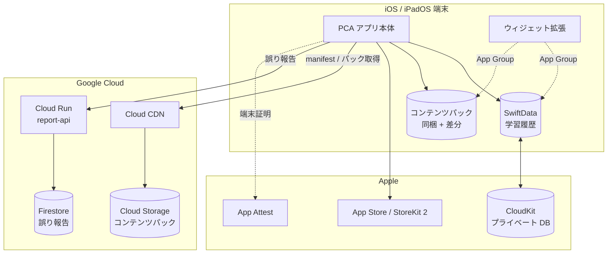
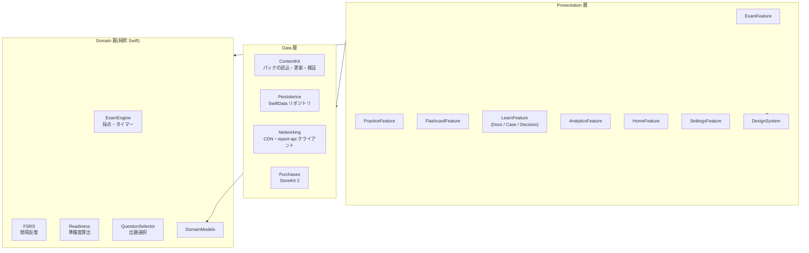
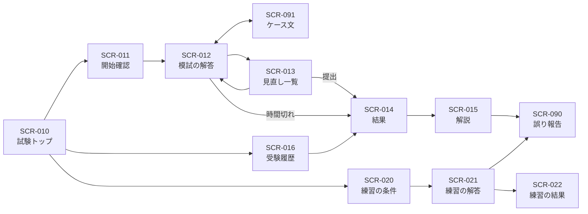
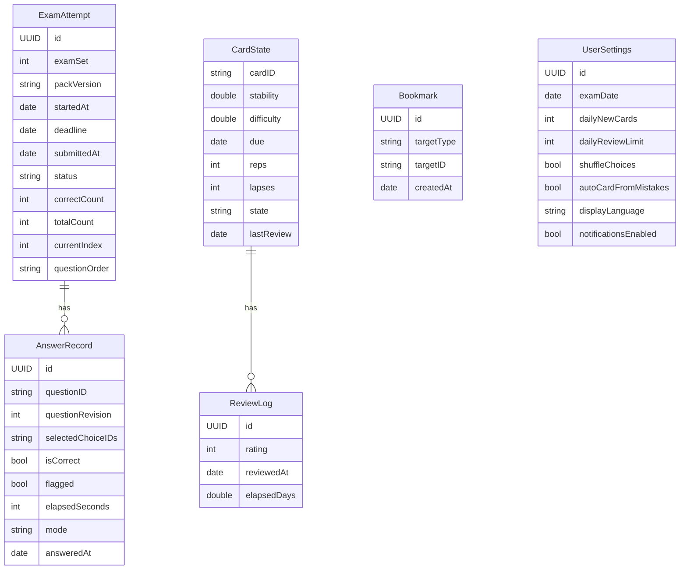
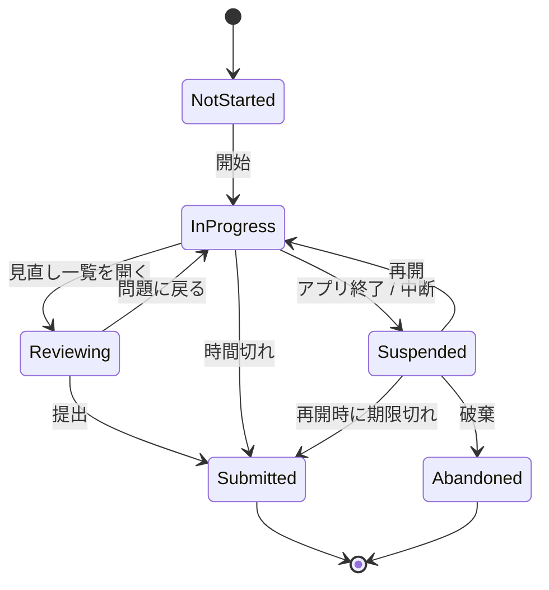
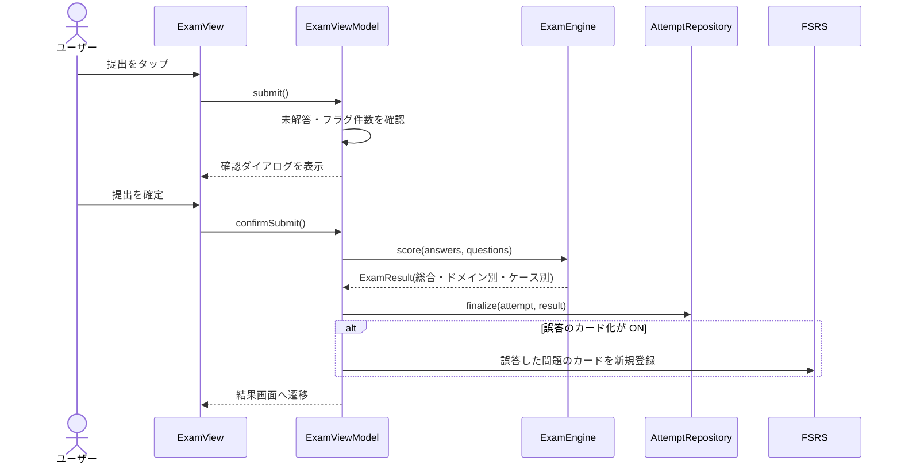
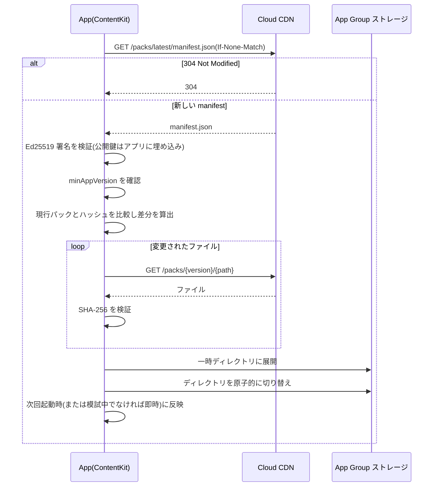
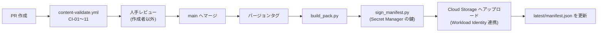

# Google Cloud Professional Cloud Architect 試験対策 iOS アプリ 基本設計書

| 項目 | 内容 |
|---|---|
| 文書バージョン | 0.1(初版ドラフト) |
| 作成日 | 2026-10-20 |
| 入力文書 | 要件定義書 v0.1 |
| 対象プラットフォーム | iOS 18+ / iPadOS 18+(AI 解説のみ iOS 26+) |
| ステータス | レビュー待ち |

---

## 目次

1. [はじめに](#1-はじめに)
2. [システム構成](#2-システム構成)
3. [モジュール設計](#3-モジュール設計)
4. [画面設計](#4-画面設計)
5. [データ設計](#5-データ設計)
6. [処理設計](#6-処理設計)
7. [外部インターフェース設計](#7-外部インターフェース設計)
8. [非機能設計](#8-非機能設計)
9. [エラー処理設計](#9-エラー処理設計)
10. [コンテンツ制作・CI 設計](#10-コンテンツ制作ci-設計)
11. [テスト設計](#11-テスト設計)
12. [要件トレーサビリティ](#12-要件トレーサビリティ)
13. [設計上の決定事項と未決事項](#13-設計上の決定事項と未決事項)

---

## 1. はじめに

### 1.1 本書の目的

要件定義書 v0.1 で定めた機能要件・非機能要件を実現するために、次の4点を定める。

- システム構成とモジュールの分割
- 画面の構成と遷移
- データ構造
- 主要な処理の方式

クラスや関数単位の詳細は、後続の詳細設計書で扱う。

### 1.2 設計方針

| No. | 方針 | 理由 |
|---|---|---|
| D-01 | **オフラインファースト**。学習機能はすべて端末内で完結させる | NFR-03。通勤中など電波が不安定な環境での利用を想定 |
| D-02 | **コンテンツとアプリを分離する**。問題・カード・ドキュメントはデータとして扱い、コードに埋め込まない | NFR-05。審査なしで修正できるようにする |
| D-03 | **ドメインロジックを純粋な Swift で書く**。採点・FSRS・準備度の算出は UI や永続化に依存させない | NFR-11。テストしやすくする |
| D-04 | **サーバー依存を最小限にする**。サーバーはコンテンツ配信と誤り報告の受付だけ | 運用コストとプライバシーリスクを抑える(NFR-09) |
| D-05 | **Swift Package による機能単位のモジュール分割** | ビルド時間の短縮、依存方向の強制 |

---

## 2. システム構成

### 2.1 全体構成図



### 2.2 構成要素一覧

| 構成要素 | 役割 | 技術 |
|---|---|---|
| アプリ本体 | 学習機能すべて | SwiftUI、Observation、SwiftData |
| ウィジェット拡張 | 「今日の1問」、復習カード数の表示 | WidgetKit |
| App Intents | Siri やショートカットからの起動 | App Intents |
| 学習履歴 DB | 解答、カードの状態、受験履歴 | SwiftData(CloudKit 同期) |
| コンテンツストア | 問題、カード、ドキュメント | JSON + Markdown(読み取り専用) |
| コンテンツ配信 | 差分パックの配信 | Cloud Storage + Cloud CDN |
| report-api | 誤り報告の受付 | Cloud Run(Go または Node.js) |
| 報告 DB | 誤り報告の保存 | Firestore |

### 2.3 App Group による共有

アプリ本体とウィジェット拡張は、App Group(`group.<bundle-id-prefix>.pca`)のコンテナで次を共有する。

- SwiftData のストアファイル(ウィジェットは読み取りのみ)
- 有効なコンテンツパックのディレクトリ

---

## 3. モジュール設計

### 3.1 レイヤー構成



**依存ルール**

- Domain 層は他の層に依存しない(Foundation のみ使用可)。
- Data 層はプロトコルを Domain 層に定義し、実装を Data 層に置く(依存性の逆転)。
- Feature 同士は直接参照しない。画面をまたぐ遷移は `AppRouter` を経由する。

### 3.2 Swift Package 構成

```
PCAApp/
├── App/                       # @main、AppRouter、依存の組み立て
├── Widget/                    # ウィジェット拡張
├── Packages/
│   ├── DomainModels/          # Question, Choice, Flashcard などの値型
│   ├── ExamEngine/            # 採点、タイマー、模試の状態機械
│   ├── FSRS/                  # スケジューラ
│   ├── Readiness/             # 準備度算出
│   ├── QuestionSelector/      # 練習モードの出題選択
│   ├── ContentKit/            # パックの読込、検証、差分更新
│   ├── Persistence/           # SwiftData モデルとリポジトリ
│   ├── Networking/            # HTTP クライアント
│   ├── Purchases/             # StoreKit 2
│   ├── DesignSystem/          # 色、タイポグラフィ、共通コンポーネント
│   └── Features/
│       ├── HomeFeature/
│       ├── ExamFeature/
│       ├── PracticeFeature/
│       ├── FlashcardFeature/
│       ├── LearnFeature/
│       ├── AnalyticsFeature/
│       └── SettingsFeature/
└── Tests/
```

### 3.3 状態管理

| 項目 | 方式 |
|---|---|
| 画面の状態 | 画面ごとに `@Observable` の ViewModel を持つ |
| 依存の注入 | `Environment` に `AppDependencies` を入れ、ViewModel の生成時に渡す |
| 画面遷移 | タブごとに `NavigationStack(path:)` を持ち、`AppRouter` が path を管理する |
| 非同期処理 | Swift Concurrency(async/await)。ViewModel は `@MainActor` |
| 永続化への書き込み | リポジトリ経由のみ。View から `ModelContext` を直接触らない |

---

## 4. 画面設計

### 4.1 タブ構成

| タブ | アイコン(SF Symbols) | 内容 |
|---|---|---|
| ホーム | `house` | 今日の学習、試験日カウントダウン、準備度の要約 |
| 試験 | `checklist` | 模試、練習モード |
| カード | `rectangle.on.rectangle` | フラッシュカード |
| 学ぶ | `book` | ドメインドキュメント、ケーススタディ、選定トレーニング |
| 分析 | `chart.bar` | 学習分析 |

設定画面はホームの右上から開く。

### 4.2 画面一覧

| 画面 ID | 画面名 | タブ | 対応要件 |
|---|---|---|---|
| SCR-001 | ホーム | ホーム | FR-PLAN-01, FR-ANLY-02 |
| SCR-002 | 設定 | ホーム | FR-CARD-05, FR-PLAN-03, FR-ACCT-03 |
| SCR-003 | 学習計画の設定 | ホーム | FR-PLAN-01 |
| SCR-010 | 試験トップ(模試一覧・練習の入口) | 試験 | FR-EXAM-01 |
| SCR-011 | 模試の開始確認 | 試験 | FR-EXAM-01 |
| SCR-012 | 模試の解答 | 試験 | FR-EXAM-02〜07, 10〜12 |
| SCR-013 | 見直し一覧 | 試験 | FR-EXAM-05 |
| SCR-014 | 模試の結果 | 試験 | FR-EXAM-08 |
| SCR-015 | 解説一覧・解説詳細 | 試験 | FR-EXAM-09, FR-PRAC-05〜08 |
| SCR-016 | 受験履歴 | 試験 | FR-EXAM-13 |
| SCR-020 | 練習の条件設定 | 試験 | FR-PRAC-01, 03, 04 |
| SCR-021 | 練習の解答 | 試験 | FR-PRAC-02, 05〜08 |
| SCR-022 | 練習の結果 | 試験 | — |
| SCR-030 | デッキ一覧 | カード | FR-CARD-01 |
| SCR-031 | カード学習 | カード | FR-CARD-02, 03, 06 |
| SCR-032 | 学習完了 | カード | — |
| SCR-040 | 学ぶトップ | 学ぶ | — |
| SCR-041 | ドメイン目次 | 学ぶ | FR-DOCS-01 |
| SCR-042 | ドキュメント閲覧 | 学ぶ | FR-DOCS-02〜06 |
| SCR-043 | ケース一覧 | 学ぶ | FR-CASE-01 |
| SCR-044 | ケース詳細・要件マッピング | 学ぶ | FR-CASE-01, 02 |
| SCR-045 | ディシジョンツリー | 学ぶ | FR-DECI-01 |
| SCR-046 | キーワード反射トレーナー | 学ぶ | FR-DECI-02 |
| SCR-050 | 分析トップ | 分析 | FR-ANLY-01〜04 |
| SCR-051 | ドメイン詳細分析 | 分析 | FR-ANLY-01, 03 |
| SCR-090 | 誤り報告(シート) | 共通 | FR-CONT-03 |
| SCR-091 | ケース文(シート / Split View) | 共通 | FR-EXAM-10, 11 |
| SCR-092 | ペイウォール | 共通 | FR-ACCT-02 |

### 4.3 画面遷移図(試験タブ)



### 4.4 主要画面のレイアウト

#### SCR-012 模試の解答(iPhone)

```
┌──────────────────────────────┐
│ ✕ 中断      問 12 / 55   ⏱ 87:42 │  ← ナビゲーションバー
├──────────────────────────────┤
│ [EHR Healthcare] 📄 ケースを見る   │  ← ケース問題のみ表示
│                              │
│ 問題文(スクロール可能)         │
│ ……………………………………………………   │
│                              │
│ ○ A. ……………………………………     │
│ ○ B. ……………………………………     │
│ ○ C. ……………………………………     │
│ ○ D. ……………………………………     │
│  ※複数選択は「2つ選択」と明示し□ │
├──────────────────────────────┤
│ 🚩 見直す   ◀ 前へ   次へ ▶   ☰ │  ← ☰ で見直し一覧
└──────────────────────────────┘
```

#### SCR-012 模試の解答(iPad、Split View)

```
┌────────────────────┬─────────────────────┐
│ ケース文             │ 問 12 / 55    ⏱ 87:42  │
│ ・会社概要           │                       │
│ ・ビジネス要件  ←ハイライト│ 問題文                 │
│ ・技術要件           │ ○ A …                  │
│ ・既存環境           │ ○ B …                  │
│ (独立スクロール)     │ ○ C …                  │
│                    │ ○ D …                  │
│                    │ 🚩見直す ◀前へ 次へ▶      │
└────────────────────┴─────────────────────┘
```

- ケース問題がない場合、左ペインは非表示にして問題を全幅で表示する。
- 左右の比率は 4:6 を初期値とし、ドラッグで変更できる。

#### SCR-015 解説詳細

```
┌──────────────────────────────┐
│ 問 12  ✅ 正解 / ❌ 不正解   [EN]  │  ← 日英切替
├──────────────────────────────┤
│ 問題文                          │
│                              │
│ ✅ B. ……(あなたの解答)          │
│   なぜ正しいか: ……               │
│ ❌ A. ……                       │
│   なぜ誤りか: ……                │
│   🏷 運用負荷  🏷 コスト超過       │  ← 誤答タグ
│ ❌ C. …… / ❌ D. ……             │
├──────────────────────────────┤
│ 📚 参考: Cloud SQL の高可用性 ↗   │  ← 出典(CC BY 4.0)
│ 🔗 関連ドキュメント 3.2           │
│ 🃏 カードに追加   ⚠️ 誤りを報告     │
└──────────────────────────────┘
```

#### SCR-001 ホーム

```
┌──────────────────────────────┐
│ PCA 対策                    ⚙︎ │
├──────────────────────────────┤
│ 試験まで 23日                   │
│ 今日の目標: カード 30 / 問題 15  │
│ [今日の学習を始める]             │
├──────────────────────────────┤
│ 合格準備度 68 (目安)            │
│ D1 ███████░ D2 █████░░          │
│ D3 ██████░░ D4 ████░░░          │
│ D5 ██████░░ D6 █████░░          │
├──────────────────────────────┤
│ 弱点: D4 ビジネスプロセス        │
│ [D4 を10問練習する]              │
├──────────────────────────────┤
│ 復習期限のカード 42枚 [復習する]  │
└──────────────────────────────┘
```

### 4.5 デザインシステム

| 項目 | 方針 |
|---|---|
| 配色 | セマンティックカラーで定義し、ライト・ダークの両方に対応(NFR-07)。正解・不正解は色だけでなくアイコン(✅/❌)でも示す |
| タイポグラフィ | Dynamic Type に対応したテキストスタイルを使う(NFR-06)。固定ポイントサイズは使わない |
| ドメインの識別色 | ドメイン1〜6にそれぞれ固有の色を割り当て、全画面で統一する |
| 共通コンポーネント | `ChoiceRow`、`DomainBadge`、`CaseBadge`、`TimerLabel`、`MistakeTagChip`、`ReferenceLink`、`MarkdownView` |
| タップ領域 | 最小 44×44pt |

---

## 5. データ設計

### 5.1 データの分類

| 分類 | 保存先 | 更新主体 | 同期 |
|---|---|---|---|
| コンテンツ(問題、カード、ドキュメント、ケース) | App Group 内のファイル(JSON / Markdown) | サーバー(差分配信) | なし(読み取り専用) |
| 学習履歴 | SwiftData | ユーザーの操作 | CloudKit |
| 設定 | SwiftData(`UserSettings`) | ユーザーの操作 | CloudKit |
| 一時状態(UI) | メモリ | — | なし |

### 5.2 コンテンツのスキーマ

#### 5.2.1 manifest.json

```json
{
  "packVersion": "1.2.0",
  "examGuideVersion": "6.1",
  "minAppVersion": "1.0.0",
  "createdAt": "2026-11-01T00:00:00Z",
  "files": [
    { "path": "questions/domain1.json", "sha256": "…", "size": 182334 }
  ],
  "signature": "base64(Ed25519 署名)"
}
```

#### 5.2.2 questions/*.json(1問分)

```json
{
  "id": "Q-3.2-0147",
  "revision": 2,
  "examGuideVersion": "6.1",
  "domain": 3,
  "subObjective": "3.2",
  "caseStudy": "ehr",
  "type": { "kind": "single" },
  "difficulty": 3,
  "wafPillars": ["security"],
  "keywords": ["CMEK", "規制対応"],
  "examSets": [1],
  "stem": { "ja": "…", "en": "…" },
  "choices": [
    {
      "id": "a",
      "text": { "ja": "…", "en": "…" },
      "isCorrect": false,
      "rationale": { "ja": "…", "en": "…" },
      "mistakeTags": ["compliance"]
    }
  ],
  "references": [
    { "title": "Cloud KMS の概要", "url": "https://…", "license": "CC-BY-4.0" }
  ]
}
```

#### 5.2.3 列挙値

| 型 | 値 |
|---|---|
| `CaseStudyID` | `ehr`, `altostrat`, `cymbal`, `knightMotives` |
| `QuestionType.kind` | `single`, `multiple`(`count` を持つ) |
| `WAFPillar` | `operationalExcellence`, `security`, `reliability`, `costOptimization`, `performance`, `sustainability` |
| `MistakeTag` | `cost`, `opsOverhead`, `compliance`, `scalability`, `availability`, `latency`, `requirementMismatch`, `deprecated` |

#### 5.2.4 その他のコンテンツ

| ファイル | 主な項目 |
|---|---|
| `flashcards/*.json` | `id`, `domain`, `subObjective`, `front`, `back`, `relatedQuestionIDs` |
| `docs/{subObjective}.md` | YAML フロントマター(`title`, `subObjective`, `references`)+ 本文 |
| `cases/*.json` | `id`, `name`, `summary`, `businessRequirements[]`, `technicalRequirements[]`, `existingEnvironment`, `officialURL`, `requirementMappings[]` |
| `decisions/*.json` | ディシジョンツリーのノード(`question`, `options[] → next / result`) |
| `drills/keywords.json` | キーワード反射ドリル(`phrase`, `correct`, `distractor`, `explanation`) |

### 5.3 学習履歴のモデル(SwiftData)

> **CloudKit 同期の制約への対応**: CloudKit と同期する SwiftData モデルでは、`@Attribute(.unique)` が使えず、全プロパティが省略可能か既定値を持つ必要がある。そのため一意性はアプリ側で担保し、リレーションはすべて省略可能にする。



| エンティティ | 補足 |
|---|---|
| `ExamAttempt.status` | `inProgress` / `submitted` / `abandoned` |
| `ExamAttempt.questionOrder` | 出題順の問題 ID と選択肢の並びを JSON 文字列で保存する(再開時に同じ順序を再現するため) |
| `AnswerRecord.mode` | `exam` / `practice` / `drill` |
| `AnswerRecord.questionRevision` | 問題が改訂されたとき、古い版への解答を区別するため |
| `CardState.cardID` | コンテンツ側のカード ID、または問題由来のカードなら `Q:` + 問題 ID |

### 5.4 データ量の見積もり

| データ | 想定量 | サイズ |
|---|---|---|
| コンテンツパック全体 | 問題 480、カード 500、ドキュメント約40ページ、図 | 約 15MB(図を含む) |
| AnswerRecord | 1日 50件 × 180日 | 約 9,000件(数 MB) |
| ReviewLog | 1日 100件 × 180日 | 約 18,000件(数 MB) |

---

## 6. 処理設計

### 6.1 模試の状態遷移



### 6.2 タイマー方式

| 項目 | 方式 |
|---|---|
| 基準 | 開始時に `deadline = startedAt + 120分` を保存し、残り時間は毎回 `deadline - now` で算出する。カウンタを減算する方式は使わない |
| バックグラウンド | 本番と同じく時間は経過し続ける(既定)。設定で「中断中は一時停止」を選んだ場合、中断時に残り時間を保存し、再開時に `deadline` を再計算する |
| 表示 | `TimelineView(.periodic(by: 1))` で1秒ごとに更新する |
| 残り時間の警告 | 残り10分と5分で表示を強調し、触覚フィードバックを出す |
| 時間切れ | 未解答は不正解として自動提出する |

### 6.3 採点処理

| 項目 | 方式 |
|---|---|
| 単一選択 | 選んだ選択肢が正解なら正答 |
| 複数選択 | 正解の集合と選んだ集合が完全に一致した場合のみ正答(部分点なし。本番に合わせる) |
| ドメイン別正答率 | 模試内の各ドメインの問題について、正答数 ÷ 出題数 |
| 保存 | 解答を選ぶたびに `AnswerRecord` を保存する(NFR-04)。提出時に `ExamAttempt` の集計値を確定する |

### 6.4 模試の提出シーケンス



### 6.5 間隔反復(FSRS)

| 項目 | 方式 |
|---|---|
| アルゴリズム | FSRS(公開されている標準パラメータを使う) |
| 実装 | `FSRS` パッケージに純粋 Swift で実装する。公開リファレンス実装のテストベクタで結果の一致を確認する(AC-08) |
| 目標保持率 | 0.90(設定で 0.80〜0.95 に変更可) |
| 評価 | Again(1) / Hard(2) / Good(3) / Easy(4) |
| 1日の出題 | 期限切れの復習カードを先に出し、その後に新規カードを上限まで出す |
| パラメータの最適化 | 初期は行わない。復習ログが 1,000 件を超えた時点での個別最適化を将来検討する |

### 6.6 合格準備度の算出

ドメインごとに理解度を求め、試験の比重で重み付けして合算する。

**ドメイン d の理解度**

```
score_d = 0.7 × acc_d + 0.3 × ret_d
```

- `acc_d`: 直近の解答を重く見た正答率。経過日数 t に対する重みを `w = 0.5^(t / 14)` とする(半減期14日)。
- `ret_d`: そのドメインのカードについて、FSRS で推定した現在の記憶保持率の平均。

**網羅度による補正**

```
cov_d = min(1, そのドメインで解答したユニークな問題数 / 20)
```

**合格準備度**

```
readiness = Σ_d ( weight_d × score_d × cov_d ) × 100
```

`weight_d` は試験ガイドの比重(合計1.0)とし、コンテンツパック側で定義する(TBD-01 の確定後に更新できるようにするため)。

**表示ルール**

- 解答数が30問未満の間は数値を出さず、「データ収集中」と表示する。
- 数値には常に「目安」と併記し、合格を予測するものではないことを示す(LG-05)。

### 6.7 練習モードの出題選択

| 選択モード | 方式 |
|---|---|
| 条件指定 | ドメイン、サブ項目、ケース、難易度で絞り込み、指定数をランダムに抽出する |
| 間違えた問題のみ | 直近の解答が不正解の問題を抽出する |
| おまかせ(弱点優先) | 問題ごとの重みを `(1 - score_d) × 未回答ボーナス × 誤答ボーナス` とし、重み付きでランダムに抽出する |
| 重複の回避 | 直近24時間に出題した問題は、候補が足りる限り除外する |

### 6.8 コンテンツ更新シーケンス



| 項目 | 方式 |
|---|---|
| 確認のタイミング | 起動時と、フォアグラウンド復帰時(前回確認から24時間以上経過していれば) |
| 反映のタイミング | 模試の受験中には反映しない(出題中の問題が変わるのを防ぐ) |
| 失敗時 | 一時ディレクトリを破棄し、現行パックを使い続ける |
| ロールバック | 直前のパックを1世代保持する |
| 同梱パック | アプリにも最新のパックを同梱し、初回起動時にネットワークがなくても使えるようにする |

### 6.9 iCloud 同期と競合解決

| 対象 | 競合時の方針 |
|---|---|
| `AnswerRecord`、`ReviewLog` | 追記のみのため競合しない(UUID で区別する) |
| `CardState` | `lastReview` が新しい方を採用する |
| `ExamAttempt`(進行中) | 同じ模試を複数の端末で同時に進めた場合は `currentIndex` が大きい方を採用し、ユーザーに通知する |
| 重複レコード | 同期後に `cardID` などで重複を検出し、アプリ側で統合する |

---

## 7. 外部インターフェース設計

### 7.1 コンテンツ配信(Cloud CDN)

| メソッド | パス | 説明 | キャッシュ |
|---|---|---|---|
| GET | `/packs/latest/manifest.json` | 最新パックの manifest | 5分 |
| GET | `/packs/{packVersion}/{path}` | パック内の個別ファイル | 1年(バージョンごとに不変) |

- 配信元の Cloud Storage バケットは非公開とし、CDN 経由でのみ公開する。
- manifest は Ed25519 で署名する。秘密鍵は Secret Manager で管理し、CI でのみ使う。

### 7.2 誤り報告 API(report-api)

**POST `/v1/reports`**

リクエスト:

```json
{
  "questionID": "Q-3.2-0147",
  "questionRevision": 2,
  "packVersion": "1.2.0",
  "reason": "wrongAnswer",
  "comment": "B ではなく C が正しいのでは(任意、500文字以内)",
  "appVersion": "1.0.3",
  "locale": "ja-JP"
}
```

| 項目 | 内容 |
|---|---|
| `reason` | `wrongAnswer` / `unclearStem` / `typo` / `outdated` / `brokenLink` / `other` |
| 認証 | App Attest のアサーションをヘッダーに付ける(不正な大量送信の防止) |
| レート制限 | 1端末あたり 1時間に20件 |
| レスポンス | `202 Accepted` |
| 個人情報 | 送信しない。端末を識別する情報は App Attest の鍵 ID のハッシュのみ |
| オフライン時 | 端末内のキューに保存し、オンライン復帰時に送信する |

### 7.3 StoreKit 2

| 項目 | 方式 |
|---|---|
| 商品定義 | 収益モデル(TBD-02)の確定後に決める。以下は「一部無料 + 買い切り」の場合の想定 |
| 無料範囲(想定) | 模試1回、各ドメインの練習問題の一部、ドキュメントすべて |
| 有料範囲(想定) | 模試2〜6回、全練習問題、全カード、分析機能 |
| 権利の確認 | `Transaction.currentEntitlements` で起動時とフォアグラウンド復帰時に確認する |
| オフライン | 最後に確認した権利をキャッシュし、オフラインでも有料機能を使えるようにする |

---

## 8. 非機能設計

### 8.1 性能

| 要件 | 設計 |
|---|---|
| NFR-01 起動2秒以内 | 起動時に読み込むのは manifest とインデックスのみ。問題本文は必要になった時点で読み込む |
| NFR-02 問題切替100ms以内 | 模試の開始時に55問分をメモリへ読み込む(約 300KB) |
| 検索 | ドキュメントの全文検索インデックスを、パックのビルド時に作成して同梱する |

### 8.2 セキュリティ

| 項目 | 設計 |
|---|---|
| コンテンツの改ざん検知 | manifest の署名検証とファイルごとの SHA-256 検証(NFR-10) |
| 通信 | HTTPS のみ(ATS の例外は設けない) |
| 学習データ | 端末内(Data Protection: `completeUntilFirstUserAuthentication`)と CloudKit のプライベート DB のみ |
| API の悪用対策 | App Attest とレート制限 |
| 秘密情報 | アプリに秘密鍵や API キーを埋め込まない。埋め込むのは署名検証用の公開鍵のみ |

### 8.3 プライバシー

| 項目 | 設計 |
|---|---|
| 収集するデータ | 誤り報告の内容、匿名の利用統計(TBD-05) |
| 収集しないデータ | 氏名、メールアドレス、位置情報、広告 ID |
| トラッキング | 行わない(ATT のダイアログは出さない) |
| データの削除 | 設定画面から学習履歴をすべて削除できる(CloudKit 上のデータも含む) |

### 8.4 アクセシビリティ

| 項目 | 設計 |
|---|---|
| VoiceOver | 選択肢には「選択肢B、選択済み」のように状態を含むラベルを付ける。タイマーは1分ごとに読み上げる(毎秒は読み上げない) |
| Dynamic Type | アクセシビリティサイズでは、選択肢を縦に積むレイアウトに切り替える |
| 色覚 | 正誤やドメインを色だけで区別しない(アイコンや文字を併用する) |
| 動きの軽減 | 「視差効果を減らす」が ON のときは画面遷移のアニメーションを簡略化する |

### 8.5 ログと監視

| 項目 | 設計 |
|---|---|
| アプリのログ | `os.Logger` をカテゴリ別に使う(`content`、`exam`、`sync`、`purchase`) |
| クラッシュ | MetricKit でクラッシュと性能の診断を収集する |
| サーバー | Cloud Logging と Cloud Monitoring。report-api のエラー率と、CDN のエラー率にアラートを設定する |

---

## 9. エラー処理設計

| ID | 事象 | 検知箇所 | ユーザーへの表示 | 処理 |
|---|---|---|---|---|
| E-01 | 同梱パックの読み込み失敗 | ContentKit | 「データの読み込みに失敗しました。再インストールしてください」 | 致命的エラーとして記録する |
| E-02 | 差分パックの署名・ハッシュの不一致 | ContentKit | 表示しない | 差分を破棄し、現行パックを継続する。ログに記録する |
| E-03 | 差分取得時のネットワークエラー | Networking | 表示しない | 次回の確認時に再試行する |
| E-04 | `minAppVersion` を満たさない | ContentKit | 「新しい問題があります。アプリを更新してください」(バナー) | 現行パックを継続する |
| E-05 | SwiftData の保存失敗 | Persistence | 「保存に失敗しました」(トースト) | 1回だけ再試行し、失敗したらログに記録する |
| E-06 | 再開時に模試の期限が切れている | ExamEngine | 「制限時間を過ぎたため提出しました」 | 自動提出する |
| E-07 | 問題が改訂され、再開中の模試の問題が変わった | ExamEngine | 表示しない | 模試の開始時のパックバージョンを保持し、その版で最後まで出題する |
| E-08 | 誤り報告の送信失敗 | Networking | 「オフラインのため、あとで送信します」 | 端末内のキューに保存する |
| E-09 | 購入の失敗・保留 | Purchases | StoreKit の標準表示に従う | 権利は付与しない |
| E-10 | iCloud が使えない | Persistence | 設定画面に「iCloud 同期オフ」と表示 | 端末内のみで動作する |

> E-07 を実現するため、コンテンツパックの直前1世代を保持する(6.8 のロールバック用と兼用)。進行中の模試が古い版を参照している間は、その版を削除しない。

---

## 10. コンテンツ制作・CI 設計

### 10.1 リポジトリ構成(コンテンツ用)

コンテンツはアプリと同じリポジトリ(モノレポ)の `content/` で管理する。Schema と Swift の `Codable` 定義(`packages/DomainModels/`)を 1 つの PR で同時に変更するためである。

```
(リポジトリのルート)
├── content/
│   ├── schemas/                # JSON Schema(Draft 2020-12)
│   ├── questions/
│   │   ├── domain1/*.yaml
│   │   └── …
│   ├── flashcards/*.yaml
│   ├── docs/*.md
│   ├── cases/*.yaml
│   ├── exam-sets.yaml          # 模試ごとの問題 ID とケースの割り当て
│   ├── weights.yaml            # ドメイン比重
│   ├── validation.yaml         # 検証の閾値
│   └── scripts/
│       ├── validate.py         # CI-01〜CI-11
│       ├── build_pack.py       # YAML → JSON、検索インデックス生成(未実装)
│       └── sign_manifest.py    # (未実装)
├── packages/DomainModels/      # Schema に対応する Swift の値型
└── .github/workflows/
    ├── content-validate.yml    # PR ごとに実行
    ├── domainmodels-test.yml   # Schema・DomainModels の変更時に swift test
    ├── content-link-check.yml  # 週 1 回のリンク切れ確認
    └── release.yml             # content-vX.Y.Z タグで実行 → 署名 → Cloud Storage へアップロード(未実装)
```

### 10.2 パイプライン



- GitHub Actions から Google Cloud への認証は Workload Identity 連携を使い、サービスアカウントキーは発行しない。
- `latest/manifest.json` の更新は最後に行う。これにより、ファイルが揃う前に端末が新しいパックを取得することを防ぐ。

### 10.3 CI 検証の実装方針

| ID | 実装 |
|---|---|
| CI-01 | JSON Schema で検証する(スキーマはアプリ側の `Codable` 定義と同じリポジトリで管理し、ずれを防ぐ) |
| CI-02 | `exam-sets.yaml` と問題の `domain` を突き合わせ、模試ごとの配分を確認する |
| CI-03 | 模試ごとに正解位置の分布を集計し、各位置が20〜30%の範囲か確認する |
| CI-04 | 選択肢の文字数を比較し、最長の選択肢が正解である割合が35%以下か確認する |
| CI-05 | 全選択肢の `rationale` が空でないことを確認する |
| CI-06 | 参照 URL に HEAD リクエストを送り、リンク切れを検出する(週1回の定期実行も行う) |
| CI-07 | 問題 ID の重複を確認する。問題文の類似度(文字 n-gram の Jaccard 係数)が 0.8 を超える組を警告する |
| CI-08 | 複数選択の問題で、`count` と正解の数が一致するか確認する |
| CI-09 | 問題 ID・ノード ID・`subObjective` の参照先が実在するか確認する |
| CI-10 | `weights.yaml` のドメイン比重の合計が 1.0 か確認する |
| CI-11 | 多言語テキストの `en` の欠落を警告する |

---

## 11. テスト設計

### 11.1 テストの種類

| 種類 | 対象 | ツール | 実行タイミング |
|---|---|---|---|
| ユニットテスト | Domain 層(採点、FSRS、準備度、出題選択)、ContentKit | Swift Testing | PR ごと |
| 結合テスト | リポジトリと SwiftData(インメモリ)、ContentKit の差分更新 | Swift Testing | PR ごと |
| スナップショットテスト | 主要画面(ライト・ダーク・Dynamic Type 最大) | swift-snapshot-testing | PR ごと |
| UI テスト | 模試の通し受験、中断と再開、オフライン動作 | XCUITest | main へのマージ時 |
| コンテンツテスト | CI-01〜11 | Python | コンテンツの PR ごと |
| 手動テスト | VoiceOver、iPad の Split View、iCloud 同期 | 実機 | リリース前 |

### 11.2 受け入れ基準との対応

| 受け入れ基準 | 検証方法 |
|---|---|
| AC-01 模試の完走と自動提出 | UI テスト(時刻を注入できる `Clock` で時間経過を再現する) |
| AC-02 強制終了後の復元 | UI テスト(アプリを終了して再起動する) |
| AC-03 ドメイン別正答率の一致 | ユニットテスト |
| AC-04 機内モードでの動作 | 手動テスト + ネットワーク層をスタブ化した UI テスト |
| AC-05 差分パックの反映と改ざんの拒否 | 結合テスト(不正な署名、ハッシュ不一致のケースを含む) |
| AC-06 CI の通過 | コンテンツの CI |
| AC-07 VoiceOver での操作 | 手動テスト |
| AC-08 FSRS の結果一致 | ユニットテスト(リファレンス実装のテストベクタを使う) |

### 11.3 テスト容易性のための設計

- 現在時刻は `Clock` プロトコルで注入する(タイマー、FSRS、準備度の半減期の検証用)。
- 乱数は `RandomNumberGenerator` を注入し、シードを固定できるようにする(出題選択と選択肢シャッフルの検証用)。
- テスト用の小さなコンテンツパック(各ドメイン数問)を `Tests/Fixtures` に用意する。

---

## 12. 要件トレーサビリティ

| 要件 ID | 設計箇所 |
|---|---|
| FR-EXAM-01〜13 | 4.2(SCR-010〜016)、4.4、6.1〜6.4 |
| FR-PRAC-01〜08 | 4.2(SCR-020〜022)、6.7、5.2.2 |
| FR-CARD-01〜07 | 4.2(SCR-030〜032)、6.5、5.3 |
| FR-DOCS-01〜06 | 4.2(SCR-041、042)、5.2.4、8.1 |
| FR-CASE-01〜04 | 4.2(SCR-043、044)、5.2.4 |
| FR-DECI-01〜03 | 4.2(SCR-045、046)、5.2.4 |
| FR-ANLY-01〜05 | 4.2(SCR-050、051)、6.6 |
| FR-PLAN-01〜04 | 4.2(SCR-001、003)、2.2(ウィジェット、App Intents) |
| FR-AI-01〜03 | 13.2(TBD) |
| FR-CONT-01〜04 | 6.8、7.1、7.2、10 |
| FR-ACCT-01〜03 | 6.9、7.3、8.3 |
| NFR-01、02 | 8.1 |
| NFR-03 | 1.2(D-01)、6.8(同梱パック) |
| NFR-04 | 6.3 |
| NFR-05 | 1.2(D-02)、6.8 |
| NFR-06 | 4.5、8.4 |
| NFR-07 | 4.5 |
| NFR-08 | 5.2.2(`ja` / `en`) |
| NFR-09 | 8.3 |
| NFR-10 | 6.8、8.2 |
| NFR-11 | 1.2(D-03)、11 |
| LG-01〜07 | 10(CI とレビュー)、5.2.2(`references.license`)、6.6(表示ルール) |

---

## 13. 設計上の決定事項と未決事項

### 13.1 決定事項

| ID | 決定 | 主な理由 | 検討した代替案 |
|---|---|---|---|
| ADR-01 | 学習履歴は SwiftData + CloudKit | 独自アカウントやサーバーが不要で、プライバシーリスクも小さい | Firebase Auth + Firestore(運用コストと個人情報の管理が増えるため不採用) |
| ADR-02 | コンテンツは署名付きの静的ファイルを CDN で配信 | サーバー処理が不要で、キャッシュが効き、安価 | API サーバーから動的配信(オフライン対応と運用コストの面で不利) |
| ADR-03 | 複数選択は部分点なし | 本番の採点方式に合わせる | 部分点あり(本番との乖離が生じるため不採用) |
| ADR-04 | タイマーは期限時刻を保存して算出する方式 | バックグラウンドや強制終了に強い | カウンタの減算(状態の復元で誤差が出るため不採用) |
| ADR-05 | 進行中の模試は開始時のパック版に固定 | 受験中に問題が変わるのを防ぐ | 常に最新版(整合性が崩れるため不採用) |

### 13.2 未決事項

| ID | 事項 | 本書への影響 |
|---|---|---|
| TBD-01 | ドメイン5・6の個別比重 | `weights.yaml` と 6.6 の準備度算出 |
| TBD-02 | 収益モデル | 7.3 の無料・有料範囲、SCR-092 |
| TBD-03 | AI 解説の実装方式 | 構成図への Vertex AI 追加の要否、プライバシー設計 |
| TBD-04 | アプリ名 | Bundle ID、App Group 名 |
| TBD-05 | 匿名の利用統計の範囲と基盤 | 8.3、8.5 |
| TBD-06 | 作問とレビューの体制 | 10.2 の人手レビュー工程 |
| TBD-07 | report-api の実装言語(Go / Node.js) | 7.2 |
| TBD-08 | 準備度の係数(0.7 / 0.3、半減期14日、網羅度20問)の妥当性 | β版の利用データで調整する |
