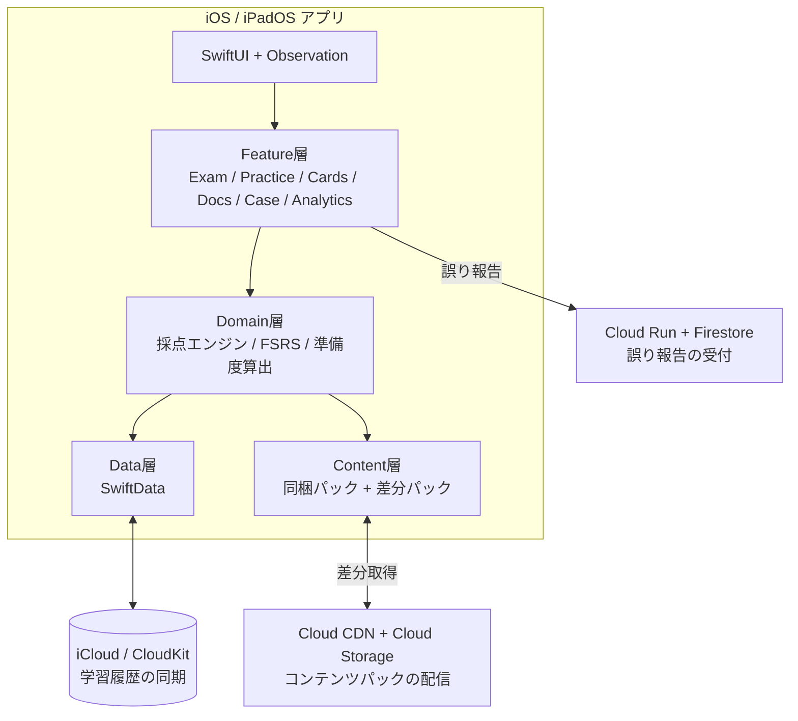
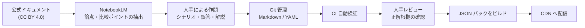

# Google Cloud Professional Cloud Architect 試験対策 iOS アプリ 要件定義書

| 項目 | 内容 |
|---|---|
| 文書バージョン | 0.1(初版ドラフト) |
| 作成日 | 2026-10-20 |
| 対象試験 | Google Cloud Certified - Professional Cloud Architect(試験ガイド v6.1) |
| 対象プラットフォーム | iOS / iPadOS |
| ステータス | レビュー待ち |

---

## 目次

1. [概要](#1-概要)
2. [前提条件・制約](#2-前提条件制約)
3. [用語定義](#3-用語定義)
4. [ユーザー像とユースケース](#4-ユーザー像とユースケース)
5. [機能要件](#5-機能要件)
6. [コンテンツ要件](#6-コンテンツ要件)
7. [データ要件](#7-データ要件)
8. [非機能要件](#8-非機能要件)
9. [システムアーキテクチャ](#9-システムアーキテクチャ)
10. [コンテンツ制作パイプライン](#10-コンテンツ制作パイプライン)
11. [法務・コンプライアンス要件](#11-法務コンプライアンス要件)
12. [リリース計画](#12-リリース計画)
13. [受け入れ基準](#13-受け入れ基準)
14. [リスクと対策](#14-リスクと対策)
15. [未決事項](#15-未決事項)

---

## 1. 概要

### 1.1 目的

Google Cloud Professional Cloud Architect(以下 PCA)認定試験の合格を目指す学習者に向けて、次の3つを一つの iOS アプリで提供する。

- 本番に近い模擬試験
- 記憶を定着させるフラッシュカード
- 出題範囲を体系的に学べるドメイン別ドキュメント

### 1.2 背景

- PCA 試験は 2025年10月30日に v6.1 へ改訂された。ケーススタディが4件中3件入れ替わり、AI関連の出題範囲(Vertex AI、AIのセキュリティ)が追加されている。
- 市販教材の多くは旧版のケーススタディ(Mountkirk Games、TerramEarth など)を前提にしたままである。
- このため、v6.1 に完全準拠した日本語中心の教材には差別化の余地がある。

### 1.3 スコープ

| 区分 | 内容 |
|---|---|
| スコープ内 | 模擬試験(6回分)、練習モード、フラッシュカード、ドメイン別ドキュメント、ケーススタディ学習、学習分析、コンテンツの差分配信 |
| スコープ外(初期) | Android 版、Web 版、他の認定試験への対応、ユーザー間のソーシャル機能 |

### 1.4 成功指標(KPI)

| 指標 | 目標値(リリース後6か月) |
|---|---|
| 模試1回以上の完走率 | インストールユーザーの 40% 以上 |
| 7日継続率 | 25% 以上 |
| 問題の誤り報告に対する修正リードタイム | 中央値 7日以内 |
| App Store 評価 | 4.5 以上 |

---

## 2. 前提条件・制約

### 2.1 試験仕様(v6.1)

| 項目 | 内容 |
|---|---|
| 問題数 | 50〜60問 |
| 試験時間 | 120分 |
| 出題形式 | 単一選択、複数選択(ケーススタディ問題を含む) |
| 受験言語 | 英語、日本語 |
| 結果の開示 | 合否のみ(スコアやドメイン別の内訳は開示されない) |
| ケーススタディ | 4件が公開され、1回の試験で2件が出題される |

### 2.2 ドメインと配点比重

| No. | ドメイン | 比重(概算) |
|---|---|---|
| 1 | Designing and planning a cloud solution architecture | 約25% |
| 2 | Managing and provisioning a solution infrastructure | 約18% |
| 3 | Designing for security and compliance | 約19% |
| 4 | Analyzing and optimizing technical and business processes | 約15% |
| 5 | Managing implementation | 約23%(ドメイン5・6の合計) |
| 6 | Ensuring solution and operations reliability | 同上 |

> ⚠️ ドメイン5と6の個別比重は、試験ガイドの原本で確認してから確定する(→ [未決事項](#15-未決事項))。

### 2.3 v6.1 の重点トピック

- **Vertex AI**: エンドツーエンドの ML ワークフロー(2.4)、構築済みソリューションや API の設定(2.5)
- **AI のセキュリティ**: Model Armor、Sensitive Data Protection、安全なモデルデプロイ
- **Well-Architected Framework**: 原則が試験全体に浸透している。オペレーショナルエクセレンスは独立した項目(6.1)になった
- **Gemini Cloud Assist**、GKE Autopilot、Cloud Deploy など

### 2.4 ケーススタディ(v6.1)

| ID | 名称 | 備考 |
|---|---|---|
| `ehr` | EHR Healthcare | 旧版から継続 |
| `altostrat` | Altostrat Media | 新規(AI活用を含む) |
| `cymbal` | Cymbal Retail | 新規(AI活用を含む) |
| `knightMotives` | KnightMotives Automotive | 新規(AI活用を含む) |

### 2.5 開発上の制約

- 最小対応 OS は iOS 18 / iPadOS 18 とする。Apple Foundation Models を使う機能だけは iOS 26 以上とする。
- 主要機能はすべてオフラインで動作すること。
- 問題はすべてオリジナルとする(→ [法務要件](#11-法務コンプライアンス要件))。

---

## 3. 用語定義

| 用語 | 定義 |
|---|---|
| 模試 | 本番形式(55問・120分)の模擬試験。全6回 |
| 本番モード | 解答中に正誤を表示せず、時間を計って行う試験形式 |
| 練習モード | 1問ごとに正誤と解説を表示する形式 |
| ケース | 試験で使われる公開ケーススタディ |
| FSRS | Free Spaced Repetition Scheduler。間隔反復のアルゴリズム |
| 誤答タグ | 誤った選択肢が「どの要件に違反しているか」を示す分類(コスト、運用負荷、規制など) |
| コンテンツパック | 問題、カード、ドキュメントをまとめた、バージョン付きの JSON 一式 |
| 合格準備度 | ドメイン比重で重み付けした正答率と記憶保持率から算出する学習の目安(合格予測ではない) |

---

## 4. ユーザー像とユースケース

### 4.1 ペルソナ

| ID | ペルソナ | 特徴 | 主なニーズ |
|---|---|---|---|
| P1 | 実務者 | GCP の実務経験が1〜3年あり、ACE を取得済み | 弱点ドメインを効率よく潰したい |
| P2 | 他クラウドからの移行者 | AWS や Azure の経験がある | GCP サービスの対応関係と選定基準を理解したい |
| P3 | スキマ時間の学習者 | 通勤時間に学習する | 短時間で回せるカードやドリル、オフライン動作 |

### 4.2 主要ユースケース

| ID | ユースケース | 対象 |
|---|---|---|
| UC-01 | 本番形式の模試を受けて実力を測る | P1, P2 |
| UC-02 | 弱点ドメインに絞って練習問題を解く | P1 |
| UC-03 | 間違えた問題をカード化し、間隔反復で復習する | 全員 |
| UC-04 | ケーススタディの要件と推奨サービスを対応づけて学ぶ | 全員 |
| UC-05 | ドメイン別の解説を読んで体系的に理解する | P2 |
| UC-06 | 試験日から逆算した学習計画に沿って毎日学習する | P3 |

---

## 5. 機能要件

優先度は MoSCoW 法で表す(**M**ust / **S**hould / **C**ould / **W**on't)。

### 5.1 模擬試験(EXAM)

| ID | 要件 | 優先度 |
|---|---|---|
| FR-EXAM-01 | 6回分の模試(各55問)を提供する | M |
| FR-EXAM-02 | 120分のカウントダウンタイマーを表示する。時間切れで自動的に提出する | M |
| FR-EXAM-03 | 解答中は正誤を表示しない | M |
| FR-EXAM-04 | 「後で見直す」フラグを問題ごとに付けられる | M |
| FR-EXAM-05 | 提出前に、未解答と見直しフラグ付きの問題を一覧できる見直し画面を出す | M |
| FR-EXAM-06 | 単一選択と複数選択(「2つ選べ」など)の両方に対応する | M |
| FR-EXAM-07 | 中断と再開ができる。アプリを終了しても状態を保持する | M |
| FR-EXAM-08 | 結果画面に総合正答率、ドメイン別正答率、ケース別正答率、所要時間を表示する | M |
| FR-EXAM-09 | 結果画面から全問の解説を確認できる | M |
| FR-EXAM-10 | iPad ではケース文を左、問題を右に並べる Split View で表示する | S |
| FR-EXAM-11 | iPhone ではケース文をシートで表示し、問題とすぐに行き来できる | M |
| FR-EXAM-12 | 選択肢の表示順をシャッフルできる(設定で切り替え) | S |
| FR-EXAM-13 | 過去の受験履歴とスコアの推移をグラフで表示する | S |

### 5.2 練習モード(PRAC)

| ID | 要件 | 優先度 |
|---|---|---|
| FR-PRAC-01 | ドメイン、サブ項目(例: 3.2)、ケース、難易度で絞り込んで出題できる | M |
| FR-PRAC-02 | 解答のたびに正誤と解説をすぐに表示する | M |
| FR-PRAC-03 | 「間違えた問題のみ」「未解答のみ」「フラグ付きのみ」で出題できる | M |
| FR-PRAC-04 | 出題数を指定できる(5、10、20問、またはすべて) | M |
| FR-PRAC-05 | 選択肢ごとに「なぜ正解か」「なぜ誤りか」の解説を表示する | M |
| FR-PRAC-06 | 誤答の選択肢に誤答タグ(コスト超過、運用負荷、要件不一致など)を表示する | S |
| FR-PRAC-07 | 問題文を日本語と英語で切り替えて表示できる | S |
| FR-PRAC-08 | 各問題から公式ドキュメント(出典 URL)へ遷移できる | M |

### 5.3 フラッシュカード(CARD)

| ID | 要件 | 優先度 |
|---|---|---|
| FR-CARD-01 | ドメイン別、トピック別のカードデッキを提供する | M |
| FR-CARD-02 | 復習のスケジュールを FSRS で管理する | M |
| FR-CARD-03 | 4段階で自己評価する(Again / Hard / Good / Easy) | M |
| FR-CARD-04 | 模試や練習で間違えた問題を自動でカード化する(設定で ON/OFF) | S |
| FR-CARD-05 | 1日の新規カード数と復習上限を設定できる | S |
| FR-CARD-06 | カードの表面と裏面に日英の用語を併記する | S |
| FR-CARD-07 | ユーザーが独自にカードを作成できる | C |

### 5.4 ドメイン別ドキュメント(DOCS)

| ID | 要件 | 優先度 |
|---|---|---|
| FR-DOCS-01 | 試験ガイドのサブ項目(1.1〜6.x)ごとに解説ページを提供する | M |
| FR-DOCS-02 | Markdown で書いた原稿をアプリ内でレンダリングする(コードブロック、表、図に対応) | M |
| FR-DOCS-03 | 解説ページから関連する問題とカードへ相互にリンクする | S |
| FR-DOCS-04 | ページ内検索と全文検索ができる | S |
| FR-DOCS-05 | ブックマークと既読管理ができる | S |
| FR-DOCS-06 | 各ページに出典(公式ドキュメントの URL)と CC BY 4.0 の表示を入れる | M |

### 5.5 ケーススタディ学習(CASE)

| ID | 要件 | 優先度 |
|---|---|---|
| FR-CASE-01 | 4ケースそれぞれの要約(ビジネス要件、技術要件、既存環境、制約)を表示する。全文は転載せず、公式ページへリンクする | M |
| FR-CASE-02 | 要件マッピング: 要件をタップすると「候補サービス」「選定理由」「除外すべき選択肢とその理由」を表示する | S |
| FR-CASE-03 | ケース別に練習問題を出題する | M |
| FR-CASE-04 | ケースごとの推奨アーキテクチャ図を表示する | C |

### 5.6 選定トレーニング(DECI)

| ID | 要件 | 優先度 |
|---|---|---|
| FR-DECI-01 | サービス選定のディシジョンツリーを対話形式で辿れる(DB選定、コンピュート選定、ハイブリッド接続、ストレージクラス) | S |
| FR-DECI-02 | キーワード反射トレーナー: 「運用負荷最小」「RTO 最小」などの定番表現に対し、二択で素早く答えるドリル | S |
| FR-DECI-03 | アーキテクチャ図の空欄にサービスをドラッグして配置する問題 | C |

### 5.7 学習分析(ANLY)

| ID | 要件 | 優先度 |
|---|---|---|
| FR-ANLY-01 | ドメイン別とサブ項目別の正答率を表示する | M |
| FR-ANLY-02 | 合格準備度を表示する。「合格予測」ではなく目安であることを明記する | S |
| FR-ANLY-03 | 誤答タグ別の集計を表示する(例: コストの見落としが多い) | S |
| FR-ANLY-04 | 学習時間と学習日数のカレンダー表示 | S |
| FR-ANLY-05 | 弱点に基づいて次に解くべき問題やカードを推薦する | C |

### 5.8 学習計画・継続支援(PLAN)

| ID | 要件 | 優先度 |
|---|---|---|
| FR-PLAN-01 | 試験日を登録すると、残り日数から1日の目標量を算出する | S |
| FR-PLAN-02 | 「今日の1問」ウィジェット(WidgetKit) | S |
| FR-PLAN-03 | 復習期限が来たカードを通知する(ユーザーが ON/OFF を選べる) | S |
| FR-PLAN-04 | App Intents に対応する(例:「Siri、PCA のカードを10枚」) | C |

### 5.9 AI 解説(AI)

| ID | 要件 | 優先度 |
|---|---|---|
| FR-AI-01 | 「別の言い方で説明して」ボタンを付け、作成済みの解説を噛み砕いて言い換える | C |
| FR-AI-02 | 正解の判定は AI に行わせない。作成済みの解説を常に正とする | M(FR-AI-01 を実装する場合) |
| FR-AI-03 | 実装方式は、オンデバイスの Apple Foundation Models、または自作ドキュメントでグラウンディングした Vertex AI(Gemini)から選ぶ | — (→ 未決事項) |

### 5.10 コンテンツ管理・品質(CONT)

| ID | 要件 | 優先度 |
|---|---|---|
| FR-CONT-01 | アプリにコンテンツパックを同梱し、オフラインで全機能が動くようにする | M |
| FR-CONT-02 | App Store の審査を経ずにコンテンツを差分配信できる | M |
| FR-CONT-03 | 各問題に「誤りを報告」ボタンを付ける。報告理由を選択式と自由記述で受け付ける | M |
| FR-CONT-04 | 試験ガイドのバージョンを各問題に持たせ、改訂時に該当する問題を一括で抽出できる | M |

### 5.11 アカウント・同期・課金(ACCT)

| ID | 要件 | 優先度 |
|---|---|---|
| FR-ACCT-01 | 学習履歴を iCloud(CloudKit)で端末間同期する。独自アカウントは不要とする | S |
| FR-ACCT-02 | StoreKit 2 による課金(モデルは未決 → 未決事項) | S |
| FR-ACCT-03 | 学習データをエクスポート・削除できる | S |

---

## 6. コンテンツ要件

### 6.1 総量

| 種別 | 数量 |
|---|---|
| 模試の問題 | 6回 × 55問 = **330問** |
| 練習専用の問題 | 150問以上(模試の問題も練習モードで再利用する) |
| フラッシュカード | 500枚以上 |
| ドメイン別ドキュメント | 試験ガイドの全サブ項目分 |
| ケーススタディの要約 | 4件 |

### 6.2 模試1回あたりのドメイン配分(55問)

| ドメイン | 問題数 | 備考 |
|---|---|---|
| 1 | 14 | |
| 2 | 10 | うち Vertex AI 関連を2〜3問 |
| 3 | 10 | Model Armor、SDP を含む |
| 4 | 8 | |
| 5・6 | 13 | 個別の比重が確定したら按分する |
| **合計** | **55** | ケーススタディ問題は上記の内数として12〜15問 |

### 6.3 ケーススタディの割り当て

6回 × 2ケース = 12枠を4ケースに均等に割り当て、各ケースが3回ずつ登場するようにする。

| 模試 | ケースA | ケースB | 難易度 |
|---|---|---|---|
| 模試1 | EHR Healthcare | Altostrat Media | 基礎 |
| 模試2 | Cymbal Retail | KnightMotives Automotive | 基礎 |
| 模試3 | EHR Healthcare | Cymbal Retail | 本番相当 |
| 模試4 | Altostrat Media | KnightMotives Automotive | 本番相当 |
| 模試5 | EHR Healthcare | KnightMotives Automotive | 本番よりやや難しい |
| 模試6 | Altostrat Media | Cymbal Retail | 本番よりやや難しい |

### 6.4 問題の品質基準

| ID | 基準 |
|---|---|
| CQ-01 | すべての問題がオリジナルであること(本試験の問題や市販教材の問題に依拠しない) |
| CQ-02 | 正解の根拠を、公式ドキュメントの URL で1つ以上示すこと |
| CQ-03 | すべての選択肢に解説があること(誤答には「なぜ誤りか」を書く) |
| CQ-04 | 模試1回あたりで、正解の位置(A〜D)がほぼ均等に分布していること(各20〜30%) |
| CQ-05 | 正解の選択肢だけが他より極端に長くならないこと(最長の選択肢が正解である割合を35%以下にする) |
| CQ-06 | 問題文はシナリオ形式とし、要件に照らして選ぶ構造にすること(単純な知識問題は練習問題全体の20%以下) |
| CQ-07 | 内容が非推奨になったサービスや機能に依存していないこと |
| CQ-08 | 公開前に、作成者以外の1名がレビューすること |

---

## 7. データ要件

### 7.1 コンテンツのデータモデル(概要)

```swift
struct Question: Codable, Identifiable {
    let id: String                // 例: "Q-3.2-0147"
    let examGuideVersion: String  // "6.1"
    let domain: Int               // 1...6
    let subObjective: String      // "3.2"
    let caseStudy: CaseStudyID?   // .ehr / .altostrat / .cymbal / .knightMotives
    let type: QuestionType        // .single / .multiple(count: Int)
    let stem: LocalizedText       // 日本語と英語
    let choices: [Choice]
    let difficulty: Int           // 1...5
    let wafPillars: [WAFPillar]
    let keywords: [String]
    let references: [Reference]   // URL とライセンス表示
    let examSets: [Int]           // 収録先の模試番号(練習専用なら空)
    let revision: Int
}

struct Choice: Codable, Identifiable {
    let id: String
    let text: LocalizedText
    let isCorrect: Bool
    let rationale: LocalizedText  // 正解なら「なぜ正しいか」、誤答なら「なぜ誤りか」
    let mistakeTags: [MistakeTag] // 誤答のみ: .cost / .opsOverhead / .compliance ...
}

struct Flashcard: Codable, Identifiable {
    let id: String
    let domain: Int
    let subObjective: String
    let front: LocalizedText
    let back: LocalizedText
    let relatedQuestionIDs: [String]
}
```

### 7.2 学習履歴のデータモデル(SwiftData)

| エンティティ | 主な属性 |
|---|---|
| `ExamAttempt` | 模試番号、開始日時、終了日時、残り時間、状態(進行中/提出済)、スコア |
| `AnswerRecord` | 問題 ID、選択した選択肢、正誤、解答時間、見直しフラグ、モード |
| `CardState` | カード ID、FSRS のパラメータ(stability、difficulty、due)、復習履歴 |
| `Bookmark` | 対象の種別(問題/ドキュメント)、対象 ID、作成日時 |
| `StudyPlan` | 試験予定日、1日の目標量 |

### 7.3 コンテンツパックの構成

```
content-pack-v{semver}/
├── manifest.json        # パックのバージョン、試験ガイドのバージョン、ハッシュ
├── questions/*.json
├── flashcards/*.json
├── docs/*.md
├── cases/*.json
└── assets/              # 図(SVG/PNG)
```

---

## 8. 非機能要件

| 区分 | ID | 要件 |
|---|---|---|
| 性能 | NFR-01 | アプリの起動(コールドスタート)から操作可能になるまで 2秒以内 |
| 性能 | NFR-02 | 問題の切り替えを 100ms 以内に行う |
| 可用性 | NFR-03 | 主要機能はすべてオフラインで動作する |
| 信頼性 | NFR-04 | 模試の途中で強制終了しても、解答状態を失わない(解答ごとに保存する) |
| 保守性 | NFR-05 | コンテンツの修正をアプリ本体のリリースから切り離す(差分配信) |
| アクセシビリティ | NFR-06 | VoiceOver と Dynamic Type に対応する。WCAG 2.1 AA 相当のコントラストを確保する |
| UI | NFR-07 | ダークモードに対応する |
| 国際化 | NFR-08 | UI は日本語を基本とし、問題とカードは日英を併記する |
| プライバシー | NFR-09 | 学習データは端末と iCloud にのみ保存する。サーバーには誤り報告と匿名の利用統計だけを送る |
| セキュリティ | NFR-10 | コンテンツパックの改ざんを検知する(manifest のハッシュを検証する) |
| 品質 | NFR-11 | ドメイン層(採点、FSRS、準備度の算出)のユニットテストのカバレッジを 80% 以上にする |

---

## 9. システムアーキテクチャ

### 9.1 全体構成



### 9.2 技術スタック

| 層 | 技術 |
|---|---|
| UI | SwiftUI、Observation、Swift Charts |
| 永続化 | SwiftData、CloudKit |
| 課金 | StoreKit 2 |
| 拡張 | WidgetKit、App Intents、UserNotifications |
| AI(任意) | Apple Foundation Models、または Vertex AI(Gemini) |
| 配信基盤 | Cloud Storage、Cloud CDN |
| 誤り報告 | Cloud Run、Firestore |
| CI/CD | GitHub Actions(コンテンツ検証)、Xcode Cloud(アプリのビルド) |

---

## 10. コンテンツ制作パイプライン

### 10.1 制作フロー



### 10.2 NotebookLM の利用方針

| 項目 | 方針 |
|---|---|
| 投入してよいソース | Google Cloud 公式ドキュメント、Architecture Center、Well-Architected Framework、試験ガイド(出題範囲の確認用) |
| 投入しないソース | 市販の模擬問題、書籍、有料講座の教材、本試験の問題(ダンプ) |
| NotebookLM の役割 | 論点やサービス比較の要点の抽出にとどめる |
| 最終成果物 | 問題文、選択肢、解説は人手で作成する |
| 事実確認 | 生成された内容は必ず公式ドキュメントと照合する |

### 10.3 CI の検証項目

| ID | 検証内容 |
|---|---|
| CI-01 | スキーマ検証(必須項目の欠け、型の誤り) |
| CI-02 | 模試ごとのドメイン配分が [6.2](#62-模試1回あたりのドメイン配分55問) と一致すること |
| CI-03 | 正解位置の分布(CQ-04) |
| CI-04 | 選択肢の長さの偏り(CQ-05) |
| CI-05 | 全選択肢に解説があること(CQ-03) |
| CI-06 | 出典 URL があり、リンク切れがないこと(CQ-02) |
| CI-07 | 問題 ID の重複がないこと、問題文が似すぎた問題がないこと |
| CI-08 | 複数選択の問題で、指定数と正解数が一致すること |

---

## 11. 法務・コンプライアンス要件

| ID | 要件 |
|---|---|
| LG-01 | 本試験の問題および市販教材の問題を使用しない。すべてオリジナル問題とする |
| LG-02 | 公式ドキュメントを参照した箇所には出典 URL と CC BY 4.0 の表示を入れる |
| LG-03 | ケーススタディ本文は転載しない。要約と公式ページへのリンクにとどめる |
| LG-04 | アプリ名やアイコンに Google の商標やロゴを使わない。「非公式」「Google とは無関係」と明記する |
| LG-05 | 合格を保証する表現を使わない(App Store の説明文、アプリ内表示ともに) |
| LG-06 | プライバシーポリシーと App Store のプライバシー表示を、実際のデータの扱いと一致させる |
| LG-07 | 有料で販売する前に、知的財産に詳しい弁護士の確認を受ける |

---

## 12. リリース計画

| フェーズ | 内容 | 主な機能 |
|---|---|---|
| **MVP(v1.0)** | 核となる学習体験 | 模試2回分(110問)、練習モード、フラッシュカード(FSRS)、ドメインドキュメント(主要サブ項目)、ケース要約4件、基本的な学習分析、誤り報告 |
| **v1.1** | コンテンツの充実 | 模試6回分すべて、全サブ項目のドキュメント、日英切替、iPad の Split View |
| **v1.2** | 差別化機能 | ケース要件マッピング、ディシジョンツリー、キーワード反射トレーナー、合格準備度、誤答タグ分析 |
| **v2.0** | 継続支援と AI | ウィジェット、学習計画、App Intents、AI 解説、図の配置問題 |

---

## 13. 受け入れ基準

| ID | 基準 |
|---|---|
| AC-01 | 模試を開始から提出まで通しで完了でき、120分経過で自動的に提出される |
| AC-02 | 模試の途中でアプリを強制終了して再起動しても、解答と残り時間が復元される |
| AC-03 | 結果画面のドメイン別正答率が、解答記録から再計算した値と一致する |
| AC-04 | 機内モードで、模試、練習、カード、ドキュメントのすべてが利用できる |
| AC-05 | 差分パックを配信すると、次回起動時に反映され、改ざんしたパックは拒否される |
| AC-06 | 全問題が CI の検証(CI-01〜CI-08)を通過している |
| AC-07 | VoiceOver で模試を一通り操作できる |
| AC-08 | FSRS の次回出題日が、リファレンス実装と同じ入力に対して同じ値を返す |

---

## 14. リスクと対策

| リスク | 影響 | 対策 |
|---|---|---|
| 試験の再改訂 | 問題が陳腐化する | 問題にバージョンを持たせ(FR-CONT-04)、差分配信で迅速に更新する |
| 問題の誤り | 信頼を失い、評価が下がる | CI、人手レビュー、誤り報告の3段階で防ぐ |
| 著作権・商標の問題 | 審査落ち、法的リスク | 法務要件(LG-01〜07)を守り、販売前に専門家の確認を受ける |
| 作問の工数が大きい | リリースが遅れる | MVP は模試2回に絞り、段階的に追加する |
| AI 解説の誤り | 誤った知識を学んでしまう | 判定には使わず、作成済み解説の言い換えに限定する(FR-AI-02) |

---

## 15. 未決事項

| ID | 事項 | 決定期限の目安 |
|---|---|---|
| TBD-01 | ドメイン5・6の個別比重(試験ガイドの原本で確認) | 作問開始前 |
| TBD-02 | 収益モデル(買い切り/サブスクリプション/一部無料) | MVP 開発の中盤 |
| TBD-03 | AI 解説の実装方式(Foundation Models か Vertex AI か) | v2.0 の計画時 |
| TBD-04 | アプリ名とブランディング(商標を避けた名称) | App Store 申請前 |
| TBD-05 | 匿名の利用統計の取得範囲と、使用する計測基盤 | MVP 開発の中盤 |
| TBD-06 | 作問とレビューの体制(作成者以外のレビュアーの確保) | 作問開始前 |
