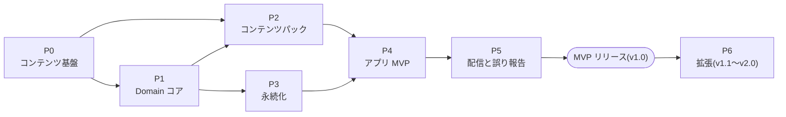
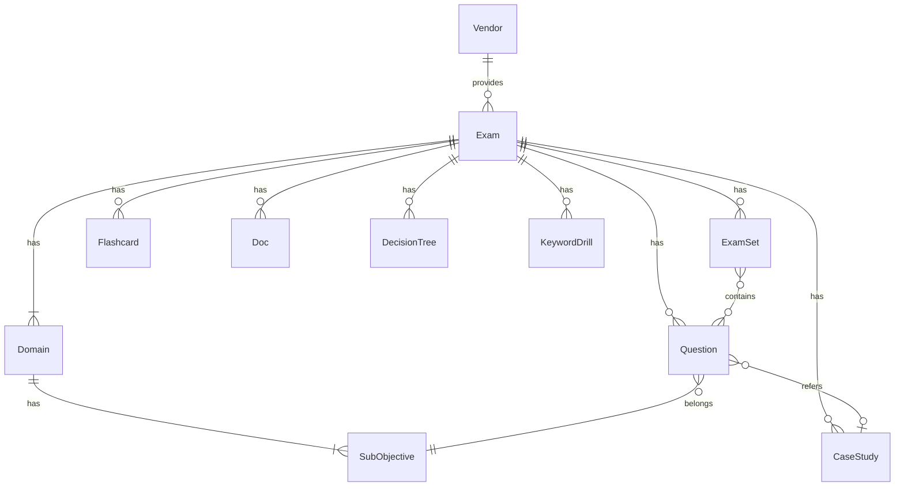
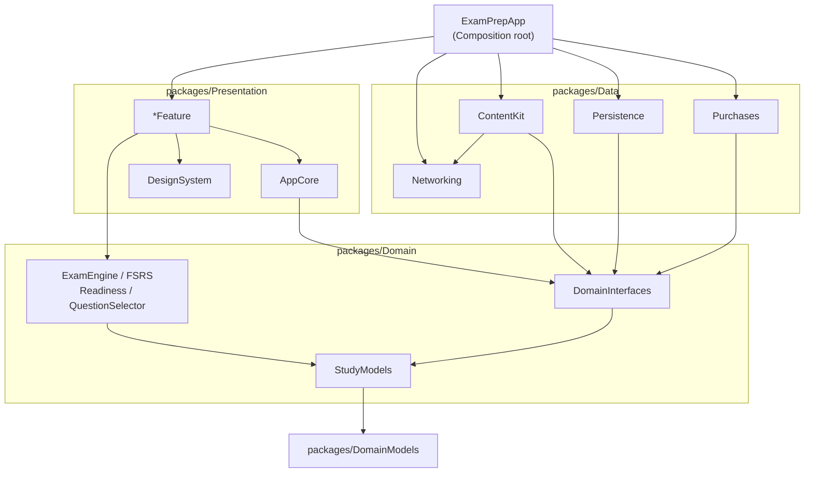
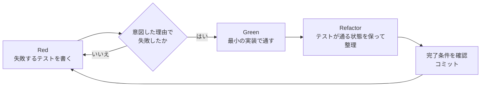

# Cloudrill 詳細設計書(索引・共通設計)

| 項目 | 内容 |
|---|---|
| 文書バージョン | 0.1(初版ドラフト) |
| 作成日 | 2026-10-21 |
| 入力文書 | 要件定義書 v0.1([RDD.md](RDD.md))、基本設計書 v0.1([BDD.md](BDD.md)) |
| 対象 | Cloudrill(クラウド認定試験対策 iOS / iPadOS アプリ)。初期リリースの対象試験は Google Cloud Professional Cloud Architect(PCA、試験ガイド v6.1) |
| ステータス | レビュー待ち |

---

## 目次

1. [本書の位置づけと読み方](#1-本書の位置づけと読み方)
2. [基本設計書からの変更点](#2-基本設計書からの変更点)
3. [名称](#3-名称)
4. [複数試験に対応するアーキテクチャ](#4-複数試験に対応するアーキテクチャ)
5. [パッケージ構成と依存関係](#5-パッケージ構成と依存関係)
6. [共通の実装規約](#6-共通の実装規約)
7. [TDD の規約](#7-tdd-の規約)
8. [外部依存の候補](#8-外部依存の候補)
9. [要件トレーサビリティ](#9-要件トレーサビリティ)
10. [未決事項](#10-未決事項)

---

## 1. 本書の位置づけと読み方

### 1.1 目的

基本設計書(BDD)で定めた構成と方式を、実装できる粒度まで具体化する。具体的には、次の3点を定める。

- 型、関数のシグネチャ、ファイルの配置
- テストを先に書く手順(TDD)と、各ステップの完了条件
- 他の試験(他ベンダーを含む)を追加できる拡張点

### 1.2 文書の一覧

詳細設計はフェーズごとに分割する。作業するときは、本書の 4〜7 章と、着手するフェーズの文書を読めばよい。

| 文書 | 内容 | 主な成果物 |
|---|---|---|
| 本書(DDD.md) | 索引、共通設計、TDD の規約、トレーサビリティ | — |
| [P0 複数試験に対応したコンテンツ基盤](DDD/DDD-P0-MultiExamContent.md) | 名称の変更、`content/exams/<examID>/` への移行、試験定義、検証ツールの汎用化 | `exam.yaml`、`vendors.yaml`、CI-12、DomainModels の試験定義型 |
| [P1 Domain コア](DDD/DDD-P1-DomainCore.md) | 採点、模試の状態機械、タイマー、FSRS、合格準備度、出題選択 | `packages/Domain` |
| [P2 コンテンツパック](DDD/DDD-P2-ContentPack.md) | パックのビルド・署名(Python)と、検証・読み込み(Swift) | `contentpack`、`ContentKit` |
| [P3 学習履歴の永続化](DDD/DDD-P3-Persistence.md) | SwiftData のモデル、リポジトリ、同期後の統合 | `Persistence` |
| [P4 アプリ MVP](DDD/DDD-P4-AppMVP.md) | アプリの骨格と MVP の画面 | `ExamPrepApp`、`packages/Presentation` |
| [P5 配信と誤り報告](DDD/DDD-P5-Delivery.md) | リリースワークフロー、差分更新、report-api | `release.yml`、`PackUpdater`、report-api |
| [P6 拡張](DDD/DDD-P6-Extensions.md) | v1.1〜v2.0 の機能、2つ目の試験の追加 | — |

### 1.3 フェーズの依存関係



- P2 と P3 は、P1 の完了後に並行して進められる。P2 の Python 側(P2-S01〜S04)は P0 だけに依存するので、P1 と並行して始めてもよい。
- MVP(v1.0)のリリース条件は、P0〜P5 の完了である。RDD 12 章の MVP には、差分配信(FR-CONT-02、優先度 M)と誤り報告(FR-CONT-03、優先度 M)が含まれる。

### 1.4 用語

RDD 3 章の用語に加えて、次の用語を使う。

| 用語 | 英語(コード上の名前) | 定義 |
|---|---|---|
| 試験 | Exam(`ExamID`) | 認定試験そのもの。例: `gcp-pca`。アプリはカタログに載った複数の試験を扱う |
| ベンダー | Vendor(`VendorID`) | 試験の提供元。例: `google-cloud`、`aws` |
| 試験定義 | ExamDefinition(`exam.yaml`) | 試験ごとのドメイン、比重、形式、有効な機能、語彙をまとめたデータ |
| 模試 | ExamSet | 試験ごとの模擬試験の1回分。番号は試験の中で1から振る |
| 受験 | Attempt | 模試を1回受けた記録 |
| カタログ | Catalog(`catalog.json`) | 配信している試験の一覧と、各試験の最新パックの版 |
| ステップ | Step(`P{n}-S{nn}`) | TDD の1サイクル(Red → Green → Refactor)で終える作業の単位 |

---

## 2. 基本設計書からの変更点

本書は、次の点で BDD と異なる。BDD と RDD への反映は、本書のレビュー後に別の PR で行う(本書の作成では編集しない)。

| No. | 変更点 | BDD・RDD での記載 | 本書での扱い | 理由 |
|---|---|---|---|---|
| C-01 | パッケージの配置 | BDD 3.2 の `PCAApp/Packages/` | 実際の配置であるルートの `packages/` に合わせる。層ごとに `packages/Domain`、`packages/Data`、`packages/Presentation` を置き、モジュールはターゲットで分ける(5 章) | 既存の `packages/DomainModels` との一貫性。Package.swift の数を減らしつつ、ターゲットの依存で依存方向を強制できる |
| C-02 | Presentation から Data への依存 | BDD 3.1 の図に `Presentation --> Data` がある | Presentation は `DomainInterfaces`(プロトコル)だけに依存する。Data の具象はアプリ本体(Composition root)で組み立てる | 依存性の逆転を徹底し、ViewModel のテストで Fake に差し替えられるようにする |
| C-03 | 複数試験への対応 | RDD 1.3 では他試験は「スコープ外(初期)」 | 「初期リリースは PCA のみ。設計とデータ構造は複数試験(他ベンダーを含む)に対応する」に変える | 合意済みの方針。移行コストが最も低い今のうちに構造を変える |
| C-04 | コンテンツの配置 | BDD 10.1 の `content/questions/` など | `content/exams/<examID>/` の下に置く。`weights.yaml` と `validation.yaml` の `examGuide` は `exam.yaml` に統合する(4.4) | 試験ごとにコンテンツを分離する |
| C-05 | 列挙値 | BDD 5.2.3 の `CaseStudyID`、`WAFPillar` は固定の列挙 | 試験語彙として `exam.yaml` で定義し、Swift では文字列 ID の struct にする(4.3) | 試験ごとに値が異なる |
| C-06 | manifest | BDD 5.2.1 の `signature` は manifest の中にある | 署名は別ファイル `manifest.sig` にし、manifest.json の**バイト列そのもの**に署名する。`formatVersion`、`examID`、`keyID` を追加する | Python と Swift で、署名対象のバイト列(キーの順序や空白)の正規化を一致させる必要がなくなる。鍵のローテーションに備える |
| C-07 | 配信のパス | BDD 7.1 の `/packs/latest/manifest.json` | `/catalog.json` と `/packs/<examID>/<packVersion>/…` にする。`latest/` は廃止する(4.8) | 版ごとに不変のパスだけにすることで、manifest と署名の取得の途中で更新される競合をなくす |
| C-08 | 学習履歴 | BDD 5.3 のエンティティに試験の区別がない | すべてのエンティティに `examID` を持たせる。試験ごとの設定は `ExamPreference` に分ける | 1つのアプリで複数の試験を扱う |
| C-09 | 現在時刻の注入 | BDD 11.3 の `Clock` プロトコル | `TimeSource` プロトコルにする(6.1) | 標準ライブラリの `Swift.Clock` と名前が衝突する |
| C-10 | 模試の状態遷移 | BDD 6.1 に「見直し中の時間切れ」と「見直し中の中断」がない | `Reviewing --> Submitted: 時間切れ` と `Reviewing --> Suspended: 中断` を追加する(P1-S05) | 見直し一覧を開いたまま、時間切れになったりアプリが終了したりする場合に対応する |
| C-11 | 誤り報告 API | BDD 7.2 のリクエストに試験の区別がない | `examID` を必須の項目に追加する(P5-S04) | 問題 ID は試験の中でのみ一意 |
| C-12 | リリースタグ | `content-vX.Y.Z` | `content/<examID>/vX.Y.Z` | 試験ごとにパックの版を管理する |
| C-13 | アプリ名・識別子 | 「PCA 試験対策」、`PCAApp`、`group.<prefix>.pca` | 表示名は Cloudrill。識別子は表示名と切り離した中立な名前にする(3 章)。TBD-04 を更新する | 合意済み |
| C-14 | 最小 OS と対象プラットフォーム | RDD 2.5 は iOS 18。一方、`packages/DomainModels` の Package.swift は iOS 17 / macOS 14、Xcode プロジェクトは `IPHONEOS_DEPLOYMENT_TARGET = 27.0`、`SUPPORTED_PLATFORMS` に macOS と visionOS を含む | 新しいパッケージは iOS 18 / macOS 15(macOS は `swift test` の実行用)とする。DomainModels は iOS 17 のままでよい(下位互換のため)。アプリのターゲットは P4-S01 で iOS 18、iPhone と iPad のみ、Swift 6 にそろえる | RDD に合わせる。`Synchronization.Mutex` などを使うため |

---

## 3. 名称

表示名とコード上の識別子を分けて管理する。商標調査や弁護士の確認(LG-07)で表示名が変わっても、変更するのは Info.plist の1項目だけで済むようにするためである。Bundle ID は App Store に申請した後は変更できない。

| 対象 | 現在 | 変更後 | 変更するステップ |
|---|---|---|---|
| 表示名(`INFOPLIST_KEY_CFBundleDisplayName`) | PCA 試験対策 | **Cloudrill**(App Store の名前の例: 「Cloudrill - クラウド認定試験対策」)。**表示名を変えるときは、ここだけを変更する** | P0-S00 |
| Xcode のプロジェクト・ターゲット・フォルダ | `PCAApp` | `ExamPrepApp` | P0-S00 |
| `@main` の型 | `MyApp` | `ExamPrepApp` | P0-S00 |
| Bundle ID | 未定 | `<逆ドメイン>.examprep` | P4-S01 |
| App Group | `group.<prefix>.pca` | `group.<逆ドメイン>.examprep` | P4-S01 |
| CloudKit コンテナ | 未定 | `iCloud.<逆ドメイン>.examprep` | P3-S01 |
| Schema の `$id` | `https://pca-content.invalid/schemas/` | `https://examprep-content.invalid/schemas/` | P0-S00 |
| Python パッケージ(検証) | `pcavalidate` | `contentvalidate`(機能を表す名前にし、ブランド名を含めない) | P0-S00 |
| Python パッケージ(ビルド・署名) | なし | `contentpack` | P2-S02 |
| リンク確認の User-Agent | `pca-content-link-check/1.0` | `examprep-content-link-check/1.0` | P0-S00 |

- 「PCA」は試験の名前としてだけ残す(`examID: gcp-pca`、`shortName: PCA`)。
- GitHub のリポジトリ名(`google-cloud-professional-cloud-architect`)の変更は任意とし、本書の対象外とする。
- `<逆ドメイン>` は TBD-04 の確定時に決める。

---

## 4. 複数試験に対応するアーキテクチャ

### 4.1 拡張性の設計方針

| No. | 方針 | 具体化 |
|---|---|---|
| X-01 | 試験に固有の情報は、コードではなくデータに置く | ドメイン、比重、サブ項目、試験時間、問題数、ケーススタディ、WAF の柱は `exam.yaml` に書く。コードに `6`、`55`、`120` などの値を書かない |
| X-02 | 1つのアプリで複数の試験を扱い、学習履歴は試験ごとに分ける | すべての学習記録に `examID` を持たせる。アプリは常に1つの「選択中の試験」(`ActiveExamContext`)を持つ |
| X-03 | ベンダーに固有の情報は `vendors.yaml` に置く | 商標の表示(LG-04)、出典ライセンスの既定値 |
| X-04 | 拡張点はプロトコルと登録表で表す | 出題形式・採点方式・学習機能を追加するとき、既存の型を変更せずに登録を追加すればよいようにする(開放閉鎖原則。4.9) |
| X-05 | アプリが解釈できないデータは配信の段階で止める | 構造が変わったら `formatVersion` を、新しい構造語彙を使うなら `minAppVersion` を上げる。古いアプリはそのパックを取り込まない |
| X-06 | 拡張性をテストで保証する | 性質の異なる2つの fixture 試験(`test-alpha`、`test-beta`)を用意し、試験ごとの分岐をコードに書かずに両方が通ることを受け入れテストにする(P0-S07) |

### 4.2 概念モデル



- 問題、カード、ドキュメントなどのコンテンツは、すべて1つの試験に属する。試験をまたいだ共有はしない(同じ内容でも試験ごとにコピーする)。試験ごとに改訂の時期と範囲が異なるため。

### 4.3 語彙の3つの層

「値が増えたときに、何を変更すれば済むか」で語彙を3つの層に分ける。

| 層 | 例 | 定義の場所 | Swift での型 | 値を追加するときの手順 | 不正な値の扱い |
|---|---|---|---|---|---|
| ① 構造語彙 | `QuestionKind`(single / multiple)、`License`、`MistakeTag`、`ExamSetStatus`、`ExamLevel`、`ScoringPolicyKind` | アプリのコード | closed enum | アプリを更新し、新しい値を使うパックの `minAppVersion` を上げる | デコードエラー(既存の方針のまま) |
| ② 試験語彙 | `CaseStudyID`、`WAFPillarID`、ドメイン番号、サブ項目 ID | `exam.yaml` | 文字列 ID の struct(`RawRepresentable`) | コンテンツの追加だけで済む(アプリの更新は不要) | CI(CI-09、CI-12)と、アプリがパックを読み込むときの整合チェック(`ContentIntegrityChecker`、P2-S07) |
| ③ 閾値 | 正解位置の分布、類似度、ドメイン配分 | `content/validation.yaml`(全体の既定値)と `content/exams/<examID>/validation.yaml`(試験ごとの上書き) | — (CI だけが使う) | 設定の変更だけで済む | 設定エラー(終了コード 2) |

- ①を「データで定義」にしない理由: 表示(`QuestionRenderer`)や採点(`AnswerEvaluator`)のコードが必要になる値だからである。データだけ追加しても、アプリは扱えない。
- `MistakeTag` を①にする理由: 誤答タグ別の分析(FR-ANLY-03)で、タグごとの表示名とアイコンをアプリで持つため。ベンダーに依存しない分類(コスト、運用負荷など)なので、試験ごとに変える必要もない。

### 4.4 試験定義(exam.yaml)

`content/exams/<examID>/exam.yaml` に置く。Schema は `content/schemas/exam.schema.json`(P0-S01)。

```yaml
id: gcp-pca                       # ExamID。ディレクトリ名と一致させる(CI-12)
vendor: google-cloud              # vendors.yaml に実在すること(CI-12)
name:
  ja: Google Cloud Professional Cloud Architect
  en: Google Cloud Professional Cloud Architect
shortName: PCA                    # 画面の狭い場所での表示用
guideVersion: "6.1"               # 引用符を付ける(数値として読まれるのを防ぐ)
guideURL: https://cloud.google.com/learn/certification/cloud-architect
format:
  durationMinutes: 120
  officialQuestionCount: { min: 50, max: 60 }
  questionKinds: [single, multiple]
  mockExam:
    questionCount: 55
    setCount: 6                   # 模試の回数の上限(exam-sets の id は 1〜setCount)
    caseStudiesPerSet: 2          # ケースがない試験では 0
scoring:
  policy: allOrNothing            # ① 構造語彙(ScoringPolicyKind)
domains:
  - id: 1
    name:
      ja: クラウド ソリューション アーキテクチャの設計と計画
      en: Designing and planning a cloud solution architecture
    weight: 0.25
    subObjectives:
      - id: "1.1"
        name: { ja: …, en: … }
  # … ドメイン 2〜6
features:
  caseStudies: true
  docs: true
  flashcards: true
  decisionTrees: true
  keywordDrills: true
taxonomies:
  wafPillars:
    - id: operationalExcellence
      name: { ja: オペレーショナル エクセレンス, en: Operational excellence }
    # …
caseStudies: [ehr, altostrat, cymbal, knightMotives]   # 表示順。cases/*.yaml の id と一致させる(CI-12)
```

| 項目 | 型 | 制約 | 使う場所 |
|---|---|---|---|
| `id` | ExamID | `^[a-z0-9]+(-[a-z0-9]+)*$`。`<ベンダー略称>-<試験略称>` を推奨 | すべて |
| `vendor` | VendorID | 同上 | 商標の表示、出典ライセンスの既定値 |
| `format.durationMinutes` | 整数 | 1 以上 | タイマー(P1-S06) |
| `format.questionKinds` | ① の配列 | 1 つ以上、重複なし | CI-12、`AnswerEvaluatorRegistry` の対応確認 |
| `format.mockExam.*` | 整数 | `questionCount` 1 以上、`setCount` 1 以上、`caseStudiesPerSet` 0 以上 | CI-02、模試一覧 |
| `scoring.policy` | ① | `allOrNothing` | `ScoringPolicy` の選択 |
| `domains[].id` | 整数 | 1 から始まる連番(CI-12) | 採点、準備度、出題選択 |
| `domains[].weight` | 数値 | 0〜1。合計は 1.0 ± 0.001(CI-10) | 準備度(BDD 6.6)。TBD-01 の確定後に更新できる |
| `domains[].subObjectives[].id` | 文字列 | `^[0-9A-Za-z]+(\.[0-9A-Za-z]+)*$`。試験内で一意(CI-12) | 問題・カード・docs の分類 |
| `features.*` | 真偽値 | 無効な機能のコンテンツは置けない(CI-12) | 「学ぶ」タブの項目(`LearnModuleRegistry`)、ケース別の集計 |
| `taxonomies.wafPillars` | 配列 | 空でもよい(WAF のない試験) | 問題の `wafPillars` の参照先(CI-09) |
| `caseStudies` | CaseStudyID の配列 | `features.caseStudies: false` のときは空 | ケース一覧の表示順、参照の確認 |

#### 統合する既存ファイル

| 既存 | 統合先 |
|---|---|
| `content/weights.yaml` | `domains[].weight` |
| `content/validation.yaml` の `examGuide.version` | `guideVersion` |
| `content/validation.yaml` の `examGuide.subObjectives` | `domains[].subObjectives` |
| `content/validation.yaml` の `examSet.questionCount` | `format.mockExam.questionCount` |

模試のドメイン配分(`examSet.domainDistribution`)、ケース問題の数、既定のケース割り当ては、アプリの実行時には使わない CI 専用の値なので、試験ごとの `validation.yaml` に置く(③)。

### 4.5 ベンダー定義(vendors.yaml)

`content/vendors.yaml` に、全試験で共有するベンダーの情報を置く。Schema は `content/schemas/vendors.schema.json`(P0-S01)。

```yaml
vendors:
  - id: google-cloud
    name: Google Cloud
    trademarkNotice:
      ja: 本アプリは Google LLC とは関係のない非公式の学習教材です。Google Cloud は Google LLC の商標です。
      en: This app is unofficial study material and is not affiliated with Google LLC. Google Cloud is a trademark of Google LLC.
    defaultReferenceLicense: CC-BY-4.0
```

- `trademarkNotice` は、設定画面の「このアプリについて」と、その試験のホームに表示する(LG-04)。
- 他ベンダーの公式ドキュメントは、CC BY 4.0 で公開されているとは限らない。その場合は `defaultReferenceLicense: link-only` とし、引用せずにリンクだけを示す。ライセンスの判断は、ベンダーを追加するときに LG-07 の確認対象にする。

### 4.6 コンテンツのディレクトリ構成(P0 の完了後)

```text
content/
├── schemas/                    # 全試験で共通の JSON Schema
├── validation.yaml             # 検証の閾値(全試験の既定値)
├── vendors.yaml                # ベンダーの定義
├── catalog.yaml                # 配信する試験の一覧(P2-S03 で追加)
├── exams/
│   └── gcp-pca/
│       ├── exam.yaml           # 試験定義
│       ├── validation.yaml     # 試験固有の閾値(任意。既定値を上書きする)
│       ├── exam-sets.yaml
│       ├── questions/domain{N}/<id>.yaml
│       ├── flashcards/*.yaml
│       ├── cases/*.yaml
│       ├── decisions/*.yaml
│       ├── drills/*.yaml
│       └── docs/*.md
├── scripts/
│   ├── validate.py             # 検証 CLI(--exam で試験を絞り込める)
│   ├── export_json.py
│   ├── build_pack.py           # P2
│   ├── contentvalidate/        # 検証の実装(旧 pcavalidate)
│   └── contentpack/            # ビルドと署名の実装(P2)
└── tests/
    └── fixtures/
        ├── valid/              # vendors.yaml、validation.yaml、exams/test-alpha/、exams/test-beta/
        ├── invalid/<ケース名>/ # valid に対する差分(パスは valid のルートからの相対)
        ├── valid-json/         # valid の YAML を JSON にしたもの(同じディレクトリ構成)
        └── packs/              # P2 の契約 fixture
```

### 4.7 ID と一意性

| ID | 一意の範囲 | アプリでの扱い |
|---|---|---|
| `ExamID`、`VendorID` | 全体 | そのまま使う |
| 問題 ID、カード ID、ケース ID、ツリー ID、ドリル ID | 試験の中 | 常に `(examID, ID)` の組で扱う。Swift では `ExamScoped<ID>` 型(P0-S09)、SwiftData では `examID` 列と ID 列の組 |
| 模試の番号 | 試験の中 | `(examID, examSet)` |
| 問題由来のカード ID | 試験の中 | `Q:` + 問題 ID(BDD 5.3 の方式を維持し、`examID` 列で試験を区別する) |

問題 ID の形式(`Q-<サブ項目>-<4桁>`)は維持し、サブ項目の部分だけを汎用化する(`^Q-[0-9A-Za-z]+(\.[0-9A-Za-z]+)*-[0-9]{4}$`)。

### 4.8 配信の構成

```text
https://<CDN>/
├── catalog.json                          # 試験の一覧(キャッシュ 5 分、ETag)
└── packs/
    └── <examID>/
        └── <packVersion>/                # 版ごとに不変(キャッシュ 1 年)
            ├── manifest.json
            ├── manifest.sig
            └── …(パックの各ファイル。形式は P2-S01)
```

```json
{
  "formatVersion": 1,
  "generatedAt": "2026-11-01T00:00:00Z",
  "exams": [
    {
      "id": "gcp-pca",
      "vendor": "google-cloud",
      "name": { "ja": "Google Cloud Professional Cloud Architect", "en": "Google Cloud Professional Cloud Architect" },
      "shortName": "PCA",
      "status": "available",
      "latestPackVersion": "1.2.0",
      "minAppVersion": "1.0.0",
      "productIDs": []
    }
  ]
}
```

- `status`: `available`(配信中)/ `comingSoon`(一覧に表示するが、取得はできない)/ `retired`(新規には表示せず、取得済みの端末では閲覧だけできる)。
- カタログには署名を付けない。カタログが改ざんされた場合に起きうるのは、存在しない版や古い版を指すことだけである。これは、manifest の署名の検証と、版の巻き戻しの拒否(P2-S05)で防げる。
- 端末は、インストールしていない試験のパックを取得しない。初回起動時に使う試験のパックはアプリに同梱する(P2-S09)。

### 4.9 アプリ内の拡張点

| 拡張点 | 置き場所 | シグネチャ(要約) | 追加するもの |
|---|---|---|---|
| `AnswerEvaluator` | `ExamEngine` | `func evaluate(_ selection: AnswerSelection, for question: Question) throws(EvaluationError) -> Bool` | 新しい出題形式の採点(P1-S03) |
| `ScoringPolicy` | `ExamEngine` | `func score(_ input: ScoringInput) -> ExamResult` | 新しい採点方式(P1-S04) |
| `QuestionRenderer` | `ExamFeature` | `@MainActor func makeBody(question: Question, selection: Binding<AnswerSelection>) -> AnyView` | 新しい出題形式の画面(P4-S07) |
| `LearnModuleRegistry` | `LearnFeature` | `func modules(for features: ExamFeatures) -> [LearnModule]` | 新しい学習機能(P4-S12) |
| `DomainPalette` | `DesignSystem` | `func color(forDomainAt index: Int) -> Color` | 6 色固定をやめ、ドメインの並び順で色を割り当てる(P4-S04) |

それぞれの登録表は、アプリ本体の Composition root(P4-S01)で組み立てる。テストでは Fake を登録できる。

### 4.10 拡張手順のチェックリスト

#### A. 新しい試験を追加する(コードの変更なし)

既存の構造語彙(①)だけで表せる試験が対象である。

1. `content/exams/<examID>/exam.yaml` を作る。ベンダーが未登録なら、先に B を行う。
2. 試験固有の閾値があれば、`content/exams/<examID>/validation.yaml` を作る。
3. コンテンツ(問題、模試の構成など)を追加する。`validate.py --exam <examID>` で error を 0 件にする。
4. `content/catalog.yaml` に試験を追加する(最初は `status: comingSoon`)。
5. 課金の対象にするなら、App Store Connect で商品を作り、`catalog.yaml` の `productIDs` に書く。
6. タグ `content/<examID>/v1.0.0` を付けてリリースする(P5-S01)。
7. 公開するときに、`status: available` にしてカタログを更新する。

アプリのリリースが必要になるのは、同梱する試験を変えるときだけである。

#### B. 新しいベンダーを追加する

1. 出典ライセンスと商標表示の方針を決め、LG-07 の確認を受ける。
2. `content/vendors.yaml` にベンダーを追加する。
3. A の手順で試験を追加する。

#### C. 新しい出題形式を追加する(アプリの更新が必要)

1. `question.schema.json` の `QuestionType` に `kind` を追加し、`QuestionKind`、`QuestionType`、`AnswerSelection` に case を追加する(Schema と Swift の型は同じ PR で変更する)。
2. `AnswerEvaluator` を実装して登録する(TDD。P1-S03 の書式に従う)。
3. `QuestionRenderer` を実装して登録する。
4. generate.py の fixture に、その形式の問題を追加する。
5. アプリをリリースした後、その形式を使う試験の `format.questionKinds` に追加し、パックの `minAppVersion` をそのアプリの版に上げる。

P6-S18(図の配置問題)が、この手順の実例である。

#### D. 新しい学習機能(コンテンツの種別)を追加する

1. Schema、`contentvalidate` の `Kind`、Swift の型を追加する。
2. `exam.yaml` の `features` にフラグを追加する(既定値は `false`。既存の試験に影響を与えない)。
3. CI-12 に、フラグとコンテンツの整合チェックを追加する。
4. 機能の画面を作り、`LearnModuleRegistry` に登録する。
5. パックの `formatVersion` を上げるかどうかを判断する(既存のファイルの構造が変わる場合だけ上げる)。

---

## 5. パッケージ構成と依存関係

### 5.1 パッケージとターゲット

```text
(リポジトリのルート)
├── ExamPrepApp/                 # アプリ本体(@main、Composition root、リソース)
├── ExamPrepApp.xcodeproj
├── ExamPrepWidget/              # ウィジェット拡張(P6-S13)
├── ExamPrepAppUITests/          # XCUITest(P4-S17)
├── packages/
│   ├── DomainModels/            # 既存。コンテンツの値型(Schema と1対1)
│   ├── Domain/
│   │   ├── Sources/
│   │   │   ├── StudyModels/       # 学習記録の値型、TimeSource
│   │   │   ├── DomainInterfaces/  # リポジトリとコンテンツ提供のプロトコル
│   │   │   ├── ExamEngine/        # 解答の判定、採点、模試の状態機械、タイマー、シャッフル
│   │   │   ├── FSRS/              # 間隔反復のスケジューラ
│   │   │   ├── Readiness/         # 合格準備度
│   │   │   ├── QuestionSelector/  # 練習の出題選択
│   │   │   └── DomainTestSupport/ # Fake、SeededGenerator、テストデータのビルダー
│   │   └── Tests/
│   ├── Data/
│   │   ├── Sources/
│   │   │   ├── ContentKit/        # パックの検証、読み込み、保存、更新、カタログ
│   │   │   ├── Persistence/       # SwiftData のモデルとリポジトリ
│   │   │   ├── Networking/        # HTTP クライアント、report-api クライアント
│   │   │   ├── Purchases/         # StoreKit 2(P6-S16)
│   │   │   └── DataTestSupport/
│   │   └── Tests/
│   └── Presentation/
│       ├── Sources/
│       │   ├── DesignSystem/
│       │   ├── AppCore/           # ActiveExamContext、AppRouter、AppDependencies
│       │   ├── HomeFeature/ ExamFeature/ PracticeFeature/ FlashcardFeature/
│       │   ├── LearnFeature/ AnalyticsFeature/ SettingsFeature/
│       │   └── PresentationTestSupport/
│       └── Tests/
└── server/
    └── report-api/              # P5(実装言語は TBD-07)
```

### 5.2 依存グラフ



### 5.3 依存のルール

| No. | ルール | 強制の方法 |
|---|---|---|
| R-01 | Domain のターゲットは Foundation と DomainModels だけに依存する(SwiftUI、SwiftData、CryptoKit などを import しない) | Package.swift の依存。`FSRS` は DomainModels にも依存しない |
| R-02 | Data のターゲットは `DomainInterfaces` のプロトコルを実装する。Presentation に依存しない | Package.swift |
| R-03 | Presentation は Data に依存しない。具象の型はアプリ本体で注入する | `packages/Presentation/Package.swift` に Data を書かない |
| R-04 | Feature 同士は互いに import しない。画面をまたぐ遷移は `AppRouter` の `Route` を使う | Package.swift |
| R-05 | `*TestSupport` は、テストのターゲットとアプリの DEBUG 構成(UI テスト用の差し替え)だけが使う | 製品のターゲットの依存に含めない |

### 5.4 CI のワークフロー

既存のワークフローに加えて、パッケージごとにワークフローを追加する。どれも、変更されたパスに応じて動く既存の方式に従う。

| ワークフロー | トリガー(パス) | 内容 | 追加するステップ |
|---|---|---|---|
| `content-validate.yml`(既存) | `content/**` | pytest、validate.py | P0-S10 でパスを更新 |
| `domainmodels-test.yml`(既存) | `packages/DomainModels/**`、`content/schemas/**`、`content/tests/fixtures/**` | swift test | P0-S10 |
| `domain-test.yml` | `packages/Domain/**`、`packages/DomainModels/**` | swift test とカバレッジの確認(80%) | P1-S11 |
| `data-test.yml` | `packages/Data/**`、`packages/Domain/**`、`content/tests/fixtures/packs/**` | swift test | P2-S05 |
| `app-test.yml` | `ExamPrepApp/**`、`packages/**` | xcodebuild test(ユニット、スナップショット)。UI テストは main への push 時だけ | P4-S01 |
| `content-release.yml` | タグ `content/*/v*` | パックのビルド、署名、アップロード | P5-S01 |
| `report-api.yml` | `server/report-api/**` | 契約テストとデプロイ | P5-S05 |

---

## 6. 共通の実装規約

### 6.1 Swift

| 項目 | 規約 |
|---|---|
| 言語モード | Swift 6(`swiftLanguageModes: [.v6]`)。並行性の検査を厳格にする |
| 型 | Domain と DomainModels の型は値型(struct / enum)にし、`Sendable` に準拠させる |
| エラー | モジュールごとにエラーの enum を定義し、typed throws(`throws(ContentError)`)で返す。`try?` でエラーを捨てない。保存したり集約したりする結果(例: ファイルごとの検証結果)には `Result` を使う |
| Optional | 強制アンラップ(`!`)を使わない。テストでは `#require` を使う |
| 早期リターン | `guard` で前提を確認し、ネストを浅くする |
| 並行性 | ViewModel は `@MainActor` の `@Observable` クラス。SwiftData へのアクセスは `@ModelActor` の actor に閉じ込める |
| 現在時刻 | `Date()` を直接呼ばない。`TimeSource` を注入する |
| 乱数 | `RandomNumberGenerator` を引数で受け取る(`using rng: inout some RandomNumberGenerator`) |
| ログ | `os.Logger(subsystem:category:)`。カテゴリは `content` / `exam` / `sync` / `purchase` / `report`。誤り報告の自由記述や設定値をログに出さない |
| コメント | 日本語。「なぜそうするか」を書く。Schema との対応がある型には、対応する Schema の参照を書く(既存の DomainModels の書き方に合わせる) |

```swift
// StudyModels/TimeSource.swift
public protocol TimeSource: Sendable {
    func now() -> Date
}

public struct SystemTimeSource: TimeSource {
    public init() {}
    public func now() -> Date { Date() }
}
```

### 6.2 Python

| 項目 | 規約 |
|---|---|
| バージョン | 3.14(`requires-python >= 3.12` を維持し、3.12 でも動くように書く) |
| 型 | すべての関数に型注釈を付ける。`Any` は YAML や JSON を読み込んだ直後の値に限る。それ以外は `object` を受け取り、`get_str` や `get_list` などの型ガードで絞り込む(既存の `contentvalidate/model.py` の方式) |
| データ | 結果やモデルは `@dataclass(frozen=True)` にする |
| エラー | 利用者の誤り(設定の不備など)は専用の例外(`ConfigError` など)にし、CLI で終了コード 2 に変換する。`except Exception: pass` は禁止 |
| 出力 | 検出結果は決定論的な順序で並べる(`Issue` の `order=True`) |

### 6.3 決定論

| 対象 | 方式 |
|---|---|
| fixture | `generate.py` の固定 seed(`SEED = 20261020`)を引き継ぐ。試験ごとに `SEED + 試験の通し番号` を使う |
| 生成した JSON | `json.dumps(..., ensure_ascii=False, indent=2, sort_keys=True)`、末尾に改行、LF。パックの JSON はサイズ削減のため `indent` を付けない(P2-S02) |
| パックの `createdAt` | `SOURCE_DATE_EPOCH` 環境変数から決める。指定がなければエラーにする(ビルドの再現性のため) |
| Swift の乱数 | `SeededGenerator`(SplitMix64)。テストでは seed を固定する |
| 出題順の保存 | 乱数の状態ではなく、決まった結果(問題 ID と選択肢 ID の並び)を保存する(P1-S07) |

### 6.4 命名規則

| 対象 | 規則 | 例 |
|---|---|---|
| Swift の型 | UpperCamelCase。プロトコルは役割の名詞 | `ExamScorer`、`AnswerEvaluator` |
| SwiftData のモデル | BDD 5.3 の名前を使う | `ExamAttempt`、`AnswerRecord` |
| 値型(学習記録) | SwiftData のモデルと区別する名前にする | `AttemptSnapshot`、`AnswerFact`、`ReviewEvent` |
| ファイル | 1ファイルに主要な型を1つ置き、型名と同じ名前にする | `ExamScorer.swift` |
| Swift のテスト | `<対象>Tests.swift`。`@Suite("<対象>")`、`@Test("<日本語の説明>")` | `ExamScorerTests.swift` |
| Python のモジュール | snake_case。ルールは `ciNN_<内容>.py` | `ci12_exam_definition.py` |
| Python のテスト | `test_<対象>_<条件>_<期待>` | `test_loader_two_exams_assigns_exam_id` |
| invalid fixture | `CI-NN-<内容>`。試験を限定するときは `CI-NN-<試験>-<内容>` | `CI-12-beta-case-disabled` |
| ステップ | `P{フェーズ}-S{2桁}`。細分化するときは末尾に英小文字 | `P1-S08a` |

---

## 7. TDD の規約

### 7.1 サイクル

すべてのステップを、次のサイクルで進める。**テストより先に製品のコードを書かない。**



| 段階 | やること | 注意点 |
|---|---|---|
| Red | ステップに書かれたテストを追加し、実行して失敗を確認する | **失敗の理由を読む**。期待した assertion で失敗していることを確かめる。コンパイルエラーによる Red は、型がまだない場合の最初の1回だけ認める。その後、誤った値を返す仮の実装を置き、assertion の失敗を確認してから Green に進む |
| Green | テストが通る最小の実装を書く | ステップの範囲を超える機能を先回りして作らない |
| Refactor | 重複の除去、名前の改善、責務の分割 | テストが通る状態を保つ。振る舞いを変えない |
| 完了条件 | ステップに書かれたコマンドを実行し、期待する結果になることを確認する | 型エラーとリントのエラーがないことも確認する |

失敗したテストを、修正せずに無効化(`.disabled`、`pytest.skip`)してはならない。前提が間違っていたと分かったら、ステップを止めて設計を見直す(CLAUDE.md のデバッグループ)。

### 7.2 ステップの書式

フェーズの文書のステップは、すべて次の書式で書く。

```markdown
### P1-S03 解答の判定(AnswerEvaluator)

| 項目 | 内容 |
|---|---|
| 対応要件 | FR-EXAM-06、ADR-03 |
| 前提 | P1-S02 |
| 成果物 | 追加・変更するファイル |

**Red**: 追加するテスト

| テスト | 条件(Arrange) | 期待(Assert) |
|---|---|---|

**Green**: 最小の実装(シグネチャ)

**Refactor**: 観点

**完了条件**: 実行するコマンドと、期待する結果
```

- 「Act」(テスト対象の呼び出し)は、Green に書くシグネチャの呼び出しとして読む。
- テストの表には、正常系と異常系を必ず両方書く。

### 7.3 テストの書き方

#### Swift(Swift Testing)

```swift
import Testing
@testable import ExamEngine
import DomainTestSupport

@Suite("AnswerEvaluator")
struct AnswerEvaluatorTests {
    @Test("複数選択は、正解の集合と完全に一致したときだけ正答になる", arguments: [
        (["a", "c"], true),
        (["a"], false),        // 不足
        (["a", "b", "c"], false), // 過剰
    ])
    func multipleExactMatch(selected: [String], expected: Bool) throws {
        // Arrange
        let question = QuestionBuilder.multiple(count: 2, correct: ["a", "c"]).build()
        let evaluator = MultipleChoiceEvaluator()
        // Act
        let result = try evaluator.evaluate(.choices(Set(selected)), for: question)
        // Assert
        #expect(result == expected)
    }
}
```

- AAA の区切りをコメントで示す。
- 表形式のテストは `arguments:` で書く。
- `XCTest` は UI テスト(XCUITest)だけに使う。

#### Python(pytest)

- ルールの検出は、既存の overlay 方式(`tests/fixtures/invalid/<ケース>/` と `expected.yaml`)で書く。新しい invalid ケースは、必ず `generate.py` の `INVALID_CASES` から生成する(手で編集しない)。
- ルール以外の単体テスト(loader、config など)は `tmp_path` の中に最小のファイル構成を作って書く。

### 7.4 テストダブル

| 方針 | 内容 |
|---|---|
| モックライブラリ | 使わない |
| 置き場所 | `DomainTestSupport`、`DataTestSupport`、`PresentationTestSupport` |
| 種類 | Fake(インメモリで動く実装)を基本にする。呼び出しの記録が必要なときだけ Spy にする |
| 名前 | `Fake<プロトコル名>`、`Stub<プロトコル名>`、`Spy<プロトコル名>` |
| 時刻 | `FixedTimeSource`(固定)、`ManualTimeSource`(`advance(by:)` で進める) |
| 乱数 | `SeededGenerator(seed:)` |
| テストデータ | `QuestionBuilder`、`ExamDefinitionBuilder` などのビルダー。既定値で最小の有効なデータを作り、テストに関係する値だけを指定する |
| コンテンツ | 結合テストでは `content/tests/fixtures/valid-json/exams/<examID>/` と `content/tests/fixtures/packs/` を直接読む(パッケージにはコピーしない。既存の方針) |

### 7.5 TDD を適用しにくい対象

| 対象 | 方針 |
|---|---|
| SwiftUI のレイアウト | 振る舞いは ViewModel のテストで Red を作る。画面の流れは XCUITest で Red を作る。スナップショットテストは、見た目の回帰を検出する目的で View の実装後に追加する |
| アクセシビリティ | ラベルの文字列は ViewModel(またはラベルを作る関数)のテストで確認する。VoiceOver での操作は手動テスト(AC-07) |
| CI のワークフロー、インフラ | テストの代わりに検証手順を書く(dry-run、ステージング環境での実行) |
| Xcode の操作(リネーム、ターゲットの追加) | 操作手順と、ビルド・テストが通ることを完了条件にする |
| FSRS のリファレンスとの一致 | リファレンス実装で生成したテストベクタを先にコミットし、それを Red にする(P1-S08a) |

### 7.6 カバレッジ

| 対象 | 基準 | 計測 |
|---|---|---|
| `packages/Domain`(TestSupport を除く) | 行カバレッジ 80% 以上(NFR-11) | `scripts/coverage.sh packages/Domain`(P1-S11 で作る。`swift test --enable-code-coverage` の結果を `llvm-cov report` で集計し、`Tests/` と `*TestSupport/` を除外する) |
| `packages/Data`、`packages/Presentation` | 目標 70%(必須ではない) | 同上 |
| Python | 必須の基準は設けない。`pytest-cov` を採用した場合は 85% を目標にする | 8 章を参照 |

カバレッジは指標であり、目的ではない。分岐の網羅は、表形式のテストで仕様の表(状態遷移表など)を1行ずつ確認することで担保する。

### 7.7 ブランチとコミット

| 項目 | 規約 |
|---|---|
| ブランチ | フェーズごとに `feat/p{n}-<内容>` を作る(例: `feat/p0-multi-exam-content`)。大きいフェーズは、ステップのまとまりごとに PR を分ける |
| コミット | 1ステップ = 1コミット。Green と Refactor の後にコミットする(テストが失敗する状態ではコミットしない) |
| メッセージ | `<type>(<scope>): <subject>`。subject にステップ ID を含める(例: `feat(exam-engine): 複数選択の完全一致判定を追加 (P1-S03)`) |
| コミットの前 | テストが通ること、型とリントのエラーがないことを確認する |
| Schema の変更 | Swift の型の変更、fixture の再生成と同じコミットに含める(CLAUDE.md の運用ルール) |

### 7.8 フェーズの完了条件(共通)

各フェーズの文書にある固有の完了条件に加えて、次をすべて満たすこと。

1. フェーズ内のすべてのステップの完了条件を満たしている。
2. `(cd content && .venv/bin/pytest)` が通る。
3. `content/.venv/bin/python content/scripts/validate.py` の error が 0 件。
4. 変更したパッケージの `swift test` が通る。
5. CI のワークフローがすべて通る。
6. README、CLAUDE.md、本書のうち、影響のある箇所を更新している。
7. フェーズの文書の「申し送り」に、後続のフェーズへの注意点を書いている。

---

## 8. 外部依存の候補

次の依存は、採用する前に確認を取る(CLAUDE.md「確認が必要な場面」)。不採用の場合の代替案も示す。

| 候補 | 用途 | 使うフェーズ | 不採用の場合の代替 |
|---|---|---|---|
| `cryptography`(Python) | Ed25519 の署名と検証 | P2-S03 | `PyNaCl`。標準ライブラリには Ed25519 がない |
| `fsrs`(py-fsrs) | FSRS のテストベクタの生成(開発時のみ。CI では使わない) | P1-S08a | 公開されているテストケースを手で書き写す |
| `pytest-cov` | Python のカバレッジ計測 | 任意 | 計測しない |
| `swift-snapshot-testing` | スナップショットテスト | P4-S18 | Xcode Previews の目視確認だけにする |
| `swift-markdown`(Apple) | Markdown のパース(推奨は、パースした結果を自前で SwiftUI に描画する方式)。**採用済み**(2026-10-31、0.9.0) | P4-S12 | `AttributedString(markdown:)`(表とコードブロックの表現力が足りない)、サードパーティの描画ライブラリ |
| Terraform | Cloud Storage、Cloud CDN、Cloud Run、Firestore の構築 | P5-S07 | 手順書による手動構築 |
| report-api の実装言語(Go / Node.js) | report-api | P5-S05 | TBD-07 |

---

## 9. 要件トレーサビリティ

### 9.1 機能要件

| 要件 | 設計(ステップ) |
|---|---|
| FR-EXAM-01 | P4-S06(模試の一覧と開始)、P0-S05(模試の構成の検証) |
| FR-EXAM-02 | P1-S06(タイマー)、P4-S07 |
| FR-EXAM-03 | P4-S07 |
| FR-EXAM-04 | P1-S05、P3-S02、P4-S07 |
| FR-EXAM-05 | P4-S08 |
| FR-EXAM-06 | P1-S03、P4-S07 |
| FR-EXAM-07 | P1-S05、P3-S02、P4-S07 |
| FR-EXAM-08 | P1-S04、P4-S09 |
| FR-EXAM-09 | P4-S09 |
| FR-EXAM-10 | P6-S02 |
| FR-EXAM-11 | P4-S07 |
| FR-EXAM-12 | P1-S07、P4-S07、P4-S16 |
| FR-EXAM-13 | P6-S04 |
| FR-PRAC-01 | P1-S10、P4-S10 |
| FR-PRAC-02 | P4-S10 |
| FR-PRAC-03 | P1-S10、P3-S03、P4-S10 |
| FR-PRAC-04 | P1-S10、P4-S10 |
| FR-PRAC-05 | P4-S09、P4-S10 |
| FR-PRAC-06 | P4-S09 |
| FR-PRAC-07 | P6-S01 |
| FR-PRAC-08 | P4-S09 |
| FR-CARD-01 | P4-S11 |
| FR-CARD-02 | P1-S08b、P1-S08c、P1-S08d、P3-S04 |
| FR-CARD-03 | P1-S08d、P4-S11 |
| FR-CARD-04 | P4-S09 |
| FR-CARD-05 | P1-S08e、P4-S16 |
| FR-CARD-06 | P6-S01 |
| FR-CARD-07 | P6-S19 |
| FR-DOCS-01 | P4-S12 |
| FR-DOCS-02 | P4-S12 |
| FR-DOCS-03 | P6-S05 |
| FR-DOCS-04 | P6-S03 |
| FR-DOCS-05 | P3-S05、P6-S05 |
| FR-DOCS-06 | P4-S12 |
| FR-CASE-01 | P4-S13 |
| FR-CASE-02 | P6-S06 |
| FR-CASE-03 | P1-S10、P4-S10 |
| FR-CASE-04 | P6-S19 |
| FR-DECI-01 | P6-S07 |
| FR-DECI-02 | P6-S08 |
| FR-DECI-03 | P6-S18 |
| FR-ANLY-01 | P4-S14 |
| FR-ANLY-02 | P1-S09、P6-S09 |
| FR-ANLY-03 | P6-S10 |
| FR-ANLY-04 | P6-S10 |
| FR-ANLY-05 | P6-S19 |
| FR-PLAN-01 | P3-S06、P6-S11 |
| FR-PLAN-02 | P6-S13 |
| FR-PLAN-03 | P6-S12 |
| FR-PLAN-04 | P6-S14 |
| FR-AI-01 | P6-S17 |
| FR-AI-02 | P6-S17 |
| FR-AI-03 | P6-S17 |
| FR-CONT-01 | P2-S09 |
| FR-CONT-02 | P5-S01、P5-S02、P5-S03 |
| FR-CONT-03 | P4-S15、P5-S04、P5-S05、P5-S06 |
| FR-CONT-04 | P0-S06(CI-12 の版の不一致の警告) |
| FR-ACCT-01 | P3-S01、P6-S15 |
| FR-ACCT-02 | P6-S16 |
| FR-ACCT-03 | P3-S08、P4-S16 |

### 9.2 非機能要件

| 要件 | 設計(ステップ) |
|---|---|
| NFR-01 | P2-S06(起動時は索引だけを読む)、P4-S17(起動時間の計測) |
| NFR-02 | P2-S06(模試の問題の一括読み込み)、P4-S07 |
| NFR-03 | P2-S09(同梱パック)、P4-S17 |
| NFR-04 | P3-S02(選ぶたびに保存) |
| NFR-05 | P2、P5-S01、P5-S03 |
| NFR-06 | P4-S04、P4-S18 |
| NFR-07 | P4-S04 |
| NFR-08 | P0-S09(`LocalizedText`)、P6-S01 |
| NFR-09 | P3-S01、P5-S05 |
| NFR-10 | P2-S05、P5-S03 |
| NFR-11 | P1-S11 |

### 9.3 受け入れ基準

| 基準 | 設計(ステップ) |
|---|---|
| AC-01 | P1-S05、P1-S06、P4-S17 |
| AC-02 | P3-S02、P4-S17 |
| AC-03 | P1-S04 |
| AC-04 | P4-S17 |
| AC-05 | P2-S05、P5-S03、P5-S08 |
| AC-06 | P0-S10(CI)。CI-12(P0-S06)と CI-13(P2-S03)の追加に伴い、「CI-01〜CI-08」は「CI-01〜CI-13」と読み替える |
| AC-07 | P4-S18(手動テスト) |
| AC-08 | P1-S08a〜P1-S08d |

### 9.4 法務・コンプライアンス要件

| 要件 | 設計(ステップ) |
|---|---|
| LG-01 | コンテンツの制作工程(BDD 10)。設計上の対応はなし |
| LG-02 | P4-S09、P4-S12(出典とライセンスの表示)、4.5(ベンダーごとの既定ライセンス) |
| LG-03 | P4-S13(要約と公式ページへのリンクだけを表示) |
| LG-04 | P0-S01(`vendors.yaml` の `trademarkNotice`)、P4-S16 |
| LG-05 | P6-S09(準備度に「目安」を併記する) |
| LG-06 | P5-S05 |
| LG-07 | 10 章(TBD-04、TBD-11) |

---

## 10. 未決事項

RDD 15 章と BDD 13.2 の未決事項を引き継ぎ、本書で追加した事項を加える。

| ID | 事項 | 本書への影響 | 決定期限の目安 |
|---|---|---|---|
| TBD-01 | ドメイン5・6の個別比重 | `content/exams/gcp-pca/exam.yaml` の `domains[].weight` | 作問開始前 |
| TBD-02 | 収益モデル | P6-S16、`catalog.yaml` の `productIDs` | MVP 開発の中盤 |
| TBD-03 | AI 解説の実装方式 | P6-S17 | v2.0 の計画時 |
| TBD-04 | アプリ名とブランディング。**表示名は Cloudrill(暫定)。App Store 申請前に商標調査を行う**。あわせて `<逆ドメイン>` を決める | 3 章、P4-S01 | App Store 申請前 |
| TBD-05 | 匿名の利用統計の範囲と基盤 | P5 | MVP 開発の中盤 |
| TBD-06 | 作問とレビューの体制 | — | 作問開始前 |
| TBD-07 | report-api の実装言語(Go / Node.js) | P5-S05 | P5 の着手前 |
| TBD-08 | 準備度の係数の妥当性 | P1-S09 の `ReadinessParameters` の既定値 | β版の利用データで調整 |
| TBD-09 | 採用する FSRS のバージョン(FSRS-5 / FSRS-6)と、リファレンス実装の版 | P1-S08a | P1 の着手前 |
| TBD-10 | 試験の切り替え UI の位置(ホームの上部か、設定か) | P4-S02 | P4 の着手前 |
| TBD-11 | 他ベンダーの出典ライセンスと商標表示の方針 | 4.5、4.10 B | 他ベンダーの試験の追加前 |
| TBD-12 | 8 章の外部依存の採否 | 各ステップ | 各ステップの着手前 |
