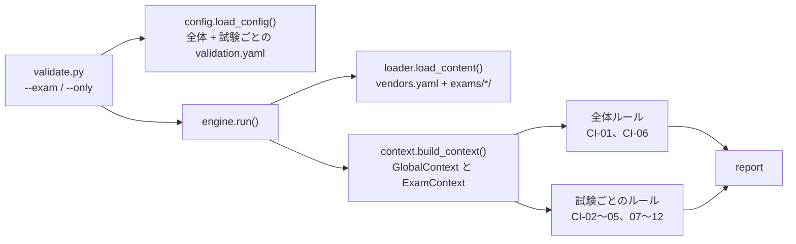

# Cloudrill 詳細設計書 P0: 複数試験に対応したコンテンツ基盤

| 項目 | 内容 |
|---|---|
| 文書バージョン | 0.1(初版ドラフト) |
| 作成日 | 2026-10-21 |
| 上位文書 | [詳細設計書(索引・共通設計)](../DDD.md) |
| 対象 | `content/`(Schema、検証ツール、fixture、コンテンツ)、`packages/DomainModels`、名称の変更 |
| ステータス | レビュー待ち |

---

## 目次

1. [目的とスコープ](#1-目的とスコープ)
2. [前提](#2-前提)
3. [設計](#3-設計)
4. [ステップ](#4-ステップ)
5. [フェーズの完了条件](#5-フェーズの完了条件)
6. [申し送り](#6-申し送り)

---

## 1. 目的とスコープ

コンテンツが数問しかない今のうちに、データ構造と検証ツールを「複数の試験(他ベンダーを含む)」を前提にした形へ移行する。あわせて、コード上の識別子を新しい名称の方針([DDD 3 章](../DDD.md#3-名称))に合わせる。

| 区分 | 内容 |
|---|---|
| スコープ内 | 名称の変更。`content/exams/<examID>/` への移行。`exam.yaml` と `vendors.yaml` の導入。Schema の汎用化。`contentvalidate` の試験単位の実行。CI-12 の新設。fixture の2試験化。DomainModels の試験定義型。manifest の形式変更 |
| スコープ外 | パックのビルドと署名(P2)。アプリの画面(P4)。問題の作成と追加 |

このフェーズの終わりには、**試験ごとの分岐をコードに書かずに**、性質の異なる2つの fixture 試験(`test-alpha`、`test-beta`)と実際のコンテンツ(`gcp-pca`)が、すべての検証を通る状態になる。

---

## 2. 前提

- 既存のテストがすべて通る状態から始める。
  - `(cd content && .venv/bin/pytest)`
  - `swift test --package-path packages/DomainModels`
- 作業用のブランチは `feat/p0-multi-exam-content` とする。現在のブランチ(`chore/merge-pca-content`)の未コミットの変更は、先にコミットするかマージしておく。
- 本フェーズは破壊的な変更を含む(Schema の `$id`、Swift の公開 API、ディレクトリ構成)。合意済み([DDD 2 章 C-03〜C-05](../DDD.md#2-基本設計書からの変更点))。

---

## 3. 設計

### 3.1 ファイルの移動と統合

| 移行前 | 移行後 | ステップ |
|---|---|---|
| `content/scripts/pcavalidate/` | `content/scripts/contentvalidate/` | P0-S00 |
| `content/questions/`、`flashcards/`、`cases/`、`decisions/`、`drills/`、`docs/`、`exam-sets.yaml` | `content/exams/gcp-pca/` の下(相対パスは同じ) | P0-S03 |
| (なし) | `content/vendors.yaml`、`content/exams/gcp-pca/exam.yaml` | P0-S03 |
| `content/weights.yaml` | `exam.yaml` の `domains[].weight` に統合して削除 | P0-S05 |
| `content/validation.yaml` の `examGuide`、`examSet.questionCount` | `exam.yaml` に統合して削除 | P0-S04 |
| `content/validation.yaml` の `examSet.domainDistribution`、`caseQuestions`、`defaultAssignments` | `content/exams/gcp-pca/validation.yaml` へ移動 | P0-S04 |
| `content/schemas/weights.schema.json` | 削除 | P0-S05 |
| `content/tests/fixtures/valid/*` | `valid/vendors.yaml`、`valid/exams/test-alpha/`、`valid/exams/test-beta/` | P0-S03、P0-S07 |

### 3.2 Schema の変更

| Schema | 変更 | ステップ |
|---|---|---|
| すべて | `$id` を `https://examprep-content.invalid/schemas/<name>.schema.json` に変える | P0-S00 |
| `exam.schema.json`(新規) | [DDD 4.4](../DDD.md#44-試験定義examyaml) の全項目。すべてのオブジェクトに `additionalProperties: false` | P0-S01 |
| `vendors.schema.json`(新規) | `{ vendors: Vendor[] }`。`Vendor` は `id`、`name`、`trademarkNotice`(LocalizedText)、`defaultReferenceLicense`(License) | P0-S01 |
| `common.schema.json` | 下表のとおり汎用化する | P0-S02 |
| `exam-sets.schema.json` | `caseStudies` の `minItems: 2` と `maxItems: 2` を外し、`minItems: 0` にする(個数は CI-02 が `caseStudiesPerSet` と照合する) | P0-S02 |
| `question.schema.json` | `wafPillars` の要素を `WAFPillarID` にする | P0-S02 |
| `manifest.schema.json` | `formatVersion`(整数 ≥ 1)、`examID`、`keyID` を追加する。`signature` を削除する([DDD 2 章 C-06](../DDD.md#2-基本設計書からの変更点)) | P0-S02 |
| `weights.schema.json` | 削除する | P0-S05 |

`common.schema.json` の変更点:

| 定義 | 変更前 | 変更後 | 範囲の確認(Schema の外) |
|---|---|---|---|
| `Domain` | 1〜6 | `minimum: 1` だけ | CI-09(`exam.yaml` の `domains` に実在するか) |
| `SubObjective` | `^[1-6]\.[0-9]+$` | `^[0-9A-Za-z]+(\.[0-9A-Za-z]+)*$` | CI-09 |
| `QuestionID` | `^Q-[1-6]\.[0-9]+-[0-9]{4}$` | `^Q-[0-9A-Za-z]+(\.[0-9A-Za-z]+)*-[0-9]{4}$` | — |
| `CardID` | `^C-[1-6]\.[0-9]+-[0-9]{4}$` | `^C-[0-9A-Za-z]+(\.[0-9A-Za-z]+)*-[0-9]{4}$` | — |
| `ExamSetNumber` | 1〜6 | `minimum: 1` だけ | CI-02(`setCount` 以下か) |
| `CaseStudyID` | enum(4値) | `^[a-z][A-Za-z0-9]*$` | CI-09、CI-12 |
| `WAFPillar` | enum(6値) | `WAFPillarID` に改名。`^[a-z][A-Za-z0-9]*$` | CI-09 |
| `ExamID`(新規) | — | `^[a-z0-9]+(-[a-z0-9]+)*$` | CI-12(ディレクトリ名との一致) |
| `VendorID`(新規) | — | `^[a-z0-9]+(-[a-z0-9]+)*$` | CI-12(`vendors.yaml` に実在するか) |
| `QuestionKind`(新規) | `question.schema.json` の中の `kind` | `enum: [single, multiple]` を共通定義にする(`exam.yaml` の `format.questionKinds` からも参照するため) | — |

変更後の制約はどれも変更前より緩い(上位集合)。そのため、既存のコンテンツは Schema の変更だけでは違反にならない。厳しくなる部分は、すべてルール(CI-09、CI-12)で確認する。

### 3.3 contentvalidate の構成



| モジュール | 変更 |
|---|---|
| `model.py` | `Kind` に `EXAM = "exam"` と `VENDORS = "vendors"` を追加する。`WEIGHTS` を削除する(P0-S05)。`SourceDoc` に `exam_id: str \| None` を追加する(全体のファイルは `None`) |
| `loader.py` | `load_content(root)` は、`root/vendors.yaml` と `root/exams/*/` を探索する。試験ディレクトリの中の探索パターンは、既存の `_PATTERNS` をそのまま使う |
| `config.py` | 全体の設定(`Thresholds`)と、試験ごとの設定(`ExamSetPolicy`)に分ける。`load_exam_config(global_raw, exam_dir)` で、試験ごとの `validation.yaml` を深いマージ(後述)で重ねる |
| `context.py` | `Context` を `ExamContext` に改名し、試験ごとに作る。全体のファイルとすべての試験を持つ `GlobalContext` を追加する。`ExamContext.definition` は、`exam.yaml` から作る `ExamDefinitionView`(Schema 違反なら `None`) |
| `rules/__init__.py` | `Rule` に `scope: Scope`(`EXAM` / `GLOBAL`、既定は `EXAM`)を追加する |
| `engine.py` | 全体ルールを1回、試験ごとのルールを試験の数だけ実行する。結果は既存と同じく、重複を除いて並べ替える |
| `validate.py` | `--exam gcp-pca[,…]` を追加する。存在しない試験 ID は終了コード 2 |

**設定の深いマージ**: マッピング同士はキーごとに再帰的にマージし、それ以外(リストやスカラー)は試験側の値で置き換える。試験側にしかないキーも有効とし、未知のキーは `ConfigError` にする(typo の検出)。

```python
# contentvalidate/config.py(抜粋)
@dataclass(frozen=True)
class Thresholds:
    draft_min_sample: int
    position_count: int
    position_min: float
    position_max: float
    longest_max: float
    longest_count_ties: bool
    ngram: int
    jaccard_threshold: float
    weights_sum: float
    weights_tolerance: float
    link_timeout: float
    link_concurrency: int
    link_user_agent: str
    link_retry_get_on: frozenset[int]


@dataclass(frozen=True)
class ExamSetPolicy:
    # (対象ドメインの組, 期待数)。例: ((5, 6), 13)
    domain_distribution: tuple[tuple[tuple[int, ...], int], ...]
    case_min: int
    case_max: int
    default_assignments: dict[int, DefaultAssignment]


@dataclass(frozen=True)
class ExamConfig:
    exam_id: str
    thresholds: Thresholds
    # 試験ごとの validation.yaml に examSet がなければ None(模試の構成チェックを省略する)
    exam_set_policy: ExamSetPolicy | None


def load_config(path: Path) -> GlobalConfig: ...
def load_exam_config(global_config: GlobalConfig, exam_dir: Path) -> ExamConfig: ...
```

```python
# contentvalidate/context.py(抜粋)
@dataclass(frozen=True)
class ExamDefinitionView:
    """exam.yaml(Schema 適合済み)から、ルールが使う値を取り出したもの。"""

    exam_id: str
    vendor: str
    guide_version: str
    domain_ids: tuple[int, ...]
    domain_weights: dict[int, float]
    sub_objective_domain: dict[str, int]  # サブ項目 ID → ドメイン番号
    question_kinds: frozenset[str]
    mock_question_count: int
    mock_set_count: int
    case_studies_per_set: int
    features: dict[str, bool]
    case_study_ids: tuple[str, ...]
    waf_pillar_ids: frozenset[str]


@dataclass
class ExamContext:
    exam_id: str
    root: Path
    config: ExamConfig
    definition: ExamDefinitionView | None
    vendor_ids: frozenset[str]
    docs: list[SourceDoc]  # この試験のファイルだけ
    # questions、question_by_id、exam_sets などの cached_property は既存のまま
```

- `ExamContext.definition` が `None`(`exam.yaml` が Schema 違反または欠落)の場合、試験定義を使うルールは、その試験について何も報告しない。原因は CI-01 が報告する(既存の「違反の連鎖を防ぐ」方針)。
- `ExamDefinitionView` を作るのは `context.py` だけにする。ルールは `exam.yaml` の生データを直接読まない。

### 3.4 CI-12「試験定義の整合」

`rules/ci12_exam_definition.py`。試験ごとに実行する(`scope=EXAM`)。

| No. | 条件 | 深刻度 | 報告する位置 |
|---|---|---|---|
| 1 | `exam.yaml` の `id` が、ディレクトリ名と一致する | error | `exam.yaml` の `id` |
| 2 | `vendor` が `vendors.yaml` に実在する | error | `exam.yaml` の `vendor` |
| 3 | `domains[].id` が 1 から始まる連番である | error | `exam.yaml` の `domains` |
| 4 | サブ項目 ID が試験の中で一意である | error | 2件目のサブ項目 |
| 5 | `caseStudies` と、`cases/*.yaml` の `id` の集合が一致する | error | 欠けている側(`exam.yaml` またはケースのファイル) |
| 6 | `features.caseStudies: false` のとき、`cases/` が空、問題の `caseStudy` がすべて `null`、模試の `caseStudies` が空である | error | 該当するファイル |
| 7 | `features.<機能>: false` のとき、その機能のファイル(`decisions/`、`drills/`、`flashcards/`、`docs/`)がない | error | 該当するファイル |
| 8 | 問題の `type.kind` が `format.questionKinds` に含まれる | error | 問題の `type.kind` |
| 9 | 問題の `examGuideVersion` が `guideVersion` と一致する(FR-CONT-04。不一致の問題を一括で列挙するために使う) | warning | 問題の `examGuideVersion` |

試験ガイドの改訂時は、`guideVersion` を上げてから `validate.py --exam <examID> --only CI-12 --format json` を実行すれば、見直しが必要な問題の一覧が得られる。

### 3.5 既存ルールの変更

| ルール | 変更 | ステップ |
|---|---|---|
| CI-01 | 全体ルールにする(`scope=GLOBAL`)。`subObjective` と `domain` の整合を、接頭辞の比較(`sub.split(".")[0]`)から `ExamDefinitionView.sub_objective_domain` の参照に変える。サブ項目が未定義の場合は CI-01 では報告しない(CI-09 が報告する) | P0-S05 |
| CI-02 | 問題数を `mock_question_count` から、配分とケース問題数を `ExamSetPolicy` から取る。新しい条件を2つ追加する: 模試の `caseStudies` の個数が `case_studies_per_set` と一致すること、模試の `id` が `mock_set_count` 以下であること。`exam_set_policy` が `None` の試験では、配分とケース問題数の確認だけを省略する | P0-S05 |
| CI-06 | 全体ルールにする。同じ URL を、試験をまたいで1回だけ確認する | P0-S05 |
| CI-07 | 重複の確認を試験の中に限定する(試験が異なれば同じ ID でもよい) | P0-S05 |
| CI-09 | サブ項目の実在を `exam.yaml` で確認する。新しい条件を3つ追加する: `domain` が `domain_ids` にある、`caseStudy` が `case_study_ids` にある、`wafPillars` の各値が `waf_pillar_ids` にある | P0-S05 |
| CI-10 | `weights.yaml` ではなく、`exam.yaml` の `domains[].weight` の合計を確認する | P0-S05 |

### 3.6 fixture の2試験

| 項目 | `test-alpha` | `test-beta` |
|---|---|---|
| 目的 | 既存の valid fixture を移したもの(PCA と同じ形) | 「PCA と違う形の試験」を、コードを変えずに扱えることを確かめる |
| ベンダー | `google-cloud` | `example-cloud`(fixture の `vendors.yaml` だけにある架空のベンダー) |
| ドメイン | 6(既存と同じ比重) | 4(0.30 / 0.30 / 0.20 / 0.20) |
| サブ項目 ID | `1.1` など(既存と同じ) | `1.1`、`1.2`、`NET.1`、`NET.2`、`3.1`、`4.1`。**ドメイン2のサブ項目は、ドメイン番号で始まらない**(CI-01 が接頭辞で判定していないことを確かめるため) |
| 形式 | 120 分、模試 55 問、6 回まで、ケース 2 件/回、single と multiple | 90 分、模試 40 問、2 回まで、ケース 0 件/回、**single のみ** |
| 有効な機能 | すべて | `docs`、`flashcards` のみ(ケース、ツリー、ドリルは無効) |
| WAF の柱 | 6 種(既存と同じ) | 3 種(`resilience`、`efficiency`、`governance`) |
| 模試 | complete 1 回(55 問) | complete 1 回(40 問。配分は D1=12、D2=12、D3=8、D4=8) |
| seed | `SEED` | `SEED + 1` |

### 3.7 DomainModels の変更

| ファイル | 変更 |
|---|---|
| `Identifiers.swift`(新規) | 文字列 ID の型 `ExamID`、`VendorID`、`CaseStudyID`、`WAFPillarID` と、試験内 ID の組 `ExamScoped<ID>` |
| `ExamDefinition.swift`(新規) | `ExamDefinition`、`ExamFormat`、`MockExamFormat`、`CountRange`、`ScoringConfig`、`ScoringPolicyKind`、`DomainDefinition`、`SubObjectiveDefinition`、`ExamFeatures`、`ExamTaxonomies`、`TaxonomyEntry` |
| `Vendor.swift`(新規) | `Vendor`、`VendorsFile` |
| `Common.swift` | enum の `CaseStudyID` と `WAFPillar` を削除する |
| `Question.swift` | `wafPillars: [WAFPillarID]`。`QuestionType` の中の `private enum Kind` を、公開の `QuestionKind` として外に出し、`QuestionType.kind` を追加する |
| `ExamSet.swift` | `caseStudies` のコメントを「`caseStudiesPerSet` 個」に直す。`DomainWeights` を削除する |
| `Manifest.swift` | `formatVersion`、`examID`、`keyID` を追加し、`signature` を削除する |

```swift
// Identifiers.swift
/// 試験語彙(DDD 4.3 の②)の ID。値の妥当性は CI と ContentIntegrityChecker が確認するので、デコード時は空文字だけを拒否する。
public protocol StringIdentifier: RawRepresentable, Codable, Hashable, Sendable, Comparable,
    CustomStringConvertible, ExpressibleByStringLiteral where RawValue == String {
    init(rawValue: String)
}

extension StringIdentifier {
    public init(stringLiteral value: String) { self.init(rawValue: value) }
    public var description: String { rawValue }
    public static func < (lhs: Self, rhs: Self) -> Bool { lhs.rawValue < rhs.rawValue }

    public init(from decoder: any Decoder) throws {
        let container = try decoder.singleValueContainer()
        let value = try container.decode(String.self)
        guard !value.isEmpty else {
            throw DecodingError.dataCorruptedError(in: container, debugDescription: "ID が空です")
        }
        self.init(rawValue: value)
    }

    public func encode(to encoder: any Encoder) throws {
        var container = encoder.singleValueContainer()
        try container.encode(rawValue)
    }
}

public struct ExamID: StringIdentifier {
    public let rawValue: String
    public init(rawValue: String) { self.rawValue = rawValue }
}
// VendorID、CaseStudyID、WAFPillarID も同じ形

/// 試験の中でだけ一意な ID を、試験をまたいで扱うための組(DDD 4.7)。
public struct ExamScoped<ID: Hashable & Sendable>: Hashable, Sendable {
    public var examID: ExamID
    public var id: ID
    public init(examID: ExamID, id: ID) {
        self.examID = examID
        self.id = id
    }
}
```

```swift
// ExamDefinition.swift(抜粋)
/// exam.schema.json(exam.yaml)
public struct ExamDefinition: Codable, Hashable, Sendable, Identifiable {
    public var id: ExamID
    public var vendor: VendorID
    public var name: LocalizedText
    public var shortName: String
    public var guideVersion: String
    public var guideURL: URL
    public var format: ExamFormat
    public var scoring: ScoringConfig
    public var domains: [DomainDefinition]
    public var features: ExamFeatures
    public var taxonomies: ExamTaxonomies
    public var caseStudies: [CaseStudyID]

    /// サブ項目 ID → ドメイン番号。CI-12 で一意性を確認済みであることを前提にする。
    public var domainBySubObjective: [String: Int] { … }
}

public struct ExamFormat: Codable, Hashable, Sendable {
    public var durationMinutes: Int
    public var officialQuestionCount: CountRange
    public var questionKinds: [QuestionKind]
    public var mockExam: MockExamFormat
}

/// exam.yaml の scoring.policy(DDD 4.3 の①)
public enum ScoringPolicyKind: String, Codable, Hashable, Sendable {
    case allOrNothing
}

public struct ExamFeatures: Codable, Hashable, Sendable {
    public var caseStudies: Bool
    public var docs: Bool
    public var flashcards: Bool
    public var decisionTrees: Bool
    public var keywordDrills: Bool
}
```

`ExamFeatures` に機能を追加するとき([DDD 4.10 D](../DDD.md#d-新しい学習機能コンテンツの種別を追加する))は、`decodeIfPresent(...) ?? false` でデコードし、フラグのない古い `exam.json` も読めるようにする。

---

## 4. ステップ

### P0-S00 名称の変更

| 項目 | 内容 |
|---|---|
| 対応要件 | [DDD 3 章](../DDD.md#3-名称)、C-13 |
| 前提 | なし |
| 成果物 | `content/scripts/contentvalidate/`(`git mv`)、全 Schema の `$id`、`contentvalidate/schemas.py`、`validation.yaml` の `userAgent`、`validate.py` と `pyproject.toml` の説明文、`ExamPrepApp/`、`ExamPrepApp.xcodeproj`、README、`content/README.md`、CLAUDE.md |

**Red**: 次のテストを追加・変更し、失敗することを確認する。

| テスト | 条件(Arrange) | 期待(Assert) |
|---|---|---|
| `tests/` の全ファイルの import | `from pcavalidate…` を `from contentvalidate…` に書き換える | `ModuleNotFoundError` で失敗する(パッケージがまだ旧名のため) |
| `test_schemas.py::test_schema_ids_use_examprep_domain`(新規) | `content/schemas/*.schema.json` をすべて読む | すべての `$id` が `https://examprep-content.invalid/schemas/` で始まる(現在は失敗する) |
| `test_cli.py::test_link_check_user_agent`(新規) | 既定の `validation.yaml` を読む | `link_user_agent == "examprep-content-link-check/1.0"` |

**Green**:

1. `git mv content/scripts/pcavalidate content/scripts/contentvalidate` を実行し、`validate.py` と `export_json.py` の import を直す。
2. 全 Schema の `$id` と `schemas.py` の基底 URL を置き換える。
3. `validation.yaml` の `userAgent` と、`pyproject.toml` の `name`(`examprep-content`)・`description`、`validate.py` の説明文を直す。
4. **Xcode の操作**(`project.pbxproj` は手で編集しない):
   1. `PCAApp.xcodeproj` を Xcode で開く。
   2. プロジェクトナビゲータでプロジェクト名をクリックして `ExamPrepApp` に変更し、確認のダイアログで、ターゲットなど関連する項目をすべて名前変更の対象にする。
   3. **Product > Scheme > Manage Schemes…** で、スキーム名を `ExamPrepApp` に変更する。
   4. ソースフォルダ(同期フォルダ)`PCAApp` を、プロジェクトナビゲータ上で `ExamPrepApp` に名前変更する(ディスク上のフォルダ名も変わる)。
   5. ターゲットの Build Settings で、`INFOPLIST_KEY_CFBundleDisplayName` を `Cloudrill` に変更する。
   6. `MyApp.swift` を `ExamPrepApp.swift` に名前変更し、`@main struct MyApp` を `@main struct ExamPrepApp` に変更する。
   7. ローカルパッケージ `packages/DomainModels` への参照が残っていることを、**Package Dependencies** で確認する。
5. README、`content/README.md`、CLAUDE.md の名称、パス、コマンドを直す。

**Refactor**: 旧名がコメントや文字列に残っていないかを grep で確認する。

**完了条件**:

```sh
(cd content && .venv/bin/pytest)                            # すべて通る
swift test --package-path packages/DomainModels             # すべて通る
xcodebuild -project ExamPrepApp.xcodeproj -scheme ExamPrepApp \
  -destination 'generic/platform=iOS Simulator' build       # BUILD SUCCEEDED
git grep -n -I -e pcavalidate -e pca-content -e PCAApp -e MyApp -- ':!Documentation.docc'   # 0 件
```

---

### P0-S01 試験定義とベンダー定義の Schema

| 項目 | 内容 |
|---|---|
| 対応要件 | [DDD 4.4](../DDD.md#44-試験定義examyaml)、[4.5](../DDD.md#45-ベンダー定義vendorsyaml)、LG-04 |
| 前提 | P0-S00 |
| 成果物 | `content/schemas/exam.schema.json`、`content/schemas/vendors.schema.json`、`common.schema.json` への `ExamID`・`VendorID`・`QuestionKind` の追加、`contentvalidate/schemas.py` の登録、`tests/test_schemas.py` |

**Red**: `test_schemas.py` に次のテストを追加する。インスタンスはテストの中に辞書で書く(fixture にはまだ追加しない)。

| テスト | 条件(Arrange) | 期待(Assert) |
|---|---|---|
| `test_exam_schema_accepts_minimal_definition` | ドメイン1つ、サブ項目1つ、機能はすべて `false`、`caseStudies: []` | 違反なし |
| `test_exam_schema_accepts_pca_definition` | [DDD 4.4](../DDD.md#44-試験定義examyaml) の例(6 ドメイン) | 違反なし |
| `test_exam_schema_rejects_numeric_guide_version` | `guideVersion: 6.1`(数値) | 違反あり(`guideVersion` の型) |
| `test_exam_schema_rejects_unknown_key` | `domains[0]` に `wieght` | 違反あり(`additionalProperties`) |
| `test_exam_schema_rejects_bad_exam_id` | `id: "GCP_PCA"` | 違反あり(pattern) |
| `test_exam_schema_rejects_unknown_question_kind` | `questionKinds: [single, ordering]` | 違反あり(enum) |
| `test_exam_schema_rejects_weight_out_of_range` | `weight: 1.5` | 違反あり(maximum) |
| `test_exam_schema_rejects_negative_cases_per_set` | `caseStudiesPerSet: -1` | 違反あり(minimum) |
| `test_vendors_schema_accepts_vendor` | [DDD 4.5](../DDD.md#45-ベンダー定義vendorsyaml) の例 | 違反なし |
| `test_vendors_schema_requires_trademark_notice_ja` | `trademarkNotice: { en: … }` | 違反あり(`ja` が必須) |
| `test_vendors_schema_rejects_empty_list` | `vendors: []` | 違反あり(`minItems: 1`) |

**Green**: 2つの Schema を追加し、`schemas.py` の `validator_for_kind` から引けるようにする(`Kind.EXAM`、`Kind.VENDORS` は P0-S03 で追加するので、この時点では Schema の名前で引く関数だけを用意する)。

**Refactor**: `exam.schema.json` の中で繰り返す構造(名前付きの項目 `{ id, name }`)を `$defs/NamedEntry` にまとめる。

**完了条件**: `(cd content && .venv/bin/pytest tests/test_schemas.py)` が通る。

---

### P0-S02 共通 Schema の汎用化と manifest の変更

| 項目 | 内容 |
|---|---|
| 対応要件 | [3.2](#32-schema-の変更)、C-05、C-06 |
| 前提 | P0-S01 |
| 成果物 | `common.schema.json`、`exam-sets.schema.json`、`question.schema.json`、`manifest.schema.json`、`tests/test_schemas.py` |

**Red**:

| テスト | 条件(Arrange) | 期待(Assert) |
|---|---|---|
| `test_question_schema_accepts_non_numeric_sub_objective` | `subObjective: "NET.1"`、`id: "Q-NET.1-0001"` | 違反なし(現在は違反になる) |
| `test_question_schema_accepts_domain_above_six` | `domain: 7` | 違反なし |
| `test_question_schema_accepts_custom_case_study_id` | `caseStudy: "acmeBank"` | 違反なし |
| `test_question_schema_accepts_custom_waf_pillar` | `wafPillars: [resilience]` | 違反なし |
| `test_question_schema_rejects_bad_case_study_id` | `caseStudy: "Acme Bank"` | 違反あり(pattern) |
| `test_exam_sets_schema_accepts_zero_case_studies` | `caseStudies: []` | 違反なし |
| `test_manifest_schema_requires_exam_id_and_format_version` | 既存の manifest の正例から `examID` を除く | 違反あり |
| `test_manifest_schema_rejects_signature_field` | `signature` を含める | 違反あり(`additionalProperties`) |

既存の負例のうち、意味が変わるもの(`domain: 7` を拒否する、など)は、期待を反転させるか削除する。削除するときは、同じ条件を P0-S05 のルールのテストで確認することを、テストのコメントに書く。

**Green**: [3.2](#32-schema-の変更) の表のとおりに Schema を変更する。

**Refactor**: パターンの重複(サブ項目の正規表現)を、`common.schema.json` の `SubObjective` から組み立てられないかを検討する。JSON Schema では正規表現を合成できないので、合成できない場合は、3つのパターンの関係をコメントに書いておく。

**完了条件**: `(cd content && .venv/bin/pytest)` が通る。`validate.py` の結果が変わらない(既存のコンテンツは引き続き error 0 件)。

---

### P0-S03 ディレクトリ構成の移行

| 項目 | 内容 |
|---|---|
| 対応要件 | [DDD 4.6](../DDD.md#46-コンテンツのディレクトリ構成p0-の完了後)、C-04 |
| 前提 | P0-S02 |
| 成果物 | `contentvalidate/model.py`、`contentvalidate/loader.py`、`tests/test_loader.py`(新規)、`tests/fixtures/generate.py`、再生成した fixture、`content/exams/gcp-pca/`、`content/vendors.yaml` |

このステップは、途中の状態ではテストが通らないため、**1つのコミットにまとめる**。

**Red**: `tests/test_loader.py` を追加する。各テストは `tmp_path` の中に最小のファイル構成を作る。

| テスト | 条件(Arrange) | 期待(Assert) |
|---|---|---|
| `test_loader_two_exams_assigns_exam_id` | `exams/a/` と `exams/b/` に問題を1つずつ置く | 各 `SourceDoc.exam_id` が `"a"`、`"b"` になる |
| `test_loader_vendors_is_global` | `vendors.yaml` を置く | `kind is Kind.VENDORS`、`exam_id is None` |
| `test_loader_missing_exam_yaml_is_reported` | `exams/a/exam.yaml` がない | CI-01 の error「必須ファイル exam.yaml がありません」(ファイルは `exams/a/exam.yaml`) |
| `test_loader_missing_vendors_is_reported` | `vendors.yaml` がない | CI-01 の error |
| `test_loader_no_exams_is_reported` | `exams/` が空 | CI-01 の error「試験がありません」 |
| `test_loader_ignores_exam_validation_yaml` | `exams/a/validation.yaml` を置く | `SourceDoc` にならない(設定ファイルのため) |
| `test_loader_paths_are_relative_to_root` | `exams/a/questions/domain1/Q-1.1-0001.yaml` | `path == "exams/a/questions/domain1/Q-1.1-0001.yaml"` |

さらに、`generate.py` の出力先を新しい構成に変えると、`test_generated.py` がコミット済みの fixture との不一致で失敗することを確認する。

**Green**:

1. `model.py` に `Kind.EXAM` と `Kind.VENDORS` を追加し、`SourceDoc` に `exam_id` を追加する。
2. `loader.py` を変更する。
   - 試験ディレクトリごとに既存の `_PATTERNS` を適用する。
   - 必須ファイルを、全体(`vendors.yaml`)と試験ごと(`exam.yaml`、`exam-sets.yaml`)に分ける。
   - この時点では、`weights.yaml` も試験ごとの必須ファイルのままにする(P0-S05 で削除する)。
3. `generate.py` を変更する。
   - valid を `vendors.yaml` と `exams/test-alpha/` に出力する。
   - invalid の overlay のパスに、接頭辞 `exams/test-alpha/` を付ける(`ALPHA = "exams/test-alpha"` を定数にする)。
   - `exam.yaml` を生成する。中身は、既存の `SUB_OBJECTIVES`、`PILLARS`、比重から作る。
4. fixture を再生成する(`content/.venv/bin/python content/tests/fixtures/generate.py`)。
5. 実際のコンテンツを移動する。
   - `git mv` で、`content/{questions,flashcards,cases,decisions,drills,docs}` と `exam-sets.yaml`、`weights.yaml` を `content/exams/gcp-pca/` に移す。
   - `content/exams/gcp-pca/exam.yaml` を作る。中身は、`validation.yaml` の `examGuide` と `weights.yaml`、RDD 2.1・2.2 の値から作る。ドメイン名の日本語は RDD 2.2 の英語名から訳し、公式ガイドとの照合が必要であることを示す `# 暫定` のコメントを付ける。
   - `content/vendors.yaml` を作る。
6. `export_json.py` を実行して、valid-json を再生成する(まだ形式は変えない。P0-S08 で対応する)。

**Refactor**: `loader.py` の必須ファイルの定義を、全体と試験ごとの2つのタプルに整理する。

**完了条件**:

```sh
(cd content && .venv/bin/pytest)                                  # すべて通る
content/.venv/bin/python content/scripts/validate.py              # error 0 件(パスが exams/gcp-pca/… になる)
git status --short content | grep -c '^R'                         # 移動したファイルが rename として検出されている
```

---

### P0-S04 設定の階層化

| 項目 | 内容 |
|---|---|
| 対応要件 | [3.3](#33-contentvalidate-の構成)、[DDD 4.3](../DDD.md#43-語彙の3つの層) の③ |
| 前提 | P0-S03 |
| 成果物 | `contentvalidate/config.py`、`content/validation.yaml`、`content/exams/gcp-pca/validation.yaml`、`tests/fixtures/valid/exams/*/validation.yaml`(generate.py で生成)、`tests/test_config.py`(新規) |

**Red**:

| テスト | 条件(Arrange) | 期待(Assert) |
|---|---|---|
| `test_exam_config_overrides_global_threshold` | 全体 `answerPosition.maxRatio: 0.30`、試験 `answerPosition.maxRatio: 0.35` | `thresholds.position_max == 0.35` |
| `test_exam_config_merges_nested_mapping` | 試験側に `longestChoice.maxRatio` だけを書く | `longest_count_ties` は全体の値のまま |
| `test_exam_config_replaces_list` | 全体 `links.retryWithGetOn: [405]`、試験 `[405, 403]` | `frozenset({405, 403})` |
| `test_exam_config_without_exam_set_policy` | 試験側に `examSet` がない | `exam_set_policy is None` |
| `test_exam_config_domain_key_accepts_any_positive_int` | `domainDistribution: { "7": 3 }` | エラーにならない(1〜6 の固定判定がないこと) |
| `test_exam_config_rejects_unknown_key` | 試験側に `answerPositon:`(typo) | `ConfigError` |
| `test_exam_config_rejects_zero_domain` | `domainDistribution: { "0": 3 }` | `ConfigError` |
| `test_global_config_rejects_exam_guide_section` | 全体に `examGuide` が残っている | `ConfigError`(`exam.yaml` へ移行済みであることを示すメッセージ) |
| `test_cli_bad_exam_config_exits_2` | 試験の `validation.yaml` が不正 | `validate.py` の終了コードが 2 |

**Green**:

1. `Config` を `Thresholds`、`ExamSetPolicy`、`ExamConfig` に分ける。
2. `load_config` と `load_exam_config` を実装する。`_parse_domains` の `1 <= d <= 6` は `d >= 1` に変える。
3. `content/validation.yaml` から `examGuide` と `examSet` を削除し、`examSet` の内容を `content/exams/gcp-pca/validation.yaml` に移す(`questionCount` は `exam.yaml` にあるので移さない)。
4. `generate.py` で、fixture の試験ごとの `validation.yaml` を出力する。

ルール(CI-02、CI-09)は、この時点ではまだ旧い設定項目を参照しているので、一時的に `ExamConfig` からの読み替えを `context.py` に置く。読み替えは P0-S05 で削除する。

**Refactor**: 型の検査(`_num`、`_int` など)の重複を整理する。既存の厳密な型検査(bool を数値として扱わない、など)は維持する。

**完了条件**: `(cd content && .venv/bin/pytest)` が通り、`validate.py` が error 0 件。

**実装メモ**(実装時に本書と変えた点。1〜2 項目めは P0-S05 で解消済み):

- `ExamContext` の導入前なので、`Context` に試験ごとの設定(`exam_config(exam_id)`)と、`exam.yaml` のサブ項目(`sub_objectives(exam_id)`)の読み替えを置いた。CI-02 の問題数も `exam.yaml` の `format.mockExam.questionCount` から読む。
- CI-07 の類似度はまだ試験をまたいで比較しているため、全体の閾値を使う。
- 全体の設定に `examSet` があっても `ConfigError` にする(試験ごとの設定にだけ書ける)。
- P0-S08 の `export()` での `validation.yaml` の除外と `test_export_skips_validation_yaml` を先に実装した(fixture に試験ごとの `validation.yaml` が入り、valid-json に `validation.json` が出力されるため)。

---

### P0-S05 試験ごとの検証コンテキストと既存ルールの移行

| 項目 | 内容 |
|---|---|
| 対応要件 | [3.3](#33-contentvalidate-の構成)、[3.5](#35-既存ルールの変更)、FR-EXAM-01、AC-06 |
| 前提 | P0-S04 |
| 成果物 | `contentvalidate/context.py`、`engine.py`、`rules/__init__.py`、`rules/ci01_schema.py`、`ci02_exam_sets.py`、`ci06_links.py`、`ci07_duplicates.py`、`ci09_references.py`、`ci10_weights.py`、`validate.py`、`generate.py` の `INVALID_CASES`、`weights.schema.json` と `weights.yaml` の削除 |

**Red**: `generate.py` の `INVALID_CASES` に次の違反ケースを追加して fixture を再生成し、`test_rules.py` の `test_invalid_case_detects_only_expected_rules` で失敗することを確認する。

| invalid ケース | overlay の内容 | 期待するルール |
|---|---|---|
| `CI-01-domain-mismatch`(既存を更新) | `subObjective: "2.1"` の問題に `domain: 1` | CI-01 error(`exam.yaml` の対応表で判定する) |
| `CI-02-cases-per-set` | 模試の `caseStudies` を1つにする | CI-02 error |
| `CI-02-set-number-range` | `id: 7` の模試を追加する(`setCount: 6`) | CI-02 error |
| `CI-09-unknown-domain` | `domain: 7` の問題 | CI-09 error |
| `CI-09-unknown-case-study` | `caseStudy: acmeBank` の問題 | CI-09 error |
| `CI-09-unknown-waf-pillar` | `wafPillars: [resilience]` の問題 | CI-09 error |
| `CI-10-weights-sum`(既存を更新) | `exam.yaml` の比重の合計を 0.985 にする | CI-10 error |

あわせて、次の単体テストを追加する。

| テスト | 条件(Arrange) | 期待(Assert) |
|---|---|---|
| `test_cli_exam_option_limits_exams` | 試験が2つある構成で `--exam a` | 試験 b のファイルの検出結果が出ない |
| `test_cli_unknown_exam_exits_2` | `--exam nope` | 終了コード 2 |
| `test_link_check_dedupes_across_exams` | 2つの試験で同じ URL を参照する | HEAD が1回だけ送られ、検出結果は両方の出現箇所に出る |
| `test_rules_skip_when_exam_definition_invalid` | `exam.yaml` が Schema 違反 | CI-01 だけが報告され、CI-02・09・10・12 は何も報告しない |

**Green**:

1. `context.py` に `GlobalContext`、`ExamContext`、`ExamDefinitionView` を実装し、P0-S04 の一時的な読み替えを削除する。
2. `Rule` に `scope` を追加し、CI-01 と CI-06 を `GLOBAL` にする。
3. `engine.run()` を、全体ルールを1回、試験ごとのルールを試験の数だけ実行する形に変える。
4. 各ルールを [3.5](#35-既存ルールの変更) のとおりに変更する。
5. `Kind.WEIGHTS`、`weights.schema.json`、`content/exams/gcp-pca/weights.yaml`、fixture の `weights.yaml` を削除する。
6. `validate.py` に `--exam` を追加する。

**Refactor**: ルールの中で `ctx.definition is None` を確認する処理が重複するので、`ExamContext.require_definition()`(`None` なら空のイテレータを返すための補助)にまとめる。

**完了条件**:

```sh
(cd content && .venv/bin/pytest)                                       # すべて通る
content/.venv/bin/python content/scripts/validate.py                   # error 0 件
content/.venv/bin/python content/scripts/validate.py --exam gcp-pca --format json | python3 -c 'import json,sys; assert all(i["file"].startswith("exams/gcp-pca/") or "/" not in i["file"] for i in json.load(sys.stdin))'
```

**実装メモ**(実装時に本書と変えた点):

- ユーザーの判断により、P0-S09 の一部を前倒しした。Schema の試験語彙の固定(`Domain` の上限、`CaseStudyID`・`WAFPillarID` の列挙)を外すと Swift の enum と食い違い、`weights.yaml` を消すと `DomainWeights` のテストが壊れるため、同じ変更で次を行った: `Identifiers.swift`(`StringIdentifier`、`ExamID`、`VendorID`、`CaseStudyID`、`WAFPillarID`、`ExamScoped`)と `IdentifierTests`、enum の `CaseStudyID`・`WAFPillar` と `DomainWeights` の削除、`Exam`・`Vendor`・`Manifest` の ID の型付け。P0-S09 に残るのは、`ExamDefinition` などへの改名、`QuestionKind` の統合、`domainBySubObjective`、`ExamDefinitionTests`、試験ごとの fixture の列挙。
- `Rule` の `scope` は、`check`(`ExamContext` を取る)と `check_global`(`GlobalContext` を取る)のどちらを持つかで決まる(型の安全のため、`scope` を別の引数にしていない)。
- CI-11 も全体のルールにした。`vendors.yaml` の `trademarkNotice` など、試験に属さないファイルの英語訳も確認するため。
- CI-01 は、`domain` が `exam.yaml` にない場合も整合を確認しない(CI-09 だけが報告する。二重報告の防止)。
- invalid ケースの名前は既存のものを使った(`CI-02-cases-per-set` → `CI-02-case-studies-per-set`、`CI-02-set-number-range` → `CI-02-set-count`)。`CI-10-exam-weights` は `weights.yaml` との照合がなくなったので削除した。`CI-02-case-mismatch` は、ケースが `exam.yaml` にないと CI-09 も検出するため、overlay で `cymbal` を `exam.yaml` とケースのファイルに追加した。
- `ExamContext.require_definition()` は作らず、各ルールで `ctx.definition is None` なら早期リターンする形にした(補助関数より読みやすいため)。

---

### P0-S06 CI-12「試験定義の整合」の新設

| 項目 | 内容 |
|---|---|
| 対応要件 | [3.4](#34-ci-12試験定義の整合)、FR-CONT-04 |
| 前提 | P0-S05 |
| 成果物 | `rules/ci12_exam_definition.py`、`rules/__init__.py`、`generate.py` の `INVALID_CASES`、`content/README.md` のルール一覧 |

**Red**: `INVALID_CASES` に次のケースを追加する。既存の `test_every_rule_has_an_invalid_case` は、CI-12 のケースがない状態で失敗する。

| invalid ケース | overlay の内容 | 期待するルール |
|---|---|---|
| `CI-12-exam-id-mismatch` | `exam.yaml` の `id: test-gamma` | CI-12 error(条件 1) |
| `CI-12-unknown-vendor` | `vendor: nowhere` | CI-12 error(条件 2) |
| `CI-12-domain-not-contiguous` | ドメイン 3 を削除し、比重を調整する | CI-12 error(条件 3)。ドメイン 3 の問題は CI-09 も検出する |
| `CI-12-duplicate-sub-objective` | 2つのドメインに `1.1` を置く | CI-12 error(条件 4) |
| `CI-12-case-list-mismatch` | `exam.yaml` の `caseStudies` から `cymbal` を外す | CI-12 error(条件 5)。`cymbal` を参照する問題は CI-09 も検出する |
| `CI-12-guide-version-mismatch` | 問題1つの `examGuideVersion: "6.0"` | CI-12 warning(条件 9) |

条件 6〜8 のケースは、`test-beta`(ケースなし、single のみ)の上で作るのが自然なので、P0-S07 で追加する。

**Green**: CI-12 を実装し、`ALL_RULES` に追加する。

**Refactor**: 「機能のフラグとディレクトリ」の対応表を定数にして、条件 6・7 を表で回すようにする(機能を追加するときは、表に1行足せばよい)。

```python
# 機能のフラグ → その機能のコンテンツの種別
FEATURE_KINDS: dict[str, Kind] = {
    "caseStudies": Kind.CASE,
    "decisionTrees": Kind.DECISION,
    "keywordDrills": Kind.DRILL,
    "flashcards": Kind.FLASHCARD,
    "docs": Kind.DOCS,
}
```

**完了条件**: `(cd content && .venv/bin/pytest)` が通り、`validate.py` が error 0 件。`validate.py --only CI-12` で、`gcp-pca` の版の不一致が warning で列挙される(問題がすべて 6.1 なら 0 件)。

**実装メモ**(実装時に本書と変えた点):

- 条件 1(`id` とディレクトリ名の一致)は先に CI-01 に実装していたので、CI-12 に移した。invalid ケースは `CI-01-exam-id-mismatch` から `CI-12-exam-id-mismatch` に改名した。
- `CI-12-case-list-mismatch` は、`test-alpha` のケースが `ehr` と `altostrat` だけなので、「`caseStudies` から `cymbal` を外す」ではなく「`caseStudies` にない `cases/cymbal.yaml` を置く」(条件 5 の逆方向)で作った。
- 条件 2 は、`vendors.yaml` が欠落または Schema 違反のときは確認しない(誤報の防止。原因は CI-01 が報告する)。条件 5 は、Schema 違反のケースのファイルも ID が読めれば数える(欠落の誤報の防止)。
- CI-12 の導入で、`gcp-pca` の `caseStudies` に `cases/` のないケースが 3 件(`altostrat`・`cymbal`・`knightMotives`)あることが分かった。ユーザーの判断で、`caseStudies` を `[ehr]` に絞った(ケースを作成したら戻す)。模試 1(draft)の `caseStudies: [ehr, altostrat]` を検出するルールは当時なかった。後のレビュー対応で、CI-09 が模試の `caseStudies` も `exam.yaml` と照合するようにし、`gcp-pca` の模試 1 を `[ehr]`、`caseStudiesPerSet` を暫定で 1 にした(ケースを追加したら戻す)。
- Refactor の `FEATURE_KINDS` は、使う条件 6・7 と一緒に P0-S07 で作る。

---

### P0-S07 2つ目の fixture 試験(拡張性の受け入れテスト)

| 項目 | 内容 |
|---|---|
| 対応要件 | [DDD 4.1 X-06](../DDD.md#41-拡張性の設計方針) |
| 前提 | P0-S06 |
| 成果物 | `generate.py`(`build_beta()`)、`tests/fixtures/valid/exams/test-beta/`、`tests/test_extensibility.py`(新規) |

**Red**:

| テスト | 条件(Arrange) | 期待(Assert) |
|---|---|---|
| `test_valid_fixture_passes_all_rules`(既存) | `test-beta` を含む valid | error・warning ともに 0 件 |
| `test_extensibility.py::test_each_exam_fixture_is_validated` | valid の各試験を `--exam` で1つずつ検証する | どの試験も 0 件。各試験で、模試が1つ以上検査されている(CI-02 の対象数を `ExamContext` から確認する) |
| `test_extensibility.py::test_validator_has_no_exam_specific_literals` | `contentvalidate/**/*.py` の全ソース | `gcp-pca`、`test-alpha`、`test-beta`、`ehr`、`altostrat`、`cymbal`、`knightMotives` を文字列として含まない |
| `test_extensibility.py::test_same_id_in_other_exam_is_allowed` | `test-beta` に、`test-alpha` と同じ ID の問題を置く(`tmp_path` に valid を複製して変更する) | CI-07 が何も検出しない(ID の一意性は試験の中だけ) |
| `CI-12-beta-case-disabled` | `test-beta` の問題に `caseStudy: ehr` | CI-12 error(条件 6)。CI-09 も検出する |
| `CI-12-beta-feature-disabled` | `test-beta` に `drills/keywords.yaml` を置く | CI-12 error(条件 7) |
| `CI-12-beta-kind-not-allowed` | `test-beta` に multiple の問題 | CI-12 error(条件 8) |
| `CI-01-beta-domain-mismatch` | `subObjective: "NET.1"` に `domain: 1` | CI-01 error |
| `CI-02-beta-distribution` | `test-beta` の模試のドメイン配分を崩す | CI-02 error |

**Green**: `generate.py` に `build_beta()` を追加し、[3.6](#36-fixture-の2試験) の仕様で `test-beta` を生成する。fixture の `vendors.yaml` に `example-cloud` を追加する。テストが失敗した場合は、**試験ごとの分岐を足すのではなく**、その値をコードに書いていた箇所を `ExamDefinitionView` か `ExamConfig` から取るように直す。

**Refactor**: `build_valid()` と `build_beta()` で共通する部分(問題の生成、カードの生成)を、試験の仕様(ドメイン、サブ項目、出題形式)を引数に取る関数にまとめる。

**完了条件**: `(cd content && .venv/bin/pytest)` が通る。`git diff --stat` で、`contentvalidate/` の変更が「値をコードから定義へ移す」ものだけであることをレビューで確認する。

**実装メモ**(実装時に本書と変えた点):

- `test-beta` は、検証ツールのコードを変えずに valid のまま全ルールを 0 件で通った。`contentvalidate/` の変更は、CI-12 の条件 6〜8 と `FEATURE_KINDS` の追加だけ。
- Refactor は Green と同時に行った。`generate.py` に試験の仕様 `ExamSpec`(`ALPHA_SPEC`、`BETA_SPEC`)を置き、`build_exam_files(spec)` が両方の試験を作る。`test-alpha` の生成結果は変わっていない(バイト単位で同じ)。
- `test-beta` の上の invalid ケースは `BETA_INVALID_CASES` に分けた(overlay の基準が `test-beta` のファイルになるため)。
- `test_same_id_in_other_exam_is_allowed` は、valid の2試験に同じ問題 ID(例: `Q-1.1-0001`)が自然にあるので、valid をそのまま使って確かめる形にした。P0-S05 で追加した同じ趣旨のテストは削除した。2つ目の試験を複製するテスト(`--exam`、リンク確認)は、複製先を `test-gamma` に変えた。
- `test-beta` の `guideVersion` は `1.0`、`guideURL` は `https://example.com/certification/beta`(架空)。
- `features.caseStudies: false` の試験に `cases/*.yaml` があると、条件 5(`caseStudies` との不一致)と条件 7(無効な機能のファイル)の両方が報告される。どちらも CI-12 なので、まとめていない。

---

### P0-S08 Swift 用 JSON の出力の対応

| 項目 | 内容 |
|---|---|
| 対応要件 | CLAUDE.md の運用ルール(Schema と Swift 型の同期) |
| 前提 | P0-S07 |
| 成果物 | `content/scripts/export_json.py`、`tests/fixtures/valid-json/`、`tests/test_generated.py` |

**Red**:

| テスト | 条件(Arrange) | 期待(Assert) |
|---|---|---|
| `test_generated.py::test_valid_json_matches_export`(既存) | 再生成した valid-json とコミット済みの内容 | 一致する(P0-S03 以降、構成が変わっているので失敗する) |
| `test_generated.py::test_export_skips_validation_yaml`(新規) | valid に試験ごとの `validation.yaml` がある | valid-json に `validation.json` が出力されない |
| `test_generated.py::test_export_includes_exam_and_vendors`(新規) | valid | `valid-json/vendors.json`、`valid-json/exams/test-alpha/exam.json`、`valid-json/exams/test-beta/exam.json` がある |

**Green**: `export()` で `validation.yaml` を除外する。出力のディレクトリ構成は、valid と同じ(`valid-json/exams/<examID>/…`)にする。valid-json を再生成する。

**Refactor**: なし(変更が小さいため)。

**完了条件**: `(cd content && .venv/bin/pytest tests/test_generated.py)` が通る。

**実装メモ**(実装時に本書と変えた点):

- Green の内容は、先行するステップで実装済みだった。`exams/<examID>/…` の構成での出力は P0-S03、`validation.yaml` の除外と `test_export_skips_validation_yaml` は P0-S04。既存の `test_valid_json_matches_export` に相当するテストは `test_swift_fixtures_are_up_to_date`。
- このステップでは `test_export_includes_exam_and_vendors` だけを追加した。実装が先にあったので、Red の段階はない(追加した時点で通った)。

---

### P0-S09 DomainModels の試験定義型

| 項目 | 内容 |
|---|---|
| 対応要件 | [3.7](#37-domainmodels-の変更)、[DDD 4.3](../DDD.md#43-語彙の3つの層)、[DDD 4.7](../DDD.md#47-id-と一意性)、NFR-08 |
| 前提 | P0-S08 |
| 成果物 | `packages/DomainModels/Sources/DomainModels/` の各ファイル、`Tests/DomainModelsTests/FixtureDecodingTests.swift`、`CustomDecodingTests.swift`、`IdentifierTests.swift`(新規)、`ExamDefinitionTests.swift`(新規) |

**Red**:

| テスト | 条件(Arrange) | 期待(Assert) |
|---|---|---|
| `FixtureDecodingTests`(既存を変更) | `valid-json/exams/*/` を列挙し、試験ごとに全ファイルをデコードする(`@Test(arguments: examDirectories)`) | `test-alpha` と `test-beta` の両方で、すべてデコードできる |
| `FixtureDecodingTests.examDefinitionMatchesDirectory` | 各試験の `exam.json` | `definition.id.rawValue` がディレクトリ名と等しい |
| `FixtureDecodingTests.vendorsDecode` | `valid-json/vendors.json` | `google-cloud` と `example-cloud` を含む |
| `IdentifierTests.decodeFromString` | `"\"ehr\""` | `CaseStudyID(rawValue: "ehr")` |
| `IdentifierTests.rejectEmpty` | `"\"\""` | `DecodingError.dataCorrupted` |
| `IdentifierTests.encodeAsPlainString` | `ExamID("gcp-pca")` をエンコードする | `"\"gcp-pca\""`(オブジェクトにならない) |
| `IdentifierTests.examScopedEquality` | 試験が異なり、ID が同じ2つの `ExamScoped` | 等しくない |
| `ExamDefinitionTests.domainBySubObjective` | `test-beta` の `exam.json` | `["NET.1": 2, …]` |
| `ExamDefinitionTests.unknownScoringPolicyFails` | `scoring.policy: "partialCredit"` | デコードエラー(①の未知の値) |
| `ExamDefinitionTests.missingFeatureFlagDefaultsToFalse` | `features` から `keywordDrills` を除く | `features.keywordDrills == false` |
| `CustomDecodingTests.questionKindIsExposed` | `{"kind":"multiple","count":2}` | `type.kind == .multiple` |
| `CustomDecodingTests.manifestHasExamIDAndFormatVersion` | `formatVersion`、`examID`、`keyID` を持ち、`signature` を持たない manifest | デコードでき、各値が読める |
| `CustomDecodingTests.manifestRequiresExamID` | `examID` がない manifest | `DecodingError.keyNotFound` |

> Swift の `Codable` は、既定では未知のキーを無視する。古い形式の `signature` が残っているかどうかは、Schema(CI-01)と `PackVerifier`(P2-S05)で確認し、Swift のデコーダでは確認しない。

**Green**: [3.7](#37-domainmodels-の変更) のとおりに型を追加・変更する。既存の `CaseStudyID.ehr` などの enum の case を参照しているコードは、`CaseStudyID("ehr")`(文字列リテラル)に置き換える。

**Refactor**: `StringIdentifier` に準拠する4つの型の定義が同じ形になるので、それ以上の共通化(マクロなど)はしない(4つなら手で書いたほうが読みやすい)。

**完了条件**:

```sh
swift test --package-path packages/DomainModels                            # すべて通る
git grep -n -e 'gcp-pca' -e 'knightMotives' -- packages/DomainModels/Sources   # 0 件(試験固有の値がコードにない)
```

**実装メモ**(実装時に本書と変えた点):

- `Identifiers.swift`、`IdentifierTests`、`Common.swift` の enum の削除、`Manifest` の型付けは P0-S05 で前倒しした(P0-S05 の実装メモを参照)。このステップでは残りの、`Exam.swift` から `ExamDefinition.swift` への改名(型名を 3.7 のとおりにそろえる)、`QuestionKind` の `Question.swift` への移動と `QuestionType.kind`、`domainBySubObjective`、`ExamFeatures` の `decodeIfPresent ?? false`、`ExamDefinitionTests`、試験ごとの fixture の列挙を行った。
- `TaxonomyEntry` は `TaxonomyEntry<ID: StringIdentifier>` のジェネリック型にした(WAF の柱以外の語彙を追加するときに、同じ型を使えるようにするため)。
- `ExamFeatures` は、追加する機能だけでなく既存の 5 つのフラグもすべて `decodeIfPresent ?? false` で読む(すべて同じ規則にしたほうが読みやすいため。Schema では 5 つとも必須なので、配信されるパックには影響しない)。
- `FixtureDecodingTests` の試験固有の値の確認(問題数、ケースの組み合わせなど)は `test-alpha` のまま残し、全ファイルのデコードと id の一致だけを全試験で行う。
- 完了条件の grep で、`Identifiers.swift` のドキュメントコメントの例(`gcp-pca`)が見つかったので、例を一般的な書き方に変えた。

---

### P0-S10 CI とドキュメントの更新

| 項目 | 内容 |
|---|---|
| 対応要件 | AC-06、[DDD 5.4](../DDD.md#54-ci-のワークフロー)、[DDD 7.8](../DDD.md#78-フェーズの完了条件共通) |
| 前提 | P0-S09 |
| 成果物 | `.github/workflows/content-validate.yml`、`domainmodels-test.yml`、`content-link-check.yml`、`content/README.md`、README、CLAUDE.md |

TDD の対象外(ワークフローとドキュメント)。代わりに次の検証手順を行う。

**検証手順**:

1. ワークフローの `paths` が、移動後のパス(`content/exams/**`、`content/vendors.yaml`)を含んでいることを確認する。
2. PR を作り、`content-validate` と `domainmodels-test` の両方が動いて通ることを確認する。
3. `content-link-check.yml` を手動実行(`workflow_dispatch`)し、全試験の URL が確認されることを確認する。
4. `content/README.md` を更新する。
   - ディレクトリ構成
   - Schema の一覧(`exam`、`vendors` を追加し、`weights` を削除)
   - ルールの一覧(CI-12 を追加)
   - `--exam` オプション
   - 「前提と判断」の 1〜20 のうち、変更があった項目(12 のサブ項目の照合先、19 の Swift の型)
5. CLAUDE.md を更新する。
   - 概要とコマンドのパス
   - 検証ツールの構成(`contentvalidate`、`GlobalContext` と `ExamContext`)
   - リリースタグ(`content/<examID>/vX.Y.Z`)
   - 命名(表示名 Cloudrill と、識別子の方針)

**完了条件**: PR 上で、全ワークフローが通る。

**実装メモ**(2026-10-21 時点の状況):

- 手順 1: ワークフローの変更は不要だった。`content-validate.yml` の `paths` は `content/**` で、`content/exams/**` と `content/vendors.yaml` を含む。`domainmodels-test.yml` は `content/schemas/**` と `content/tests/fixtures/**`(valid-json を含む)を対象にしている。`content-link-check.yml` は `--exam` を付けずに全試験を確認する。
- 手順 4・5: README、`content/README.md`、CLAUDE.md は、各ステップの中で随時更新した(Schema の一覧、ルールの一覧、`--exam`、前提と判断の 12・19、検証ツールの構成)。このステップでは、概要の文言、`--exam` のコマンド例、コンテンツのパス、試験 ID の命名、リリースタグ(`content/<examID>/vX.Y.Z`)を更新した。
- 手順 2・3(PR 上での CI の確認と、`content-link-check` の手動実行)は、push と PR の作成が必要なので未実施。

**フェーズの完了条件の確認状況**(2026-10-21 時点):

| No. | 結果 | 備考 |
|---|---|---|
| 1 | 一部未達 | `test-alpha`・`test-beta` は `--strict` で 0 件。`gcp-pca` は、模試 1(draft、2 問)の CI-02 の warning が 7 件あり、`--strict` の終了コードが 1。コードではなくコンテンツ(問題の作成)の課題 |
| 2 | 達成 | `test_validator_has_no_exam_specific_literals` が通り、P0-S09 の grep が 0 件 |
| 3 | 達成 | P0-S00 の grep が 0 件 |
| 4 | レビュー待ち | |

---

## 5. フェーズの完了条件

[DDD 7.8](../DDD.md#78-フェーズの完了条件共通) の共通条件に加えて、次を満たすこと。

| No. | 条件 | 確認方法 |
|---|---|---|
| 1 | `test-alpha`、`test-beta`、`gcp-pca` のすべてで error・warning が 0 件 | `validate.py --strict` の終了コードが 0 |
| 2 | 検証ツールと DomainModels に、試験固有の値が書かれていない | `test_validator_has_no_exam_specific_literals`、P0-S09 の grep |
| 3 | 旧名が、Documentation.docc 以外に残っていない | P0-S00 の grep |
| 4 | `content/README.md` と CLAUDE.md が新しい構成を説明している | レビュー |

---

## 6. 申し送り

| 宛先 | 内容 |
|---|---|
| P1 | 採点、タイマー、準備度は、`ExamDefinition`(`format`、`domains`、`scoring`)を引数に取る。`55`、`120`、`6` などの値を Domain 層に書かない |
| P2 | パックの `exam.json` は、`exam.yaml` に `vendors.yaml` の該当ベンダーを埋め込んで作る(オフラインでも商標の表示を出せるようにするため)。manifest の形式は P0-S02 で確定済み |
| P2 | `ContentIntegrityChecker` は、CI-09・CI-12 と同じ条件をアプリ側で確認する。条件の一覧は [3.4](#34-ci-12試験定義の整合) と [3.5](#35-既存ルールの変更) を参照する |
| P4 | `exam.yaml` のドメイン名の日本語訳は暫定値。表示に使う前に、公式の試験ガイドと照合する(TBD-01 と同時に行う) |
| BDD 更新の PR | BDD 5.2.3 の列挙値の表、10.1 のリポジトリ構成、10.3 の CI-12 の追加を反映する |
