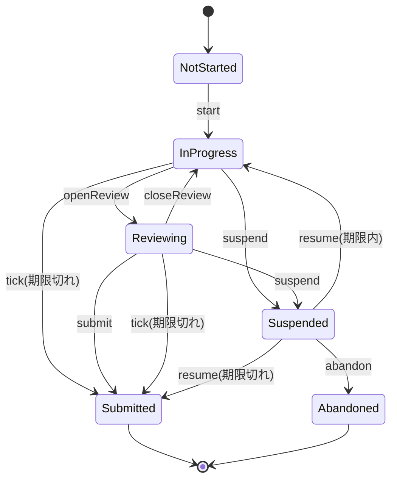

# Cloudrill 詳細設計書 P1: Domain コア

| 項目 | 内容 |
|---|---|
| 文書バージョン | 0.1(初版ドラフト) |
| 作成日 | 2026-10-21 |
| 上位文書 | [詳細設計書(索引・共通設計)](../DDD.md) |
| 対象 | `packages/Domain`(`StudyModels`、`ExamEngine`、`FSRS`、`Readiness`、`QuestionSelector`、`DomainTestSupport`) |
| ステータス | レビュー待ち |

---

## 目次

1. [目的とスコープ](#1-目的とスコープ)
2. [前提](#2-前提)
3. [設計](#3-設計)
4. [ステップ](#4-ステップ)
5. [フェーズの完了条件](#5-フェーズの完了条件)
6. [申し送り](#6-申し送り)

---

## 1. 目的とスコープ

学習機能の中核になる計算を、UI と永続化に依存しない純粋な Swift で実装する(BDD 1.2 D-03、NFR-11)。

| 区分 | 内容 |
|---|---|
| スコープ内 | 解答の判定、採点、模試の状態機械、タイマー、選択肢のシャッフルと出題順、FSRS、1日の出題キュー、合格準備度、練習の出題選択、テスト用の部品 |
| スコープ外 | 永続化(P3)、コンテンツの読み込み(P2)、画面(P4)。リポジトリのプロトコル(`DomainInterfaces`)は、最初に実装する P2・P3 で、実装と一緒に定義する |

**試験に依存しないこと**: このフェーズのコードには、試験固有の値(問題数 55、時間 120 分、ドメイン数 6 など)を書かない。すべて `ExamDefinition` か引数で受け取る([DDD 4.1 X-01](../DDD.md#41-拡張性の設計方針))。テストでは、`test-alpha` 型と `test-beta` 型の2種類の `ExamDefinition` を使い分ける。

---

## 2. 前提

- P0 が完了している(`ExamDefinition`、`QuestionKind`、`CaseStudyID` などが DomainModels にある)。
- ブランチは `feat/p1-domain-core`。

---

## 3. 設計

### 3.1 パッケージ

```swift
// packages/Domain/Package.swift
// swift-tools-version: 6.0
// Domain 層。Foundation と DomainModels 以外に依存しない(DDD 5.3 R-01)。
import PackageDescription

let package = Package(
    name: "Domain",
    platforms: [.iOS(.v18), .macOS(.v15)],
    products: [
        .library(name: "StudyModels", targets: ["StudyModels"]),
        .library(name: "ExamEngine", targets: ["ExamEngine"]),
        .library(name: "FSRS", targets: ["FSRS"]),
        .library(name: "Readiness", targets: ["Readiness"]),
        .library(name: "QuestionSelector", targets: ["QuestionSelector"]),
        .library(name: "DomainTestSupport", targets: ["DomainTestSupport"]),
    ],
    dependencies: [
        .package(path: "../DomainModels"),
    ],
    targets: [
        .target(name: "StudyModels", dependencies: ["DomainModels"]),
        .target(name: "ExamEngine", dependencies: ["StudyModels", "DomainModels"]),
        // FSRS は学習内容に依存しないアルゴリズムなので、DomainModels にも依存させない
        .target(name: "FSRS"),
        .target(name: "Readiness", dependencies: ["StudyModels", "DomainModels"]),
        .target(name: "QuestionSelector", dependencies: ["StudyModels", "DomainModels"]),
        .target(name: "DomainTestSupport", dependencies: ["StudyModels", "DomainModels"]),
        .testTarget(name: "StudyModelsTests", dependencies: ["StudyModels", "DomainTestSupport"]),
        .testTarget(name: "ExamEngineTests", dependencies: ["ExamEngine", "DomainTestSupport"]),
        .testTarget(name: "FSRSTests", dependencies: ["FSRS"], resources: [.process("Vectors")]),
        .testTarget(name: "ReadinessTests", dependencies: ["Readiness", "DomainTestSupport"]),
        .testTarget(name: "QuestionSelectorTests", dependencies: ["QuestionSelector", "DomainTestSupport"]),
        .testTarget(name: "DomainTestSupportTests", dependencies: ["DomainTestSupport"]),
    ],
    swiftLanguageModes: [.v6]
)
```

### 3.2 型の一覧

| ターゲット | 型 | 種類 | ステップ |
|---|---|---|---|
| StudyModels | `TimeSource`、`SystemTimeSource` | protocol / struct | P1-S01 |
| StudyModels | `AnswerSelection` | enum(① 構造語彙。出題形式ごとの選択の形) | P1-S02 |
| StudyModels | `StudyMode` | enum(`exam` / `practice` / `drill`) | P1-S02 |
| StudyModels | `AnswerFact` | struct(解答1件の事実) | P1-S02 |
| StudyModels | `ScoreTally`、`ExamResult` | struct | P1-S02 |
| StudyModels | `QuestionOrder` | struct(出題順と選択肢の並び。保存用) | P1-S02 |
| ExamEngine | `AnswerEvaluator`、`SingleChoiceEvaluator`、`MultipleChoiceEvaluator`、`AnswerEvaluatorRegistry` | protocol / struct | P1-S03 |
| ExamEngine | `ScoringPolicy`、`AllOrNothingScoring`、`ScoringInput` | protocol / struct | P1-S04 |
| ExamEngine | `ExamSession`、`ExamSessionState`、`ExamSessionEvent`、`SubmitReason` | struct / enum | P1-S05 |
| ExamEngine | `ExamTimer`、`ExamTimerPolicy` | struct | P1-S06 |
| ExamEngine | `ExamOrderBuilder` | enum(名前空間) | P1-S07 |
| FSRS | `Rating`、`CardPhase`、`FSRSCard`、`FSRSParameters`、`FSRSScheduler`、`ReviewOutcome` | enum / struct | P1-S08b〜P1-S08d |
| FSRS | `DailyQueueBuilder`、`DailyLimits`、`DailyQueue` | struct | P1-S08e |
| Readiness | `ReadinessCalculator`、`ReadinessParameters`、`ReadinessInput`、`ReadinessResult`、`DomainReadiness` | struct / enum | P1-S09 |
| QuestionSelector | `QuestionSummary`、`PracticeHistory`、`PracticeCriteria`、`SelectionParameters`、`QuestionSelector` | struct / enum | P1-S10 |
| DomainTestSupport | `FixedTimeSource`、`ManualTimeSource`、`SeededGenerator`、`QuestionBuilder`、`ExamDefinitionBuilder`、`approximatelyEqual` | — | P1-S01 |

### 3.3 模試の状態遷移(BDD 6.1 の詳細化)



BDD 6.1 に対して、`Reviewing --> Submitted: tick(期限切れ)` と `Reviewing --> Suspended: suspend` を追加した([DDD 2 章 C-10](../DDD.md#2-基本設計書からの変更点))。見直し一覧を開いたまま、時間切れになったり、アプリが終了したりする場合に対応するためである。

**遷移表**(P1-S05 のテストは、この表の 48 マスをすべて確認する)

| 状態 \ イベント | start | suspend | resume | openReview | closeReview | submit | abandon | tick |
|---|---|---|---|---|---|---|---|---|
| notStarted | inProgress | × | × | × | × | × | × | 変化なし |
| inProgress | × | suspended | × | reviewing | × | × | × | 期限切れなら submitted(timeExpired)、それ以外は変化なし |
| reviewing | × | suspended | × | × | inProgress | submitted(user) | × | 期限切れなら submitted(timeExpired)、それ以外は変化なし |
| suspended | × | × | 期限切れなら submitted(timeExpired)、それ以外は inProgress | × | × | × | abandoned | 変化なし |
| submitted | × | × | × | × | × | × | × | 変化なし |
| abandoned | × | × | × | × | × | × | × | 変化なし |

- × は `ExamSessionError.invalidTransition(from:event:)` を投げる。
- `tick` はエラーにしない。画面の更新タイマーが、提出の後に1回余分に発火することがあるため。
- 提出は見直し一覧からだけ行う(BDD 4.3 の画面遷移に合わせる)。

### 3.4 合格準備度の計算例(BDD 6.6)

P1-S09 のテストで使う、手計算の例。比重 `weight_1 = 0.25`、現在時刻を基準(t = 0)とする。

| 入力 | 値 |
|---|---|
| ドメイン1の解答 | t = 0 日で正解(重み 1.0)、t = 14 日で不正解(重み 0.5) |
| ドメイン1のカードの記憶保持率 | 0.9、0.7 |

| 計算 | 値 |
|---|---|
| `acc_1` | (1.0 × 1 + 0.5 × 0) ÷ (1.0 + 0.5) = 0.666667 |
| `ret_1` | (0.9 + 0.7) ÷ 2 = 0.8 |
| `score_1` | 0.7 × 0.666667 + 0.3 × 0.8 = 0.706667 |
| `cov_1` | min(1, 2 ÷ 20) = 0.1 |
| ドメイン1の寄与 | 0.25 × 0.706667 × 0.1 × 100 = 1.766667 |

---

## 4. ステップ

### P1-S01 パッケージの雛形とテスト用の部品

| 項目 | 内容 |
|---|---|
| 対応要件 | [DDD 7.4](../DDD.md#74-テストダブル)、BDD 11.3、C-09 |
| 前提 | P0 の完了 |
| 成果物 | `packages/Domain/Package.swift`、`Sources/StudyModels/TimeSource.swift`([DDD 6.1](../DDD.md#61-swift) の定義)、`Sources/DomainTestSupport/`、`Tests/DomainTestSupportTests/` |

**Red**:

| テスト | 条件(Arrange) | 期待(Assert) |
|---|---|---|
| `SeededGeneratorTests.sameSeedSameSequence` | seed 42 の生成器を2つ | 最初の 100 個の値が一致する |
| `SeededGeneratorTests.matchesSplitMix64Reference` | seed 0 | 最初の値が `0xE220A8397B1DCDAF`(SplitMix64 の参照実装の値) |
| `SeededGeneratorTests.differentSeedsDiffer` | seed 1 と seed 2 | 最初の値が異なる |
| `ManualTimeSourceTests.advance` | 2026-11-01T00:00:00Z から `advance(by: .seconds(90))` | `now()` が 00:01:30 |
| `SystemTimeSourceTests.isCloseToDate` | `SystemTimeSource().now()` と `Date()` | 差が 1 秒未満(製品の実装が `Date()` を返すことの確認) |
| `ExamDefinitionBuilderTests.alphaLike` | `.alphaLike()` | ドメイン 6、120 分、55 問、ケースあり |
| `ExamDefinitionBuilderTests.betaLike` | `.betaLike()` | ドメイン 4、90 分、40 問、ケースなし、single のみ |
| `QuestionBuilderTests.multipleHasRequestedCorrectCount` | `.multiple(count: 2, correct: ["a", "c"])` | `correctChoiceIDs == ["a", "c"]`、`type == .multiple(count: 2)` |

**Green**:

```swift
// DomainTestSupport/SeededGenerator.swift
/// SplitMix64。テストで乱数の結果を固定するために使う(製品のコードでは使わない)。
public struct SeededGenerator: RandomNumberGenerator, Sendable {
    private var state: UInt64
    public init(seed: UInt64) { state = seed }
    public mutating func next() -> UInt64 {
        state &+= 0x9E37_79B9_7F4A_7C15
        var z = state
        z = (z ^ (z >> 30)) &* 0xBF58_476D_1CE4_E5B9
        z = (z ^ (z >> 27)) &* 0x94D0_49BB_1331_11EB
        return z ^ (z >> 31)
    }
}

// DomainTestSupport/ManualTimeSource.swift
import Synchronization

public final class ManualTimeSource: TimeSource {
    private let current: Mutex<Date>
    public init(_ start: Date) { current = Mutex(start) }
    public func now() -> Date { current.withLock { $0 } }
    public func advance(by duration: Duration) {
        current.withLock { $0 = $0.addingTimeInterval(duration.timeInterval) }
    }
}
```

`ExamDefinitionBuilder` の `.alphaLike()` と `.betaLike()` は、P0 の fixture の `test-alpha`・`test-beta` と同じ形にする([P0 3.6](DDD-P0-MultiExamContent.md#36-fixture-の2試験))。

**Refactor**: `Duration.timeInterval`(秒の `Double`)の変換を、StudyModels の拡張にまとめる。

**完了条件**: `swift test --package-path packages/Domain --filter DomainTestSupportTests` が通る。

**実装メモ**(実装時に本書と変えた点):

- `Package.swift` には、3.1 のターゲットのうち `StudyModels`、`DomainTestSupport`、`DomainTestSupportTests` だけを宣言した。SwiftPM は空のターゲットをエラーにするので、残りのターゲットは各ステップで追加する。
- DomainModels の値型(`ExamDefinition` とその構成要素、`Question`)に public な init を追加した。memberwise init は `internal` なので、別のモジュールにあるビルダーから組み立てられないため(追加だけで、既存の API は変えていない)。
- ビルダーは、値を `with(\.keyPath, value)` で差し替える形にした。`.alphaLike()` は fixture の形(ドメイン、サブ項目、比重、形式、機能)に合わせた。ただし、ベンダー ID とケース ID は、実在の試験の語彙を避けて中立な値(`test-vendor`、`case-a`、`case-b`)にした。
- `SystemTimeSourceTests` と `Duration.timeInterval`、`FixedTimeSource`、`approximatelyEqual` のテストも `DomainTestSupportTests` に置いた(`StudyModelsTests` は P1-S02 で作る)。
- 完了条件 3 の grep(`55|120`)は `Sources/DomainTestSupport/ExamDefinitionBuilder.swift` を検出する。これはテストデータで、試験の値ではない。

---

### P1-S02 学習記録の値型(StudyModels)

| 項目 | 内容 |
|---|---|
| 対応要件 | BDD 5.3、[DDD 6.1](../DDD.md#61-swift) |
| 前提 | P1-S01 |
| 成果物 | `Sources/StudyModels/` の各ファイル、`Tests/StudyModelsTests/` |

```swift
/// 選択の形。出題形式(QuestionKind)を追加するときは case を追加する(DDD 4.10 C)。
public enum AnswerSelection: Hashable, Sendable {
    case choices(Set<String>)
}
// Codable の形: {"kind":"choices","choiceIDs":["a","c"]}(choiceIDs は昇順に並べて出力する)

public struct AnswerFact: Hashable, Sendable {
    public var examID: ExamID
    public var questionID: String
    public var questionRevision: Int
    public var domain: Int
    public var subObjective: String
    public var caseStudy: CaseStudyID?
    public var selection: AnswerSelection
    public var isCorrect: Bool
    public var mode: StudyMode
    public var answeredAt: Date
    public var elapsedSeconds: Int
}

public struct ScoreTally: Hashable, Sendable {
    public var correct: Int
    public var total: Int
    /// 出題数が 0 なら nil(0% と区別する)
    public var ratio: Double? { total == 0 ? nil : Double(correct) / Double(total) }
}

public struct ExamResult: Hashable, Sendable {
    public var total: ScoreTally
    /// ExamDefinition の全ドメインをキーに持つ(出題がないドメインは 0/0)
    public var byDomain: [Int: ScoreTally]
    /// ケース機能が無効な試験では空
    public var byCaseStudy: [CaseStudyID: ScoreTally]
    public var unansweredCount: Int
}

public struct QuestionOrder: Codable, Hashable, Sendable {
    public static let currentVersion = 1
    public var version: Int
    public var items: [Item]

    public struct Item: Codable, Hashable, Sendable {
        public var questionID: String
        /// 表示する順の選択肢 ID
        public var choiceIDs: [String]
    }
}
```

**Red**:

| テスト | 条件(Arrange) | 期待(Assert) |
|---|---|---|
| `AnswerSelectionTests.encodesSortedChoiceIDs` | `.choices(["c", "a"])` | `{"choiceIDs":["a","c"],"kind":"choices"}`(キーを並べ替えたエンコーダで比較する) |
| `AnswerSelectionTests.roundTrip` | エンコードしてデコードする | 元の値と等しい |
| `AnswerSelectionTests.unknownKindFails` | `{"kind":"ordering"}` | デコードエラー |
| `ScoreTallyTests.ratioIsNilWhenEmpty` | `ScoreTally(correct: 0, total: 0)` | `ratio == nil` |
| `ScoreTallyTests.ratio` | `ScoreTally(correct: 3, total: 4)` | `ratio == 0.75` |
| `QuestionOrderTests.roundTrip` | 2問分の `QuestionOrder` | エンコードとデコードで等しい |
| `QuestionOrderTests.rejectsFutureVersion` | `version: 2` の JSON を `QuestionOrder.decode(from:)` で読む | `QuestionOrderError.unsupportedVersion(2)` |

**Green**: 上の型を実装する。`QuestionOrder.decode(from: Data) throws(QuestionOrderError) -> QuestionOrder` を用意し、版の確認をまとめる。

**Refactor**: Codable の実装で、キーの名前を `CodingKeys` に集める。

**完了条件**: `swift test --package-path packages/Domain --filter StudyModelsTests` が通る。

**実装メモ**(実装時に本書と変えた点):

- `QuestionOrderError` は `unsupportedVersion(Int)` と `invalidData(underlying: any Error)` の2つにした。デコードのエラーは握りつぶさず、元のエラーを保持する。このため、テスト `QuestionOrderTests.rejectsCorruptedData` を追加した。
- `decode(from:)` は、`version` だけを先に読んで版を確かめ、その後で全体を読む。未来の版で `items` の形が変わっていても、デコードエラーではなく `unsupportedVersion` として報告するため。
- `QuestionOrder.init(items:)` は、`version` に `currentVersion` を入れる。ほかの型には public な init を追加した(memberwise init は `internal` のため)。
- `StudyMode` は `String` の raw value と `Codable` を持たせ、`AnswerFact.swift` に置いた。`AnswerFact` を Codable にするかどうかは、保存の形を決める P3 で判断する。

---

### P1-S03 解答の判定(AnswerEvaluator)

| 項目 | 内容 |
|---|---|
| 対応要件 | FR-EXAM-06、ADR-03、[DDD 4.9](../DDD.md#49-アプリ内の拡張点) |
| 前提 | P1-S02 |
| 成果物 | `Sources/ExamEngine/AnswerEvaluator.swift`、`AnswerEvaluatorRegistry.swift`、`Tests/ExamEngineTests/AnswerEvaluatorTests.swift` |

**Red**:

| テスト | 条件(Arrange) | 期待(Assert) |
|---|---|---|
| `singleCorrect` | single、正解 `b`、選択 `{b}` | `true` |
| `singleWrong` | single、正解 `b`、選択 `{a}` | `false` |
| `singleTwoSelections` | single、選択 `{a, b}` | `false`(エラーにはしない) |
| `singleUnknownChoice` | single、選択 `{z}`(存在しない ID) | `false` |
| `multipleExactMatch`(表形式) | multiple(2)、正解 `{a, c}`。選択 `{a, c}` / `{a}` / `{a, b, c}` / `{b, d}` | `true` / `false` / `false` / `false`(部分点なし) |
| `evaluatorRejectsOtherKind` | `SingleChoiceEvaluator` に multiple の問題 | `EvaluationError.unsupportedKind(.multiple)` |
| `registryDispatchesByKind` | `.standard` に single と multiple の問題 | それぞれ正しく判定される |
| `registryUnsupportedKind` | single だけを登録した registry に multiple の問題 | `EvaluationError.unsupportedKind(.multiple)` |
| `registryRejectsDuplicateKind` | single を2つ登録する | `RegistryError.duplicateKind(.single)` |
| `registryCoversAllKinds` | `.standard` | `QuestionKind.allCases` のすべてに対応している(新しい形式を追加したときに、登録漏れを検出するため) |

**Green**:

```swift
public enum EvaluationError: Error, Equatable, Sendable {
    case unsupportedKind(QuestionKind)
}

public protocol AnswerEvaluator: Sendable {
    var kind: QuestionKind { get }
    func evaluate(_ selection: AnswerSelection, for question: Question) throws(EvaluationError) -> Bool
}

public struct AnswerEvaluatorRegistry: Sendable {
    public enum RegistryError: Error, Equatable { case duplicateKind(QuestionKind) }
    public init(_ evaluators: [any AnswerEvaluator]) throws(RegistryError)
    public static let standard: AnswerEvaluatorRegistry
    public func supports(_ kind: QuestionKind) -> Bool
    public func evaluate(_ selection: AnswerSelection, for question: Question) throws(EvaluationError) -> Bool
}
```

`QuestionKind` に `CaseIterable` がなければ、P0-S09 の型に追加する(DomainModels の変更になるので、このステップのコミットに含める)。

**Refactor**: single と multiple の判定が「正解の集合と選択の集合の一致」で共通化できるかを検討する。single は選択が1つという前提があるので、別の型のまま残してよい。

**完了条件**: `swift test --package-path packages/Domain --filter AnswerEvaluatorTests` が通る。

**実装メモ**(実装時に本書と変えた点):

- `QuestionKind` は P0-S09 の時点で `CaseIterable` だったので、DomainModels は変更していない。
- `standard` は、重複を確かめない private な init で作る(`try!` を避けるため)。全形式に対応していることは `registryCoversAllKinds` で確かめる。
- Refactor: single と multiple の判定を、`AnswerSelection.matchesExactly(_:)`(選択の集合と正解の集合の一致)にまとめた。single は正解が1つなので、2つ選ぶと自動的に不一致になる。型は本書のとおり別のまま残した。
- Package.swift に `ExamEngine` と `ExamEngineTests` を追加した。

---

### P1-S04 採点(ScoringPolicy)

| 項目 | 内容 |
|---|---|
| 対応要件 | FR-EXAM-08、AC-03、BDD 6.3 |
| 前提 | P1-S03 |
| 成果物 | `Sources/ExamEngine/ScoringPolicy.swift`、`AllOrNothingScoring.swift`、`Tests/ExamEngineTests/ScoringTests.swift` |

**Red**:

| テスト | 条件(Arrange) | 期待(Assert) |
|---|---|---|
| `totalCountsCorrectAnswers` | 4問中、正解3問 | `total == 3/4` |
| `unansweredIsIncorrect` | 4問中、2問だけ解答して両方正解 | `total == 2/4`、`unansweredCount == 2` |
| `byDomainHasEveryDomain` | `alphaLike`(6ドメイン)で、ドメイン1と2の問題だけを出題 | `byDomain` のキーが 1〜6。ドメイン3〜6は `0/0` |
| `byDomainForBeta` | `betaLike`(4ドメイン) | `byDomain` のキーが 1〜4 |
| `byCaseStudy` | `alphaLike`、ケース `ehr` の問題2問(1問正解)、ケースなし2問 | `byCaseStudy == [ehr: 1/2]` |
| `byCaseStudyEmptyWhenDisabled` | `betaLike` | `byCaseStudy` が空 |
| `domainTotalsSumToTotal`(AC-03) | seed 固定で、55問と解答をランダムに作る。20回くり返す | `byDomain` の合計が `total` と一致する。素朴なループで数え直した値とも一致する |
| `unsupportedKindPropagates` | 登録されていない形式の問題を含む | `EvaluationError.unsupportedKind` |
| `policyForKind` | `ScoringPolicies.policy(for: .allOrNothing)` | `AllOrNothingScoring` |

**Green**:

```swift
public struct ScoringInput: Sendable {
    public var definition: ExamDefinition
    public var questions: [Question]
    /// 問題 ID → 選択。キーがなければ未解答
    public var answers: [String: AnswerSelection]
}

public protocol ScoringPolicy: Sendable {
    var kind: ScoringPolicyKind { get }
    func score(_ input: ScoringInput, evaluators: AnswerEvaluatorRegistry) throws(EvaluationError) -> ExamResult
}

public enum ScoringPolicies {
    public static func policy(for kind: ScoringPolicyKind) -> any ScoringPolicy
}
```

**Refactor**: 集計(ドメイン別、ケース別)を、汎用の `tally(by:)` 関数にまとめる。

**完了条件**: `swift test --package-path packages/Domain --filter ScoringTests` が通る。

**実装メモ**(実装時に本書と変えた点):

- 未対応の出題形式は、未解答の問題も含めて採点の前に確かめる。解答の有無で、エラーになるかどうかが変わらないようにするため。
- `byDomain` は試験定義の全ドメインを 0/0 で初期化する。`byCaseStudy` は、出題のあったケースだけを持つ(テスト `byCaseStudy` の期待値のとおり)。
- テストのケース ID は、`ehr` ではなく `alphaLike` の `case-a` を使った(P1-S01 の実装メモを参照)。
- Refactor: 集計は、`Sequence<QuestionOutcome>.tally(by:initialKeys:)`(internal)にまとめた。キーが nil の問題(ケースなしの問題)は数えない。
- `ScoringPolicies.policy(for:)` は `switch` で書いた。`ScoringPolicyKind` に case を追加すると、コンパイルエラーで実装漏れが分かる。

---

### P1-S05 模試の状態機械(ExamSession)

| 項目 | 内容 |
|---|---|
| 対応要件 | FR-EXAM-04、FR-EXAM-07、AC-01、BDD 6.1、[3.3](#33-模試の状態遷移bdd-61-の詳細化) |
| 前提 | P1-S04(採点は使わないが、`ExamResult` の型を使う) |
| 成果物 | `Sources/ExamEngine/ExamSession.swift`、`Tests/ExamEngineTests/ExamSessionTransitionTests.swift`、`ExamSessionAnswerTests.swift` |

**Red**:

| テスト | 条件(Arrange) | 期待(Assert) |
|---|---|---|
| `transitionTable`(表形式、48 件) | [3.3](#33-模試の状態遷移bdd-61-の詳細化) の遷移表の各マス。期限内・期限切れは `ManualTimeSource` で作る | 表のとおりの状態になる。× のマスは `invalidTransition` |
| `startSetsDeadline` | 90 分の試験を 10:00 に開始する | `timer.deadline == 11:30` |
| `selectRecordsAnswer` | inProgress で、問題1に `{a}` を選ぶ | `answers["Q1"] == .choices(["a"])` |
| `selectNilClearsAnswer` | 選択済みの問題に `nil` を選ぶ | 未解答に戻る |
| `selectOnlyInProgress` | reviewing で選ぶ | `invalidTransition`(見直し中は解答を変えない。問題に戻ってから変える) |
| `selectUnknownQuestion` | 出題順にない問題 ID | `ExamSessionError.unknownQuestion` |
| `toggleFlag` | 問題1のフラグを2回切り替える | 1回目で `flags` に入り、2回目で外れる |
| `moveClampsIndex` | 40問の試験で `move(to: 45)` | `ExamSessionError.indexOutOfRange` |
| `reviewSummary` | 40問中、30問解答、フラグ3問 | `unansweredQuestionIDs.count == 10`、`flaggedQuestionIDs.count == 3` |
| `restoreFromSnapshot` | 解答・フラグ・現在の位置・タイマーを持つ `ExamSession` を `Snapshot` に変換し、復元する | 元の値と等しい(P3 の永続化と、AC-02 の前提) |

**Green**:

```swift
public enum SubmitReason: String, Codable, Hashable, Sendable { case user, timeExpired }

public enum ExamSessionState: Hashable, Sendable {
    case notStarted, inProgress, reviewing, suspended
    case submitted(SubmitReason)
    case abandoned
}

public enum ExamSessionEvent: Hashable, Sendable {
    case start, suspend, resume, openReview, closeReview, submit, abandon, tick
}

public enum ExamSessionError: Error, Equatable, Sendable {
    case invalidTransition(from: ExamSessionState, event: ExamSessionEvent)
    case unknownQuestion(String)
    case indexOutOfRange(Int)
}

public struct ExamSession: Hashable, Sendable {
    public private(set) var state: ExamSessionState
    public private(set) var timer: ExamTimer?
    public private(set) var answers: [String: AnswerSelection]
    public private(set) var flags: Set<String>
    public private(set) var currentIndex: Int
    public let order: QuestionOrder

    public init(order: QuestionOrder, duration: Duration, timerPolicy: ExamTimerPolicy)
    public mutating func handle(_ event: ExamSessionEvent, at now: Date) throws(ExamSessionError)
    public mutating func select(_ selection: AnswerSelection?, for questionID: String) throws(ExamSessionError)
    public mutating func toggleFlag(for questionID: String) throws(ExamSessionError)
    public mutating func move(to index: Int) throws(ExamSessionError)
    public var unansweredQuestionIDs: [String] { get }
    public var flaggedQuestionIDs: [String] { get }

    public struct Snapshot: Codable, Hashable, Sendable { … }
    public var snapshot: Snapshot { get }
    public init(snapshot: Snapshot, timerPolicy: ExamTimerPolicy)
}
```

**Refactor**: 遷移の判定を、`(state, event) -> 次の状態` の純粋関数(`static func transition`)に切り出す。`handle` は、その結果とタイマーの操作を組み合わせるだけにする。

**完了条件**: `swift test --package-path packages/Domain --filter ExamSession` が通る。遷移表のテストが 48 件実行されていることを、テストの出力で確認する。

**実装メモ**(実装時に本書と変えた点):

- `select` を inProgress 以外で呼んだときのエラーは、`invalidTransition` ではなく、新しく追加した `ExamSessionError.operationNotAllowed(ExamSessionState)` にした。`select` は `ExamSessionEvent` にないので、`event` に入れる値がない。また、イベントに足すと遷移表が 48 マスでなくなる。`toggleFlag` と `move` は、inProgress と reviewing のときだけ受け付ける。
- `ExamTimer` は、状態機械が使う部分(`init(startedAt:duration:)`、`remaining`、`isExpired`、`pause`、`resume`)だけをこのステップで作った。`init(startedAt:definition:)`、`crossedThreshold`、`ExamTimerTests` は P1-S06 で作る。
- 遷移表のテストは、各マスで期限内と期限切れの両方を確かめる(条件付きのマス: inProgress・reviewing の tick と、suspended の resume)。状態は notStarted からイベントを送って作る(submitted は `submitted(.user)`)。
- テストを2件追加した: `transitionTableHasAllCells`(表が 48 マスで重複がないこと)と `invalidTransitionKeepsTimer`(× の遷移でタイマーも変わらないこと)。`handle` はタイマーの写しで判定してから確定する。
- `ExamSessionState` の Codable は自動合成を使った(`Snapshot` に入れるため)。保存の形は P3 で見直す。`Snapshot` はタイマーのポリシーを含めない(設定なので、復元時に渡す)。

---

### P1-S06 タイマー(ExamTimer)

| 項目 | 内容 |
|---|---|
| 対応要件 | FR-EXAM-02、AC-01、E-06、BDD 6.2、ADR-04 |
| 前提 | P1-S05(状態機械からタイマーを操作するため、型は P1-S05 で仮に定義済み。ここで振る舞いを完成させる) |
| 成果物 | `Sources/ExamEngine/ExamTimer.swift`、`Tests/ExamEngineTests/ExamTimerTests.swift` |

**Red**:

| テスト | 条件(Arrange) | 期待(Assert) |
|---|---|---|
| `remainingIsDeadlineMinusNow` | 120 分、開始から 30 分後 | 残り 90 分 |
| `remainingNeverNegative` | 期限から 5 分後 | 残り 0、`isExpired == true` |
| `expiredExactlyAtDeadline` | 期限ちょうど | `isExpired == true` |
| `pauseKeepsRemaining` | `pausesWhileSuspended: true`。30 分後に一時停止し、さらに 60 分たつ | 残り 90 分のまま |
| `resumeRecomputesDeadline` | 上の状態から 12:00 に再開する | `deadline == 12:00 + 90 分` |
| `noPauseByDefault` | `pausesWhileSuspended: false`(既定)。30 分後に中断し、60 分後に再開する | 残り 30 分(本番と同じく時間は経過し続ける) |
| `crossedThreshold`(表形式) | しきい値 [10 分, 5 分]。前回の残り 10:01 → 今回 9:59 / 5:01 → 4:59 / 9:00 → 8:00 / 0:10 → 0:00 | 10 分 / 5 分 / なし / なし |
| `durationComesFromDefinition` | `betaLike`(90 分)で `ExamTimer(startedAt:definition:)` | `duration == 90 分` |
| `resumeAfterExpiryAutoSubmits`(E-06) | `ExamSession` を中断し、期限後に `resume` | `state == .submitted(.timeExpired)` |

**Green**:

```swift
public struct ExamTimerPolicy: Hashable, Sendable {
    public var pausesWhileSuspended: Bool = false
    public var warningThresholds: [Duration] = [.seconds(600), .seconds(300)]
}

public struct ExamTimer: Codable, Hashable, Sendable {
    public let duration: Duration
    public private(set) var deadline: Date
    /// 一時停止中の残り時間。動いている間は nil
    public private(set) var pausedRemaining: Duration?

    public init(startedAt: Date, duration: Duration)
    public init(startedAt: Date, definition: ExamDefinition)
    public func remaining(at now: Date) -> Duration
    public func isExpired(at now: Date) -> Bool
    public mutating func pause(at now: Date)
    public mutating func resume(at now: Date)
    /// 前回の確認から今回までに越えた警告のしきい値(触覚フィードバックを1回だけ出すため)
    public func crossedThreshold(from previous: Date, to now: Date, policy: ExamTimerPolicy) -> Duration?
}
```

**Refactor**: `Date` と `Duration` の変換を `StudyModels` の拡張に集める(P1-S01 の Refactor の続き)。

**完了条件**: `swift test --package-path packages/Domain --filter ExamTimerTests` が通る。

**実装メモ**(実装時に本書と変えた点):

- `crossedThreshold` は「前回の残り > しきい値 ≧ 今回の残り」で判定する。しきい値ちょうどに達した場合も越えたとみなす。複数を一度に越えたときは、短い方(より切迫した方)を返す。この2つを、表形式のテストのケースに追加した。
- 一時停止中は残り時間が変わらないので、`crossedThreshold` は nil を返し、`isExpired` も false になる。
- Refactor: StudyModels に `Date.adding(_:)` と `Date.duration(since:)` を追加した。`ExamTimer` と `ManualTimeSource` は、これを使って変換する。

---

### P1-S07 出題順と選択肢のシャッフル

| 項目 | 内容 |
|---|---|
| 対応要件 | FR-EXAM-12、BDD 5.3 の `questionOrder`、[DDD 6.3](../DDD.md#63-決定論) |
| 前提 | P1-S02 |
| 成果物 | `Sources/ExamEngine/ExamOrderBuilder.swift`、`Sources/StudyModels/DeterministicShuffle.swift`、`Tests/ExamEngineTests/ExamOrderBuilderTests.swift` |

**Red**:

| テスト | 条件(Arrange) | 期待(Assert) |
|---|---|---|
| `keepsExamSetOrder` | 模試の `questionIDs` が [Q3, Q1, Q2] | 出題順も [Q3, Q1, Q2]。模試の問題の順は固定する |
| `noShuffleKeepsChoiceOrder` | `shuffleChoices: false` | 選択肢は元の並び |
| `shuffleIsDeterministic` | `shuffleChoices: true`、seed 7 で2回作る | 2回とも同じ並び |
| `shuffleGolden` | seed 7、選択肢 [a, b, c, d] | 期待値の並び(実装後に1回だけ記録し、以降は固定する。アルゴリズムを変えた場合だけ更新する) |
| `shuffleKeepsAllChoices` | seed を 100 通り | どの並びも {a, b, c, d} の並べ替えである |
| `restoreValidatesChoices` | 保存した `QuestionOrder` の選択肢 ID と、問題の選択肢 ID が異なる | `QuestionOrderError.choicesMismatch(questionID:)` |
| `fisherYatesDoesNotUseStdlibShuffle` | 同じ seed で `DeterministicShuffle` の結果を2つの並べ替え対象(長さ 4 と 5)に適用する | 期待値の表と一致する(標準ライブラリの `shuffled(using:)` は、Swift のバージョン間で結果が同じとは限らないため、自前の Fisher–Yates を使う) |

**Green**:

```swift
public enum ExamOrderBuilder {
    public static func make(
        questionIDs: [String],
        questions: [String: Question],
        shuffleChoices: Bool,
        using rng: inout some RandomNumberGenerator
    ) throws(QuestionOrderError) -> QuestionOrder

    public static func validate(_ order: QuestionOrder, against questions: [String: Question]) throws(QuestionOrderError)
}
```

**Refactor**: `DeterministicShuffle` を StudyModels に置き、QuestionSelector(P1-S10)からも使えるようにする。

**完了条件**: `swift test --package-path packages/Domain --filter ExamOrderBuilderTests` が通る。

**実装メモ**(実装時に本書と変えた点):

- `DeterministicShuffle` は、Fisher–Yates に加えて、上限付きの乱数(Lemire の方法と棄却)も自前で実装した。標準ライブラリの `random(in:using:)` も、版の間で結果が同じとは限らないため。
- ゴールデンの期待値(`shuffleGolden`、`fisherYatesDoesNotUseStdlibShuffle`)は、Swift の出力を記録するのではなく、同じアルゴリズムの Python の参照実装(SplitMix64、Lemire、Fisher–Yates)で求めた。実装の誤りを期待値として固定しないため。Swift の結果は、初回から一致した。
- `QuestionOrderError` に `missingQuestion(String)` と `choicesMismatch(questionID:)` を追加した。`make` と `validate` は、出題順にある問題がコンテンツになければ `missingQuestion` を投げる。このためのテスト `missingQuestion` を追加した。
- `validate` は、選択肢 ID の集合(並べ替えた配列)を比べる。シャッフル後の並びは問わない。
- Refactor は不要だった(`DeterministicShuffle` は最初から StudyModels に置いた)。

---

### P1-S08a FSRS のバージョンの確定とテストベクタ

| 項目 | 内容 |
|---|---|
| 対応要件 | AC-08、BDD 6.5、TBD-09 |
| 前提 | P1-S01。外部依存 `fsrs`(py-fsrs)の採用の確認([DDD 8 章](../DDD.md#8-外部依存の候補)) |
| 成果物 | `scripts/fsrs_vectors.py`、`scripts/requirements-dev.txt`(py-fsrs の版を `==` で固定)、`packages/Domain/Tests/FSRSTests/Vectors/fsrs-vectors.json`、`Tests/FSRSTests/FSRSVectorTests.swift` |

**決めること**(このステップの最初に、ユーザーの確認を取る):

| 項目 | 推奨 | 理由 |
|---|---|---|
| アルゴリズムの版 | 着手時点の py-fsrs の最新の安定版が採用している版 | 公式のリファレンス実装と一致させる(AC-08) |
| パラメータ | その版の既定値 | BDD 6.5「公開されている標準パラメータを使う」 |
| 目標保持率 | 0.90 | BDD 6.5 |
| 学習ステップ(分単位の再出題) | リファレンス実装の既定値に従う | ベクタとの一致を優先する |
| 間隔のゆらぎ(fuzz) | 無効 | 結果を決定論にする。必要になったら、乱数を注入する形で追加する |

**テストベクタの形式**:

```json
{
  "generator": { "library": "py-fsrs", "version": "<固定した版>", "fsrsVersion": "<FSRS-5 など>" },
  "parameters": { "w": [/* 既定値 */], "desiredRetention": 0.9, "learningSteps": [/* 秒 */], "relearningSteps": [/* 秒 */], "maximumInterval": 36500 },
  "cases": [
    {
      "name": "new-good-good-again",
      "start": "2026-01-01T09:00:00Z",
      "reviews": [ { "rating": 3, "at": "2026-01-01T09:00:00Z" } ],
      "expected": [ { "phase": "learning", "stability": 0.0, "difficulty": 0.0, "due": "…", "retrievabilityAtDue": 0.0 } ]
    }
  ]
}
```

ケースは、少なくとも次の系列を含める。

- 4 種類の初回評価
- 正解を続ける系列(長い間隔)
- 忘却(Again)を含む系列
- 予定より早い復習と遅い復習
- 同じ日の2回目の復習

**Red**: `FSRSVectorTests` を追加する。ベクタの各ケースについて、`FSRSScheduler` で評価を順に適用し、期待値と比べる。`FSRSScheduler` はまだないので、まずコンパイルエラーになる。仮の実装(状態を変えずに返す)を置いて、assertion で失敗することを確認する。

| 比較する値 | 許容誤差 |
|---|---|
| `stability`、`difficulty`、`retrievability` | 相対誤差 1e-9 |
| `due` | 1 秒(日付の計算での丸め) |
| `phase` | 完全一致 |

**Green**: このステップでは実装しない(P1-S08b〜d で通す)。テストは `withKnownIssue` で囲んでおき、P1-S08d で外す。

> `withKnownIssue` は「既知の失敗」を明示する Swift Testing の機能で、[DDD 7.1](../DDD.md#71-サイクル) が禁止する無効化(テストを実行しないこと)とは異なる。テストは実行され続け、P1-S08d で通るようになると「既知の問題が起きなかった」という失敗に変わるので、外し忘れも検出できる。

**完了条件**:

- `python3 scripts/fsrs_vectors.py --out packages/Domain/Tests/FSRSTests/Vectors/fsrs-vectors.json` を2回実行し、結果が同じであること(決定論)。
- `swift test --package-path packages/Domain --filter FSRSVectorTests` が「既知の問題」として報告されること。

**実装メモ**(2026-10-21 にユーザーの確認を取って決めた点と、本書と変えた点):

- 決めたこと: `fsrs`(py-fsrs)**6.3.2**(FSRS-6、MIT、2026-08-09 公開)を採用した。パラメータは既定値(21 個)、目標保持率 0.90、学習ステップは既定値(learning 1 分・10 分、relearning 10 分)、最大間隔 36500 日、fuzz は無効。
- 依存の置き場所: `scripts/requirements-dev.txt` ではなく、`content/pyproject.toml` の uv 依存グループ `fsrs` にした(既存の Python の依存管理に合わせる)。既定の `uv sync` には含まれないので、CI には入らない。スクリプトは `content/scripts/fsrs_vectors.py` に置いた。
  - 再生成: `uv sync --project content --group fsrs` の後に `content/.venv/bin/python content/scripts/fsrs_vectors.py --out packages/Domain/Tests/FSRSTests/Vectors/fsrs-vectors.json`
- ベクタは 15 ケース(4 種類の初回評価、Good・Easy・Hard の連続、忘却 3 系列、早い復習と遅い復習、同じ日の2回目、評価の混在)。期待値には、本書の形式に加えて学習ステップの位置 `step` を含めた。2回生成して一致することを確認した。
- py-fsrs 6 には new の段階がなく、新規カードは learning の step 0 から始まる。`CardPhase.new` はアプリ側だけの段階として残し、ベクタの期待値には現れない。
- py-fsrs の `get_card_retrievability` は、経過日数を整数(`timedelta.days`、切り捨て)で数える。P1-S08b の `ForgettingCurve` を `retrievabilityAtDue` と一致させるときに注意する。
- Red は2段階で確認した。仮の実装がない状態でコンパイルエラーになること。仮の実装(カードを変えずに返す)では、`withKnownIssue` を一時的に外すと assertion で失敗すること。
- 仮の型(`Rating`、`CardPhase`、`FSRSCard`、`ReviewOutcome`、`FSRSParameters`、`FSRSError`、`FSRSScheduler`)は、P1-S08b・c の定義の形で置いた。`FSRSParameters.init` は `throws(FSRSError)` だが、範囲の確認は P1-S08b で実装する。
- ベクタが読めることと、必要な系列があることを確かめるテスト `vectorsAreWellFormed` を追加した(このステップで通る)。

---

### P1-S08b FSRS: 記憶保持率と間隔

| 項目 | 内容 |
|---|---|
| 対応要件 | FR-CARD-02 |
| 前提 | P1-S08a |
| 成果物 | `Sources/FSRS/ForgettingCurve.swift`、`Tests/FSRSTests/ForgettingCurveTests.swift` |

忘却曲線: `R(t, S) = (1 + FACTOR × t / S) ^ DECAY`。次の間隔: `I(r, S) = S / FACTOR × (r ^ (1 / DECAY) − 1)`。

- FSRS-5 では `DECAY = −0.5`、`FACTOR = 19 / 81` である。
- FSRS-6 では、`DECAY` がパラメータ(`−w[20]`)になり、`FACTOR = 0.9 ^ (1 / DECAY) − 1` で求める。

どちらの版でも `R(S, S) = 0.9` になる。版の違いは `ForgettingCurve` の初期化で吸収する。

**Red**:

| テスト | 条件(Arrange) | 期待(Assert) |
|---|---|---|
| `retrievabilityAtStabilityIsNinetyPercent` | 任意の S(1、10、100 日) | `R(S, S) ≈ 0.9` |
| `retrievabilityAtZeroIsOne` | t = 0 | `R == 1` |
| `retrievabilityDecreases` | t = 1, 2, 3 … | 単調に減少する |
| `intervalForNinetyPercentIsStability` | r = 0.9 | `I == S` |
| `intervalRoundsAndClamps` | 計算結果 0.3 日 / 40000 日 | 1 日 / `maximumInterval` |
| `retentionOutOfRangeIsRejected` | 目標保持率 0.79 / 0.96 | `FSRSError.retentionOutOfRange`(設定できる範囲は 0.80〜0.95。BDD 6.5) |

**Green**: `ForgettingCurve`(`retrievability(elapsedDays:stability:)`、`interval(desiredRetention:stability:)`)と、`FSRSParameters.init(...) throws(FSRSError)` を実装する。

**Refactor**: 日数の計算(`Date` の差を日単位の `Double` にする)を1か所にまとめる。

**完了条件**: `swift test --package-path packages/Domain --filter ForgettingCurveTests` が通る。

---

### P1-S08c FSRS: 初回の評価

| 項目 | 内容 |
|---|---|
| 対応要件 | FR-CARD-02、AC-08 |
| 前提 | P1-S08b |
| 成果物 | `Sources/FSRS/FSRSScheduler.swift`(初回の評価)、`Tests/FSRSTests/InitialReviewTests.swift` |

**Red**:

| テスト | 条件(Arrange) | 期待(Assert) |
|---|---|---|
| `initialStabilityPerRating`(表形式) | 新規カードに Again / Hard / Good / Easy | `stability == w[0] / w[1] / w[2] / w[3]` |
| `initialDifficultyIsClamped` | 4 種類の評価 | `difficulty` が 1〜10 の範囲 |
| `easierRatingGivesLongerDue` | 同じ時刻に Again と Easy | Easy の `due` のほうが遅い |
| `vectorsInitialCases` | テストベクタのうち、評価が1回だけのケース | 期待値と一致する |

**Green**:

```swift
public enum Rating: Int, Codable, Sendable, CaseIterable { case again = 1, hard, good, easy }
public enum CardPhase: String, Codable, Sendable { case new, learning, review, relearning }

public struct FSRSCard: Codable, Hashable, Sendable {
    public var phase: CardPhase
    public var stability: Double
    public var difficulty: Double
    public var due: Date
    public var reps: Int
    public var lapses: Int
    public var lastReview: Date?
    public var step: Int?           // 学習ステップの位置
    public static func new(at now: Date) -> FSRSCard
}

public struct ReviewOutcome: Hashable, Sendable {
    public var card: FSRSCard
    public var elapsedDays: Double
    public var rating: Rating
    public var reviewedAt: Date
}

public struct FSRSScheduler: Sendable {
    public init(parameters: FSRSParameters)
    public func review(_ card: FSRSCard, rating: Rating, at now: Date) -> ReviewOutcome
    public func retrievability(of card: FSRSCard, at now: Date) -> Double
}
```

**Refactor**: パラメータ `w` の添字に名前を付ける(`w[4]` ではなく `initialDifficultyBase` など)。読みやすさのため。

**完了条件**: `swift test --package-path packages/Domain --filter InitialReviewTests` が通る。

---

### P1-S08d FSRS: 2回目以降の評価

| 項目 | 内容 |
|---|---|
| 対応要件 | FR-CARD-02、FR-CARD-03、AC-08 |
| 前提 | P1-S08c |
| 成果物 | `Sources/FSRS/FSRSScheduler.swift`(更新式)、`Tests/FSRSTests/SubsequentReviewTests.swift`、`FSRSVectorTests.swift` の `withKnownIssue` の削除 |

**Red**:

| テスト | 条件(Arrange) | 期待(Assert) |
|---|---|---|
| `againIncrementsLapses` | review の状態のカードに Again | `lapses` が 1 増え、`phase == .relearning` |
| `goodIncreasesStability` | review の状態で、期限ちょうどに Good | `stability` が増える |
| `difficultyMovesWithRating` | Again と Easy を同じ状態のカードに | Again のほうが `difficulty` が大きい |
| `lateReviewUsesElapsedDays` | 期限の 10 日後に Good | 期限ちょうどの Good より `stability` が大きい(忘れかけた状態での想起は、記憶を強くする) |
| `sameDayReview` | 同じ日の2回目の評価 | リファレンス実装と同じ扱い(短期の安定度の式)になる |
| `allVectors` | テストベクタの全ケース(`withKnownIssue` を外す) | すべて期待値と一致する |

**Green**: 難易度の更新(線形の減衰と平均への回帰)、想起時と忘却時の安定度の更新、学習ステップの遷移を、選んだ版の仕様のとおりに実装する。**式の正しさはテストベクタで判断する**(本書では式を再掲しない。版ごとに異なるため)。

**Refactor**: `review` を、フェーズごとの関数(`reviewNew`、`reviewLearning`、`reviewReview`)に分ける。

**完了条件**: `swift test --package-path packages/Domain --filter FSRS` がすべて通り、既知の問題が 0 件。

---

### P1-S08e 1日の出題キュー

| 項目 | 内容 |
|---|---|
| 対応要件 | FR-CARD-05、BDD 6.5「1日の出題」 |
| 前提 | P1-S08d |
| 成果物 | `Sources/FSRS/DailyQueueBuilder.swift`、`Tests/FSRSTests/DailyQueueBuilderTests.swift` |

**Red**:

| テスト | 条件(Arrange) | 期待(Assert) |
|---|---|---|
| `reviewsBeforeNew` | 期限切れ 3 枚、新規 5 枚、上限は新規 10・復習 100 | 復習 3 枚の後に新規 5 枚 |
| `reviewLimit` | 期限切れ 150 枚、復習の上限 100 | 復習は 100 枚 |
| `newLimitConsidersToday` | 新規の上限 20、今日すでに 15 枚を学習済み | 新規は 5 枚 |
| `dueOrder` | 期限が異なる復習カード | 期限の古い順 |
| `dueUntilEndOfLocalDay` | タイムゾーン Asia/Tokyo。期限が今日の 23:00(現在は 9:00) | 今日のキューに含まれる |
| `notDueTomorrow` | 期限が明日の 0:30 | 含まれない |
| `newCardOrderIsStable` | 新規カードの並び(コンテンツ側の順) | その順のまま |

**Green**:

```swift
public struct DailyLimits: Hashable, Sendable {
    public var newCards: Int
    public var reviews: Int
}

public struct DailyQueue: Hashable, Sendable {
    public var reviewCardIDs: [String]
    public var newCardIDs: [String]
}

public struct DailyQueueBuilder: Sendable {
    public init(calendar: Calendar)
    public func build(
        reviewCandidates: [(id: String, card: FSRSCard)],
        newCardIDs: [String],
        limits: DailyLimits,
        introducedToday: Int,
        reviewedToday: Int,
        now: Date
    ) -> DailyQueue
}
```

`Calendar` を注入する(タイムゾーンをテストで固定するため)。

**Refactor**: タプルの引数を、名前付きの型(`ScheduledCard`)に置き換える。

**完了条件**: `swift test --package-path packages/Domain --filter DailyQueueBuilderTests` が通る。

---

### P1-S09 合格準備度(Readiness)

| 項目 | 内容 |
|---|---|
| 対応要件 | FR-ANLY-02、BDD 6.6、LG-05、TBD-08 |
| 前提 | P1-S02 |
| 成果物 | `Sources/Readiness/ReadinessCalculator.swift`、`Tests/ReadinessTests/ReadinessCalculatorTests.swift` |

**解釈を補った点**(BDD 6.6 に書かれていない点):

| 項目 | 本書での扱い |
|---|---|
| 「解答数が 30 問未満」 | 解答した**ユニークな問題の数**で数える(同じ問題をくり返し解いても増えない) |
| 対象にする解答 | `mode` が `exam` と `practice` の解答。`drill`(キーワードドリル)は問題ではないので含めない |
| 経過日数 t | `now − answeredAt` を日数にしたもの。負(端末間の時計のずれ)なら 0 にする |
| 記憶保持率の入力 | 呼び出し側が FSRS で計算した値を、ドメインごとに渡す(Readiness は FSRS に依存しない) |

**Red**:

| テスト | 条件(Arrange) | 期待(Assert) |
|---|---|---|
| `collectingBelowMinimum` | ユニークな問題 29 問 | `.collecting(answeredUniqueQuestions: 29, required: 30)` |
| `repeatedAnswersDoNotCount` | 10 問を 3 回ずつ解答する | `.collecting(answeredUniqueQuestions: 10, …)` |
| `workedExample` | [3.4](#34-合格準備度の計算例bdd-66) の例に、他ドメインの 30 問を加える | ドメイン1の寄与 ≈ 1.766667 |
| `halfLife` | t = 14 日の解答の重み | 0.5 |
| `noAnswersDomainScoresZero` | ドメイン3の解答が 0 件 | `domains[3].score == 0`、`accuracy == nil` |
| `noCardsUsesAccuracyOnly` | 解答はあるが、カードの保持率が空 | `score == accuracy` |
| `coverageCapsAtOne` | ユニークな問題が 25 問 | `coverage == 1` |
| `weightsFromDefinition` | `betaLike`(比重 0.3 / 0.3 / 0.2 / 0.2)で、全ドメインが満点 | `score == 100` |
| `drillAnswersExcluded` | `mode: .drill` の解答 | 計算に含まれない |
| `futureAnswerTreatedAsNow` | `answeredAt` が `now` の 1 日後 | 重みが 1.0 |
| `parametersMustSumToOne` | `accuracyWeight: 0.6`、`retentionWeight: 0.3` | `ReadinessError.weightsMustSumToOne` |

**Green**:

```swift
public struct ReadinessParameters: Hashable, Sendable {
    public var accuracyWeight: Double = 0.7
    public var retentionWeight: Double = 0.3
    public var halfLifeDays: Double = 14
    public var coverageTarget: Int = 20
    public var minimumUniqueQuestions: Int = 30
    public init(...) throws(ReadinessError)
}

public struct ReadinessInput: Sendable {
    public var definition: ExamDefinition
    public var answers: [AnswerFact]
    /// ドメイン番号 → 復習済みカードの現在の記憶保持率
    public var cardRetentions: [Int: [Double]]
    public var now: Date
}

public struct DomainReadiness: Hashable, Sendable {
    public var accuracy: Double?
    public var retention: Double?
    public var coverage: Double
    public var score: Double
}

public enum ReadinessResult: Hashable, Sendable {
    case collecting(answeredUniqueQuestions: Int, required: Int)
    case ready(score: Double, domains: [Int: DomainReadiness])
}

public struct ReadinessCalculator: Sendable {
    public init(parameters: ReadinessParameters)
    public func calculate(_ input: ReadinessInput) -> ReadinessResult
}
```

**Refactor**: ドメインごとの計算を `domainReadiness(...)` に切り出し、合算と分ける。

**完了条件**: `swift test --package-path packages/Domain --filter ReadinessCalculatorTests` が通る。

---

### P1-S10 練習の出題選択(QuestionSelector)

| 項目 | 内容 |
|---|---|
| 対応要件 | FR-PRAC-01、FR-PRAC-03、FR-PRAC-04、FR-CASE-03、BDD 6.7 |
| 前提 | P1-S07(`DeterministicShuffle`)、P1-S09 |
| 成果物 | `Sources/QuestionSelector/` の各ファイル、`Tests/QuestionSelectorTests/` |

**アルゴリズム**:

1. 候補を問題 ID の昇順に並べる(入力の順序に結果が左右されないようにするため)。
2. 条件で絞り込む。異なる項目どうしは AND、同じ項目の中は OR。空の集合は「絞り込まない」。
3. 範囲(全問 / 間違えた問題のみ / 未解答のみ / フラグ付きのみ)で絞り込む。
4. 直近 24 時間に出題した問題(recent)と、それ以外(fresh)に分ける。fresh だけで指定数に足りれば fresh から選ぶ。足りなければ fresh をすべて使い、不足分を recent から出題の古い順に補う。
5. 選び方:
   - ランダム: `DeterministicShuffle` で並べ替えて先頭から取る。
   - 弱点優先: 重み `w = max(minimumWeight, 1 − score_d) × 未解答ボーナス × 誤答ボーナス` で、重み付きの非復元抽出を行う。手法は Efraimidis–Spirakis(鍵 `u^(1/w)` の大きい順。`u` は (0, 1] の乱数)。

| パラメータ | 既定値 | 補足 |
|---|---|---|
| `recentExclusion` | 24 時間 | BDD 6.7 |
| `unansweredBonus` | 1.5 | BDD 6.7 に値の記載がないため、本書で決める。β版のデータで調整する(TBD-08 と同時に) |
| `wrongBonus` | 2.0 | 同上 |
| `minimumWeight` | 0.05 | `score_d = 1` のドメインの問題が、二度と出なくなるのを防ぐ |

**Red**:

| テスト | 条件(Arrange) | 期待(Assert) |
|---|---|---|
| `filtersByDomain` | ドメイン {1, 3} | 結果がすべてドメイン 1 か 3 |
| `filtersBySubObjectiveAndCase` | サブ項目 {1.1}、ケース {ehr} | 両方を満たす問題だけ |
| `filtersByDifficulty` | 難易度 2...3 | 範囲内だけ |
| `wrongOnly` | 直近の結果が不正解の問題 2 問 | その 2 問だけ |
| `unansweredOnly` | 解答履歴のない問題 | それだけ |
| `flaggedOnly` | フラグ付きの問題 | それだけ |
| `countLimits`(表形式) | 候補 30、指定 5 / 10 / 20 / すべて | 5 / 10 / 20 / 30 件 |
| `countExceedsCandidates` | 候補 3、指定 10 | 3 件 |
| `noDuplicates` | seed を 100 通り | どの結果にも重複がない |
| `excludesRecentWhenEnough` | 候補 20(うち recent 5)、指定 10 | recent を含まない |
| `fillsFromOldestRecent` | 候補 10(うち recent 6)、指定 8 | fresh 4 問と、recent のうち出題の古い 4 問 |
| `inputOrderDoesNotMatter` | 同じ候補を逆順で渡す | 同じ seed なら同じ結果 |
| `weaknessFirstPrefersWeakDomain` | ドメイン1の score 0.2、ドメイン2の score 0.9。seed 固定で 1 問の抽出を 10,000 回 | ドメイン1の出現回数がドメイン2より多い |
| `weaknessFirstStillPicksStrongDomain` | 同上 | ドメイン2も 1 回以上出る(`minimumWeight` が効いている) |
| `emptyResult` | 条件に合う問題がない | 空の配列(エラーにしない。画面で「該当する問題がありません」と表示する) |

**Green**:

```swift
public struct QuestionSummary: Hashable, Sendable {
    public var id: String
    public var domain: Int
    public var subObjective: String
    public var caseStudy: CaseStudyID?
    public var difficulty: Int
    public var kind: QuestionKind
}

public struct PracticeHistory: Sendable {
    /// 問題 ID → 直近の解答が正解か
    public var lastResult: [String: Bool]
    public var flagged: Set<String>
    public var lastServedAt: [String: Date]
}

public enum PracticeScope: Hashable, Sendable { case all, wrongOnly, unanswered, flagged }
public enum PracticeCount: Hashable, Sendable { case fixed(Int), all }
public enum SelectionStrategy: Hashable, Sendable {
    case random
    case weaknessFirst(domainScores: [Int: Double])
}

public struct PracticeCriteria: Hashable, Sendable {
    public var domains: Set<Int> = []
    public var subObjectives: Set<String> = []
    public var caseStudies: Set<CaseStudyID> = []
    public var difficulty: ClosedRange<Int>?
    public var scope: PracticeScope = .all
    public var count: PracticeCount = .fixed(10)
    public var strategy: SelectionStrategy = .random
}

public struct QuestionSelector: Sendable {
    public init(parameters: SelectionParameters = .init())
    public func select(
        from candidates: [QuestionSummary],
        history: PracticeHistory,
        criteria: PracticeCriteria,
        now: Date,
        using rng: inout some RandomNumberGenerator
    ) -> [String]
}
```

**Refactor**: 絞り込み(手順 2・3)、fresh と recent への分割(手順 4)、抽出(手順 5)を、それぞれ別の関数にする。

**完了条件**: `swift test --package-path packages/Domain --filter QuestionSelectorTests` が通る。

---

### P1-S11 カバレッジの確認と CI

| 項目 | 内容 |
|---|---|
| 対応要件 | NFR-11、[DDD 7.6](../DDD.md#76-カバレッジ)、[DDD 5.4](../DDD.md#54-ci-のワークフロー) |
| 前提 | P1-S10 |
| 成果物 | `scripts/coverage.sh`、`.github/workflows/domain-test.yml` |

TDD の対象外(計測のスクリプトとワークフロー)。次の手順で検証する。

```sh
# scripts/coverage.sh <パッケージのパス> [最低値(%)]
# swift test --enable-code-coverage を実行し、Tests/ と *TestSupport/ を除いて行カバレッジを集計する。
# 最低値を下回ったら終了コード 1 で終わる。
scripts/coverage.sh packages/Domain 80
```

**検証手順**:

1. ローカルで `scripts/coverage.sh packages/Domain 80` を実行し、80% 以上であることを確認する。
2. 意図的に、テストのない関数を1つ追加して実行し、カバレッジが下がって数値に反映されることを確認する(確認後に削除する)。
3. `domain-test.yml` を追加する。macOS で `swift test` とカバレッジの確認を実行する。トリガーは `packages/Domain/**` と `packages/DomainModels/**` の変更。
4. PR で、ワークフローが動いて通ることを確認する。

**完了条件**: `domain-test.yml` が PR 上で通り、カバレッジが 80% 以上。

---

## 5. フェーズの完了条件

[DDD 7.8](../DDD.md#78-フェーズの完了条件共通) の共通条件に加えて、次を満たすこと。

| No. | 条件 | 確認方法 |
|---|---|---|
| 1 | `packages/Domain` の行カバレッジが 80% 以上(TestSupport を除く) | `scripts/coverage.sh packages/Domain 80` |
| 2 | FSRS のテストベクタがすべて一致し、既知の問題が 0 件 | `swift test --package-path packages/Domain --filter FSRS` |
| 3 | Domain のソースに、試験固有の値がない | `git grep -n -E '\b(55|120)\b' -- packages/Domain/Sources` の結果をレビューし、試験の値でないことを確認する |
| 4 | Domain のソースが Foundation と DomainModels 以外を import していない | `git grep -n '^import' -- packages/Domain/Sources` の結果が `Foundation`、`DomainModels`、`StudyModels`、`Synchronization` だけ(`Synchronization` は TestSupport のみ) |

---

## 6. 申し送り

| 宛先 | 内容 |
|---|---|
| P2 | `QuestionSelector` は `QuestionSummary` の配列を受け取る。パックの `questions/index.json`(P2-S01)は、この型に直接デコードできる形にする |
| P3 | `ExamSession.Snapshot` と `QuestionOrder` を、`ExamAttempt` に JSON で保存する。`AnswerSelection` の Codable の形式(`kind` + `choiceIDs`)を、`AnswerRecord` の `selectedChoiceIDs` の代わりに使う(列名は `selectionJSON`) |
| P3 | `FSRSCard` を `CardState` に、`ReviewOutcome` を `ReviewLog` に対応させる |
| P4 | 準備度の画面は `.collecting` のときに数値を出さない。数値には常に「目安」を併記する(LG-05) |
| P4 | タイマーの表示は `TimelineView(.periodic(by: 1))` の各回で `ExamSession.handle(.tick, at:)` を呼ぶ。警告は `crossedThreshold` で判定する |
