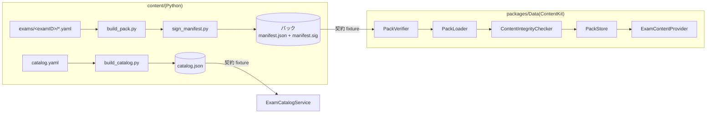

# Cloudrill 詳細設計書 P2: コンテンツパック

| 項目 | 内容 |
|---|---|
| 文書バージョン | 0.1(初版ドラフト) |
| 作成日 | 2026-10-21 |
| 上位文書 | [詳細設計書(索引・共通設計)](../DDD.md) |
| 対象 | `content/scripts/contentpack/`(ビルド・署名・カタログ)、`packages/Data` の `ContentKit`、`packages/Domain` の `DomainInterfaces`(コンテンツ提供のプロトコル) |
| ステータス | レビュー待ち |

---

## 目次

1. [目的とスコープ](#1-目的とスコープ)
2. [前提](#2-前提)
3. [設計](#3-設計)
4. [ステップ](#4-ステップ)
5. [フェーズの完了条件](#5-フェーズの完了条件)
6. [申し送り](#6-申し送り)

---

## 1. 目的とスコープ

YAML のコンテンツを、署名付きの配信用パックにする処理(Python)と、アプリがパックを検証して読み込む処理(Swift)を作る。2つの言語の間の取り決めは、**契約 fixture**(Python が作ったパックを、Swift のテストがそのまま読む)で固定する。

| 区分 | 内容 |
|---|---|
| スコープ内 | パックの形式、`build_pack.py`、`sign_manifest.py`、`build_catalog.py`、`catalog.yaml`、CI-13、契約 fixture、`PackVerifier`、`PackLoader`、`ContentIntegrityChecker`、`PackStore`、同梱パックとカタログ |
| スコープ外 | CDN からの取得と差分更新(P5-S03)、リリースのワークフロー(P5-S01)、ドキュメントの全文検索インデックス(P6-S03) |



---

## 2. 前提

- P0 が完了している。Swift 側(P2-S05 以降)は、P1 の完了も前提にする(`QuestionKind` の対応一覧を `AnswerEvaluatorRegistry` から得るため)。
- 外部依存 `cryptography` の採用を確認済みである([DDD 8 章](../DDD.md#8-外部依存の候補))。
- ブランチは `feat/p2-content-pack`。

---

## 3. 設計

### 3.1 パックの形式(formatVersion 1)

```text
<examID>/<packVersion>/
├── manifest.json
├── manifest.sig              # manifest.json のバイト列に対する Ed25519 署名(Base64、改行なし)
├── exam.json                 # exam.yaml を JSON にしたもの(ExamDefinition)
├── vendor.json               # vendors.yaml のうち、この試験のベンダー(Vendor)
├── exam-sets.json            # ExamSetsFile
├── questions/
│   ├── index.json            # 全問題の要約(QuestionIndexEntry の配列)
│   └── domain{N}.json        # ドメインごとの問題本文(Question の配列。ID の昇順)
├── flashcards.json           # 全カードを1つにまとめたもの({ cards: [...] })。features.flashcards が true のときだけ
├── cases.json                # CaseStudy の配列。features.caseStudies が true のときだけ
├── decisions.json            # DecisionTree の配列。features.decisionTrees が true のときだけ
├── drills.json               # { drills: [...] }。features.keywordDrills が true のときだけ
├── docs/
│   ├── index.json            # DocEntry の配列(フロントマターと本文のパス)
│   └── <subObjective>.md     # フロントマターを除いた本文
└── assets/                   # 図(SVG / PNG)
```

```json
{
  "formatVersion": 1,
  "examID": "gcp-pca",
  "packVersion": "1.2.0",
  "examGuideVersion": "6.1",
  "minAppVersion": "1.0.0",
  "createdAt": "2026-11-01T00:00:00Z",
  "keyID": "prod-2026",
  "files": [
    { "path": "exam.json", "sha256": "…", "size": 4096 }
  ]
}
```

| 項目 | 規則 |
|---|---|
| `files` | `manifest.json` と `manifest.sig` を除く全ファイル。`path` の昇順 |
| JSON の書式 | キーを並べ替え、空白なし(`separators=(",", ":")`)、UTF-8、末尾に改行なし。`manifest.json` だけは読みやすさのため `indent=2` にする(署名はバイト列に対して行うので、書式は検証に影響しない) |
| `createdAt` | `SOURCE_DATE_EPOCH` から作る(秒精度、`Z`) |
| `formatVersion` | ファイルの構成やキーの意味を変えたら上げる。アプリは `supportedFormatVersion` 以下のパックだけを取り込む |
| `minAppVersion` | 新しい構造語彙(①)を使うときに、それを解釈できる最初のアプリの版にする([DDD 4.10 C](../DDD.md#c-新しい出題形式を追加するアプリの更新が必要)) |

**問題の索引**(`questions/index.json` の1件):

```json
{ "id": "Q-3.2-0147", "revision": 2, "domain": 3, "subObjective": "3.2", "caseStudy": "ehr",
  "difficulty": 3, "kind": "single", "examSets": [1] }
```

起動時には、索引と `exam.json`・`exam-sets.json`・`docs/index.json` だけを読む(NFR-01)。問題の本文は、模試の開始時や練習の開始時に、必要なドメインのファイルだけを読む(NFR-02)。

### 3.2 追加する Schema と Swift の型

| Schema(`content/schemas/`) | 対象 | Swift の型(DomainModels) |
|---|---|---|
| `pack-question-index.schema.json` | `questions/index.json` | `QuestionIndexEntry` |
| `pack-docs-index.schema.json` | `docs/index.json` | `DocEntry`(`subObjective`、`title`、`references`、`path`) |
| `catalog.schema.json` | `catalog.json`([DDD 4.8](../DDD.md#48-配信の構成)) | `Catalog`、`CatalogEntry`、`CatalogStatus` |
| `catalog-source.schema.json` | `content/catalog.yaml` | (Python のみ) |

Schema と Swift の型は、同じ PR で変更する(CLAUDE.md の運用ルール)。

### 3.3 署名と鍵

| 項目 | 方式 |
|---|---|
| アルゴリズム | Ed25519 |
| 署名の対象 | `manifest.json` のバイト列そのもの([DDD 2 章 C-06](../DDD.md#2-基本設計書からの変更点)) |
| `manifest.sig` | 64 バイトの署名を Base64(標準のアルファベット、パディングあり)にした ASCII。改行なし |
| 本番の鍵 | 32 バイトの秘密鍵(seed)を Base64 にして Secret Manager に置く。CI からだけ読む(P5-S01) |
| 鍵 ID | `manifest.json` の `keyID`。アプリは、鍵 ID と公開鍵の組を複数持つ(ローテーションのため) |
| ローテーション | ①新しい公開鍵を入れたアプリをリリースする → ②その版が十分に普及したら、新しい鍵で署名を始める → ③古い鍵を外したアプリをリリースする |
| テスト用の鍵 | `contentpack.testing.test_signing_key(label)` が、`SHA-256("examprep-test-key:" + label)` を seed にして決定論的に作る。秘密鍵はファイルにしない(PEM をコミットしない)。公開鍵だけを `packs/test-keys.json` に出力する |

### 3.4 アプリ内の保存の構成(PackStore)

```text
<App Group コンテナ>/Library/Application Support/Content/
└── <examID>/
    ├── state.json                  # 現在の版、直前の版、模試が固定している版
    ├── versions/<packVersion>/…    # インストール済みのパック
    └── staging/<UUID>/             # 更新中の一時ディレクトリ(P5-S03)
```

```json
{
  "current": { "source": "installed", "version": "1.2.0" },
  "previous": { "source": "bundled", "version": "1.0.0" },
  "pins": { "<受験の UUID>": "1.1.0" }
}
```

- `source` は `bundled`(アプリに同梱。読み取り専用)か `installed`(`versions/` の下)。同梱パックはコピーしない(初回起動を速くするため。NFR-01)。
- `state.json` は `Data.write(to:options: .atomic)` で書く(同じボリューム内でのリネームになるので、書き込みの途中で失われない)。
- 削除の対象は、`current`、`previous`、`pins` のどれにも含まれない版だけである(E-07、BDD 6.8 のロールバック)。
- インストール時に全ファイルを検証したパックは、起動時には再検証しない(NFR-01)。

### 3.5 Swift の型

```swift
// packages/Domain/Sources/DomainInterfaces/ExamContentProvider.swift
/// 1つの試験の、読み込み済みのコンテンツ。Feature はこのプロトコルだけに依存する(DDD 5.3 R-03)。
public protocol ExamContentProvider: Sendable {
    var definition: ExamDefinition { get }
    var vendor: Vendor { get }
    var packVersion: String { get }
    var questionIndex: [QuestionIndexEntry] { get }
    var examSets: [ExamSet] { get }
    var docsIndex: [DocEntry] { get }
    func questions(ids: [String]) async throws(ContentError) -> [Question]
    func flashcards() async throws(ContentError) -> [Flashcard]
    func caseStudies() async throws(ContentError) -> [CaseStudy]
    func decisionTrees() async throws(ContentError) -> [DecisionTree]
    func keywordDrills() async throws(ContentError) -> [KeywordDrill]
    func docBody(for entry: DocEntry) async throws(ContentError) -> String
}

public enum ContentError: Error, Equatable, Sendable {
    case fileMissing(String)
    case undecodable(path: String, reason: String)
    case featureDisabled(String)
    case unknownQuestionIDs([String])
    case integrityViolations([IntegrityViolation])
    case storage(String)
}
```

```swift
// packages/Data/Sources/ContentKit/PackVerifier.swift
public struct PackVerifier: Sendable {
    public init(keyRing: PublicKeyRing, appVersion: SemanticVersion, supportedFormatVersion: Int)
    /// 検証の順序: 署名 → デコード → 形式の版 → アプリの版 → 試験 ID → 版の巻き戻し → 各ファイル(パス、存在、サイズ、SHA-256)
    public func verify(
        packAt directory: URL,
        expectedExamID: ExamID,
        currentVersion: SemanticVersion?
    ) throws(PackVerificationError) -> Manifest
}

public enum PackVerificationError: Error, Equatable, Sendable {
    case manifestMissing
    case signatureMissing
    case signatureInvalid
    case manifestUndecodable
    case unsupportedFormat(Int)
    case appTooOld(required: String)            // E-04
    case examMismatch(expected: ExamID, actual: ExamID)
    case notNewer(current: String, candidate: String)
    case unsafePath(String)
    case fileMissing(String)
    case sizeMismatch(String)
    case hashMismatch(String)
}
```

- **署名を最初に確かめる**。署名が正しいと分かるまで、manifest の JSON をデコードしない(信頼できない入力を解析しないため)。
- 署名の検証は、鍵リングのすべての鍵で試す。成功した鍵の ID と、デコード後の `keyID` が一致しなければ `signatureInvalid` にする。
- パスの安全性は、Schema と同じ正規表現に加えて、次の2点で確かめる。
  - 標準化した URL がパックのディレクトリの中にあること
  - シンボリックリンクでないこと

---

## 4. ステップ

### P2-S01 パックの形式の Schema と Swift の型

| 項目 | 内容 |
|---|---|
| 対応要件 | [3.1](#31-パックの形式formatversion-1)、[3.2](#32-追加する-schema-と-swift-の型)、RDD 7.3 |
| 前提 | P0 |
| 成果物 | `content/schemas/pack-question-index.schema.json`、`pack-docs-index.schema.json`、`catalog.schema.json`、`catalog-source.schema.json`、`tests/test_schemas.py`、`packages/DomainModels/Sources/DomainModels/PackIndex.swift`、`Catalog.swift`、`Tests/DomainModelsTests/PackIndexTests.swift` |

**Red**:

| テスト | 条件(Arrange) | 期待(Assert) |
|---|---|---|
| `test_question_index_schema_accepts_entry` | [3.1](#31-パックの形式formatversion-1) の索引の例 | 違反なし |
| `test_question_index_schema_rejects_missing_kind` | `kind` がない | 違反あり |
| `test_docs_index_schema_requires_path` | `path` がない | 違反あり |
| `test_catalog_schema_accepts_example` | [DDD 4.8](../DDD.md#48-配信の構成) の例 | 違反なし |
| `test_catalog_schema_rejects_unknown_status` | `status: beta` | 違反あり |
| `test_catalog_source_schema_accepts_minimal` | `exams: [{ id: gcp-pca, status: comingSoon, productIDs: [] }]` | 違反なし |
| `PackIndexTests.decodeIndexEntry` | 索引の例 | `kind == .single`、`caseStudy == "ehr"` |
| `PackIndexTests.indexEntryWithoutCase` | `caseStudy: null` | `caseStudy == nil` |
| `CatalogTests.decodeCatalog` | カタログの例 | `exams[0].status == .available` |
| `CatalogTests.unknownStatusFails` | `status: beta` | デコードエラー(① 構造語彙) |

**Green**: Schema と型を追加する。`QuestionSelector` に `QuestionSummary.init(_ entry: QuestionIndexEntry)` を追加する。

**Refactor**: `QuestionIndexEntry` と `Question` で共通の項目(`id`、`domain` など)の型が一致していることを、型のコメントで対応づける。

**完了条件**: `(cd content && .venv/bin/pytest tests/test_schemas.py)` と `swift test --package-path packages/DomainModels` が通る。

**実装メモ**(実装時に本書と変えた点):

- `CatalogTests` は `PackIndexTests.swift` に入れず、`Tests/DomainModelsTests/CatalogTests.swift` に分けた(テスト名とファイル名をそろえるため)。
- カタログの `latestPackVersion` と `minAppVersion` は、`SemVer` か `null` にした(どちらも必須のキー)。P2-S03 の `test_catalog_from_source`(`--previous` なし)では、パックがまだないので `null` になる。Swift の型では `String?`。
- `docs/index.json` の `path` は、Schema で `docs/` 直下の `.md` に限った(`^docs/[A-Za-z0-9_-][A-Za-z0-9._-]*\.md$`)。パスの安全性は manifest の `files` と同じく P2-S05 でも確かめる。
- `CatalogStatus` は `catalog.schema.json#/$defs/CatalogStatus` に置き、`catalog-source.schema.json` から参照する。試験 ID の実在と重複は CI-13(P2-S03)が確かめるので、`catalog-source` の Schema では確かめない。
- `QuestionIndexEntry` には public の init を付けた(Domain のテストと、P2-S07 のテストで値を作るため)。`DocEntry`・`Catalog` はデコードだけで使うので付けていない。
- 本書の Red に加えて、次のテストを足した: 索引の `caseStudy: null` の受理と `caseStudy` キーの欠落の拒否、docs の `path` が `docs/` の外を指す場合の拒否、カタログの未配信の試験(版が `null`)の受理、`catalog-source` の未知の status の拒否、Swift の `unknownKindFails`・`decodeDocEntry`・`unreleasedExam`、Domain の `summaryFromIndexEntry`。
- 新しい Schema は、ソースの YAML(`Kind`)に対応しないので、fixture と `export_json.py` は変えていない。

---

### P2-S02 パックのビルド(build_pack.py)

| 項目 | 内容 |
|---|---|
| 対応要件 | FR-CONT-01、NFR-05、[DDD 6.3](../DDD.md#63-決定論) |
| 前提 | P2-S01 |
| 成果物 | `content/scripts/build_pack.py`(CLI)、`content/scripts/contentpack/__init__.py`、`build.py`、`tests/test_build_pack.py` |

```text
content/scripts/build_pack.py --exam <examID> --version <X.Y.Z> --min-app-version <X.Y.Z> --key-id <ID>
                              [--root content] --out <出力先>
環境変数 SOURCE_DATE_EPOCH(必須)
出力: <出力先>/<examID>/<version>/(manifest.sig は作らない。署名は sign_manifest.py が行う)
終了コード: 0 = 成功 / 1 = コンテンツの検証で error がある / 2 = 引数・環境の不備、出力先がすでにある
```

**Red**:

| テスト | 条件(Arrange) | 期待(Assert) |
|---|---|---|
| `test_build_is_deterministic` | 同じ入力と `SOURCE_DATE_EPOCH` で2回ビルドする | すべてのファイルのバイト列が一致する |
| `test_build_aborts_on_validation_error` | CI-08 違反の invalid fixture(`materialize` で作る) | 終了コード 1。出力先が作られない |
| `test_build_allows_warnings` | CI-11(warning)だけがある状態 | 終了コード 0。warning を標準エラーに出す |
| `test_build_requires_source_date_epoch` | 環境変数がない | 終了コード 2 |
| `test_build_refuses_existing_output` | 出力先がすでにある | 終了コード 2(上書きしない) |
| `test_manifest_lists_all_files_sorted` | `test-alpha` | `files` が出力の全ファイル(manifest を除く)と一致し、`path` の昇順 |
| `test_manifest_hashes_match` | 同上 | 各ファイルの SHA-256 とサイズが一致する |
| `test_manifest_validates_against_schema` | 同上 | `manifest.schema.json` に適合する |
| `test_beta_pack_has_no_disabled_features` | `test-beta` | `cases.json`、`decisions.json`、`drills.json` がない |
| `test_questions_split_by_domain` | `test-alpha` | `questions/domain1.json` 〜 `domain6.json` があり、各問題が自分のドメインのファイルにある |
| `test_index_matches_questions` | 同上 | 索引の件数と ID が、全ドメインのファイルの問題と一致する |
| `test_docs_frontmatter_removed` | 同上 | `docs/*.md` の先頭が `---` で始まらない。`docs/index.json` にフロントマターの内容がある |
| `test_vendor_embedded` | `test-beta` | `vendor.json` の `id == "example-cloud"` |
| `test_pack_has_no_exam_specific_code_paths` | `contentpack/**/*.py` | 試験 ID の文字列を含まない([P0 の拡張性テスト](DDD-P0-MultiExamContent.md#p0-s07-2つ目の-fixture-試験拡張性の受け入れテスト)と同じ確認) |

**Green**: `contentpack.build.build_pack(root, exam_id, version, min_app_version, key_id, out, epoch) -> Path` を実装する。検証は `contentvalidate.engine.run(..., exams={exam_id})` を再利用する。YAML の読み込みは `contentvalidate.loader.parse_yaml` を再利用する(`export_json.py` と同じ正規化にするため)。

**Refactor**: ファイルごとの変換(問題の分割、カードの結合、docs の分離)を、`Kind` ごとの関数の表にまとめる。新しい種別を追加するときは、表に1行足せばよいようにする。

**完了条件**: `(cd content && .venv/bin/pytest tests/test_build_pack.py)` が通る。

**実装メモ**(実装時に本書と変えた点):

- `build_pack` は `Path` ではなく `BuiltPack(path, warnings)` を返す。CLI が warning を標準エラーに出すため。error があるときは `ContentInvalid(issues)`(終了コード 1)、引数・環境の不備と出力先がすでにあるときは `BuildError`(終了コード 2)を送出する。全体の設定ファイルを指定できるように、validate.py と同じ `--config` も受け付ける。
- 検証は `engine.run(..., exam_ids={exam_id})` を、読み込みは `loader.load_content`(内部で `parse_yaml`)を再利用した。docs の本文を取り出すために、`loader` に `strip_frontmatter` を追加した(フロントマターの判定は `split_frontmatter` と共有)。本文の先頭の空行も除く。
- 出力は、出力先と同じディレクトリの一時ディレクトリに書いてから rename する。途中で失敗しても、不完全なパックを残さない。引数の検証と内容の検証は書き込みの前に行うので、終了コードが 1 か 2 のときは何も作らない。
- `--version` と `--min-app-version` は `common.schema.json` の `SemVer` の正規表現で確かめる(正規表現を Schema から読み、コードに複製しない)。作った manifest は書き込む前に `manifest.schema.json` で検証する。
- `questions/domain{N}.json` は、`exam.yaml` のすべてのドメインについて出力する(問題がなければ空の配列)。読み込み側(P2-S06)がファイルの有無で分岐しなくて済むようにするため。
- `docs/index.json` は `features.docs` が false でも空の配列で出力する(起動時に必ず読むため)。本文は `docs/<subObjective>.md` に置き、同じ `subObjective` の docs が2つあれば `BuildError` にする。
- 配列(問題、カード、ケース、ツリー、ドリル、docs)は ID(docs は `subObjective`)の昇順に並べる。カードとドリルは、ファイルをまたいで1つのラッパー(`{ cards: [...] }`、`{ drills: [...] }`)にまとめる。
- `assets/` はまだ作らない。図の元データの置き場所がコンテンツの規約にないため(図を追加するときに、置き場所と一緒に決める)。
- 本書の Red に加えて、次のテストを足した: 引数の不備(存在しない試験、SemVer でない版)、`SOURCE_DATE_EPOCH` が空・数値でない・負の場合、各ファイルの Schema への適合(索引、docs の索引、exam、exam-sets、flashcards)、JSON の書式、`test-alpha` で有効な機能のファイルがあること。
- `manifest.schema.json` と `content/README.md` の「生成と署名はこのリポジトリの対象外」という記述を直した(生成は build_pack.py、署名は P2-S03 の sign_manifest.py)。
- 実データ(`gcp-pca`)でもビルドできることを確かめた(warning は既存の CI-02 の 7 件だけ)。

---

### P2-S03 署名、カタログ、CI-13

| 項目 | 内容 |
|---|---|
| 対応要件 | NFR-10、[3.3](#33-署名と鍵)、[DDD 4.8](../DDD.md#48-配信の構成) |
| 前提 | P2-S02 |
| 成果物 | `content/scripts/sign_manifest.py`、`build_catalog.py`、`contentpack/sign.py`、`catalog.py`、`testing.py`、`verify.py`、`content/catalog.yaml`、`contentvalidate/rules/ci13_catalog.py`、`tests/test_sign.py`、`tests/test_catalog.py` |

```text
content/scripts/sign_manifest.py --manifest <manifest.json> --key-id <ID> (--key-env <環境変数名> | --test-key <label>)
content/scripts/build_catalog.py [--previous <catalog.json>] [--update <examID>=<manifest.json> …] [--root content] --out <catalog.json>
```

**Red**:

| テスト | 条件(Arrange) | 期待(Assert) |
|---|---|---|
| `test_sign_and_verify` | テスト用の鍵で署名する | `contentpack.verify.verify_pack` が成功する |
| `test_signature_is_deterministic` | 同じ鍵で2回署名する | `manifest.sig` が一致する(Ed25519 は決定論的) |
| `test_tampered_manifest_fails` | 署名後に `manifest.json` を1バイト変える | 検証が `signature_invalid` で失敗する |
| `test_key_id_mismatch_exits_2` | manifest の `keyID` と `--key-id` が異なる | 終了コード 2 |
| `test_sig_format` | 署名ファイル | Base64 の ASCII で改行がなく、デコードすると 64 バイト |
| `test_verify_detects_hash_mismatch` | 署名後に `exam.json` を変える | `hash_mismatch` |
| `test_catalog_from_source` | `catalog.yaml` と `exam.yaml` だけ(`--previous` なし) | 全試験の名前とベンダーが入り、`latestPackVersion` は `null` |
| `test_catalog_update_entry` | `--previous` と、`--update gcp-pca=<manifest>` | その試験の `latestPackVersion` と `minAppVersion` だけが更新される |
| `test_catalog_rejects_downgrade` | `--update` の版が、`--previous` の版より低い | 終了コード 2 |
| `test_catalog_is_deterministic` | 同じ入力で2回 | バイト列が一致する |
| `CI-13-unknown-exam`(invalid fixture) | `catalog.yaml` に存在しない試験 ID | CI-13 error |
| `CI-13-duplicate-exam`(invalid fixture) | 同じ試験 ID が2回 | CI-13 error |

CI-13 は全体ルール(`scope=GLOBAL`)とする。`catalog.yaml` は任意のファイルで、ない場合は CI-13 は何も報告しない(fixture の大半のケースを単純に保つため)。

**Green**: 上記を実装する。`verify.py` は、P5-S01 でアップロード後の確認にも使う。

**Refactor**: Swift の `PackVerifier` と同じ検証の順序([3.5](#35-swift-の型))に、Python の `verify_pack` の順序をそろえる。エラーの名前も、Swift の enum の case と対応させる(`signature_invalid` ↔ `signatureInvalid`)。

**完了条件**: `(cd content && .venv/bin/pytest)` が通り、`validate.py` が error 0 件。

**実装メモ**:

- `cryptography==50.0.2` を直接依存として固定した。署名 CLI は manifest の Schema と鍵 ID を確認し、manifest を変更せずに署名する。署名・カタログとも一時ファイルからアトミックに置き換える。
- `verify_pack` は鍵 ID → `Ed25519PublicKey` の辞書を受け取る。`VerificationError.code` は Swift の case に対応する snake_case。署名・デコード・版・ファイルの検証を関数に分け、SHA-256 は1MBずつ読む。パスの Schema 違反はファイル検証段階の `unsafe_path` として扱う。
- カタログの `generatedAt` にも必須の `SOURCE_DATE_EPOCH` を使う。パックが未配信の場合は `comingSoon` と版 `null` を使い、`available` かつ版なしは既存 Schema に従って拒否する。初期の `content/catalog.yaml` は `comingSoon`。
- `catalog.yaml` を任意の全体ソースとして loader に追加した。構文・Schema 違反は CI-01、試験 ID の実在・重複は CI-13。`--exam` で絞っても全試験の実在を調べる。CI-13 の invalid fixture は生成スクリプトからルート直下への overlay として生成する。
- 追加確認: 鍵のローテーション、署名検証前の JSON 解析禁止、鍵 ID の不一致、存在・サイズ・hash、パスと親ディレクトリのシンボリックリンク、SemVer の prerelease と build metadata、環境変数の不備、秘密値を出さないエラー、書き込み失敗時の旧ファイル保持。Schema の SemVer 正規表現で許容される空の識別子・数値 prerelease の先頭ゼロも、比較処理では拒否する。
- 作業ブランチは利用者の指定により `dev` を継続する。

---

### P2-S04 契約 fixture

| 項目 | 内容 |
|---|---|
| 対応要件 | AC-05、[DDD 7.4](../DDD.md#74-テストダブル) |
| 前提 | P2-S03 |
| 成果物 | `content/tests/fixtures/generate_packs.py`、`content/tests/fixtures/packs/`、`tests/test_generated.py` への追加 |

```text
content/tests/fixtures/packs/
├── test-keys.json                  # { "test-2026": "<公開鍵 Base64>", "test-next": "<公開鍵 Base64>" }
├── catalog.json
├── valid/
│   ├── test-alpha/1.0.0/
│   ├── test-alpha/1.1.0/           # 問題を1つ改訂した版(P5-S03 の差分更新のテスト用)
│   └── test-beta/1.0.0/
└── tampered/
    ├── bad-signature/              # manifest.json を1バイト変えた
    ├── unknown-key/                # 鍵リングにない鍵(label: "outsider")で署名した
    ├── hash-mismatch/              # questions/domain1.json の内容を変えた
    ├── size-mismatch/              # manifest の size を変えて署名し直した
    ├── missing-file/               # exam-sets.json を削除した
    ├── app-too-old/                # minAppVersion: 99.0.0 で署名した
    ├── unsupported-format/         # formatVersion: 2 で署名した
    ├── exam-mismatch/              # test-beta の内容に examID: test-alpha を付けて署名した
    └── path-traversal/             # files[].path に "../outside.json" を含めて署名した(Schema を迂回して直接書く)
```

**Red**:

| テスト | 条件(Arrange) | 期待(Assert) |
|---|---|---|
| `test_generated.py::test_packs_match_generator` | `generate_packs.py` の出力とコミット済みの `packs/` | 一致する(現在は `packs/` がないので失敗する) |
| `test_generated.py::test_valid_packs_verify` | `packs/valid/*/*` を `verify_pack` で検証する | すべて成功する |
| `test_generated.py::test_tampered_packs_fail_with_expected_error` | `packs/tampered/*` | 各ディレクトリ名に対応するエラーで失敗する(対応表は `generate_packs.py` に置く) |

**Green**: `generate_packs.py` を実装し、`packs/` を生成してコミットする。`SOURCE_DATE_EPOCH` は固定値(`1793491200` = 2026-11-01T00:00:00Z)を使う。

**Refactor**: 改ざんの種類と期待するエラーの対応表を、Swift のテスト(P2-S05)からも読めるように、`packs/tampered/expected.json` に出力する。

**完了条件**: `(cd content && .venv/bin/pytest tests/test_generated.py)` が通る。

**実装メモ**:

- `generate_packs.py [--out <packs>]` は一時ディレクトリで元の fixture を生成し、製品の build/sign/catalog を通して出力する。元の valid fixture は変更しない。生成が完了してから出力先を置き換える。
- `test-alpha/1.1.0` は先頭の問題1件の revision と日英の解説を改訂する。正常なパックは3つ、改ざんは設計どおり9種類。
- `tampered/expected.json` は `{directory, error, expectedExamID}` の配列。`exam-mismatch` は beta の内容に alpha の examID を付け、期待する試験を beta として検証する。hash-mismatch はファイルサイズを変えずに改ざんする。
- 生成物の一致に加えて、再生成時の古いファイルの除去、改訂が1問だけであること、カタログの Schema・試験・版をテストする。公開鍵だけを保存し、秘密鍵は保存しない。

---

### P2-S05 パックの検証(PackVerifier)

| 項目 | 内容 |
|---|---|
| 対応要件 | NFR-10、AC-05、E-02、E-04 |
| 前提 | P2-S04、P1 の完了 |
| 成果物 | `packages/Data/Package.swift`、`Sources/ContentKit/SemanticVersion.swift`、`PublicKeyRing.swift`、`PackVerifier.swift`、`Tests/ContentKitTests/`、`.github/workflows/data-test.yml` |

**Red**:

| テスト | 条件(Arrange) | 期待(Assert) |
|---|---|---|
| `SemanticVersionTests.ordering`(表形式) | `1.0.0 < 1.0.1 < 1.1.0 < 2.0.0`、`1.0.0-alpha < 1.0.0`、`1.0.0-alpha < 1.0.0-alpha.1 < 1.0.0-beta`、`1.0.0+build == 1.0.0`(順序の比較) | SemVer 2.0.0 の優先順位に従う |
| `SemanticVersionTests.rejectsInvalid` | `1.0`、`01.0.0`、`v1.0.0` | 初期化が `nil` |
| `PublicKeyRingTests.loadsTestKeys` | `packs/test-keys.json` | 鍵が2つ |
| `PackVerifierTests.validPacks` | `packs/valid/*/*` | すべて成功し、`Manifest` を返す |
| `PackVerifierTests.tamperedPacks`(表形式) | `packs/tampered/*` と `expected.json` | 各ディレクトリで、期待する `PackVerificationError` になる |
| `PackVerifierTests.notNewerIsRejected` | `currentVersion: 1.1.0` で `test-alpha/1.0.0` | `.notNewer(current: "1.1.0", candidate: "1.0.0")` |
| `PackVerifierTests.sameVersionIsRejected` | `currentVersion: 1.0.0` で `test-alpha/1.0.0` | `.notNewer` |
| `PackVerifierTests.firstInstallAllowsAnyVersion` | `currentVersion: nil` | 成功する |
| `PackVerifierTests.symlinkIsRejected` | 一時ディレクトリに有効なパックをコピーし、1ファイルをシンボリックリンクに置き換える | `.unsafePath` |
| `PackVerifierTests.signatureCheckedBeforeDecode` | `manifest.json` を不正な JSON にし、署名は元のまま | `.signatureInvalid`(`.manifestUndecodable` ではない) |

テストは、fixture を `URL(filePath: #filePath)` からの相対パス(`../../content/tests/fixtures/packs`)で直接読む(DomainModels のテストと同じ方式)。

**Green**: [3.5](#35-swift-の型) の `PackVerifier` を実装する。SHA-256 は CryptoKit の `SHA256` で、`FileHandle` から 1MB ずつ読んで計算する(大きな図のファイルでメモリを使いすぎないため)。

**Refactor**: 検証の各段階を、`private func checkSignature`、`checkVersions`、`checkFiles` に分ける。

**完了条件**: `swift test --package-path packages/Data --filter PackVerifierTests` と `SemanticVersionTests` が通る。`data-test.yml` を追加し、PR で通ることを確認する。

**実装メモ**:

- Data パッケージを追加。外部の暗号ライブラリを増やさず、CryptoKit の Ed25519 と SHA-256 を使用した。
- `PublicKeyRing(data:)` は JSON の鍵 ID → Base64 公開鍵を読み、鍵 ID の空文字・Base64・32バイト長を検証する。
- `SemanticVersion` は任意桁数の整数を文字列で比較する。build metadata は比較・等価性・ハッシュに含めず、description には元の表記を保持する。
- Python の `expected.json` を直接読み、正常3パックと改ざん9種類の契約を検証する。追加でメタデータ欠落、ファイルと親ディレクトリのシンボリックリンク、不正なSemVer、公開鍵不備を確認する。
- ローカルでは `DEVELOPER_DIR=/Applications/Xcode.app/Contents/Developer` を指定して実行した。`data-test.yml` は追加済み。リモートの PR CI は push / PR 作成後に確認する。

---

### P2-S06 パックの読み込み(PackLoader と ExamContentProvider)

| 項目 | 内容 |
|---|---|
| 対応要件 | NFR-01、NFR-02、FR-CONT-01 |
| 前提 | P2-S05 |
| 成果物 | `packages/Domain/Sources/DomainInterfaces/ExamContentProvider.swift`(Domain の Package.swift にターゲットを追加)、`packages/Data/Sources/ContentKit/PackLoader.swift`、`PackContent.swift`、`Tests/ContentKitTests/PackLoaderTests.swift` |

**Red**:

| テスト | 条件(Arrange) | 期待(Assert) |
|---|---|---|
| `loadsEagerParts` | `packs/valid/test-alpha/1.0.0` | `definition`、`vendor`、`questionIndex`、`examSets`、`docsIndex` が読める |
| `doesNotReadQuestionBodiesAtLoad` | 読み込みを `SpyFileReader` で記録する | `questions/domain*.json` を読んでいない(NFR-01) |
| `questionsReadOnlyNeededDomains` | ドメイン 2 の問題 ID だけを要求する | 読んだのは `questions/domain2.json` だけ |
| `questionsAreCached` | 同じ ID を2回要求する | ファイルの読み込みは1回 |
| `questionsKeepRequestedOrder` | ID を [Q3, Q1] の順で要求する | 結果も [Q3, Q1] の順 |
| `unknownQuestionID` | 存在しない ID を含めて要求する | `ContentError.unknownQuestionIDs([その ID])`(黙って除かない) |
| `disabledFeature` | `test-beta` で `caseStudies()` | `ContentError.featureDisabled("caseStudies")` |
| `docBody` | `test-alpha` の `docsIndex[0]` | フロントマターのない本文 |
| `loadAllQuestionsForExamSetUnderBudget` | 55 問を一括で読む | 処理時間を計測し、記録する(しきい値は実機で決める。シミュレータでは記録のみ) |

> 存在しない ID は、CI と `ContentIntegrityChecker` で防いでいるので、ここに来るのはプログラムの誤りだけである。早く気づけるように、結果から除かずにエラーにする。`ContentError` に `unknownQuestionIDs([String])` を追加する。

**Green**:

```swift
public struct PackLoader: Sendable {
    public init(fileReader: any FileReading = FileManagerReader())
    public func load(packAt directory: URL, manifest: Manifest) throws(ContentError) -> PackContent
}

/// 読み込み済みのパック。索引などは不変の値として持ち、問題の本文は actor の中でキャッシュする。
public final class PackContent: ExamContentProvider {
    public let definition: ExamDefinition
    public let vendor: Vendor
    public let packVersion: String
    public let questionIndex: [QuestionIndexEntry]
    public let examSets: [ExamSet]
    public let docsIndex: [DocEntry]
    private let bodies: QuestionBodyCache   // actor
    // …
}
```

`FileReading` は、ファイルの読み込みを抽象化するプロトコルにする(テストで読み込みを記録するため)。

**Refactor**: 本文のキャッシュ(`QuestionBodyCache`)と、ファイルの読み込み(`FileReading`)の責務を分ける。

**完了条件**: `swift test --package-path packages/Data --filter PackLoaderTests` と `swift test --package-path packages/Domain` が通る。

**実装メモ**:

- Domain に `DomainInterfaces` を追加し、`ExamContentProvider` と型付き `ContentError` を定義した。`IntegrityViolation` は ContentError が参照するため、Data ではなく DomainInterfaces に置く（詳細は P2-S07）。
- 起動時の読み込みは exam、vendor、問題索引、模試、docs索引の5ファイル。本文は `QuestionBodyCache` actor でドメイン単位にキャッシュする。ファイル I/O は `FileReading.swift` に分離した。
- 問題要求の順序・重複を保持し、索引にない ID は I/O 前にエラーにする。同時10要求でも本文の読み込みが1回であることを確認する。無効機能は明示的なエラー、索引外の DocEntry も拒否する。
- 55問の読み込み時間はローカルMacで約5ms（記録のみ。実機のしきい値ではない）。Data 全24テストを確認した。

---

### P2-S07 内容の整合チェック(ContentIntegrityChecker)

| 項目 | 内容 |
|---|---|
| 対応要件 | [DDD 4.3](../DDD.md#43-語彙の3つの層) の②、NFR-10 |
| 前提 | P2-S06 |
| 成果物 | `Sources/ContentKit/ContentIntegrityChecker.swift`、`IntegrityViolation.swift`、`Tests/ContentKitTests/ContentIntegrityCheckerTests.swift` |

CI-09・CI-12 と同じ条件を、アプリでも確認する。CI を通らずに作られたパック(手作業や、ツールの不具合)を取り込まないためである。

**Red**: `test-alpha` のパックを読み込み、テストの中で1か所だけ値を書き換えた `PackContent` を作って確認する。

| テスト | 書き換え | 期待(Assert) |
|---|---|---|
| `validPacksHaveNoViolations` | なし(`test-alpha`、`test-beta`) | 違反 0 件 |
| `unknownDomain` | 索引の1件を `domain: 9` | `.unknownDomain(questionID:, domain: 9)` |
| `subObjectiveInWrongDomain` | `subObjective: "2.1"`、`domain: 1` | `.subObjectiveDomainMismatch` |
| `unknownCaseStudy` | `caseStudy: "acmeBank"` | `.unknownCaseStudy` |
| `caseStudyWhenDisabled` | `test-beta` の索引の1件に `caseStudy: "ehr"` | `.caseStudyFeatureDisabled` |
| `unsupportedKind` | `supportedKinds: [.single]` で `test-alpha`(multiple を含む) | `.unsupportedQuestionKind(.multiple)` |
| `kindNotAllowedByExam` | `test-beta` の索引の1件を `kind: multiple` | `.questionKindNotAllowed` |
| `examSetReferencesMissingQuestion` | 模試の `questionIDs` に存在しない ID | `.missingQuestion` |
| `examSetCaseCount` | 模試の `caseStudies` を1つにする(`caseStudiesPerSet: 2`) | `.examSetCaseCountMismatch` |
| `unknownWAFPillar` | 問題本文の `wafPillars: [resilience]`(`test-alpha`) | `.unknownWAFPillar`(本文の確認は、模試の開始時に問題を読み込んだときに行う) |

**Green**:

```swift
public struct ContentIntegrityChecker: Sendable {
    /// supportedKinds は、アプリ本体で AnswerEvaluatorRegistry.standard から作って渡す(ContentKit を ExamEngine に依存させないため)
    public init(supportedKinds: Set<QuestionKind>)
    public func check(_ content: PackContent) -> [IntegrityViolation]
    public func check(questions: [Question], in definition: ExamDefinition) -> [IntegrityViolation]
}
```

**Refactor**: 確認の条件を、P0 の [3.4](DDD-P0-MultiExamContent.md#34-ci-12試験定義の整合) と [3.5](DDD-P0-MultiExamContent.md#35-既存ルールの変更) の表と同じ順に並べ、各条件のコメントに、対応する CI のルール ID を書く。

**完了条件**: `swift test --package-path packages/Data --filter ContentIntegrityCheckerTests` が通る。

**実装メモ**:

- `IntegrityViolation` は DomainInterfaces に置き、`ContentError` から参照できるようにした。ContentKit から ExamEngine への依存は追加していない。
- 索引と本文に共通する語彙チェックは共有し、CI-09・CI-12 の対応をコメントで明記した。本文側では WAF の柱も検査する。
- 設計のテストに加え、未知のサブ項目・模試ケース、ドメイン連番、サブ項目重複、チェック時に本文を読まないことを確認した。

---

### P2-S08 パックの保存(PackStore)

| 項目 | 内容 |
|---|---|
| 対応要件 | E-07、BDD 6.8(ロールバック)、[3.4](#34-アプリ内の保存の構成packstore) |
| 前提 | P2-S07 |
| 成果物 | `Sources/ContentKit/PackStore.swift`、`PackState.swift`、`Tests/ContentKitTests/PackStoreTests.swift` |

テストは、一時ディレクトリをコンテナの代わりに使う。

**Red**:

| テスト | 条件(Arrange) | 期待(Assert) |
|---|---|---|
| `initialStateIsEmpty` | 何もない | `state(for:)` の `current == nil` |
| `installMovesStagingIntoVersions` | `staging/<UUID>/` にパックを置いて `install` | `versions/1.0.0/` に移り、`staging` が空になる |
| `installRefusesExistingVersion` | 同じ版を2回 `install` | `ContentError.storage("…already installed")` |
| `activateShiftsPrevious` | 1.0.0 を有効化した後に 1.1.0 を有効化する | `current == 1.1.0`、`previous == 1.0.0` |
| `activateIsAtomic` | `state.json` の書き込みを失敗させる(書き込み不可のディレクトリ) | エラーになり、`state.json` は元の内容のまま |
| `pinKeepsVersion` | 1.0.0 を受験 A が固定 → 1.1.0、1.2.0 を順に有効化 → `garbageCollect` | 1.0.0 が残る(E-07) |
| `unpinAllowsRemoval` | 上の状態で受験 A の固定を外して `garbageCollect` | 1.0.0 が消え、1.1.0(previous)と 1.2.0(current)が残る |
| `bundledIsNeverDeleted` | `previous` が `bundled` | `garbageCollect` が同梱パックに触れない |
| `rollback` | `current == 1.1.0`、`previous == 1.0.0` で `rollback` | `current == 1.0.0`、`previous == nil` |
| `stateSurvivesReopen` | 書き込んだ後に、新しい `PackStore` で同じディレクトリを開く | 同じ状態が読める |
| `perExamIsolation` | `test-alpha` と `test-beta` を別々に操作する | 互いの状態に影響しない |

**Green**:

```swift
public enum PackSource: String, Codable, Sendable { case bundled, installed }
public struct PackLocation: Codable, Hashable, Sendable {
    public var source: PackSource
    public var version: String
}

public actor PackStore {
    public init(root: URL, fileManager: FileManager = .default)
    public func state(for examID: ExamID) throws(ContentError) -> PackState
    public func install(staged: URL, version: String, for examID: ExamID) throws(ContentError)
    public func activate(_ location: PackLocation, for examID: ExamID) throws(ContentError)
    public func rollback(for examID: ExamID) throws(ContentError)
    public func pin(_ version: String, for examID: ExamID, attemptID: UUID) throws(ContentError)
    public func unpin(attemptID: UUID, for examID: ExamID) throws(ContentError)
    public func garbageCollect(for examID: ExamID) throws(ContentError)
    public func directory(for location: PackLocation, examID: ExamID, bundledRoot: URL) -> URL
}
```

**Refactor**: `state.json` の読み書きを `PackStateFile` に分ける。

**完了条件**: `swift test --package-path packages/Data --filter PackStoreTests` が通る。

**実装メモ**:

- `PackStore` actor が状態操作を直列化し、`PackStateFile` が JSON の読み書きを担当する。状態をメモリにキャッシュせず、アトミックな書き込みが失敗した場合にも旧状態を保持する。
- `pins` は Swift では `[UUID: String]`、JSON では設計どおり UUID 文字列をキーにしたオブジェクトにする。同じ場所の再有効化は previous を変更しない。
- `install` は同じ試験の `staging/<UUID>` 直下にある検証済みパックを移動する。既存版を上書きしない。署名・整合検証は呼び出し側で行う。
- 試験 ID・版・シンボリックリンクを確認し、存在しないインストール版の有効化を拒否する。このため `directory(for:examID:bundledRoot:)` も設計例に加えて `throws(ContentError)` とした。
- chmod で状態ディレクトリを書き込み不可にしてアトミック性を確認した。固定版保持→固定解除→不要版削除、再オープン、ロールバック、試験分離も確認済み。Data 全48テストが通過。

---

### P2-S09 同梱パックとカタログ(ExamCatalogService)

| 項目 | 内容 |
|---|---|
| 対応要件 | FR-CONT-01、NFR-03、[DDD 4.8](../DDD.md#48-配信の構成) |
| 前提 | P2-S08 |
| 成果物 | `Sources/ContentKit/BundledPacks.swift`、`ExamCatalogService.swift`、`ContentBootstrapper.swift`、`Tests/ContentKitTests/ExamCatalogServiceTests.swift`、`ContentBootstrapperTests.swift` |

同梱パックは、アプリのバンドルの `Packs/<examID>/<version>/` に置き、`Packs/catalog.json` に同梱時点のカタログを置く(リソースの組み込みは P4-S01)。テストでは、`packs/valid/` を同梱パックのディレクトリとして渡す。

**Red**:

| テスト | 条件(Arrange) | 期待(Assert) |
|---|---|---|
| `bundledPacksAreListed` | 同梱 `test-alpha/1.0.0`、`test-beta/1.0.0` | 2つの試験が「利用可能かつインストール済み」 |
| `firstLaunchUsesBundled` | `PackStore` が空 | `test-alpha` の有効な場所が `bundled 1.0.0`。ファイルのコピーは発生しない |
| `newerInstalledWins` | 同梱 1.0.0、インストール済み 1.1.0 | `installed 1.1.0` |
| `newerBundledWinsAfterAppUpdate` | インストール済み 1.0.0、アプリの更新で同梱が 1.1.0 になった | `bundled 1.1.0`。インストール済みの 1.0.0 は `previous` になる |
| `comingSoonIsListedButNotLoadable` | カタログに `status: comingSoon` の試験 | 一覧に出るが、`load` は `ContentError.storage("not available")` |
| `retiredHiddenUnlessInstalled` | `retired` の試験が、インストール済みのものと、そうでないもの | インストール済みのものだけが一覧に出る |
| `bootstrapVerifiesIntegrity` | 同梱パックの1つが `ContentIntegrityChecker` で違反になる | その試験は利用できず、`ContentError.integrityViolations` を報告する。他の試験は利用できる |
| `bootstrapFailsWhenNoUsableExam` | 同梱パックがすべて読めない | `ContentError` を返す(E-01「データの読み込みに失敗しました。再インストールしてください」の表示につなぐ) |

**Green**:

```swift
public struct ExamCatalogService: Sendable {
    public init(bundled: BundledPacks, store: PackStore, cachedCatalog: Catalog?)
    public func entries() async throws(ContentError) -> [ExamCatalogItem]   // 表示用(状態つき)
    public func activeLocation(for examID: ExamID) async throws(ContentError) -> PackLocation?
}

/// 起動時に呼ぶ。各試験の有効なパックを決め、読み込み、整合を確認する。
public struct ContentBootstrapper: Sendable {
    public func bootstrap() async -> ContentBootstrapResult
}

public struct ContentBootstrapResult: Sendable {
    public var available: [ExamID: any ExamContentProvider]
    public var failures: [ExamID: ContentError]
}
```

**Refactor**: 「どの版を有効にするか」の判定を、純粋関数 `resolveActiveLocation(bundled:installed:)` に切り出し、表形式のテストで確認する。

**完了条件**: `swift test --package-path packages/Data` がすべて通る。

**実装状況・引き継ぎ**(2026-10-27、P2-S09 の途中):

- 作業ブランチは既存の実装メモに従い `dev` を継続。起動処理の Red を `0a78dff` で引き継ぎ、再開後は利用者の指示により、次の Green コミットで作業を区切る。
- カタログ部分は Red → Green を完了した。`d2e3af1` でテストを追加し、`BundledPacks` 未定義のコンパイル失敗を確認。`d401d5c` で `BundledPacks`・`ExamCatalogService`・`ExamCatalogItem` を実装し、`ExamCatalogServiceTests` 全9テストが成功した。着手前の Data 全48テストも成功済み。
- `BundledPacks(root:)` は `root/catalog.json` を読む。契約 fixture は catalog と valid のディレクトリが分かれているため、テストでは `BundledPacks(root:catalog:)` を使う。同梱版は同梱カタログから決め、キャッシュの `latestPackVersion` は同梱版の選択に使わない。
- `ExamCatalogService.activeLocation(for:)` は読み取りだけで状態を変更しない。現在有効な installed 版と同梱版を比較し、同じ版なら installed を保持する。`load(for:loader:integrityChecker:)` は manifest の試験 ID・版、試験定義の ID・ベンダーの一致、`ContentIntegrityChecker` の結果を確認してから `PackStore.activate` を呼ぶ。整合確認の失敗時は旧状態を維持する。
- 起動処理は **Red → Green 完了**。再開時に `ContentBootstrapper` 未定義のコンパイル失敗を再確認してから実装した。先行テストは変更せず、`ContentBootstrapperTests` 全9テスト(識別情報の不一致4ケースを含む)と Data 全66テスト・8スイートが成功した。
- `ContentBootstrapper(catalogService:loader:integrityChecker:)` の loader は既定値あり。結果は設計の `available`・`failures` に加え、`available` が空なら `.storage("no usable exam")` を返す計算プロパティ `fatalError: ContentError?` を持つ(E-01 用)。comingSoon は起動対象外、未取得の retired はスキップする。comingSoon と未知の試験への明示的な load は `.storage("not available")`。
- 壊れた `state.json` や不正なコンテンツは試験ごとに失敗を収集する。`entries()` 全体の失敗で起動を止めない。起動時に読むのは各試験の manifest と5つの索引・定義ファイルで、問題本文や署名の全再検証は行わない。新しい同梱版への切替で installed 版を previous に残し、再起動でも previous が維持されることを確認した。

```sh
env DEVELOPER_DIR=/Applications/Xcode.app/Contents/Developer swift test --package-path packages/Data --filter ContentBootstrapperTests
env DEVELOPER_DIR=/Applications/Xcode.app/Contents/Developer swift test --package-path packages/Data
```

次の担当者は以下の順で続けること(TDD を継続し、段階ごとにコミット):

1. 版の選択を純粋関数 `resolveActiveLocation(bundled:installed:)` に抽出し、SemVer・同版・片方なしなどの表形式テストを追加する。これはまだ未着手。既存の振る舞いをテストで固定したうえで Refactor する。
2. Refactor 後に Data 全体を検証し、Python 全体と `validate.py`、秘密鍵の非混入など P2 の共通・固有の完了条件を確認する。今回の Green では Swift Data のみ検証済み。リモート CI は未実行で、P2 完了とはまだ扱わない。
3. README・CLAUDE.md は起動処理の追加を反映済み。本書の実装状況を最終結果に更新する。アプリのリソース組み込みと起動時の呼び出しは P4-S01 の担当で、今回の変更には含めていない。

SwiftPM はサンドボックス内でユーザーのキャッシュへの書き込みを拒否されたため、上記の Swift テストは権限を拡張して実行した。生成済みの契約 fixture は変更していない。異常系の変更はテストの一時コピーだけに行う。

---

## 5. フェーズの完了条件

[DDD 7.8](../DDD.md#78-フェーズの完了条件共通) の共通条件に加えて、次を満たすこと。

| No. | 条件 | 確認方法 |
|---|---|---|
| 1 | Python で作った契約 fixture を、Swift がすべて期待どおりに検証できる | `swift test --package-path packages/Data --filter PackVerifierTests` |
| 2 | パックのビルドが決定論的である | `test_build_is_deterministic`、`test_packs_match_generator` |
| 3 | `test-beta` のパックが、ケースなどの無効な機能を含まずに作られ、アプリで読める | `test_beta_pack_has_no_disabled_features`、`bundledPacksAreListed` |
| 4 | 秘密鍵がリポジトリにない | `git grep -n -I -e 'PRIVATE KEY' -e 'BEGIN OPENSSH'` が 0 件 |

---

## 6. 申し送り

| 宛先 | 内容 |
|---|---|
| P4 | アプリの起動時に `ContentBootstrapper(catalogService:loader:integrityChecker:).bootstrap()` を呼ぶ。checker の supportedKinds はアプリの `AnswerEvaluatorRegistry` から渡す。`failures` があれば、その試験だけを使えない状態にする。`fatalError != nil` なら E-01 を表示する |
| P4 | 同梱するパックは、ビルドの前に `build_pack.py` で作り、`ExamPrepApp/Resources/Packs/` に置く。公開鍵(`PublicKeyRing`)はアプリ本体の定数にする。テスト用の鍵は DEBUG 構成でだけ含める |
| P5 | `PackUpdater` は、`staging/<UUID>/` に取得したファイルを置き、`PackVerifier.verify` → `ContentIntegrityChecker.check` → `PackStore.install` → `activate` の順に呼ぶ。模試の受験中は `activate` を遅らせる |
| P5 | 差分の算出には、現在のパックの manifest と、新しい manifest の `sha256` を比べる。変わっていないファイルは、`versions/<現在の版>/` からハードリンク(できなければコピー)する |
