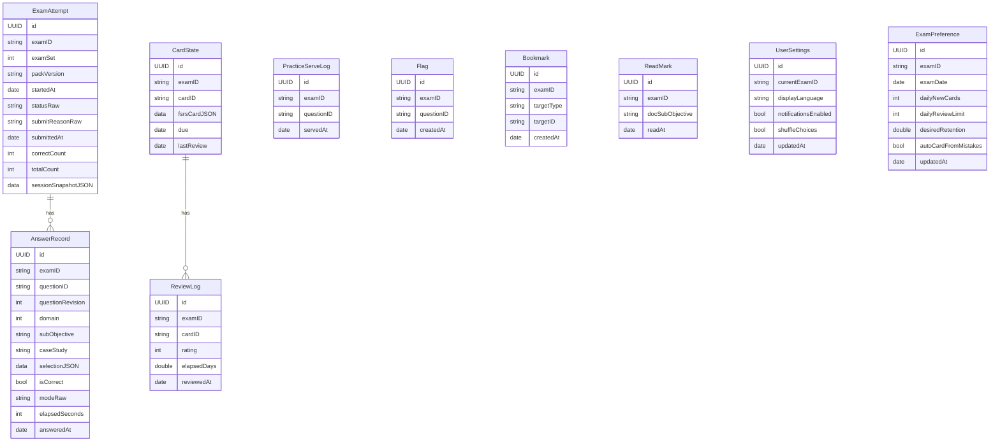

# Cloudrill 詳細設計書 P3: 学習履歴の永続化

| 項目 | 内容 |
|---|---|
| 文書バージョン | 0.1(初版ドラフト) |
| 作成日 | 2026-10-21 |
| 上位文書 | [詳細設計書(索引・共通設計)](../DDD.md) |
| 対象 | `packages/Data` の `Persistence`、`packages/Domain` の `DomainInterfaces`(リポジトリのプロトコル) |
| ステータス | P3-S01 の Red → Green → Refactor とローカル検証完了。P3-S02 以降は未着手 |

---

## 目次

1. [目的とスコープ](#1-目的とスコープ)
2. [前提](#2-前提)
3. [設計](#3-設計)
4. [ステップ](#4-ステップ)
5. [フェーズの完了条件](#5-フェーズの完了条件)
6. [申し送り](#6-申し送り)

---

## 1. 目的とスコープ

学習履歴を SwiftData に保存するリポジトリを作る。最初から CloudKit との同期を前提にしたモデルにし、すべての記録を試験ごとに分ける([DDD 2 章 C-08](../DDD.md#2-基本設計書からの変更点))。

| 区分 | 内容 |
|---|---|
| スコープ内 | SwiftData のモデル(V1)、リポジトリのプロトコルと実装、同期後の重複の統合、データのエクスポートと全削除、移行計画の配線 |
| スコープ外 | CloudKit 同期の有効化(P6-S15。モデルは本フェーズで同期できる形にしておく)、画面(P4) |

---

## 2. 前提

- P1 が完了している(`AnswerFact`、`ExamSession.Snapshot`、`FSRSCard`、`ReviewOutcome` を使う)。
- P2 と並行して進めてよい。
- ブランチは利用者の指定により `dev` を維持する。プッシュ・PR 操作は利用者が担当する。

---

## 3. 設計

### 3.1 モデル(SchemaV1)

BDD 5.3 のエンティティに `examID` を加え、試験ごとの設定を `ExamPreference` に分ける。



| 方針 | 内容 | 理由 |
|---|---|---|
| CloudKit の制約 | `@Attribute(.unique)` を使わない。すべてのプロパティに既定値を付けるか、省略可能にする。リレーションはすべて省略可能 | BDD 5.3 の注記 |
| 列挙値 | `String` で保存し、`…Raw` の名前にする。読み出し時に enum に変換し、未知の値は `PersistenceError.corrupted` にする | SwiftData の列挙値の扱いと、移行のしやすさ |
| 構造を持つ値 | `AnswerSelection`、`ExamSession.Snapshot`、`FSRSCard` は JSON(`Data`)で保存する | 出題形式を追加しても、モデルの移行が要らない |
| 検索に使う値 | `examID`、`questionID`、`due` などは、JSON の外に列として持つ | `#Predicate` で絞り込むため |
| 追記のみの記録 | `AnswerRecord`、`ReviewLog`、`PracticeServeLog` は更新しない | 同期の競合を起こさない(BDD 6.9) |
| 試験ごとの分離 | すべての検索に `examID` の条件を付ける | X-02 |

`Flag`(見直し用ではなく、練習の「フラグ付きのみ」用)と `PracticeServeLog`(直近 24 時間の出題の除外用)は、BDD 5.3 にない。P1-S10 の `PracticeHistory` を作るために追加した。

### 3.2 リポジトリのプロトコル(DomainInterfaces)

```swift
public enum PersistenceError: Error, Equatable, Sendable {
    case notFound
    case corrupted(String)
    case saveFailed(String)
}

public protocol ExamAttemptRepository: Sendable {
    func start(examID: ExamID, examSet: Int, packVersion: String, snapshot: ExamSession.Snapshot) async throws(PersistenceError) -> UUID
    func save(snapshot: ExamSession.Snapshot, for attemptID: UUID) async throws(PersistenceError)
    func record(_ answer: AnswerFact, in attemptID: UUID) async throws(PersistenceError)
    func finalize(attemptID: UUID, result: ExamResult, reason: SubmitReason, at date: Date) async throws(PersistenceError)
    func abandon(attemptID: UUID) async throws(PersistenceError)
    func inProgress(examID: ExamID) async throws(PersistenceError) -> AttemptSnapshot?
    func history(examID: ExamID) async throws(PersistenceError) -> [AttemptSummary]
}

public protocol AnswerHistoryRepository: Sendable {
    func record(_ answer: AnswerFact) async throws(PersistenceError)
    func answers(examID: ExamID) async throws(PersistenceError) -> [AnswerFact]
    func practiceHistory(examID: ExamID, now: Date) async throws(PersistenceError) -> PracticeHistory
    func markServed(questionIDs: [String], examID: ExamID, at date: Date) async throws(PersistenceError)
    func setFlag(_ flagged: Bool, questionID: String, examID: ExamID) async throws(PersistenceError)
}

public protocol CardStateRepository: Sendable {
    func card(id: String, examID: ExamID) async throws(PersistenceError) -> FSRSCard?
    func apply(_ outcome: ReviewOutcome, cardID: String, examID: ExamID) async throws(PersistenceError)
    func scheduledCards(examID: ExamID) async throws(PersistenceError) -> [(id: String, card: FSRSCard)]
    func reviewCount(examID: ExamID, on day: DateInterval) async throws(PersistenceError) -> (introduced: Int, reviewed: Int)
    func addCardFromQuestion(questionID: String, examID: ExamID, at date: Date) async throws(PersistenceError)
}
```

`BookmarkRepository`、`SettingsRepository`、`DataManagementRepository`(エクスポートと全削除)も、同じ形で定義する(P3-S05〜S08)。

- 問題由来のカードの ID は `Q:` + 問題 ID とする([DDD 4.7](../DDD.md#47-id-と一意性))。
- `AnswerHistoryRepository.record` と `ExamAttemptRepository.record` の両方が `AnswerRecord` を作る。前者は練習、後者は模試の記録で、`modeRaw` で区別する。

### 3.3 実装の方式

| 項目 | 方式 |
|---|---|
| 並行性 | 各リポジトリは `@ModelActor` の actor にする。`ModelContext` を actor の外に出さない |
| 返す値 | `@Model` のオブジェクトではなく、StudyModels の値型(`AnswerFact`、`AttemptSnapshot` など)に変換して返す |
| 保存 | 書き込みのたびに `save()` する(NFR-04)。失敗したら1回だけ再試行し、それでも失敗したら `PersistenceError.saveFailed` を投げる(E-05) |
| コンテナ | `ModelContainerFactory.make(inMemory:cloudKitContainer:storeDirectory:)`。テストはインメモリ、アプリは App Group の URL を `storeDirectory` に渡す。ディスク保存で保存先を省略するとエラー |

---

## 4. ステップ

### P3-S01 SchemaV1 とコンテナ

| 項目 | 内容 |
|---|---|
| 対応要件 | FR-ACCT-01、NFR-09、BDD 5.3 |
| 前提 | P1 の完了 |
| 成果物 | `packages/Data/Sources/Persistence/SchemaV1.swift`、`ModelContainerFactory.swift`、`Tests/PersistenceTests/SchemaV1Tests.swift` |

**Red**:

| テスト | 条件(Arrange) | 期待(Assert) |
|---|---|---|
| `containerOpensInMemory` | `make(inMemory: true, cloudKitContainer: nil)` | 例外なく開ける |
| `allPropertiesHaveDefaults` | `SchemaV1.models` の各型を、引数なしの初期化子で作る | 作れる(CloudKit の制約。既定値の付け忘れを検出する) |
| `noUniqueAttributes` | `Schema(SchemaV1.models)` のエンティティを走査する | `unique` の制約がない |
| `relationshipsAreOptional` | 同上 | すべてのリレーションが省略可能 |
| `storeIsInAppGroup` | `make(inMemory: false, …)` に一時ディレクトリを渡す | ストアのファイルがそのディレクトリの中に作られる |

**Green**: [3.1](#31-モデルschemav1) のモデルを `enum SchemaV1: VersionedSchema` の中に定義する。

**Refactor**: 既定値(空文字、`.distantPast`)を定数にまとめる。

**完了条件**: `swift test --package-path packages/Data --filter SchemaV1Tests` が通る。

**実装メモ**(2026-10-27、P3-S01 完了):

- `Persistence` の library/target と `PersistenceTests` を追加した。空のターゲット用ファイルは削除し、`SchemaV1.swift` と `ModelContainerFactory.swift` に置き換えた。
- `SchemaV1` は 3.1 の10モデルと全列を持つ。構造値は Data、列挙値は文字列で保存する。`currentExamID`、`examDate`、`caseStudy`、提出情報、最終復習日時など、未設定がある列は Optional にした。UUID はレコードごとに生成する。
- `ExamAttempt.answers` ↔ `AnswerRecord.attempt`、`CardState.reviewLogs` ↔ `ReviewLog.cardState` のリレーションを明示し、両側を Optional にした。削除規則は `.nullify`（同期後の重複統合で親を削除しても追記のみの履歴を巻き添えにしないため）。CloudKit の実同期は P6-S15 で確認する。
- 引数なしのモデル生成に加えて、`Schema.Attribute.defaultValue` または Optional、unique 制約なし、逆リレーションをテストした。共通の空文字・Data・日時は内部の `SchemaV1Defaults` に集約した。JSON の初期値は空の Data なので、S02 以降のリポジトリが保存前に実際の値をエンコードして設定する。
- ファクトリーは `storeDirectory: URL? = nil` を追加した。ディスクでは指定先に `StudyHistory.store` を作る。保存先なしは `ModelContainerFactoryError.storeDirectoryRequired`、非 file URL は `.invalidStoreDirectory`。ディレクトリ作成や SwiftData の I/O エラーは呼び出し側へ伝える。App Group の URL は P4 のアプリ側で解決する。
- インメモリでは保存先の指定があってもファイルを作らず、CloudKit も無効にする。ディスクでは `cloudKitContainer: nil` を明示的な同期無効として扱い、ID があるときは private database の設定に渡す。実アカウントを使った同期は今回のテスト対象外。

TDD の確認記録:

| コミット | 段階・結果 |
|---|---|
| `528d461` | 6テストを先行追加。型未定義の最初のコンパイル Red |
| `87d5180` | 最小モデルと常にインメモリを返す仮実装で assertion Red を確認。列不足10件、リレーション不足1件、保存設定の不一致2件。既存 ContentKit 70テストは成功 |
| `a9698b0` | 保存先の指定漏れ・非 file URL・再オープン後のデータ保持を追加し、3テスト4件の assertion 失敗を確認。インメモリでファイルも CloudKit 接続も作らないテストも追加 |
| `ca10468` | 10モデルとコンテナ生成を実装。SchemaV1Tests 10件と既存 ContentKit 70件が成功 |
| `45bd033` | 共通の既定値を整理し、同じ全80テストの成功を再確認 |

最初の仮実装で型が解決した際、Swift Testing のマクロ展開で `allSatisfy(\.isOptional)` がコンパイルエラーになったため、同じ条件の明示的なクロージャへ変更した。期待値は変更していない。

検証コマンド:

```sh
env DEVELOPER_DIR=/Applications/Xcode.app/Contents/Developer swift test --package-path packages/Data --filter SchemaV1Tests
env DEVELOPER_DIR=/Applications/Xcode.app/Contents/Developer swift test --package-path packages/Data
```

P3-S02 以降のリポジトリと P3-S09 の移行計画は未実装。リモート CI は利用者が実施する。P3 フェーズ全体の完了条件はまだ満たしていない。

---

### P3-S02 模試の受験の記録(ExamAttemptRepository)

| 項目 | 内容 |
|---|---|
| 対応要件 | FR-EXAM-04、FR-EXAM-07、NFR-04、AC-02、E-05、E-07 |
| 前提 | P3-S01 |
| 成果物 | `Sources/Persistence/SwiftDataExamAttemptRepository.swift`、`DomainInterfaces/ExamAttemptRepository.swift`、`Tests/PersistenceTests/ExamAttemptRepositoryTests.swift` |

**Red**:

| テスト | 条件(Arrange) | 期待(Assert) |
|---|---|---|
| `startAndFindInProgress` | `test-alpha` の模試1を開始する | `inProgress(examID: test-alpha)` がその受験を返す |
| `inProgressIsPerExam` | `test-alpha` だけ開始する | `inProgress(examID: test-beta)` は `nil` |
| `snapshotRoundTrip` | 解答・フラグ・現在位置・タイマーを持つスナップショットを保存し、読み直す | 元の値と等しい(AC-02 の前提) |
| `recordEachAnswer` | 3 回 `record` する | `AnswerRecord` が 3 件。`modeRaw == "exam"` |
| `recordSurvivesNewContainer` | ファイルのストアで記録し、別のコンテナで開き直す | 記録が読める(強制終了後の復元の代わり) |
| `finalizeSetsResult` | `finalize` | `statusRaw == "submitted"`、`correctCount`・`totalCount` が結果と一致、`inProgress` は `nil` |
| `finalizeTwiceFails` | 提出済みの受験に `finalize` | `PersistenceError.corrupted` |
| `packVersionIsKept` | 1.0.0 で開始した受験 | 読み出した `packVersion == "1.0.0"`(E-07。P2 の `pin` と組み合わせる) |
| `history` | 提出済み 2 件、放棄 1 件 | `history` は提出済みの 2 件を新しい順に返す |
| `saveRetriesOnce` | 1回目の保存だけ失敗する `ModelContext` の代替(`FailingSaver`) | 2回目で成功し、エラーにならない |
| `saveFailsAfterRetry` | 2回とも失敗する | `PersistenceError.saveFailed` |

`save()` の失敗を再現するため、保存処理を `Saver` プロトコルで包み、テストで差し替える。

**Green**: [3.2](#32-リポジトリのプロトコルdomaininterfaces) の `ExamAttemptRepository` を実装する。

**Refactor**: `@Model` と値型の変換を `…Mapper` に分ける。

**完了条件**: `swift test --package-path packages/Data --filter ExamAttemptRepositoryTests` が通る。

---

### P3-S03 練習の解答履歴(AnswerHistoryRepository)

| 項目 | 内容 |
|---|---|
| 対応要件 | FR-PRAC-03、FR-ANLY-01、BDD 6.7 |
| 前提 | P3-S02 |
| 成果物 | `Sources/Persistence/SwiftDataAnswerHistoryRepository.swift`、`Tests/PersistenceTests/AnswerHistoryRepositoryTests.swift` |

**Red**:

| テスト | 条件(Arrange) | 期待(Assert) |
|---|---|---|
| `lastResultUsesLatestAnswer` | 同じ問題に、不正解 → 正解の順で解答 | `practiceHistory.lastResult[Q] == true` |
| `examAnswersCountInHistory` | 模試で不正解だった問題 | 「間違えた問題のみ」の対象になる(`lastResult[Q] == false`) |
| `servedWithinWindow` | 25 時間前と 1 時間前に出題した問題 | 両方の `lastServedAt` が入る(24 時間の判定は QuestionSelector が行う) |
| `flagToggle` | `setFlag(true)` → `setFlag(false)` | `flagged` から外れる |
| `perExam` | `test-alpha` と `test-beta` に同じ問題 ID の記録 | 互いの履歴に混ざらない |
| `answersForReadiness` | 練習 2 件、模試 3 件、ドリル 1 件 | `answers(examID:)` が 6 件を返す(ドリルを除くのは Readiness の責務) |

**Green**: `AnswerHistoryRepository` を実装する。

**Refactor**: 検索条件(`#Predicate`)の組み立てを補助関数にまとめる。

**完了条件**: `swift test --package-path packages/Data --filter AnswerHistoryRepositoryTests` が通る。

---

### P3-S04 カードの状態と復習ログ(CardStateRepository)

| 項目 | 内容 |
|---|---|
| 対応要件 | FR-CARD-02、FR-CARD-04、FR-CARD-05 |
| 前提 | P3-S01 |
| 成果物 | `Sources/Persistence/SwiftDataCardStateRepository.swift`、`Tests/PersistenceTests/CardStateRepositoryTests.swift` |

**Red**:

| テスト | 条件(Arrange) | 期待(Assert) |
|---|---|---|
| `applyCreatesStateAndLog` | 新規カードに Good を適用 | `CardState` が 1 件、`ReviewLog` が 1 件 |
| `applyUpdatesExisting` | 同じカードに 2 回適用 | `CardState` は 1 件のまま、`ReviewLog` は 2 件 |
| `fsrsCardRoundTrip` | 適用した `FSRSCard` を読み直す | 等しい |
| `dueColumnMatchesJSON` | 適用後 | `due` 列と、JSON の中の `due` が一致する |
| `reviewCountForDay` | 今日 3 枚の新規、5 回の復習、昨日 2 回 | `(introduced: 3, reviewed: 5)` |
| `cardFromQuestion` | 問題 Q-1.1-0001 からカードを作る | ID が `Q:Q-1.1-0001` の新規カード |
| `cardFromQuestionIsIdempotent` | 同じ問題から 2 回作る | 1 件のまま |

**Green**: `CardStateRepository` を実装する。

**Refactor**: 日付の範囲(今日)の計算は、呼び出し側から `DateInterval` で受け取り、リポジトリでは計算しない。

**完了条件**: `swift test --package-path packages/Data --filter CardStateRepositoryTests` が通る。

---

### P3-S05 ブックマークと既読

| 項目 | 内容 |
|---|---|
| 対応要件 | FR-DOCS-05 |
| 前提 | P3-S01 |
| 成果物 | `Sources/Persistence/SwiftDataBookmarkRepository.swift`、`DomainInterfaces/BookmarkRepository.swift`、`Tests/PersistenceTests/BookmarkRepositoryTests.swift` |

**Red**:

| テスト | 条件(Arrange) | 期待(Assert) |
|---|---|---|
| `toggleBookmark` | 問題を 2 回ブックマークする | 2 回目で外れる |
| `bookmarksByType` | 問題 2 件、ドキュメント 1 件 | 種別で絞り込める |
| `markRead` | ドキュメント 3.2 を既読にする | `isRead(3.2) == true` |
| `markReadIsIdempotent` | 2 回既読にする | `ReadMark` は 1 件 |
| `unknownTargetType` | 保存されていた `targetType` が未知の値 | `PersistenceError.corrupted` |

**Green**: `BookmarkRepository` を実装する。`targetType` は `question` / `doc` の enum にする。

**Refactor**: なし。

**完了条件**: `swift test --package-path packages/Data --filter BookmarkRepositoryTests` が通る。

---

### P3-S06 設定と試験ごとの設定

| 項目 | 内容 |
|---|---|
| 対応要件 | FR-CARD-05、FR-EXAM-12、FR-PLAN-01、[DDD 4.1 X-02](../DDD.md#41-拡張性の設計方針) |
| 前提 | P3-S01 |
| 成果物 | `Sources/Persistence/SwiftDataSettingsRepository.swift`、`DomainInterfaces/SettingsRepository.swift`、`StudyModels/Settings.swift`、`Tests/PersistenceTests/SettingsRepositoryTests.swift` |

**Red**:

| テスト | 条件(Arrange) | 期待(Assert) |
|---|---|---|
| `defaultsWhenEmpty` | 何も保存していない | `UserSettings` の既定値(表示言語 `ja`、シャッフルなし)と、`ExamPreference` の既定値(新規 20 枚、復習 200 枚、保持率 0.90、誤答のカード化 ON) |
| `preferenceIsPerExam` | `test-alpha` の試験日だけを設定する | `test-beta` の試験日は `nil` |
| `currentExam` | `currentExamID` を `test-beta` にする | 読み直すと `test-beta` |
| `retentionValidated` | `ExamPreference(desiredRetention: 0.99)` を作る | `SettingsError.outOfRange`(値の検証は StudyModels の初期化子で行い、リポジトリには不正な値が届かない) |
| `duplicateRowsResolvedByUpdatedAt` | 同じ試験の `ExamPreference` が 2 件ある(同期後の状態を再現) | `updatedAt` の新しい方を返す(統合そのものは P3-S07) |

既定値(新規 20 枚、復習 200 枚)は BDD に記載がないため、本書で決める。設定画面で変更できる(FR-CARD-05)。

**Green**: `SettingsRepository` を実装する。

**Refactor**: 既定値を `ExamPreference.default` に集める。

**完了条件**: `swift test --package-path packages/Data --filter SettingsRepositoryTests` が通る。

---

### P3-S07 同期後の重複の統合

| 項目 | 内容 |
|---|---|
| 対応要件 | BDD 6.9、FR-ACCT-01 |
| 前提 | P3-S02〜S06 |
| 成果物 | `Sources/Persistence/SyncMerge.swift`(純粋関数)、`SyncDeduplicator.swift`(SwiftData への適用)、`Tests/PersistenceTests/SyncMergeTests.swift` |

統合の規則は純粋関数にし、表形式で確認する。SwiftData への適用は薄い層にする。

| 対象 | 重複の判定 | 残す方 |
|---|---|---|
| `CardState` | `(examID, cardID)` | `lastReview` が新しい方。同じなら `id` の小さい方(決定論のため) |
| `ExamPreference` | `examID` | `updatedAt` が新しい方 |
| `UserSettings` | 常に1件 | `updatedAt` が新しい方 |
| `ExamAttempt`(進行中) | `(examID, examSet)` かつ `statusRaw == inProgress` | スナップショットの `currentIndex` が大きい方。もう一方は `abandoned` にし、利用者に通知する(BDD 6.9) |
| `Flag`、`Bookmark`、`ReadMark` | `(examID, 対象)` | `createdAt` が古い方 |
| `AnswerRecord`、`ReviewLog`、`PracticeServeLog` | 統合しない(UUID で区別され、追記のみ) | — |

**Red**:

| テスト | 条件(Arrange) | 期待(Assert) |
|---|---|---|
| `cardStateKeepsLatestReview`(表形式) | `lastReview` が異なる 2 件 / 同じ 2 件 / 片方が `nil` | 上の規則のとおり |
| `preferenceKeepsLatest` | `updatedAt` が異なる 2 件 | 新しい方 |
| `inProgressAttemptsResolved` | 同じ模試の進行中が 2 件(`currentIndex` 12 と 30) | 30 の方が残り、12 の方は `abandoned`。結果に `notifyUser == true` |
| `differentExamsAreNotDuplicates` | `test-alpha` と `test-beta` の同じ `cardID` | どちらも残る |
| `appendOnlyUntouched` | `AnswerRecord` が 2 件(内容が同じ) | 2 件とも残る |
| `deduplicatorAppliesPlan` | インメモリのストアに重複を作り、`SyncDeduplicator.run()` | 規則どおりに削除・更新される |

**Green**: `SyncMerge`(入力は値型の配列、出力は「残す ID」と「変更する ID」の計画)と、それを適用する `SyncDeduplicator` を実装する。

**Refactor**: 種類ごとの規則を、キーと比較関数の組の表にする。

**完了条件**: `swift test --package-path packages/Data --filter SyncMergeTests` が通る。

---

### P3-S08 エクスポートと全削除

| 項目 | 内容 |
|---|---|
| 対応要件 | FR-ACCT-03、BDD 8.3「データの削除」、NFR-09 |
| 前提 | P3-S07 |
| 成果物 | `Sources/Persistence/DataManagement.swift`、`DomainInterfaces/DataManagementRepository.swift`、`Tests/PersistenceTests/DataManagementTests.swift` |

**Red**:

| テスト | 条件(Arrange) | 期待(Assert) |
|---|---|---|
| `exportContainsAllEntities` | 各エンティティを 1 件以上保存する | エクスポートの JSON に、全エンティティの全件が含まれる |
| `exportIsVersioned` | エクスポート | 先頭に `"exportVersion": 1` と `"schema": "V1"` |
| `exportCanFilterByExam` | `examID: test-alpha` を指定 | `test-beta` の記録を含まない |
| `exportIsDeterministic` | 同じデータで 2 回 | キーの並びと配列の順(`id` の昇順)が同じ |
| `deleteAllRemovesEverything` | `deleteAll()` | 全エンティティが 0 件 |
| `deleteExamOnly` | `deleteAll(examID: test-alpha)` | `test-beta` の記録と `UserSettings` は残る |

CloudKit 上のデータも消えることは、同期を有効にする P6-S15 で、実機の手動テストで確認する。

**Green**: `DataManagementRepository` を実装する。エクスポートは `ExportDocument`(Codable)に変換して JSON にする。

**Refactor**: エンティティごとの変換を、エクスポートと統合(P3-S07)で共有できるようにする。

**完了条件**: `swift test --package-path packages/Data --filter DataManagementTests` が通る。

---

### P3-S09 移行計画の配線

| 項目 | 内容 |
|---|---|
| 対応要件 | 将来のモデル変更への備え |
| 前提 | P3-S08 |
| 成果物 | `Sources/Persistence/MigrationPlan.swift`、`Tests/PersistenceTests/MigrationPlanTests.swift` |

**Red**:

| テスト | 条件(Arrange) | 期待(Assert) |
|---|---|---|
| `planListsSchemas` | `ExamPrepMigrationPlan.schemas` | `[SchemaV1.self]` |
| `containerUsesPlan` | `ModelContainerFactory.make` で作ったコンテナ | 移行計画を指定して開いている(ファクトリーの引数を記録する `Spy` で確認) |
| `reopenExistingStore` | V1 で作ったストアのファイルを、計画つきで開き直す | データが残っている |

**Green**: `enum ExamPrepMigrationPlan: SchemaMigrationPlan` を定義し、`stages` は空にする。

**Refactor**: なし。

**完了条件**: `swift test --package-path packages/Data` がすべて通る。

モデルを変更するとき(V2 の追加)の手順:

1. `SchemaV2` を追加し、`schemas` に加える。
2. `stages` に移行の段階を追加する。
3. V1 のストアを fixture として作り、V2 で開いて内容が正しく移ることのテストを先に書く。

---

## 5. フェーズの完了条件

[DDD 7.8](../DDD.md#78-フェーズの完了条件共通) の共通条件に加えて、次を満たすこと。

| No. | 条件 | 確認方法 |
|---|---|---|
| 1 | すべての検索が `examID` で絞り込まれている | `git grep -n '#Predicate' -- packages/Data/Sources/Persistence` の各箇所をレビューする |
| 2 | リポジトリが `@Model` のオブジェクトを外に返していない | 公開 API の戻り値の型をレビューする |
| 3 | CloudKit の制約を満たしている | P3-S01 のテスト |

---

## 6. 申し送り

| 宛先 | 内容 |
|---|---|
| P4 | 模試の画面は、解答を選ぶたびに `ExamAttemptRepository.record` と `save(snapshot:)` を呼ぶ。開始時に `PackStore.pin`、提出・放棄時に `unpin` を呼ぶ |
| P4 | 起動時(と、同期の通知を受けたとき)に `SyncDeduplicator.run()` を呼ぶ。進行中の受験を統合した場合は、利用者に通知する |
| P6-S15 | 同期を有効にするときは、`ModelContainerFactory.make` に CloudKit のコンテナ ID(`iCloud.<逆ドメイン>.examprep`)を渡す。全削除が CloudKit 上でも反映されることを実機で確認する |
