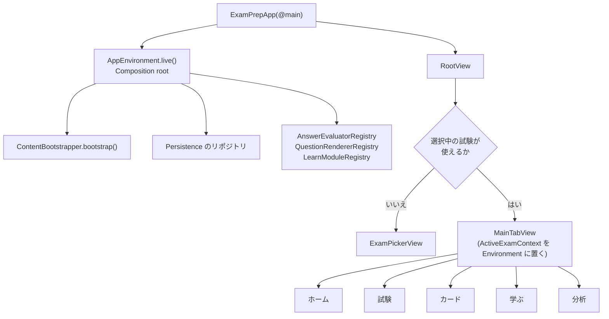

# Cloudrill 詳細設計書 P4: アプリ MVP

| 項目 | 内容 |
|---|---|
| 文書バージョン | 0.1(初版ドラフト) |
| 作成日 | 2026-10-21 |
| 上位文書 | [詳細設計書(索引・共通設計)](../DDD.md) |
| 対象 | `ExamPrepApp`(アプリ本体)、`packages/Presentation`、`ExamPrepAppUITests` |
| ステータス | ホーム・模試開始・解答・見直しと提出・結果と解説をアプリへ接続済み（S09まで） |

---

## 目次

1. [目的とスコープ](#1-目的とスコープ)
2. [前提](#2-前提)
3. [設計](#3-設計)
4. [ステップ](#4-ステップ)
5. [フェーズの完了条件](#5-フェーズの完了条件)
6. [申し送り](#6-申し送り)

---

## 1. 目的とスコープ

P1〜P3 の部品を組み合わせて、MVP(RDD 12 章)の画面を作る。画面の振る舞いは ViewModel のテストで、画面の流れは UI テストで先に Red を作る([DDD 7.5](../DDD.md#75-tdd-を適用しにくい対象))。

| 区分 | 内容 |
|---|---|
| スコープ内 | アプリの骨格(Composition root、試験の選択、画面遷移)、デザインシステム、MVP の画面(BDD 4.2 の SCR-001・002・010〜015・020〜022・030〜032・040〜044・050・090・091)、UI テスト |
| スコープ外 | 差分配信と誤り報告の送信(P5。本フェーズでは送信キューまで作る)、v1.1 以降の機能(P6) |

---

## 2. 前提

### 着手時点の確認（2026-10-28）

- P2・P3 の実装とローカル検証は完了。今回も Data 116テスト、Domain 148テストが成功した。リモート CI は未確認。
- 利用者の指定により `dev` ブランチのまま進め、コミットは利用者が行う。以下の機能ブランチ作成は今回には適用しない。
- TBD-10 は本書の既定案（ホーム上部の試験名からシート表示）を採用する。今回実装したのは選択状態と ViewModel で、シートを含む View は未実装。
- `swift-markdown` と `swift-snapshot-testing` は採用確認済みだが、依存には未追加。S12・S18 でそれぞれ導入する。
- `ExamPrepApp` は初期画面のまま。Xcode プロジェクトへの依存追加・設定変更は、リポジトリの規約に従い GUI で行う必要がある。
- `content/catalog.yaml` の `gcp-pca` は `comingSoon`。開発用の同梱パック生成とアプリへのコピー、本番の公開判定は未実施。

### 初回の成果物と検証範囲

| ステップ | 実装済み | 残作業 |
|---|---|---|
| S01 | Presentation パッケージ、プロトコル型の `AppDependencies`、SwiftUI Environment の注入口、`presentation-test.yml` | アプリ側 `AppEnvironment`、起動引数、レンダラー登録表との整合、同梱パック、Xcode 設定・依存の接続、アプリ/UIテスト・`app-test.yml` |
| S02 | `ActiveExamContext`、起動時選択の純粋関数、`ExamPickerViewModel` | `RootView`・選択シート・`MainTabView.id(examID)` への接続 |
| S03 | `AppRouter`、全15種類の Route のタブ対応、タブ別 path、提出後の経路置換、試験切り替え時のリセット | 各画面の `NavigationStack` への接続 |

Presentation の14テスト（パラメータ化されたケースを含む）が成功。前回選択の復元、1試験の自動選択、複数試験の選択要求、読み込み不可・全試験不可、設定保持、中断スナップショットの保存、保存失敗時の状態維持、切り替え連打、近日公開・公開終了・商標表示、画面遷移を検証した。最初のルーターテストでは未実装型によるコンパイル失敗を確認してから実装した（assertion Red ではない）。

`ActiveExamContext` は `ContentBootstrapper` の `available` と `failures.keys`、カタログ、リポジトリ、時計、ルーターを受け取る。Presentation は Data に依存しない。切り替え先の設定取得・旧試験の中断保存・選択設定の保存が成功してから表示状態と経路を更新する。選択設定の保存だけが失敗した場合、旧試験は中断保存済みのまま選択され続ける。再開処理はアプリ接続時に行う。

```sh
env DEVELOPER_DIR=/Applications/Xcode.app/Contents/Developer swift test --package-path packages/Presentation
env DEVELOPER_DIR=/Applications/Xcode.app/Contents/Developer swift test --package-path packages/Data
env DEVELOPER_DIR=/Applications/Xcode.app/Contents/Developer swift test --package-path packages/Domain
```

初回時点ではアプリ側 Composition root・開発用パック・Xcode接続を後続作業としていた。以下に継続実装の結果を記録する。P4全体の完了を示すものではない。

### 継続実装: 起動処理と同梱パック（2026-10-28）

- `packages/AppComposition` にアプリ専用の `AppEnvironment` と `AppRootView` を追加した。アプリ本体から呼び出す Composition root をパッケージ化することで、Xcode の接続前にも実リポジトリとコンテンツを使って検証できる。Presentation → Data の依存は禁止したまま。
- `AppEnvironment.live` は `SystemTimeSource` と実ストアを使い、呼び出し元が解決した App Group 保存先を受け取る。開発用の印が付いたパックは拒否する。CloudKit は未接続。
- DEBUG専用の `development` はシステム時計と開発用ディスクストアを使う。`uiTesting` は固定・進行可能な時計、固定seed、インメモリまたは指定ディレクトリのストアを使用する。`-content-fixture` は1.0.0を選ぶ。`-store-path` はストアファイルではなく保存先ディレクトリ。矛盾した引数・不正な日時・パス・未知の引数は起動エラーになる。起動処理はローカル読み込みだけでネットワークアクセスはない。
- `QuestionRendererRegistry` はsingle/multipleの選択肢を正誤なしで表示する。採点登録表と描画登録表が一致しない場合は起動を拒否する。選択数制約・セッション保存・デザインシステムとの統合はS07で追加する。
- `scripts/bundle_packs.sh --development` は既存のビルド・署名処理を再利用し、`ExamPrepApp/Resources/Packs` にカタログ、署名付き2試験（Alphaの2版を含む）、テスト公開鍵、開発用の印を生成する。52ファイルの再生成一致と既存出力の保護を確認した。本番カタログの `comingSoon` は変更していない。
- `AppRootView` は起動中・致命的エラー・試験選択・試験概要を表示し、ホーム上部の試験名から選択シートを開く。画面文言はString Catalog。模試開始などのMVP学習画面・5タブの接続は未実装。
- AppCompositionの7テスト（引数検証9ケースを含む）とReleaseビルドを検証するCIを `app-test.yml` に追加した。実パックの署名、選択のディスク復元、固定時計とシステム時計、実保存、開発パックの本番起動拒否を検証する。これはSimulator上のUIテストではない。
- ローカルでは上記7テスト、Presentationの14テスト、Releaseビルド、AppCompositionのiOS 18 Simulator向けクロスビルドが成功した。パッケージのクロスビルドは `swift build --build-system native --sdk <iPhoneSimulator.sdk> --triple arm64-apple-ios18.0-simulator` で確認した。アプリ本体の `xcodebuild` とSimulatorでの画面操作は接続後に検証する。

利用者の明示承認を受けてXcode接続パッチを適用した。AppCompositionのローカル参照、iOS 18 / Swift 6 / iPhone・iPadへの設定、`Resources/Packs` のフォルダコピー、ContentViewからの起動画面呼び出しを接続済み。アプリ全体のSimulator向けビルドと、生成された.app内のカタログ・パック階層を確認した。App Group・本番識別子・本番パックは未完了。

`ExamPrepAppUITests`を追加し、共有Schemeから試験選択と切り替え、単一試験の自動選択、不正な起動引数のエラー表示を検証する。UI検証で翻訳キーが表示される不具合を確認し、AppCompositionの`defaultLocalization`を`ja`に修正した。CIのアプリビルドはPRでも実行し、UIテストはmainへのpush・手動実行で実行する。

### 継続実装: P4-S04 デザインシステム（2026-10-28）

- 本番 App Group ID は利用者確認により未定のまま保留する。Debug の開発用保存先で P4 を継続できる。本番 plist・entitlement・コンテナの対応、本番識別子・本番パック、リモート CI の確認は残作業。
- `packages/Presentation/Sources/DesignSystem` に `DomainPalette`、`ChoiceRow`、`DomainBadge`、`CaseBadge`、`ResultBadge`、`TimerLabel`、`MistakeTagChip`、`ReferenceLink` を追加した。`MarkdownView` は引き続き S12 で実装する。
- ドメイン色は試験定義の並び順から割り当てる。6色を循環させ、周回ごとに記号を変更する。バッジの背景はライトで白・ダークで黒に固定し、全6色の文字コントラスト比が両モードで4.5以上であることを独立した相対輝度計算で検証した。正誤は色・アイコン・文言で表示する。
- 選択肢は最小44ptのタップ領域、Dynamic Type、アクセシビリティサイズでの縦並び、選択状態と本文を含む VoiceOver ラベルを備える。既存の `QuestionRendererRegistry` を `ChoiceRow` に接続した。解答中の正誤表示は追加しない。
- タイマーの表示は秒単位、アクセシビリティラベルは分単位（残り1〜59秒は「残り 1 分未満」）。DesignSystem の翻訳は SwiftPM でも利用できる日本語 `.strings` リソースに置く。全共通部品を含むライト・ダーク・最大文字サイズの Preview を追加した。Preview の目視・VoiceOver の実機確認は未実施。
- テストを先行追加し、型が未実装のコンパイル失敗を確認した。実装後に検出した誤答タグの翻訳キー表示を修正し、Presentation 全20テスト（DesignSystem 6、既存14）と AppComposition 全7テストが成功した。アプリ全体の Debug・iOS Simulator 向けビルド（署名なし）も成功した。次の実装ステップは S05 のホーム。

### 継続実装: P4-S05 ホーム（2026-10-29）

- `HomeViewModel`・`HomeView` を追加し、起動後の概要画面を SCR-001 に置き換えた。上部の `shortName` から試験選択シートを開く。今日の学習、弱点、期限到来のカード数、進行中の模試の再開を表示する。準備度・カウントダウンは P6 のまま。
- `AccuracySummary` を AppCore に置き、選択中の試験の全解答履歴を解答時点のドメイン・サブ項目で集計する。未解答は `nil`（0%と区別）、弱点は解答のあるドメインの最低正答率、同率は試験定義順。P4-S14 から共有できる。
- 復習期限は注入した時計の `now` 以下の学習済みカードとする（新規・未来期限を除外、上限による切り詰めなし）。カード機能が無効なら取得・表示しない。今日の学習は練習条件の未指定ルート、弱点は対象ドメインの練習条件、復習はカードタブ、再開は保存済み受験 ID のルートへ遷移する。
- 5タブとタブ別 NavigationStack を接続し、試験切り替え時は `.id(examID)` でホーム状態を作り直す。後続ステップの学習画面は「準備中」の接続点であり、練習・模試・カード学習自体はまだ利用できない。
- 表示時・フォアグラウンド復帰・引っ張って更新で再取得する。取得失敗を未学習状態として表示せず、再試行を提供する。再取得失敗時は直前の成功データを保持する。
- HomeViewModelTests を先行追加し、未実装型によるコンパイル失敗を確認してから実装した。Presentation 全28テスト（HomeViewModel 8、既存20）、AppComposition 全7テスト、iOS Simulator のアプリビルドとUIテスト5件が成功。ホーム空状態のスクリーンショットも目視確認し、試験名の重複を解消した。最終調整後にホーム表示・遷移および切り替え時の経路リセットのUIテストも個別に再実行して成功した。ダークモード・最大文字サイズ・実機 VoiceOver の確認は S18 に残る。リモートCIは未確認。

### 継続実装: P4-S06 試験トップと模試開始（2026-10-29）

- `ExamTopViewModel`・`ExamTopView` は complete の模試を ID 順に表示し、試験定義の `setCount` の範囲外を除外する。draft を含める指定は DEBUG のみ有効（通常の一覧では非表示）。`ExamStartViewModel`・`ExamStartView` は定義由来の問題数・時間と対象ケース名、時間経過の注意を表示する。ケース機能が無効ならケース本文を取得しない。
- 開始時に同じ試験の進行中受験を確認し、存在すれば再開／確認付き破棄を提示する。設定のシャッフル指定・注入 seed から `ExamOrderBuilder` で順序を決定し、注入時計で開始したスナップショットを保存する。保存とパック固定が成功してから `.examSession` に遷移する。await 中の連打は拒否する。
- `DomainInterfaces.PackPinning` を追加し、`PackStore` を適合させ、AppDependencies に注入した。Presentation は Data に依存しない。pin 失敗時は保存済み受験を保持し、再開時に同じ版の固定を再試行する。破棄は abandon 成功後に unpin する。解除だけ失敗した場合は画面内で解除を再試行でき、再読み込みでも操作を保持する。
- 試験タブの一覧・開始確認を Composition root に接続した。解答先は S07 の接続点のままであり、開始しても解答はまだできない。次の実装対象は **P4-S07 解答画面**。本番 App Group・識別子・パックとリモート CI は引き続き未完了。
- 先行テストで未実装型によるコンパイル失敗を確認した。解除失敗後の再読み込みで操作が失われるケースは assertion の失敗を確認して修正した。Presentation 全40テスト（S06 8件）、AppComposition 全8テスト（実ストアとパック固定・解除の統合検証を含む）、Data の関連15テストが成功。AppComposition の Release ビルドも成功。iOS Simulator のアプリビルドと UI テスト全6件が成功し、Beta の開始確認（40問・90分、ケース欄なし）から開始後のホーム再開表示まで検証した。開始確認画面のスクリーンショットも目視確認した。

### 継続実装: P4-S07 模試の解答（2026-10-29）

- `ExamSessionController` が読み込み・即時保存・時計・中断復元・自動提出を担当し、`ExamSessionViewModel` は正解と解説を含まない表示用の値へ変換する。開始時に全問題を1回で読み、保存済みの `QuestionOrder` で問題と選択肢を表示する。単一／複数選択、選択数の上限、解除、見直しフラグ、前後移動、ケースの要約シートを接続した。
- `DomainInterfaces.ExamContentResolving` と `ContentKit.ExamContentResolver` を追加し、受験に記録した版を同梱／インストール済みパックから解決する。最新版へ置き換えず、試験・版・ベンダー・索引の整合を確認する。Presentation → Data の依存は追加していない。
- 解答は `record` の原子的保存を確認した時点で表示へ反映し、続いて `save(snapshot:)` を呼ぶ。後者だけ失敗しても保存済み解答と画面を一致させる。移動・フラグは保存成功後に反映する。await中の重複操作を拒否し、保存待ち中のバックグラウンド移行は完了後に処理する。
- タイマーは期限から残り秒を計算し、10分・5分を越えたときに警告と触覚フィードバックを要求する。バックグラウンド中も時間が進み、再開時の時間切れも採点・`finalize`・`unpin`・結果経路への置換を行う。解除だけ失敗した場合は提出を重複させず再試行する。結果先には保存済みの提出理由・正答数を表示する最小の確認画面を接続した。
- 先行テストで未実装型によるコンパイル失敗を確認した。Presentation 全55テストが成功（保存待ち中の重複操作とバックグラウンド移行も検証）。AppComposition 全9テスト（実ディスクでの選択・フラグ・位置の復元と時間切れ提出を含む）、Data 既存120テストと新規の固定版解決2テストが成功。AppComposition の Release ビルドも成功。UI検証ではタイマーの再描画ループを発見し、安定した開始時刻と秒単位のtask IDに修正した。選択肢がボタンとして認識されない問題も共通部品のアクセシビリティ属性で修正した。Simulator UIテストは既存5件と、修正後の解答・強制終了復元・期限超過提出2件が成功（計7件）。選択済みの解答画面と期限超過の提出画面はスクリーンショットでも目視確認した。
- 次は **P4-S08 見直し一覧と手動提出**。S09の詳細な結果・解説、自動カード化、本番 App Group・識別子・パック、リモートCI、実機 VoiceOver の確認は未完了。

### 継続実装: P4-S08 見直しと提出（2026-10-30）

- `ExamReviewViewModel`・`ExamReviewView` を追加し、未解答・見直しフラグの件数と全問題の状態を表示する。問題番号から `closeReview` → 指定問題へ移動し、保存に成功してから解答画面に戻る。提出には件数を示す確認ダイアログを挟み、キャンセルも可能。
- `ExamSessionStore` が受験IDごとに同じ解答ViewModelを共有し、解答と見直しを往復しても問題本文を再取得しない。画面間のpush/popでは中断せず、タブ移動・バックグラウンドでは中断する。見直し中に復帰すると `.reviewing` を復元し、見直し・提出確認中の期限超過は自動提出を優先する。
- `ExamSubmission` に採点・`finalize`・カード追加・`unpin` を集約し、時間切れと手動提出で共用した。カード機能と `autoCardFromMistakes` が有効な場合、選択して誤答した問題だけをカード化する（未解答は含めない）。部分的な失敗後はインスタンス内の進捗を使って未完了処理を再試行し、提出・追加済みカードを重複処理しない。永続的な提出後処理キューは追加していない。
- 先行テストで未実装APIによるコンパイル失敗を確認した。Presentation 全66テスト（S08の11件を含む）、AppComposition 全10テスト、Releaseビルドが成功。実ストアでの手動提出・カード保存・パック固定解除と、再起動後の結果・カードの存在も検証した。Simulatorの既存7件と、確認ボタンのテスト対象指定を修正後に再実行した見直し・手動提出1件が成功（計8件）。見直し一覧・手動提出後の画面をスクリーンショットでも目視確認した。
- 追補（S09 後のレビュー対応）: 提出時の `unpin` は `retain` に置き換えた。結果・解説で受験時の版を開けるよう、試験ごとに直近 20 件の受験は固定を残す（DDD-P2 3.4）。
- S07とS08の実装は利用者が `dev` へコミット済みで、PR #12 でレビュー中。追加された解答履歴の修正を含む HEAD `fc5ede0` でも、受験リポジトリ8件、AppComposition全10件、強制終了復元・期限超過提出と見直し・手動提出のUIテスト2件が成功した。次は **P4-S09 結果と解説**。エージェントによるコミットは行っていない。

### 継続実装: P4-S09 結果と解説（2026-10-30）

- `ExamResultViewModel`・`ExamResultView` で提出確認画面を置き換えた。総合正答数と正答率、所要時間、試験定義順のドメイン名と集計、出題されたケース名と集計、全問の解説へのリンクを表示する。出題なしは0%と区別し、ケース機能が無効なら集計欄を出さない。時間切れ後の遅い再起動でも所要時間は保存済みタイマーの試験時間を超えない。
- `SubmittedExamContent` は提出済み履歴から受験時の `packVersion` を解決し、保存済み `QuestionOrder` を検証して問題・選択肢の順を復元する。現在の版に置き換えない。総合成績は保存済み解答から再採点し、提出時の正答数との一致も確認する。版の欠落・出題順の破損・成績不一致は再読み込み可能なエラー表示にする。
- `ExplanationViewModel`・`ExplanationView` は全選択肢の正誤・選択状態・理由、誤答タグ、出典を表示する。日英切り替えは英訳がなければ日本語へフォールバックする。`ReferenceLink` は CC BY 4.0 / Apache 2.0 を表示し、link-only はリンクだけを表示する。
- カード機能が有効なら手動追加でき、既存の `Q:<questionID>` を読み込んで「追加済み」を表示する。追加失敗は再試行可能で、連打を拒否する。関連資料があり docs 機能が有効な場合だけ `.doc(subObjective:)` へ進む。資料本文はS12の接続点のまま。誤り報告は問題ID・revision・試験ID・パック版を持つシートまで接続し、フォームと永続キューはS15で実装する。
- 先行テストの未実装APIによるコンパイル失敗を確認してから実装した。Presentation 全81テスト（DesignSystem 7、その他74）が成功。AppCompositionの実ストアテストは提出後の再起動から結果・解説・自動追加済みカードの復元まで拡張した。Simulatorの結果は [S09引き継ぎ](../../docs/handoffs/2026-10-30-p4-s09-results-explanations.md) に記録する。
- 利用者の指示によりS09で区切り、次は **P4-S10 練習モード**。`dev` の未コミット変更として残し、コミットは利用者が行う。本番App Group・本番パック・リモートCIは今回の対象外。

### 設計時の前提（未完了項目を含む）

- P2 と P3 が完了している。
- 外部依存 `swift-snapshot-testing` と `swift-markdown` の採否を確認済みである([DDD 8 章](../DDD.md#8-外部依存の候補))。
- TBD-10(試験の切り替え UI の位置)を決めてある。本書では「ホームのナビゲーションバーの試験名をタップしてシートで選ぶ」方式を前提にする。
- ブランチは、機能ごとに `feat/p4-<機能>` を作る。

---

### 継続実装: P4-S10 練習モード（2026-10-30）

- `PracticeFeature` の `PracticeViewModel`・`PracticeView` を追加し、ホームの今日の学習・弱点と試験トップから接続した。ドメイン・サブ項目・ケースは試験定義由来、ケース機能無効なら非表示。難易度・誤答／未解答／フラグ・5／10／20／すべてを指定できる。
- `QuestionSelector` に履歴と条件を渡し、選択した本文の全件取得・出題記録の保存後に開始する。該当なしと取得・保存失敗を区別する。本文は開始時に保持し、後から別の版に差し替えない。
- 解答は共有の `QuestionRendererRegistry`、解説は練習用の入口を追加した `ExplanationViewModel`・`ExplanationView` を使う。必要な選択数を満たして「解答する」を押すと、`.practice` の解答履歴保存成功後に正誤・全選択肢の解説を表示する。カード手動追加・日英切り替え・関連資料・版付き報告も共有する。
- フラグの保存、保存失敗の再試行、保存中の二重操作防止、全問終了時の総合・ドメイン別集計を実装した。練習の段階は一つの ViewModel の値型 `state` で管理し、`.practiceSetup` の画面内で切り替える。予約済みの `.practiceSession` / `.practiceResult` ルートは使っていない。アプリ終了からの練習位置の復元は対象外だが、確定した履歴は永続化する。
- Presentation 91テスト、AppComposition 11テスト、Releaseビルド、Simulator UIテスト3件が成功した。
- 次は **P4-S11 フラッシュカード**。検証結果と既存境界は `docs/handoffs/2026-10-30-p4-s10-practice.md` を参照。

---

## 3. 設計

### 3.1 アプリの骨格



| 型 | 置き場所 | 役割 |
|---|---|---|
| `AppDependencies` | AppCore | プロトコル型の依存(リポジトリ、`TimeSource`、登録表、乱数の種の供給)をまとめた struct。`@Entry` で `EnvironmentValues` に置く |
| `AppEnvironment` | `packages/AppComposition/Sources/AppComposition/AppEnvironment.swift` | アプリ専用の Composition root。`live(packsRoot:storeDirectory:)`(本番)、`development(packsRoot:storeDirectory:)`(開発)、`uiTesting(arguments:packsRoot:workingDirectory:)`(UI テスト)で `AppDependencies` を組み立てる。`development` と `uiTesting` は DEBUG 構成でだけコンパイルする |
| `ActiveExamContext` | AppCore | `@MainActor @Observable`。選択中の試験の `ExamContentProvider` と `ExamPreference` を持つ。`switchExam(to:)` で切り替える |
| `AppRouter` | AppCore | タブの選択と、タブごとの `NavigationStack` の path を持つ。画面をまたぐ遷移は `Route` を受け取って処理する |
| `QuestionRendererRegistry` | ExamFeature | 出題形式ごとの View を返す([DDD 4.9](../DDD.md#49-アプリ内の拡張点)) |
| `LearnModuleRegistry` | LearnFeature | `ExamFeatures` に応じて「学ぶ」タブの項目を返す |

**試験を切り替えたとき**: `MainTabView` に `.id(activeExam.examID)` を付け、画面の状態と ViewModel をすべて作り直す。進行中の模試がある場合は、切り替える前に中断する(`suspend`)。

### 3.2 ViewModel の規約

| 項目 | 規約 |
|---|---|
| 型 | `@MainActor @Observable final class <画面>ViewModel` |
| 依存 | 初期化子で `AppDependencies` と `ActiveExamContext` から必要なものだけを受け取る |
| 状態 | 画面に出す値は `private(set) var state: <画面>State`(値型)にまとめる。テストは `state` を比べる |
| 操作 | 利用者の操作 1 つにつき、メソッドを 1 つ用意する(`select(choiceID:)`、`submitTapped()` など) |
| 非同期 | `async` のメソッドにして、テストでは `await` で完了を待つ。`Task { }` を ViewModel の中で作らない(作るのは View の `.task` だけ) |
| エラー | 利用者に見せるエラーは `state.alert`(BDD 9 章の文言)にする。ログは `os.Logger` に出す |
| 文言 | 画面の文言は String Catalog に置く。テストでは文言のキーで比べる |

### 3.3 UI テストの起動引数

| 引数 | 意味 |
|---|---|
| `-ui-testing` | `AppEnvironment.uiTesting` を使う |
| `-fixed-now 2026-11-01T09:00:00Z` | `ManualTimeSource` をこの時刻で作る |
| `-advance-on-launch 7200` | 起動時に時計を指定の秒数だけ進める(時間切れの再現) |
| `-content-fixture test-alpha` | 同梱カタログを利用可能な `test-alpha` に絞り込み、バージョン `1.0.0` を選択する |
| `-store-in-memory` / `-store-path <path>` | インメモリのストア / 指定した保存先ディレクトリ内のストア(強制終了後の復元の確認用) |
| `-network offline` | ネットワークを常に失敗させる |

---

## 4. ステップ

画面のステップは、次の順で進める。

1. ViewModel のテスト(Red)
2. ViewModel の実装(Green)
3. View の実装と Preview での確認
4. 必要なら UI テスト

各ステップの表には、ViewModel のテストだけを載せる。

### P4-S01 アプリの設定と Composition root

| 項目 | 内容 |
|---|---|
| 対応要件 | [DDD 3 章](../DDD.md#3-名称)、C-14、[DDD 5.4](../DDD.md#54-ci-のワークフロー) |
| 前提 | P2、P3 |
| 成果物 | `packages/Presentation/Package.swift`、`Sources/AppCore/AppDependencies.swift`、`packages/AppComposition/Sources/AppComposition/AppEnvironment.swift`、`ExamPrepApp/Resources/Packs/`、`.github/workflows/app-test.yml` |

**Xcode の設定**(Build Settings で変更する。`project.pbxproj` は手で編集しない):

| 設定 | 現在 | 変更後 |
|---|---|---|
| `IPHONEOS_DEPLOYMENT_TARGET` | 27.0 | 18.0 |
| `SUPPORTED_PLATFORMS` | iphoneos、iphonesimulator、macosx、xros、xrsimulator | iphoneos、iphonesimulator |
| `TARGETED_DEVICE_FAMILY` | 1,2,7 | 1,2 |
| `SWIFT_VERSION` | 5.0 | 6.0 |
| `PRODUCT_BUNDLE_IDENTIFIER` | 仮の値 | `<逆ドメイン>.examprep`(TBD-04 の確定後) |
| App Groups(Signing & Capabilities) | なし | `group.<逆ドメイン>.examprep` |

ローカルパッケージ `packages/Domain`、`packages/Data`、`packages/Presentation` は、**File > Add Package Dependencies… > Add Local…** から追加する(CLAUDE.md)。

**Red**:

| テスト | 条件(Arrange) | 期待(Assert) |
|---|---|---|
| `AppEnvironmentTests.uiTestingParsesArguments` | [3.3](#33-ui-テストの起動引数) の引数 | `TimeSource.now()` が指定の時刻。ストアがインメモリ |
| `AppEnvironmentTests.liveUsesSystemTime` | `live()` | `TimeSource` が `SystemTimeSource` |
| `AppEnvironmentTests.supportedKindsMatchRegistry` | `live()` | `ContentIntegrityChecker` に渡す対応形式が、`AnswerEvaluatorRegistry.standard` と `QuestionRendererRegistry.standard` の両方で対応している形式と一致する(片方だけに登録された形式を検出する) |
| `BundledPacksResourceTests.packsArePresent` | アプリのバンドル | `Packs/catalog.json` と、カタログの `available` の試験のパックがある |

**Green**: `AppDependencies`、`AppEnvironment` を実装する。同梱パックは、ビルドの前に `build_pack.py` と `sign_manifest.py` で作り、`ExamPrepApp/Resources/Packs/` にコピーするスクリプト `scripts/bundle_packs.sh` を用意する(本番のビルドでは本番の鍵で署名したパックを使い、ローカルの開発ではテスト用の鍵を使う)。

**Refactor**: 依存の組み立てを、層ごとの関数(`makeContent()`、`makePersistence()`)に分ける。

**完了条件**: `xcodebuild test -scheme ExamPrepApp -destination 'platform=iOS Simulator,name=iPhone 16'` が通る。`app-test.yml` が PR で通る。

---

### P4-S02 選択中の試験と切り替え(ActiveExamContext)

| 項目 | 内容 |
|---|---|
| 対応要件 | [DDD 4.1 X-02](../DDD.md#41-拡張性の設計方針)、TBD-10、E-01 |
| 前提 | P4-S01 |
| 成果物 | `Sources/AppCore/ActiveExamContext.swift`、`Sources/HomeFeature/ExamPickerViewModel.swift`、テスト |

**Red**:

| テスト | 条件(Arrange) | 期待(Assert) |
|---|---|---|
| `restoresLastExam` | 設定の `currentExamID == test-beta`、2 試験とも利用可能 | `test-beta` が選択される |
| `singleExamAutoSelected` | 利用可能な試験が 1 つ、設定なし | その試験が選択され、選択画面は出ない |
| `multipleExamsShowPicker` | 利用可能な試験が 2 つ、設定なし | `needsSelection == true` |
| `lastExamUnavailable` | 設定の試験が `failures` にある | 選択画面を出し、「この試験のデータを読み込めませんでした」を表示する |
| `noExamAvailable` | 全試験が読めない | `state.fatal == .contentLoadFailed`(E-01) |
| `switchSavesSetting` | `test-alpha` から `test-beta` に切り替える | 設定の `currentExamID` が更新される |
| `switchSuspendsRunningExam` | `test-alpha` の模試が進行中 | 切り替えの前に、その受験のスナップショットが中断の状態で保存される |
| `pickerShowsCatalogStatus` | カタログに `comingSoon` の試験 | 一覧に「近日公開」として出るが、選べない |
| `pickerShowsTrademarkNotice` | 選択中の試験のベンダー | `vendor.trademarkNotice` が表示用の状態に入る(LG-04) |

**Green**: `ActiveExamContext` と `ExamPickerViewModel` を実装する。

**Refactor**: 起動時の判定(どの試験を選ぶか)を純粋関数にする。

**完了条件**: `swift test --package-path packages/Presentation --filter ActiveExamContextTests` と `ExamPickerViewModelTests` が通る。

---

### P4-S03 画面遷移(AppRouter)

| 項目 | 内容 |
|---|---|
| 対応要件 | BDD 3.3、BDD 4.3、[DDD 5.3 R-04](../DDD.md#53-依存のルール) |
| 前提 | P4-S02 |
| 成果物 | `Sources/AppCore/AppRouter.swift`、`Route.swift`、テスト |

```swift
public enum Tab: Hashable, Sendable { case home, exam, cards, learn, analytics }

public enum Route: Hashable, Sendable {
    case examStart(examSet: Int)
    case examSession(attemptID: UUID)
    case examReview(attemptID: UUID)
    case examResult(attemptID: UUID)
    case explanation(attemptID: UUID?, questionID: String)
    case practiceSetup(PracticePreset?)
    case practiceSession(PracticeSessionID)
    case practiceResult(PracticeSessionID)
    case deck(DeckID)
    case cardSession(DeckID)
    case docsIndex(domain: Int?)
    case doc(subObjective: String)
    case caseList
    case caseDetail(CaseStudyID)
    case analyticsDomain(Int)
}
```

**Red**:

| テスト | 条件(Arrange) | 期待(Assert) |
|---|---|---|
| `openSwitchesTab` | ホームで `open(.practiceSetup(.domain(4)))` | `selectedTab == .exam`、試験タブの path の末尾がその Route |
| `pathsArePerTab` | 試験タブで 2 画面進み、カードタブに移る | 試験タブの path は 2 件のまま |
| `submitReplacesStack` | 模試の解答 → 見直し → 提出 | path が `[examResult]` だけになる(戻るボタンで解答画面に戻れない) |
| `resetOnExamSwitch` | 試験を切り替える | 全タブの path が空になる |
| `routeTabMapping`(表形式) | 全 Route | それぞれ決まったタブに属する |

**Green**: `AppRouter` を実装する。

**Refactor**: Route とタブの対応を、`Route.tab` の computed property にまとめる。

**完了条件**: `swift test --package-path packages/Presentation --filter AppRouterTests` が通る。

---

### P4-S04 デザインシステム

| 項目 | 内容 |
|---|---|
| 対応要件 | NFR-06、NFR-07、BDD 4.5、[DDD 4.9](../DDD.md#49-アプリ内の拡張点) の `DomainPalette` |
| 前提 | P4-S01 |
| 成果物 | `Sources/DesignSystem/` の各ファイル、テスト |

**Red**:

| テスト | 条件(Arrange) | 期待(Assert) |
|---|---|---|
| `paletteAssignsByIndex` | ドメインの並び順 0〜5 | 6 色がすべて異なる |
| `paletteHandlesMoreDomains` | 並び順 6〜11 | 色を循環させ、同じ色のドメインには異なる記号(●▲■…)を組み合わせる。(色, 記号) の組がすべて異なる |
| `paletteContrast`(表形式) | 各色のライト・ダーク | 背景色とのコントラスト比が 4.5 以上(WCAG 2.1 AA。比は相対輝度の式で計算する) |
| `choiceRowAccessibilityLabel` | 選択肢 B、選択済み | 「選択肢B、選択済み」(BDD 8.4) |
| `resultBadgeNotColorOnly` | 正解・不正解のバッジ | アイコン名(✅/❌ に対応する SF Symbols)と文言を持つ |
| `timerLabelAccessibility` | 残り 87 分 42 秒 | 読み上げ用の文言は「残り 87 分」(1 分単位。BDD 8.4) |

共通コンポーネントは、BDD 4.5 の `ChoiceRow`、`DomainBadge`、`CaseBadge`、`TimerLabel`、`MistakeTagChip`、`ReferenceLink`、`MarkdownView` である。`MarkdownView` は P4-S12 で作る。

**Green**: 色(セマンティックカラー)、文字のスタイル(Dynamic Type)、共通コンポーネントを実装する。アクセシビリティの文言は、コンポーネントから切り出した関数(`ChoiceRow.accessibilityLabel(for:)` など)にして、テストする。

**Refactor**: コンポーネントごとに Preview を、ライト・ダーク・最大の文字サイズの 3 種類で用意する。

**完了条件**: `swift test --package-path packages/Presentation --filter DesignSystemTests` が通る。

---

### P4-S05 ホーム(SCR-001)

| 項目 | 内容 |
|---|---|
| 対応要件 | SCR-001(MVP では今日の学習、弱点、復習期限のカード数) |
| 前提 | P4-S04 |
| 成果物 | `Sources/HomeFeature/HomeViewModel.swift`、`HomeView.swift`、テスト |

**Red**:

| テスト | 条件(Arrange) | 期待(Assert) |
|---|---|---|
| `showsExamName` | 選択中の試験 `test-beta` | ナビゲーションのタイトルが `shortName` |
| `dueCardCount` | 期限切れのカード 42 枚 | `state.dueCards == 42` |
| `weakestDomain` | ドメイン別の正答率(ドメイン 4 が最低) | `state.weakDomain == 4`。ボタンの Route は `.practiceSetup(.domain(4))` |
| `noDataYet` | 解答 0 件 | 弱点の欄に「まず練習を始めましょう」を出す |
| `resumeBanner` | 進行中の模試がある | 「模試を再開する」のバナーを出す |

準備度とカウントダウンは P6(v1.2、v2.0)で追加する。

**Green**: `HomeViewModel` と `HomeView` を実装する。

**Refactor**: 集計(ドメイン別の正答率)は、分析画面(P4-S14)と共有する `AccuracySummary` に切り出す。

**完了条件**: `swift test --package-path packages/Presentation --filter HomeViewModelTests` が通る。

---

### P4-S06 試験トップと模試の開始(SCR-010、SCR-011)

| 項目 | 内容 |
|---|---|
| 対応要件 | FR-EXAM-01 |
| 前提 | P4-S05 |
| 成果物 | `Sources/ExamFeature/ExamTopViewModel.swift`、`ExamStartViewModel.swift`、View、テスト |

**Red**:

| テスト | 条件(Arrange) | 期待(Assert) |
|---|---|---|
| `listsCompleteExamSets` | `complete` の模試 1 つ、`draft` 1 つ | `complete` だけを表示する(`draft` は DEBUG 構成でのみ表示) |
| `examSetCountFromDefinition` | `test-beta`(`setCount: 2`) | 表示する模試は最大 2 回 |
| `startShowsFormat` | `test-beta` | 開始確認に「40 問・90 分」(`ExamDefinition` から) |
| `startShowsCases` | `test-alpha` の模試 1 | ケース名 2 件を表示する |
| `startCreatesAttemptAndPins` | 開始をタップ | `ExamAttemptRepository.start` と `PackStore.pin` が呼ばれ、Route が `.examSession` |
| `startBlockedWhenInProgress` | 同じ試験で別の模試が進行中 | 「進行中の模試があります」と、再開または破棄の選択肢を出す |
| `abandonUnpins` | 進行中の模試を破棄する | `abandon` と `unpin` が呼ばれる |

**Green**: ViewModel と View を実装する。出題順は `ExamOrderBuilder.make` で作り、乱数の種は `AppDependencies.seedProvider` から得る。

**Refactor**: なし。

**完了条件**: 該当する ViewModel のテストが通る。

---

### P4-S07 模試の解答(SCR-012、SCR-091)

| 項目 | 内容 |
|---|---|
| 対応要件 | FR-EXAM-02、03、04、06、07、11、12、NFR-02、NFR-04、E-06、E-07 |
| 前提 | P4-S06 |
| 成果物 | `Sources/ExamFeature/ExamSessionViewModel.swift`、`ExamSessionView.swift`、`QuestionRendererRegistry.swift`、`ChoiceQuestionRenderer.swift`、`CaseSheetView.swift`、テスト |

**Red**:

| テスト | 条件(Arrange) | 期待(Assert) |
|---|---|---|
| `loadsAllQuestionsAtStart` | 55 問の模試を開く | `questions(ids:)` を 1 回だけ呼び、以後の問題の切り替えでは読み込まない(NFR-02) |
| `noCorrectnessShown` | 解答を選ぶ | `state` に正誤の情報がない(FR-EXAM-03) |
| `selectPersistsImmediately` | 選択肢を選ぶ | `record` と `save(snapshot:)` が、選ぶたびに呼ばれる(NFR-04) |
| `multipleShowsRequiredCount` | multiple(2) の問題 | 「2つ選択」と表示する |
| `multipleRejectsExtraSelection` | multiple(2) で 2 つ選んだ後に 3 つ目を選ぶ | 3 つ目は選択されず、選択済みの 2 つはそのまま。「選択できるのは 2 つまでです」を表示する |
| `flagToggle` | 見直しフラグを切り替える | スナップショットに反映される |
| `timerTicks` | `ManualTimeSource` を 61 秒進めて `tick()` | 残り時間の表示が 1 分減る |
| `warningAtTenMinutes` | 残り 10:01 から 9:59 に進める | `state.warning == .tenMinutes`、触覚フィードバックの要求が 1 回 |
| `autoSubmitOnExpiry` | 期限を過ぎて `tick()` | `finalize(reason: .timeExpired)` が呼ばれ、Route が `.examResult`(E-06) |
| `suspendOnBackground` | `scenePhaseChanged(.background)` | 状態が `suspended` で保存される |
| `resumeAfterExpiry` | 中断中に期限を過ぎ、`scenePhaseChanged(.active)` | 自動で提出し、「制限時間を過ぎたため提出しました」を表示する(E-06) |
| `restoresFromSnapshot` | 保存済みのスナップショットで開く | 現在の問題、解答、フラグ、残り時間が復元される(AC-02) |
| `caseSheetOnlyForCaseQuestions` | ケース問題とそれ以外 | ケース問題でだけ「ケースを見る」を出す(FR-EXAM-11) |
| `shuffleSettingApplied` | 設定 `shuffleChoices: true` で開始した模試 | 表示順が `QuestionOrder` の順(FR-EXAM-12) |
| `usesPinnedPack` | 1.0.0 で開始し、その後 1.1.0 が有効になった | 1.0.0 の問題を表示し続ける(E-07) |
| `rendererRegistryCoversKinds` | `QuestionRendererRegistry.standard` | `QuestionKind.allCases` のすべてに対応している |

**Green**: ViewModel、View、`QuestionRendererRegistry`、ケース文のシートを実装する。タイマーの表示は `TimelineView(.periodic(by: 1))` で、各回に `tick()` を呼ぶ。

**Refactor**: 解答の保存とタイマーの処理を、ViewModel から `ExamSessionController`(View に依存しない)に切り出し、ViewModel は表示用の変換だけにする。

**完了条件**: `ExamSessionViewModelTests` が通る。

---

### P4-S08 見直しと提出(SCR-013)

| 項目 | 内容 |
|---|---|
| 対応要件 | FR-EXAM-05、BDD 6.4 |
| 前提 | P4-S07 |
| 成果物 | `Sources/ExamFeature/ExamReviewViewModel.swift`、View、テスト |

**Red**:

| テスト | 条件(Arrange) | 期待(Assert) |
|---|---|---|
| `listsUnansweredAndFlagged` | 未解答 3 問、フラグ 2 問 | 一覧に件数と問題番号が出る |
| `jumpToQuestion` | 一覧の問題 12 をタップ | `closeReview` の後に、問題 12 に移動する |
| `submitAsksConfirmation` | 未解答がある状態で提出をタップ | 確認ダイアログに「未解答 3 問、見直し 2 問」 |
| `confirmSubmitScores` | 確認する | `ScoringPolicy.score` → `finalize(reason: .user)` → `retain` の順に呼ばれ、Route が `.examResult` |
| `autoCardFromMistakes` | 設定 ON、誤答 4 問 | `addCardFromQuestion` が 4 回呼ばれる(FR-CARD-04) |
| `autoCardDisabled` | 設定 OFF | 呼ばれない |
| `expiryWhileReviewing` | 見直し中に期限を過ぎる | 自動で提出する(C-10) |

**Green**: ViewModel と View を実装する。

**Refactor**: 提出の処理(採点、保存、カード化)を `ExamSubmission` にまとめ、時間切れの自動提出(P4-S07)と共有する。

**完了条件**: `ExamReviewViewModelTests` が通る。

---

### P4-S09 結果と解説(SCR-014、SCR-015)

| 項目 | 内容 |
|---|---|
| 対応要件 | FR-EXAM-08、FR-EXAM-09、FR-PRAC-05、FR-PRAC-06、FR-PRAC-08、FR-CARD-04、LG-02 |
| 前提 | P4-S08 |
| 成果物 | `Sources/ExamFeature/ExamResultViewModel.swift`、`ExplanationViewModel.swift`、View、テスト |

**Red**:

| テスト | 条件(Arrange) | 期待(Assert) |
|---|---|---|
| `showsTotals` | 55 問中 40 問正解、所要時間 98 分 | 「40 / 55(73%)」「98 分」 |
| `domainBreakdownUsesDefinitionNames` | `test-beta` | ドメイン名が `exam.json` の名前で、4 行 |
| `caseBreakdownHiddenWhenDisabled` | `test-beta` | ケース別の欄を出さない |
| `explanationShowsAllRationales` | 解説を開く | 全選択肢の「なぜ正しいか / なぜ誤りか」が出る(FR-PRAC-05) |
| `mistakeTagsOnWrongChoices` | 誤答の選択肢 | 誤答タグを表示する(FR-PRAC-06) |
| `referencesShowLicense` | `license: CC-BY-4.0` と `link-only` | 前者には「CC BY 4.0」の表示、後者にはリンクだけを出す(LG-02) |
| `addToCards` | 「カードに追加」をタップ | `addCardFromQuestion` が呼ばれ、ボタンが「追加済み」になる |
| `reportOpensSheet` | 「誤りを報告」をタップ | 誤り報告のシート(SCR-090)を、問題 ID と版を渡して開く |
| `relatedDocLink` | 問題のサブ項目 3.2 に docs がある | 「関連ドキュメント 3.2」の Route が `.doc(subObjective: "3.2")` |

**Green**: ViewModel と View を実装する。

**Refactor**: 解説の View は、練習(P4-S10)と共有する。

**完了条件**: `ExamResultViewModelTests`、`ExplanationViewModelTests` が通る。

---

### P4-S10 練習モード(SCR-020〜022)

| 項目 | 内容 |
|---|---|
| 対応要件 | FR-PRAC-01〜05、FR-CASE-03 |
| 前提 | P4-S09 |
| 成果物 | `Sources/PracticeFeature/` の各 ViewModel と View、テスト |

**Red**:

| テスト | 条件(Arrange) | 期待(Assert) |
|---|---|---|
| `filterOptionsFromDefinition` | `test-beta` | ドメイン 4 つ、サブ項目は `exam.json` の一覧。ケースの絞り込みは出さない |
| `caseFilterWhenEnabled` | `test-alpha` | ケース 4 件を選べる(FR-CASE-03) |
| `countOptions` | 条件設定 | 5、10、20、すべて(FR-PRAC-04) |
| `emptyResult` | 該当なし | 「該当する問題がありません」 |
| `startUsesSelector` | 条件を指定して開始 | `QuestionSelector.select` に条件と履歴が渡され、`markServed` が呼ばれる |
| `immediateFeedback` | 解答する | すぐに正誤と解説が出る(FR-PRAC-02) |
| `recordsPracticeAnswer` | 解答する | `AnswerHistoryRepository.record` が `mode: .practice` で呼ばれる |
| `resultSummary` | 10 問を終える | 正答数とドメイン別の内訳 |

**Green**: ViewModel と View を実装する。

**Refactor**: 解答の画面は、`QuestionRendererRegistry` を模試と共有する。

**完了条件**: `PracticeFeature` のテストが通る。

---

### P4-S11 フラッシュカード(SCR-030〜032)

| 項目 | 内容 |
|---|---|
| 対応要件 | FR-CARD-01、FR-CARD-02、FR-CARD-03 |
| 前提 | P4-S10 |
| 成果物 | `Sources/FlashcardFeature/` の各 ViewModel と View、テスト |

**Red**:

| テスト | 条件(Arrange) | 期待(Assert) |
|---|---|---|
| `decksByDomainAndSubObjective` | カードのあるドメイン | ドメイン別とサブ項目別のデッキ。「間違えた問題」のデッキ(`Q:` で始まるカード)も出す |
| `hiddenWhenFeatureDisabled` | `features.flashcards: false` の試験 | カードのタブに「この試験にはカードがありません」を出す |
| `queueFromDailyBuilder` | 復習 3 枚、新規 5 枚 | `DailyQueueBuilder` の順に出す |
| `flipThenRate` | 表 → 裏 → Good | `FSRSScheduler.review` → `CardStateRepository.apply` |
| `ratingButtonsShowIntervals` | 裏を表示した状態 | 4 つのボタンに次の間隔(例: 「10分」「1日」「3日」「8日」)を出す |
| `finishShowsSummary` | キューを終える | 学習完了画面(SCR-032)に枚数を出す |

**Green**: ViewModel と View を実装する。

**Refactor**: なし。

**完了条件**: `FlashcardFeature` のテストが通る。

---

### P4-S12 ドキュメント(SCR-040〜042)

| 項目 | 内容 |
|---|---|
| 対応要件 | FR-DOCS-01、FR-DOCS-02、FR-DOCS-06、LG-02、[DDD 4.9](../DDD.md#49-アプリ内の拡張点) の `LearnModuleRegistry` |
| 前提 | P4-S04 |
| 成果物 | `Sources/LearnFeature/LearnModuleRegistry.swift`、`DocsIndexViewModel.swift`、`DocViewModel.swift`、`Sources/DesignSystem/MarkdownView.swift`、テスト |

**Red**:

| テスト | 条件(Arrange) | 期待(Assert) |
|---|---|---|
| `learnModulesFollowFeatures`(表形式) | `test-alpha` / `test-beta` | alpha: ドキュメント、ケース(要約のみ)。beta: ドキュメントだけ(ツリーとドリルは P6 で登録する) |
| `docsGroupedByDomain` | `docsIndex` | ドメインの順に、サブ項目の順で並ぶ |
| `missingDocsShown` | 定義にあるがドキュメントのないサブ項目 | 「準備中」として表示する |
| `docShowsReferences` | ドキュメントを開く | 出典の一覧と、ライセンスの表示(FR-DOCS-06) |
| `markdownBlocks`(表形式) | 見出し、段落、箇条書き、表、コードブロック、画像 | それぞれ対応するブロックの種類に変換される(FR-DOCS-02。`MarkdownView` が描画に使う中間表現をテストする) |
| `unsupportedMarkdownFallsBack` | HTML のブロック | 段落の文字列として表示し、落ちない |
| `imagesFromPackAssets` | `` | パックの `assets/x.svg` の URL に解決される。パックの外を指すパスは表示しない |

**Green**: `LearnModuleRegistry`、ViewModel、`MarkdownView` を実装する。

**Refactor**: Markdown の中間表現への変換(`MarkdownDocument`)を、描画と分ける。

**完了条件**: `LearnFeature` と `DesignSystem` のテストが通る。

---

### P4-S13 ケーススタディの要約(SCR-043、SCR-044)

| 項目 | 内容 |
|---|---|
| 対応要件 | FR-CASE-01、LG-03 |
| 前提 | P4-S12 |
| 成果物 | `Sources/LearnFeature/CaseListViewModel.swift`、`CaseDetailViewModel.swift`、View、テスト |

**Red**:

| テスト | 条件(Arrange) | 期待(Assert) |
|---|---|---|
| `casesInDefinitionOrder` | `exam.json` の `caseStudies` の順 | その順に並ぶ |
| `detailShowsSummarySections` | ケースを開く | 要約、ビジネス要件、技術要件、既存環境 |
| `officialLinkShown` | 同上 | 公式ページへのリンクを出す(全文は転載しない。LG-03) |
| `practiceForCase` | 「このケースの問題を解く」 | Route が `.practiceSetup(.caseStudy(id))` |
| `notRegisteredWhenDisabled` | `test-beta` | 「学ぶ」タブに項目が出ない |

要件マッピング(FR-CASE-02)は P6-S06 で追加する。

**Green**: ViewModel と View を実装する。

**Refactor**: なし。

**完了条件**: 該当するテストが通る。

---

### P4-S14 基本の分析(SCR-050)

| 項目 | 内容 |
|---|---|
| 対応要件 | FR-ANLY-01 |
| 前提 | P4-S05 |
| 成果物 | `Sources/AnalyticsFeature/AnalyticsViewModel.swift`、View、テスト |

**Red**:

| テスト | 条件(Arrange) | 期待(Assert) |
|---|---|---|
| `accuracyByDomain` | ドメイン 1 で 10 問中 7 問正解 | 70% |
| `accuracyBySubObjective` | サブ項目別 | 解答のあるサブ項目だけを出す |
| `noAnswersDomain` | 解答 0 件のドメイン | 「—」(0% と区別する) |
| `domainNamesFromDefinition` | `test-beta` | 4 行、`exam.json` の名前 |
| `perExamOnly` | 2 試験の解答 | 選択中の試験の解答だけを集計する |

**Green**: ViewModel と View を実装する。グラフは Swift Charts を使う。

**Refactor**: 集計は P4-S05 の `AccuracySummary` を使う。

**完了条件**: `AnalyticsFeature` のテストが通る。

---

### P4-S15 誤り報告のシートと送信キュー(SCR-090)

| 項目 | 内容 |
|---|---|
| 対応要件 | FR-CONT-03、E-08、BDD 7.2 |
| 前提 | P4-S09 |
| 成果物 | `Sources/SettingsFeature/ReportSheetViewModel.swift`(共通のシート)、`DomainInterfaces/ReportQueue.swift`、`packages/Data/Sources/Persistence/SwiftDataReportQueue.swift`、テスト |

送信キューは、報告を端末に保存しておき、P5-S06 の `ReportClient` が送信する。本フェーズでは、送信の部分を Fake にする。

**Red**:

| テスト | 条件(Arrange) | 期待(Assert) |
|---|---|---|
| `reasonsAreSelectable` | シートを開く | BDD 7.2 の 6 種類の理由 |
| `commentLimit` | 501 文字のコメント | 送信できない。残りの文字数を表示する |
| `privacyNoticeShown` | シートを開く | 「氏名・メールアドレスなどの個人情報は書かないでください」(BDD 7.2) |
| `enqueueContainsContext` | 送信する | キューの項目に `examID`、`questionID`、`questionRevision`、`packVersion`、`appVersion`、`locale` が入る(C-11) |
| `offlineMessage` | `-network offline` 相当の Fake | 「オフラインのため、あとで送信します」(E-08) |
| `queuePersists` | キューに入れてから、新しいコンテナで開き直す | 項目が残っている |

**Green**: ViewModel、キューのモデル(`PendingReport`。SwiftData に追加するので、P3 の `SchemaV1` に含める。P3 の完了後に追加する場合は `SchemaV2` にする)を実装する。

**Refactor**: なし。

**完了条件**: 該当するテストが通る。

---

### P4-S16 設定(SCR-002)

| 項目 | 内容 |
|---|---|
| 対応要件 | FR-CARD-05、FR-EXAM-12、FR-ACCT-03、LG-04 |
| 前提 | P4-S02 |
| 成果物 | `Sources/SettingsFeature/SettingsViewModel.swift`、View、テスト |

**Red**:

| テスト | 条件(Arrange) | 期待(Assert) |
|---|---|---|
| `editsExamPreference` | 新規カードの上限を 30 にする | 選択中の試験の `ExamPreference` だけが変わる |
| `shuffleSetting` | シャッフルを ON にする | 以後に開始する模試に反映される(進行中の模試は変わらない) |
| `exportData` | 「データを書き出す」 | `DataManagementRepository.export` の結果を、共有シートに渡すファイルとして作る |
| `deleteRequiresConfirmation` | 「すべて削除」 | 確認ダイアログを出し、確定したときだけ `deleteAll` を呼ぶ |
| `aboutShowsNotices` | 「このアプリについて」 | 全ベンダーの `trademarkNotice` と、「非公式」「合格を保証するものではありません」の文言(LG-04、LG-05) |

**Green**: ViewModel と View を実装する。

**Refactor**: なし。

**完了条件**: `SettingsFeature` のテストが通る。

---

### P4-S17 UI テスト(受け入れ基準)

| 項目 | 内容 |
|---|---|
| 対応要件 | AC-01、AC-02、AC-04、NFR-01、NFR-03 |
| 前提 | P4-S16 |
| 成果物 | `ExamPrepAppUITests/ExamFlowUITests.swift`、`ResumeUITests.swift`、`OfflineUITests.swift`、`LaunchPerformanceTests.swift` |

**Red**(XCUITest。それぞれ、対応する画面を作る前に書いて失敗を確認してもよいし、P4-S06 以降の各ステップで少しずつ追加してもよい):

| テスト | 手順 | 期待 |
|---|---|---|
| `testCompleteExamAndSubmit`(AC-01) | `test-alpha` の模試を開始し、全問に解答し、見直しから提出する | 結果画面が出る |
| `testAutoSubmitOnTimeout`(AC-01) | 開始後、`-advance-on-launch` 付きで起動し直す | 「制限時間を過ぎたため提出しました」と結果画面 |
| `testResumeAfterTermination`(AC-02) | `-store-path` を指定して 5 問解答し、`app.terminate()` → 同じ引数で起動 | 5 問の解答と、残り時間(終了中に経過した分を引いた値)が復元される |
| `testAllFeaturesOffline`(AC-04) | `-network offline` で、模試、練習、カード、ドキュメントを順に開く | すべて利用できる |
| `testBetaExamHasNoCaseUI` | `-content-fixture test-beta` | 「学ぶ」タブにケースがなく、模試の開始確認が「40 問・90 分」 |
| `testLaunchPerformance`(NFR-01) | `XCTApplicationLaunchMetric` | 記録する(2 秒以内かは実機で確認する) |

**Green**: 失敗した箇所の画面やアクセシビリティ識別子を直す。

**Refactor**: 画面の操作を Page Object(`ExamScreen`、`ReviewScreen`)にまとめる。

**完了条件**: `xcodebuild test -scheme ExamPrepApp -only-testing:ExamPrepAppUITests` が通る。

---

### P4-S18 アクセシビリティとスナップショット

| 項目 | 内容 |
|---|---|
| 対応要件 | NFR-06、NFR-07、AC-07 |
| 前提 | P4-S17 |
| 成果物 | `packages/Presentation/Tests/SnapshotTests/`、手動テストの記録(`Documentation.docc/` には置かず、PR に添付する) |

TDD の対象外(見た目の回帰の検出と、手動の確認)。

**検証手順**:

1. 主要な画面(SCR-001、012、014、015、031、042)のスナップショットを、ライト、ダーク、最大の文字サイズの 3 条件で記録する。
2. Xcode の Accessibility Inspector の監査を、上の画面で実行し、警告を 0 件にする。
3. 実機の VoiceOver で、模試を開始から提出まで操作する(AC-07)。確認項目は BDD 8.4 の表とする。
4. 「視差効果を減らす」を ON にして、画面遷移のアニメーションが簡略化されることを確認する。

**完了条件**: スナップショットテストが通り、手動テストの記録が PR にある。

---

## 5. フェーズの完了条件

[DDD 7.8](../DDD.md#78-フェーズの完了条件共通) の共通条件に加えて、次を満たすこと。

| No. | 条件 | 確認方法 |
|---|---|---|
| 1 | AC-01、02、04 の UI テストが通る | P4-S17 |
| 2 | `test-beta` でも、すべての画面が開けて、無効な機能の UI が出ない | `testBetaExamHasNoCaseUI` と手動の確認 |
| 3 | Presentation が Data を import していない | `git grep -n -e 'import ContentKit' -e 'import Persistence' -- packages/Presentation` が 0 件 |
| 4 | AC-07 の手動テストを実施した | PR の記録 |

---

## 6. 申し送り

| 宛先 | 内容 |
|---|---|
| P5 | 誤り報告は `ReportQueue` に溜まっている。`ReportClient` は、起動時とオンライン復帰時にキューを送信する |
| P5 | `PackUpdater` は、`ActiveExamContext` に「模試の受験中か」を問い合わせ、受験中なら `activate` を遅らせる |
| P6 | 「学ぶ」タブの新しい機能は、`LearnModuleRegistry` に登録する。ホームの準備度とカウントダウンは、`HomeViewModel` の状態に追加する |
