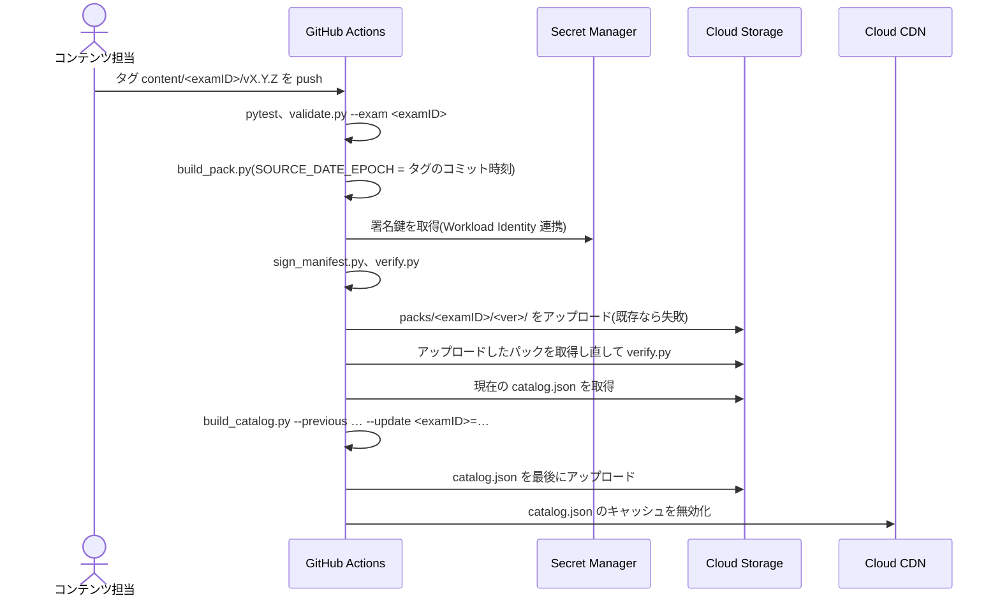
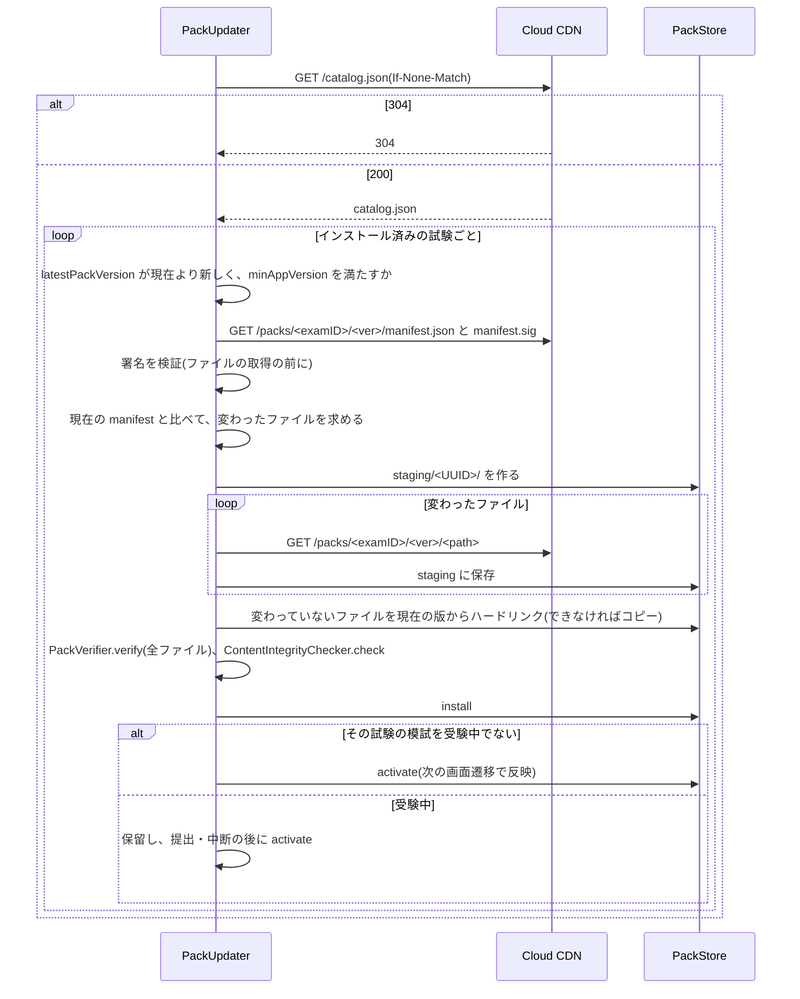

# Cloudrill 詳細設計書 P5: 配信と誤り報告

| 項目 | 内容 |
|---|---|
| 文書バージョン | 0.1(初版ドラフト) |
| 作成日 | 2026-10-21 |
| 上位文書 | [詳細設計書(索引・共通設計)](../DDD.md) |
| 対象 | `.github/workflows/content-release.yml`、`ContentKit` の `PackUpdater`、`Networking`、`server/report-api/`、Google Cloud の配信基盤 |
| ステータス | レビュー待ち |

---

## 目次

1. [目的とスコープ](#1-目的とスコープ)
2. [前提](#2-前提)
3. [設計](#3-設計)
4. [ステップ](#4-ステップ)
5. [フェーズの完了条件](#5-フェーズの完了条件)
6. [申し送り](#6-申し送り)

---

## 1. 目的とスコープ

App Store の審査を経ずにコンテンツを更新する仕組み(FR-CONT-02、NFR-05)と、誤り報告の受付(FR-CONT-03)を作る。このフェーズの完了が、MVP(v1.0)のリリース条件になる。

| 区分 | 内容 |
|---|---|
| スコープ内 | リリースのワークフロー、カタログの公開、アプリの差分更新、report-api(契約、実装、デプロイ)、アプリの報告送信、配信基盤の構築、ステージング環境での E2E |
| スコープ外 | 匿名の利用統計(TBD-05)、課金(P6-S16) |

---

## 2. 前提

- P4 が完了している。
- TBD-07(report-api の実装言語)と、Terraform の採否([DDD 8 章](../DDD.md#8-外部依存の候補))を決めてある。
- Google Cloud のプロジェクトを、ステージングと本番の 2 つ用意してある。
- ブランチは `feat/p5-<内容>`。

---

## 3. 設計

### 3.1 リリースの流れ



| 規則 | 理由 |
|---|---|
| 版のディレクトリは、既存なら上書きしない(`gcloud storage cp --if-generation-match=0`) | 配信済みの版を変えないため(端末がキャッシュしている) |
| `catalog.json` は最後に更新する | パックのファイルがそろう前に、端末が新しい版を取得しないため(BDD 10.2) |
| タグの版と、`build_pack.py` に渡す版を一致させる | CLAUDE.md の「リリースタグと packVersion を一致させる」 |
| ステージングで確認してから本番へ | `workflow_dispatch` の入力で、配信先(staging / production)を選ぶ。タグの push はステージングに配信する |

### 3.2 アプリの更新の流れ(BDD 6.8 の詳細化)



| 項目 | 方式 |
|---|---|
| 確認のタイミング | 起動時と、フォアグラウンドに戻ったとき(前回の確認から 24 時間以上たっていれば)。BDD 6.8 |
| 失敗したとき | `staging` を削除し、現在の版を使い続ける(E-02、E-03)。利用者には表示しない |
| `minAppVersion` を満たさない | ホームに「新しい問題があります。アプリを更新してください」のバナーを出す(E-04) |
| 通信 | `HTTPClient` プロトコル(Networking)を通す。テストでは Fake にする |

### 3.3 report-api

**エンドポイント**(OpenAPI 3.1 で `server/report-api/openapi.yaml` に定義する):

| メソッド | パス | 説明 |
|---|---|---|
| GET | `/v1/challenge` | App Attest 用の使い捨ての値を返す(有効期限 5 分) |
| POST | `/v1/devices` | App Attest の attestation を登録する(初回だけ) |
| POST | `/v1/reports` | 誤り報告を受け付ける。assertion をヘッダーに付ける |

**`POST /v1/reports` のリクエスト**(BDD 7.2 に `examID` を追加。C-11):

```json
{
  "examID": "gcp-pca",
  "questionID": "Q-3.2-0147",
  "questionRevision": 2,
  "packVersion": "1.2.0",
  "reason": "wrongAnswer",
  "comment": "B ではなく C が正しいのでは",
  "appVersion": "1.0.3",
  "locale": "ja-JP"
}
```

| 項目 | 方式 |
|---|---|
| 入力の検証 | `examID` と `questionID` は Schema と同じパターン。`comment` は 500 文字以内。未知のキーは 400 |
| 認証 | `X-App-Attest-Key-ID` と `X-App-Attest-Assertion`。assertion は、リクエスト本文の SHA-256 と challenge に対するもの |
| レート制限 | 鍵 ID のハッシュごとに 1 時間 20 件(BDD 7.2)。超えたら 429 |
| 個人情報 | 保存の前に、`comment` のメールアドレスと電話番号のパターンを `[redacted]` に置き換える |
| 保存 | Firestore の `reports` コレクション。`expireAt = 受付時刻 + 180 日` を TTL のフィールドにする |
| ログ | `comment` をログに出さない |
| 応答 | 受付時は 202。本文なし |

---

## 4. ステップ

### P5-S01 コンテンツのリリースのワークフロー

| 項目 | 内容 |
|---|---|
| 対応要件 | FR-CONT-02、NFR-05、BDD 10.2 |
| 前提 | P5-S07(配信基盤)のステージング環境 |
| 成果物 | `.github/workflows/content-release.yml`、`content/scripts/release_pack.sh`(ワークフローから呼ぶ手順をまとめたもの) |

TDD の対象外(ワークフロー)。スクリプトの中の Python の処理は、P2 のテスト済みの関数を呼ぶだけにする。

**検証手順**:

1. `release_pack.sh` を、ローカルで `--dry-run`(アップロードの代わりに、ローカルのディレクトリに出力する)で実行し、`verify.py` が通ることを確認する。
2. ステージングに向けて、`content/test-alpha/v1.0.0` 相当のタグで実行する。ステージングでは、テスト用の鍵ではなく、ステージング用の鍵を Secret Manager に置いて使う。
3. 同じタグで再実行し、上書きされずに失敗することを確認する。
4. `catalog.json` が最後に更新されていることを、Cloud Storage のオブジェクトの更新時刻で確認する。
5. ワークフローの権限を確認する。`permissions` は `contents: read` と `id-token: write` だけにし、サービスアカウントの権限は、対象のバケットへの書き込みと、署名鍵の読み取りだけにする。

**完了条件**: ステージングにパックとカタログが公開され、P5-S03 の `PackUpdater` から取得できる。

---

### P5-S02 カタログだけの更新

| 項目 | 内容 |
|---|---|
| 対応要件 | [DDD 4.10 A](../DDD.md#a-新しい試験を追加するコードの変更なし) の手順 4・7 |
| 前提 | P5-S01 |
| 成果物 | `content-release.yml` の `workflow_dispatch`(`catalog-only` の入力)|

試験の `status` の変更(`comingSoon` → `available` など)は、パックをリリースせずに、カタログだけを更新して行う。

**検証手順**: `catalog.yaml` の `status` を変えて `catalog-only` で実行し、パックのディレクトリに変更がなく、`catalog.json` だけが更新されることを確認する。

**完了条件**: ステージングで確認できる。

---

### P5-S03 アプリの差分更新(PackUpdater)

| 項目 | 内容 |
|---|---|
| 対応要件 | FR-CONT-02、NFR-10、AC-05、E-02、E-03、E-04、E-07 |
| 前提 | P2 の完了 |
| 成果物 | `packages/Data/Sources/Networking/HTTPClient.swift`、`URLSessionHTTPClient.swift`、`packages/Data/Sources/ContentKit/PackUpdater.swift`、`PackDiff.swift`、テスト |

テストでは、`FakeHTTPClient` が `content/tests/fixtures/packs/` のファイルを返す(パスと応答の対応表を持つ)。

**Red**:

| テスト | 条件(Arrange) | 期待(Assert) |
|---|---|---|
| `PackDiffTests.changedFiles` | `test-alpha` 1.0.0 と 1.1.0 の manifest | 変わったファイルだけ(1.1.0 で改訂した問題のドメインのファイルと索引) |
| `PackDiffTests.removedFilesIgnored` | 新しい版で削除されたファイル | 取得の対象にもコピーの対象にもならない |
| `notModified` | カタログの応答が 304 | 何もしない |
| `updatesToNewerVersion` | 現在 1.0.0、カタログは 1.1.0 | 1.1.0 がインストールされ、有効になる |
| `downloadsOnlyChangedFiles` | 同上 | 取得したのは manifest、署名、変わったファイルだけ |
| `signatureCheckedBeforeDownload` | 署名が不正な manifest を返す | 他のファイルを 1 つも取得しない |
| `tamperedFileRejected`(AC-05) | 1 ファイルだけ改ざんした内容を返す | インストールせず、現在の版のまま。`staging` が空 |
| `networkErrorKeepsCurrent`(E-03) | 途中で通信エラー | 現在の版のまま。`staging` が空 |
| `appTooOldShowsBanner`(E-04) | `minAppVersion` がアプリより新しい | インストールせず、`updateRequired == true` |
| `deferredDuringExam`(E-07) | その試験の模試を受験中 | インストールはするが、`activate` は提出の後に行う |
| `otherExamNotAffected` | `test-alpha` を受験中に `test-beta` を更新 | `test-beta` はすぐに有効になる |
| `throttle` | 前回の確認から 23 時間 | 確認しない。25 時間なら確認する |
| `URLSessionHTTPClientTests.etag` | `URLProtocol` のスタブで 304 を返す | `If-None-Match` を送り、304 を `.notModified` として返す |

**Green**: `PackUpdater` を実装する。

```swift
public protocol HTTPClient: Sendable {
    func get(_ url: URL, etag: String?) async throws(NetworkError) -> HTTPResponse
}

public actor PackUpdater {
    public init(baseURL: URL, http: any HTTPClient, store: PackStore, verifier: PackVerifier,
                integrity: ContentIntegrityChecker, timeSource: any TimeSource, examActivity: any ExamActivityProviding)
    public func checkForUpdates(force: Bool) async -> UpdateReport
}
```

`ExamActivityProviding` は、試験ごとに模試を受験中かを返すプロトコル(DomainInterfaces に置き、アプリ本体で `ActiveExamContext` から作る)。

**Refactor**: 1 つの試験の更新処理を `updateExam(_:)` に切り出し、試験ごとのエラーが他の試験に影響しないようにする。

**完了条件**: `swift test --package-path packages/Data --filter PackUpdater` と `PackDiffTests` が通る。

---

### P5-S04 report-api の契約

| 項目 | 内容 |
|---|---|
| 対応要件 | FR-CONT-03、BDD 7.2、C-11 |
| 前提 | TBD-07 の決定 |
| 成果物 | `server/report-api/openapi.yaml`、`server/report-api/contract-tests/`、`.github/workflows/report-api.yml` |

契約テストは、HTTP だけで API を確かめるテスト(言語に依存しない)にする。実装(P5-S05)より先に書く。

**Red**(契約テスト。ローカルで起動したサーバーに対して実行する):

| テスト | リクエスト | 期待 |
|---|---|---|
| `accepts_valid_report` | 正しい本文と assertion | 202 |
| `rejects_missing_exam_id` | `examID` なし | 400 |
| `rejects_bad_question_id` | `questionID: "x"` | 400 |
| `rejects_long_comment` | 501 文字 | 400 |
| `rejects_unknown_key` | `email` を含む | 400 |
| `rejects_unknown_reason` | `reason: "spam"` | 400 |
| `rejects_without_assertion` | ヘッダーなし | 401 |
| `rejects_reused_challenge` | 同じ challenge を 2 回使う | 2 回目は 401 |
| `rate_limit` | 同じ鍵で 21 件 | 21 件目は 429 |
| `redacts_contact_info` | `comment` にメールアドレスと電話番号 | 保存された文書で `[redacted]` に置き換わっている(テスト用の Firestore エミュレータで確認) |
| `sets_ttl` | 正しい報告 | 保存された文書の `expireAt` が受付時刻の 180 日後 |

App Attest の検証は、テストでは「テスト用の検証器」に差し替える(本物の attestation は実機でしか作れないため)。差し替えは、ステージング・本番の設定では無効にし、起動時にその設定を確認する。

**Green**: このステップでは実装しない。契約テストが「サーバーがない」ことで失敗することを確認する。

**完了条件**: `openapi.yaml` のレビューが済んでいる。テストが失敗する状態ではコミットしない規約([DDD 7.7](../DDD.md#77-ブランチとコミット))に従い、契約テストは P5-S05 の実装と同じコミットに含める(P5-S04 で単独にコミットするのは `openapi.yaml` だけ)。`report-api.yml` も P5-S05 で追加する。

---

### P5-S05 report-api の実装

| 項目 | 内容 |
|---|---|
| 対応要件 | FR-CONT-03、NFR-09、LG-06、BDD 7.2 |
| 前提 | P5-S04 |
| 成果物 | `server/report-api/` の実装、単体テスト、Dockerfile |

**Red**: P5-S04 の契約テストに加えて、実装の言語で単体テストを書く。

| テスト | 条件 | 期待 |
|---|---|---|
| `redact_email` | `"連絡は a.b@example.com へ"` | `"連絡は [redacted] へ"` |
| `redact_phone`(表形式) | `090-1234-5678`、`+81 90 1234 5678`、`03(1234)5678` | `[redacted]` |
| `keep_non_contact_numbers` | `"Q-3.2-0147 の 2 番"`、`"99.95% の SLA"` | 変わらない |
| `rate_window` | 59 分前に 20 件 / 61 分前に 20 件 | 拒否 / 受付 |
| `log_excludes_comment` | 報告を受け付ける | ログの出力に `comment` の内容がない |

**Green**: 契約テストと単体テストが通るように実装する。

**Refactor**: 入力の検証の正規表現を、`content/schemas/common.schema.json` から生成するか、同じ値であることをテストで確認する(パターンのずれを防ぐ)。

**完了条件**: 契約テストと単体テストが、ローカル(Firestore エミュレータ)と CI で通る。

---

### P5-S06 アプリの報告送信(ReportClient)

| 項目 | 内容 |
|---|---|
| 対応要件 | FR-CONT-03、E-08 |
| 前提 | P4-S15、P5-S05 |
| 成果物 | `packages/Data/Sources/Networking/ReportClient.swift`、`AppAttestService.swift`、`ReportSender.swift`、テスト |

**Red**:

| テスト | 条件(Arrange) | 期待(Assert) |
|---|---|---|
| `sendsQueuedReports` | キューに 2 件 | 2 件を送信し、202 ならキューから消す |
| `keepsOnNetworkError` | 通信エラー | キューに残る |
| `dropsOn400` | 400(本文の不備) | キューから消し、ログに記録する(再送しても成功しないため) |
| `retriesOn429Later` | 429 | キューに残し、次の機会まで送らない |
| `registersDeviceOnce` | 初回の送信 | `/v1/devices` を 1 回だけ呼ぶ。2 回目以降は呼ばない |
| `assertionCoversBody` | 送信する | assertion の対象が、本文の SHA-256 と challenge |
| `sendsOnReconnect` | オフラインからオンラインに変わる | キューを送信する |

`DCAppAttestService` は `AppAttestService` プロトコルで包み、テストでは Fake にする。

**Green**: 上記を実装する。

**Refactor**: なし。

**完了条件**: 該当するテストが通る。実機で、ステージングの report-api に 1 件送れることを確認する。

---

### P5-S07 配信基盤の構築

| 項目 | 内容 |
|---|---|
| 対応要件 | BDD 2.1、BDD 7.1、BDD 8.5 |
| 前提 | Terraform の採否 |
| 成果物 | `infra/`(Terraform を採用した場合)または `Documentation.docc/` 外の手順書 |

TDD の対象外(インフラ)。

| リソース | 設定 |
|---|---|
| Cloud Storage | 配信用のバケット。公開アクセスを無効にし、CDN(バックエンドバケット)経由でのみ読めるようにする |
| Cloud CDN | `catalog.json` は 5 分、`packs/**` は 1 年のキャッシュ。HTTPS のみ |
| Secret Manager | 署名鍵(ステージング、本番で別)。読み取りはリリース用のサービスアカウントだけ |
| Workload Identity 連携 | GitHub のリポジトリとタグの条件で、リリース用のサービスアカウントを借用できるようにする |
| Cloud Run | report-api。最小インスタンス 0 |
| Firestore | `reports` コレクション。`expireAt` に TTL のポリシー |
| Cloud Monitoring | report-api の 5xx の割合と、CDN の 5xx の割合にアラート(BDD 8.5) |

**検証手順**: `terraform plan` の差分をレビューし、ステージングに適用する。P5-S01 と P5-S06 がステージングで動くことで確認する。

**完了条件**: ステージングの全リソースが動いている。本番は、MVP のリリース前に同じ手順で構築する。

---

### P5-S08 ステージングでの E2E

| 項目 | 内容 |
|---|---|
| 対応要件 | AC-05、FR-CONT-02、FR-CONT-03 |
| 前提 | P5-S01〜S07 |
| 成果物 | 手動テストの記録(PR に添付) |

**検証手順**:

1. ステージングを向くアプリ(DEBUG 構成)を実機に入れ、同梱パック 1.0.0 で起動する。
2. 1.1.0 をリリースし、アプリを再起動する。次の画面遷移で 1.1.0 の内容になることを確認する(AC-05 の前半)。
3. 改ざんしたパック(`tampered/hash-mismatch` の手順で作ったもの)を、検証用の別のパスに置き、カタログをそこに向けて起動する。インストールされないことを確認する(AC-05 の後半)。
4. 模試の受験中に 1.2.0 をリリースし、提出するまで問題が変わらないことを確認する(E-07)。
5. 機内モードで誤り報告を送り、機内モードを解除すると送信されることを確認する(E-08)。

**完了条件**: 全手順の結果が PR に記録されている。

---

## 5. フェーズの完了条件

[DDD 7.8](../DDD.md#78-フェーズの完了条件共通) の共通条件に加えて、次を満たすこと。

| No. | 条件 | 確認方法 |
|---|---|---|
| 1 | AC-05 をステージングで確認した | P5-S08 |
| 2 | 署名鍵がリポジトリにも、ワークフローのログにもない | `git grep` と、ワークフローのログのレビュー |
| 3 | report-api が `comment` をログに出していない | P5-S05 のテストと、ステージングのログの確認 |
| 4 | 本番の配信基盤が構築されている | MVP のリリース判定で確認する |

---

## 6. 申し送り

| 宛先 | 内容 |
|---|---|
| MVP のリリース | App Store のプライバシー表示を、report-api が受け取る項目(端末を識別する情報は App Attest の鍵 ID のハッシュのみ)と一致させる(LG-06) |
| P6-S20 | 新しい試験は、`catalog.yaml` に `comingSoon` で追加し、パックのリリース後に P5-S02 で `available` にする |
